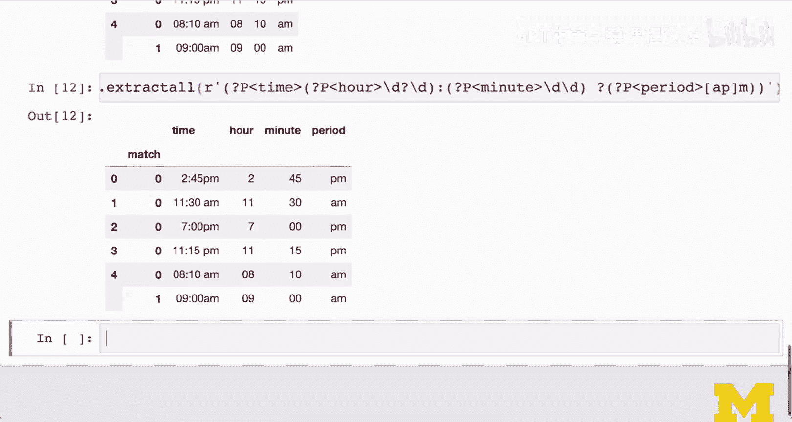

# 4：带命名组的Pandas正则表达式 🐍


在本节课中，我们将学习如何在Pandas中处理文本数据，特别是使用正则表达式和字符串方法。我们将从基础操作开始，逐步深入到使用命名捕获组进行复杂的数据提取。

首先，让我们查看我们的数据框。它目前只有一个名为`text`的列，每个条目都是一个包含星期几和时间的字符串。

## 使用Pandas字符串方法

通过`str`属性，我们可以访问一系列字符串处理方法，这些方法可以轻松地对Series中的每个元素进行操作。

以下是几个基础字符串方法的示例：

*   **`str.len()`**：计算每个字符串的字符数。
*   **`str.split()`**：按空格分割每个字符串。
*   **`str.contains()`**：检查字符串是否包含特定模式。
*   **`str.count()`**：统计模式在每个字符串中出现的次数。
*   **`str.findall()`**：查找字符串中所有匹配模式的子串。

例如，使用`str.findall()`可以找出每个字符串中所有的数字。

## 使用正则表达式捕获组

正则表达式的捕获组允许我们提取感兴趣的模式。假设我们想从每个字符串中提取小时和分钟。

通过用括号`()`捕获这些不同的组，`str.findall()`能够将这些组返回给我们。

```python
# 示例：提取小时和分钟
pattern = r'(\d{1,2}):(\d{2})'
df['text'].str.findall(pattern)
```

## 使用`str.replace()`进行替换

`str.replace()`方法可用于替换字符串中的模式。例如，将所有以“day”结尾的星期几替换为三个问号。

```python
df['text'].str.replace(r'\w+day', '???')
```

如果想基于原始内容进行更复杂的替换，可以结合使用`str.replace()`和Lambda表达式。例如，将完整的星期几名称替换为其三字母缩写。

```python
df['text'].str.replace(r'(\w+day)', lambda m: m.group(0)[:3].upper())
```

## 使用`str.extract()`创建新列

`str.extract()`方法允许我们使用提取的组快速创建新的数据列。例如，使用之前提取小时和分钟的模式，我们可以得到一个包含两列（小时和分钟）的新数据框。

```python
df[['hour', 'minute']] = df['text'].str.extract(r'(\d{1,2}):(\d{2})')
```

请注意，`str.extract()`只提取模式第一次匹配的组。要获取所有匹配项，应使用`str.extractall()`。

## 使用命名捕获组

命名捕获组可以使提取的数据更具可读性。我们可以在组的开头括号后使用`?P<name>`语法为组命名。

`extractall()`方法将使用这些组名作为返回数据框的列名。

```python
# 示例：使用命名组提取时间信息
pattern = r'(?P<time>(?P<hour>\d{1,2}):(?P<minute>\d{2}) (?P<period>[AP]M))'
df['text'].str.extractall(pattern)
```

在上面的模式中，我们为整个时间、小时、分钟和上午/下午时段分别定义了命名组。



## 总结


本节课中，我们一起学习了Pandas中处理文本数据的核心方法。我们从基础的字符串操作开始，如计算长度和分割，然后学习了如何使用正则表达式进行模式匹配、提取和替换。最后，我们探讨了强大的`str.extract()`和`str.extractall()`方法，以及如何使用命名捕获组来清晰地组织提取的数据。


Pandas提供了许多额外的文本数据处理方法，建议查阅Pandas官方文档中关于“Working with Text Data”的部分以获取更多信息。通过组合使用这些方法，你将能够利用Pandas进行非常强大的文本处理。