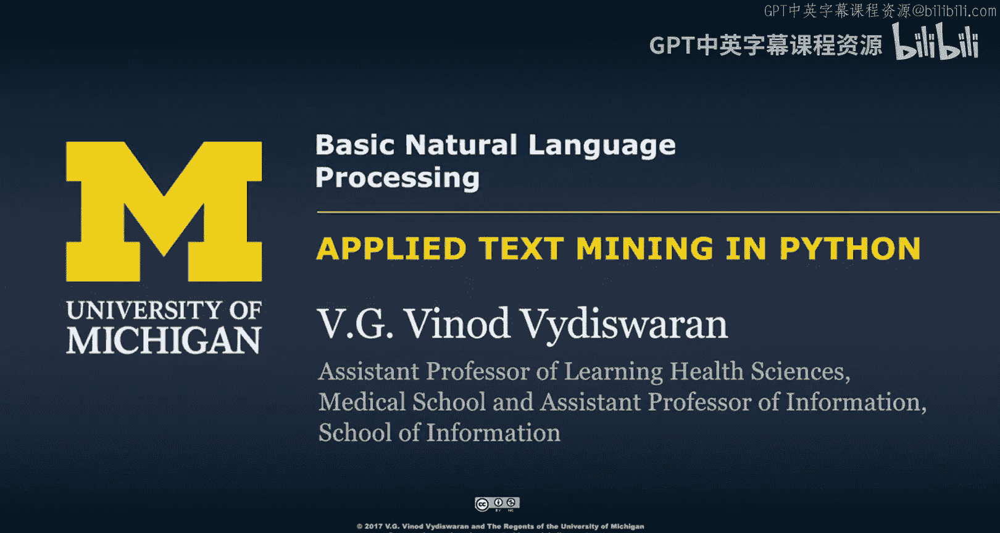
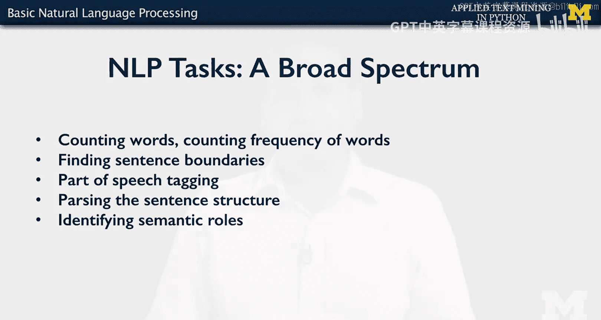
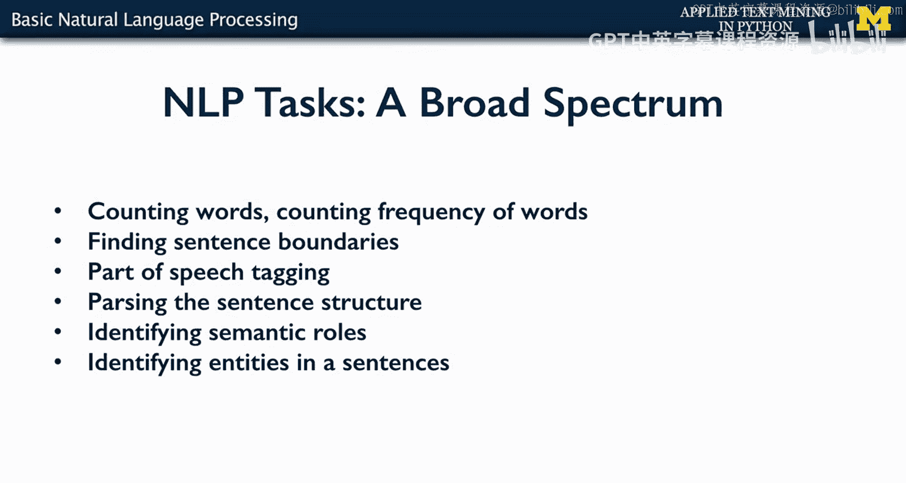
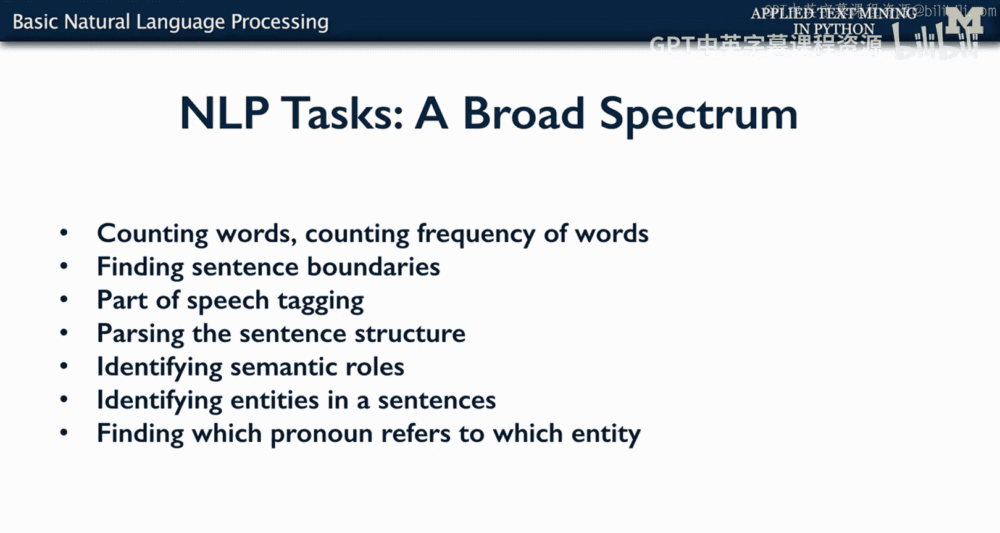

# 6：自然语言处理基础

在本节课中，我们将要学习自然语言处理的基础知识，并探讨它如何与我们一直在讨论的Python文本挖掘相关联。

## 什么是自然语言？🤔

自然语言是指人类在日常交流中使用的任何语言。这与人工语言或计算机语言（如Python）形成对比。例如，英语、中文、印地语、俄语或西班牙语都是自然语言。

根据这个定义，我们在短信息或推文中使用的语言也属于自然语言。

## 什么是自然语言处理？⚙️

自然语言处理是指对自然语言进行的任何计算或操作，旨在获取关于词语含义和句子结构的洞察。

当我们审视自然语言时，需要考虑它们是在不断演变的。以下是语言演变的一些表现：

以下是语言演变的一些具体表现：

*   **新词增加**：例如 `selfie`（自拍）或 `photo bomb`（抢镜）。
*   **旧词过时**：例如 `thou shalt`（汝应）这类词汇已很少使用。
*   **词义变化**：有些词的古今含义可能完全相反。例如，`learn` 在古英语中意为“教导”。
*   **语法规则变化**：例如，在古英语中，动词通常位于句末，而非现代英语常见的句中位置。

## 自然语言处理任务 📋

当我们谈论NLP任务时，具体指什么呢？任务可以非常简单，也可以非常复杂。

以下是NLP的一些常见任务：

*   **基础任务**：例如统计词数、计算词频或在语料库中查找独特词汇。
*   **进阶任务**：在此基础上，可以寻找句子边界或进行词性标注。
*   **句法分析**：解析句子结构，尝试理解更复杂的语法结构，并判断它们是否适用于特定句子。
*   **语义角色识别**：识别词语在句子中扮演的语义角色。例如，在句子 `Mary loves John` 中，`Mary` 是主语，`John` 是宾语，`love` 是连接两者的动词。

## 更复杂的NLP任务 🧩

除了上述任务，NLP还包括一些更复杂的处理。

以下是其他一些NLP任务：

*   **命名实体识别**：识别句子中的实体。在我们之前的例子 `Mary loves John` 中，`Mary` 和 `John` 就是两个实体（人物）。
*   **指代消解**：确定代词所指代的实体。例如，在句子 `John said he is happy` 中，确定 `he` 指代的是 `John`。

在自由文本上可以执行的任务还有很多。挑战在于如何高效地完成这些任务，以及它们如何应用于整体的文本挖掘。我们将在接下来的视频中看到其中一些应用。

## 总结 📝

本节课中，我们一起学习了自然语言处理的基础概念。我们了解了什么是自然语言及其演变特性，并介绍了从基础的词频统计到复杂的命名实体识别和指代消解等一系列NLP任务。这些任务是进行有效文本挖掘的基础，为我们后续深入学习Python中的文本处理技术做好了准备。