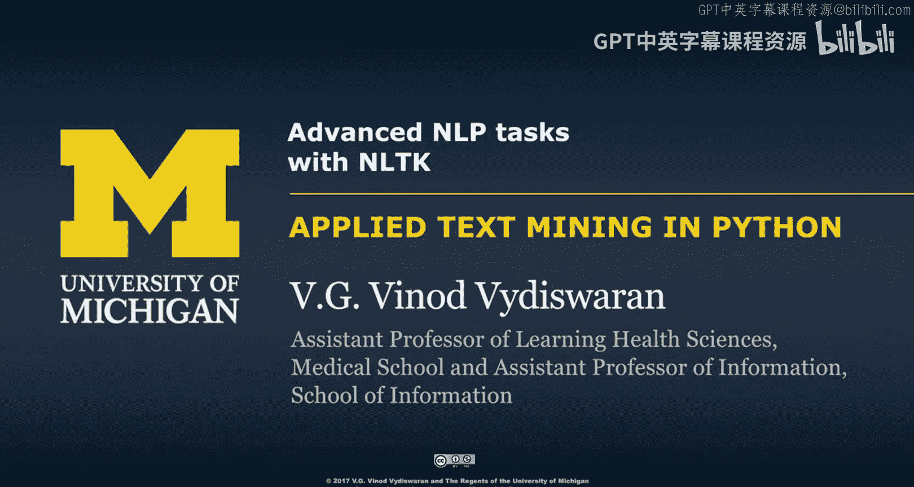
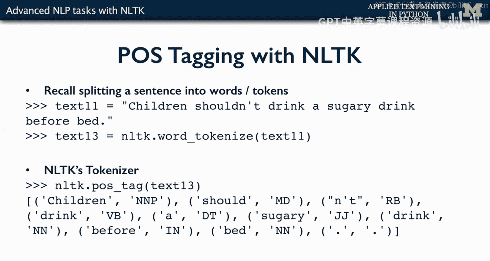
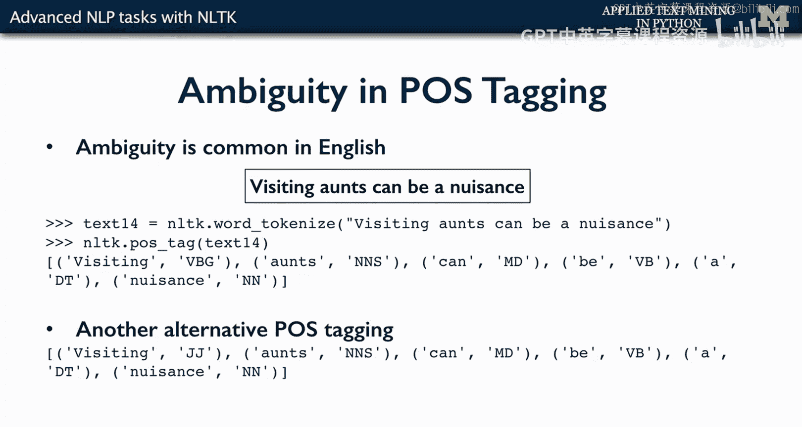
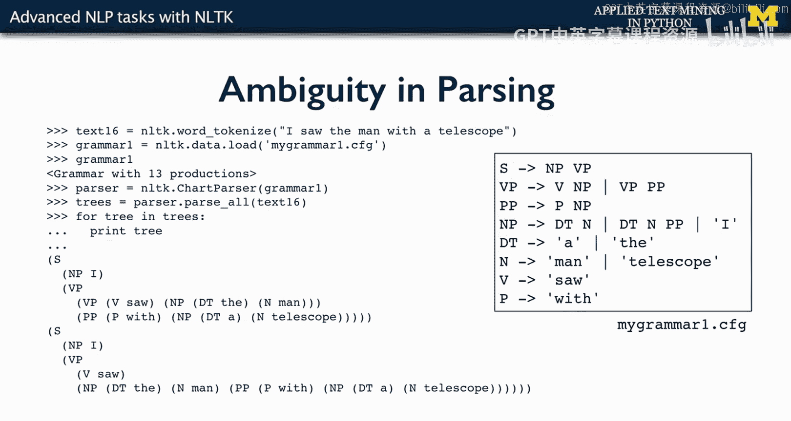
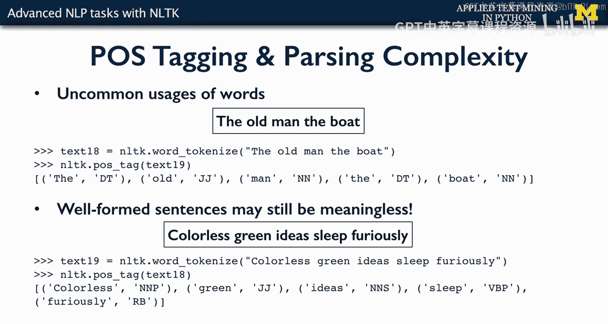
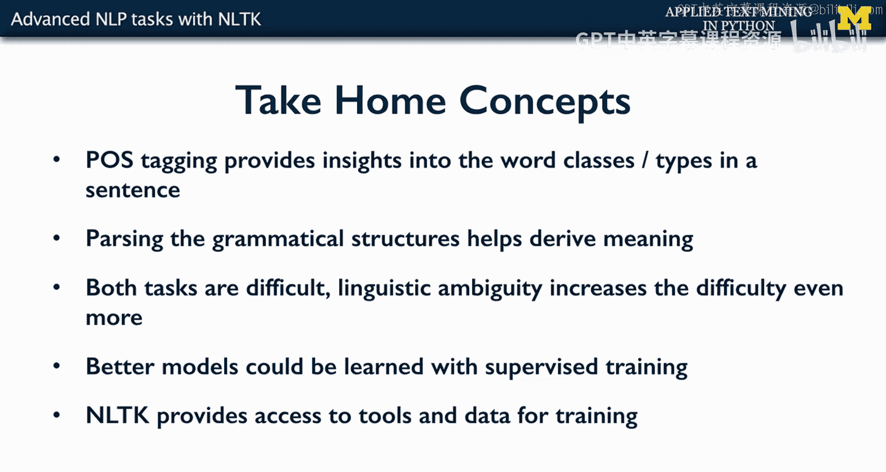

# 8：使用NLTK进行高级NLP任务





在本节课中，我们将从基础的NLP任务过渡到使用NLTK进行高级NLP任务。我们将重点学习词性标注和句法分析，理解它们在自然语言处理中的重要性，并探讨其中存在的挑战。

## 词性标注 🏷️

上一节我们介绍了基础的文本处理任务，如分词和词干提取。本节中，我们来看看如何识别句子中每个单词的词性。

词性是指单词的语法类别，例如名词、动词、形容词等。在NLTK中，词性标签远不止这些基础类别，还包括连词、基数词、限定词、介词、情态动词、代词、副词、符号等多种类型。动词本身也分为多种时态和形式。

要查看NLTK中某个标签的具体含义，可以使用 `nltk.help.upenn_tagset()` 命令。例如，输入 `MD` 会显示它代表情态助动词，并列出如 `can`、`cannot`、`could`、`may`、`might`、`shall`、`should`、`will`、`would` 等单词。

以下是进行词性标注的步骤：

1.  首先，需要将句子分割成单词（分词）。
2.  然后，对分词后的列表应用NLTK的词性标注器。

例如，对于句子 “Children shouldn’t drink a sugary drink before bed.”：

```python
import nltk
sentence = "Children shouldn't drink a sugary drink before bed."
tokens = nltk.word_tokenize(sentence)
# tokens: ['Children', 'should', "n't", 'drink', 'a', 'sugary', 'drink', 'before', 'bed', '.']




pos_tags = nltk.pos_tag(tokens)
# pos_tags: [('Children', 'NNS'), ('should', 'MD'), ("n't", 'RB'), ('drink', 'VB'), ('a', 'DT'), ('sugary', 'JJ'), ('drink', 'NN'), ('before', 'IN'), ('bed', 'NN'), ('.', '.')]
```

标注结果显示：`Children` 是复数名词（NNS），`should` 是情态动词（MD），`n’t` 是副词（RB），`drink` 是动词（VB），`a` 是限定词（DT），等等。

进行词性标注的原因在于，它可以将具有相似语法功能的单词（如所有名词、所有情态动词）归为一类。这在特征工程或特征提取中非常有用，因为你无需单独处理每个单词，而是可以处理整个类别。

## 词性标注的歧义性 🤔

现在我们已经知道如何进行词性标注，接下来应该讨论词性标注中存在的歧义问题。事实上，歧义在英语中非常常见。




以这个句子为例：“Visiting aunts can be a nuisance.” 它有两种可能的含义：
1.  去拜访阿姨可能是一件麻烦事。（“Visiting” 作为动词的现在分词）
2.  来访的阿姨们可能是一件麻烦事。（“Visiting” 作为形容词）

如果我们对这个句子进行分词和词性标注：

```python
tokens = nltk.word_tokenize("Visiting aunts can be a nuisance.")
pos_tags = nltk.pos_tag(tokens)
# 结果可能显示：('Visiting', 'VBG'), ('aunts', 'NNS'), ...
```

这个结果将 “Visiting” 标注为动名词（VBG），意味着第一种解释（“去拜访”）被选中。这是因为在大型语料库中，“visiting” 更常被用作动词的进行时形式，而不是形容词。NLTK的词性标注器基于统计概率，会选择在给定上下文中更常见的标签。然而，第二种解释在语法上也是完全有效的，这体现了自然语言的歧义性。

## 句法分析 🌳

既然我们已经了解了如何找出句子的词性，现在让我们来看看句子结构本身，并进行句法分析。

如果遵循定义良好的语法结构，理解句子就会变得容易。例如，对于句子 “Alice loves Bob”，我们不仅想知道哪个是名词、哪个是动词，还想知道它们在这个句子中是如何关联、如何组合成句的。

在NLTK中，我们可以使用上下文无关文法来定义句子结构，并使用解析器进行分析。以下是一个简单的例子：

```python
# 定义文法规则
grammar = nltk.CFG.fromstring("""
    S -> NP VP
    VP -> V NP
    NP -> 'Alice' | 'Bob'
    V -> 'loves'
""")

# 创建解析器
parser = nltk.ChartParser(grammar)

# 解析句子
sentence = ['Alice', 'loves', 'Bob']
for tree in parser.parse(sentence):
    print(tree)
    tree.pretty_print()
```

这段代码会生成一个句法分析树，显示句子 “Alice loves Bob” 的结构：句子（S）由名词短语（NP “Alice”）和动词短语（VP）组成；动词短语又由动词（V “loves”）和名词短语（NP “Bob”）组成。

## 句法分析的歧义性 🔄

与词性标注一样，句法分析也存在歧义，即使句子在语法上是正确的。

一个经典的例子是：“I saw the man with a telescope.” 这个句子有两种含义：
1.  我用望远镜看到了那个人。（“with a telescope” 修饰动词 “saw”）
2.  我看到了那个拿着望远镜的人。（“with a telescope” 修饰名词 “man”）

这种歧义来源于介词短语 “with a telescope” 在句法树中附着位置的不同。在语法上，动词短语（VP）可以有两种构成方式：
*   方式一：动词（V） + 名词短语（NP），而名词短语本身可以包含一个介词短语（PP）。
*   方式二：动词短语（VP） + 介词短语（PP），其中动词短语是动词（V）+名词短语（NP）。

在NLTK中，如果我们定义一个包含这两种可能性的文法，解析器会生成两棵不同的句法树，对应句子的两种不同解释。



## 使用树库 🌲

我们之前举例使用了简单的自定义文法，但不可能每次都手动创建文法。实际上，生成通用的文法规则本身就是一个需要大量训练数据和人工投入的学习任务。为此，人们创建了“树库”——一个大型的已解析句法树集合。


NLTK提供了对树库的访问，例如来自《华尔街日报》的树库数据：

```python
from nltk.corpus import treebank
first_sentence = treebank.parsed_sents()[0]
print(first_sentence)
```

这将输出树库中第一个句子的句法分析树，例如：“Pierre Vinken, 61 years old, will join the board as a nonexecutive director Nov. 29.” 这个句子已经按照树库中的结构进行了分析。

## 语言处理的复杂性 🧩

最后需要指出，词性标注和句法分析之外，语言处理还存在更多复杂性。

例如，有些句子看似符合语法，但解析困难或毫无意义：
*   **非常规用法**：如 “The old man the boat.” 乍一看，“the old man” 像是一个名词短语，但实际上 “man” 在这里是动词（意为“操纵”）。标准的词性标注器可能会错误地将 “man” 标注为名词。
*   **无意义的句子**：如 “Colorless green ideas sleep furiously.” 这个句子在语法结构上似乎正确，但语义上毫无意义。即使词性标注结果正确（形容词+名词+动词+副词），它也不传达任何实际含义。

这表明，语言有许多层次的含义和复杂性，仅靠词性标签和句法树目前还无法完全解决。



## 总结 📝


本节课中我们一起学习了使用NLTK进行高级NLP任务。

*   **词性标注**：我们学习了如何为句子中的每个单词分配语法类别（如名词、动词），这有助于理解单词的类型和功能，对特征工程非常有用。
*   **句法分析**：我们探讨了如何解析句子的语法结构，生成句法树以理解单词之间的组合关系。
*   **任务难点**：我们认识到这两项任务都具有挑战性，语言中的歧义性（如词性歧义、句法附着歧义）进一步增加了难度。
*   **工具与数据**：NLTK不仅提供了执行这些任务的工具，还提供了如树库这样的数据资源，可用于训练更复杂的模型。




这些高级NLP任务为我们从文本中提取更深层次的信息奠定了基础。在接下来的模块中，我们将更详细地探讨如何训练这些模型，以及如何构建用于此类任务的监督学习方法。