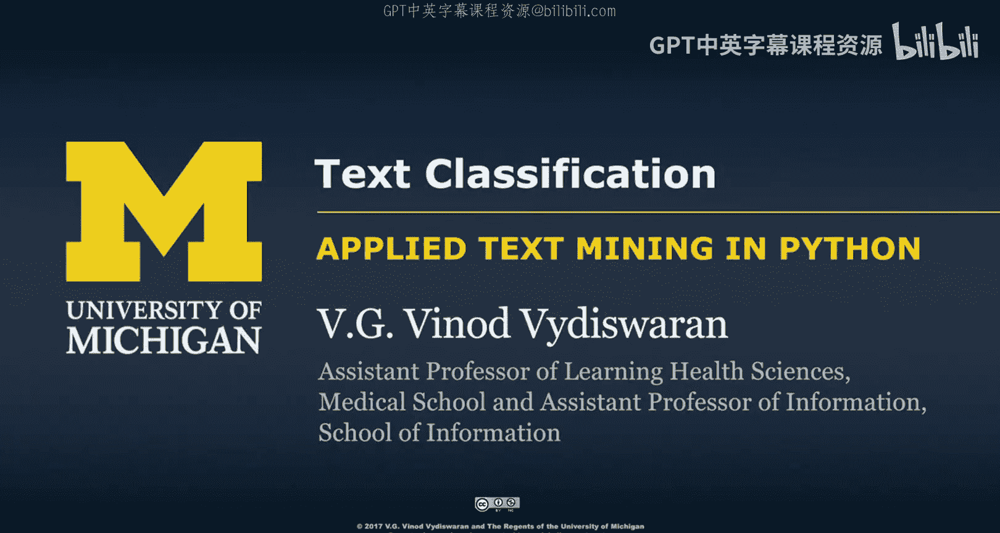
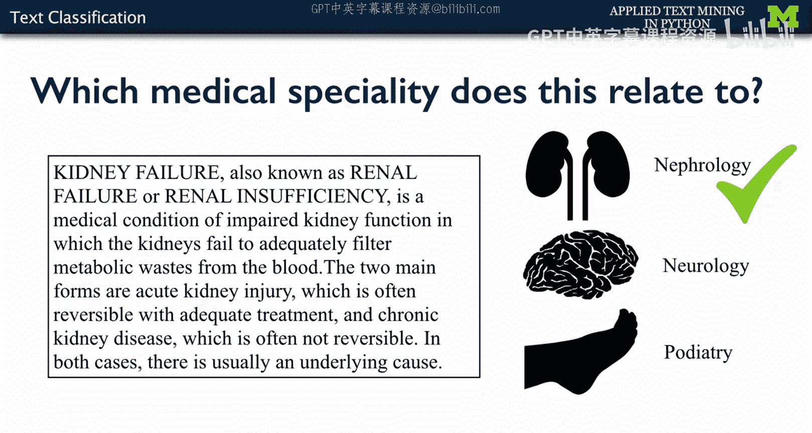
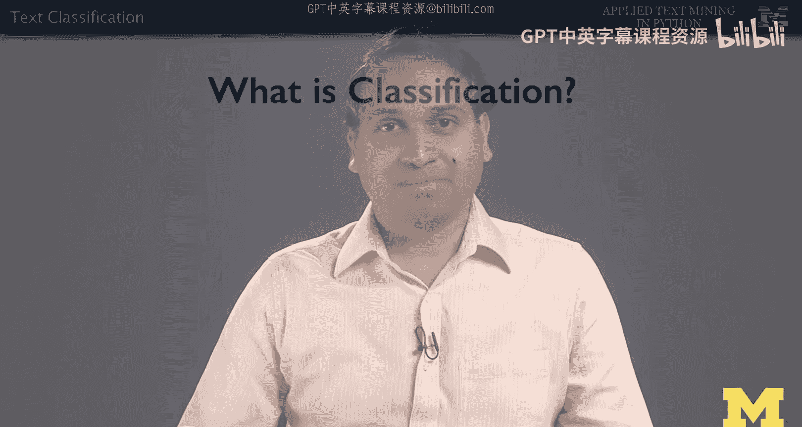
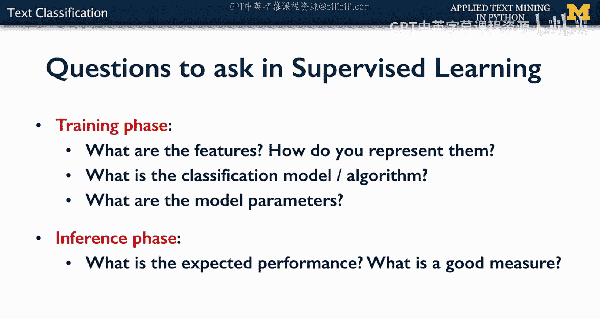

# 10：文本分类技术 🧠

在本节课中，我们将要学习文本分类，也称为文本的监督学习。我们将从理解什么是分类开始，探讨其应用场景，并介绍构建分类模型所需的关键概念和步骤。

## 什么是分类？ 🏷️

分类的任务是为一组给定的输入分配正确的类别标签。在之前的例子中，我们看到了三个类别：肾脏病学、神经病学和足病学。我们的目标是根据文本内容，将新的医学文档归入正确的类别。

## 文本分类的应用实例 📰

以下是文本分类在现实世界中的一些常见应用：

*   **新闻分类**：根据新闻文章的内容，将其归类为政治、体育或科技等版面。
*   **垃圾邮件过滤**：分析电子邮件内容，判断其是否为垃圾邮件，并决定是否将其放入垃圾邮件文件夹。
*   **情感分析**：阅读一篇电影评论，判断其表达的是正面还是负面的情感。
*   **拼写纠正**：在单词级别进行判断。例如，根据上下文判断“weather”（天气）和“whether”（是否）哪个拼写正确；或根据目标读者判断“color”（美式拼写）和“colour”（英式拼写）哪个更合适。

所有这些任务都属于**监督学习**的范畴。

## 监督学习流程 🔄

监督学习之所以称为“监督”，是因为机器像人类一样，从带有标签的过往实例中学习。其流程主要分为两个阶段：

1.  **训练阶段**：使用带有标签的数据集来构建模型。
2.  **推理阶段**：将训练好的模型应用于新的、无标签的数据，以预测其标签。

### 数据集术语 📊

在监督学习中，我们会遇到几种不同类型的数据集：

*   **带标签数据集**：每个数据实例都包含特征（X）和对应的正确标签（y）。
*   **无标签数据集**：数据实例只有特征（X），没有标签（y），用于推理预测。
*   **训练集**：从带标签数据中划分出来，专门用于训练模型、学习参数的部分。
*   **验证集/留存集**：在训练阶段用于评估模型性能、调整超参数的数据集，确保模型不会过度拟合训练数据。
*   **测试集**：完全独立、在训练和调参过程中从未见过的数据集，用于最终评估模型的泛化能力。

## 分类问题的类型 📈

根据类别数量的不同，分类问题可以分为几种类型：

*   **二分类**：只有两个可能的类别。例如：垃圾邮件/非垃圾邮件、正面/负面。
*   **多分类**：类别数量大于两个。例如：将新闻分为政治、体育、科技等多个类别。
*   **多标签分类**：一个数据实例可以同时属于多个类别。例如，一篇新闻可能同时被标记为“政治”和“经济”。

在本课程中，我们主要关注二分类和多分类问题。

## 构建分类模型的关键问题 ❓

在构建一个监督学习模型时，无论是训练阶段还是推理阶段，我们都需要回答一些核心问题。

上一节我们介绍了分类的基本概念，本节中我们来看看构建模型时需要解决的具体问题。

### 训练阶段需要回答的问题

以下是训练阶段需要明确的核心问题：

1.  **特征表示**：如何将输入数据（如文本）转化为模型可以理解的特征（X）？例如，对于垃圾邮件检测，特征可能包括是否包含“尼日利亚”、“中奖”、“汇款”等特定词汇。
2.  **模型与算法**：使用哪种分类模型或算法？例如，逻辑回归、支持向量机或神经网络。
3.  **模型参数**：根据所选模型，需要学习哪些具体的参数？例如，每个特征对应的权重。

### 推理阶段需要回答的问题

在推理阶段，我们关注的是模型的性能：

1.  **性能评估**：使用哪些指标来衡量模型的好坏？例如，准确率、精确率、召回率或F1分数。
2.  **模型验证**：如何知道我们构建的模型是优秀的？这需要通过独立的测试集进行最终验证。

## 总结 📝

本节课中我们一起学习了文本分类的基础知识。我们了解到文本分类是一种监督学习任务，其目标是为文本数据分配预定义的类别标签。我们探讨了分类的应用场景，如新闻分类和垃圾邮件过滤，并介绍了监督学习的两个核心阶段：训练和推理。此外，我们还区分了二分类、多分类和多标签分类等不同类型。最后，我们明确了在构建一个分类模型时，无论是特征表示、算法选择还是性能评估，都需要系统地回答一系列关键问题。在接下来的课程中，我们将逐一深入探讨这些问题。