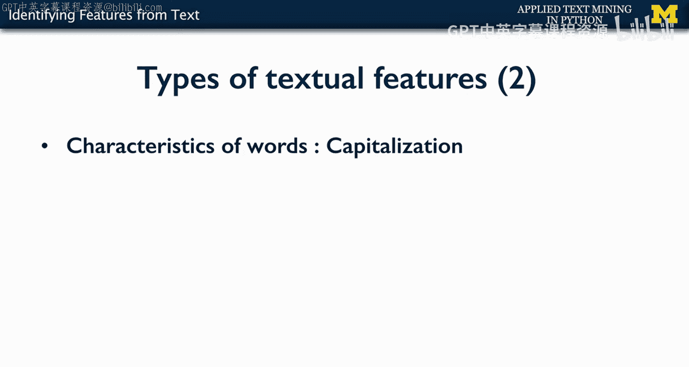
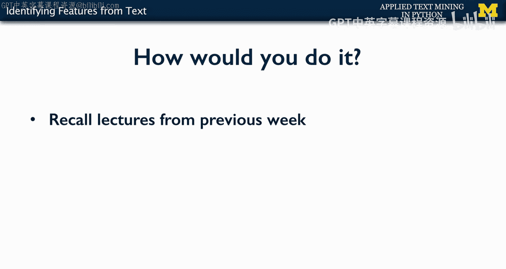

# 11：文本特征识别

在本视频中，我们将回答监督学习场景中需要考虑的三个问题中的第一个。这个问题就是特征识别。你如何从文本中识别特征。

## 为什么文本数据如此独特？

在监督学习场景中，文本数据带来了非常独特的挑战。你所需的所有信息或案例中的所有信息都包含在文本中。但文本是一个非常宽泛的概念。你可以用不同的方式解析文本文档。特征可以从文本中以不同的粒度提取。

## 文本特征类型示例

让我们来看一个你将获得的文本特征类型的例子。

文本的基本构成单位是单词集合。因此，这是迄今为止最常见的特征类别，当你添加它们时，会带来大量的特征。例如，英语中大约有40，000个独特的单词。所以，仅看普通英语，你就会有40，000个特征。如果你查看社交媒体或其他类型的数据，你可能会得到更多的特征，因为可能存在独特的单词拼写等等，所有这些都将是单词。

当你获得这么多特征时，这里要开始回答的一个问题是，如何处理常见出现的单词。在某些情况下，它们被称为停用词。像“the”这样的词出现得非常频繁。它是英语中最常见的词。每个文档、每个句子都可能包含“the”这个词。但更普遍地说，对于分类任务，“the”这个词不如其他词重要。例如，如果你谈论政治，并且有“Parliament”这个词，那么“Parliament”这个词比“the”这个词更能决定文档是否属于政治类别。

下一步是归一化。你是否将所有单词转换为小写，以便大写P的“Parliament”和小写p的“parliament”被视为相同或相同的特征？或者我们应该保持原样？“US”大写指的是美国，而如果你将其小写，它将与单词“us”无法区分。所以在某些情况下你想保持原样，在某些情况下你想转换为小写，那么你如何做出这个选择？

还存在词干提取和词形还原的问题。例如，你不希望复数形式成为不同的特征。所以你会想要对它们进行词形还原或词干提取。

以上所有这些仍然关于单词，让我们超越单词。你实际上可以识别单词的特征或特性，例如，大写。

正如我所说，“US”是大写的。“White House”中“W”和“H”大写与“white house”非常不同，对吧？所以大写是识别某些单词及其含义的重要特征。

你可以使用句子中单词的词性。这些可以作为你的特征。例如，如果某个特定单词前面有一个限定词很重要，那么那个单词就成为一个重要特征。一个例子是“weather”和“whether”的例子，回想我们讨论过的拼写纠正问题，你想确定正确的拼写是“whether”（W-H-E-T-H-E-R）还是“weather”（W-E-A-T-H-E-R）。如果你看到一个限定词，比如“the”，在那个词前面，它很可能是“weather”（W-E-A-T-H-E-R）。所以这个词前面的特定词性成为一个非常重要的特征。

你可能还想知道句子的语法结构或解析句子并获取句子解析结构，以查看与特定名词关联的动词是什么，它离关联的名词有多远等等。然后，你可能希望将意义相似的单词分组，用一个特征来表示一组单词。一个例子是“buy”和“purchase”等等。这些都是同义词。你不希望有两个不同的特征，一个用于“buy”，一个用于“purchase”，你可能想把它们归为一组，因为它们意思相同，具有相同的语义。但也可能是其他组，如头衔或尊称，如“Mr.”、“M”、“doctor”、“professor”等。或者数字集合，因为你不想专门为0设置一个特征，为1设置另一个特征等等，所有数字，所以你可能想说，如果它是0到10，000之间的任何数字，我就把它称为“number”。这样你就突然将10，000个特征减少到一个。日期也是如此，如果你能使用正则表达式识别日期，并且做得很好，那么你可能想说，也许所有日期都会被识别并称为一个特征“date”，因为我不想为每一个可能的特定日期学习一个特征，那是一个无限的列表。

其他类型的特征将取决于分类任务。例如，你可能拥有来自单词内部的特征或具有单词序列的特征。一个例子是二元组或三元组。想到“White House”的例子，你想说“White House”作为一个双词结构（二元组）在概念上是一个事物。与“white”和“house”作为两个不同的特征、两个不同的事物相比。你可能还想拥有字符子序列，例如“ING”或“ION”。仅仅通过查看它，你就知道“ING”基本上表示它是一个动词的进行时形式，对吧？所以仅仅查看一个单词中的“ING”就能将其识别为动词。“ION”更可能出现在单词末尾，是某种形式的名词。因此，仅这些字符子序列就可以帮助你识别某些类别，如果这对于你拥有的特定分类任务很重要的话。

## 如何实现？

我们已经讨论了其中一些特征，我建议你回顾前一周关于自然语言处理和基本NLP任务的讲座，我们在那里已经解决了一些这样的问题。你现在只需要识别它们，并使其作为特征可用于你的分类任务。

我们很快会看到更多特征的例子。

## 总结

在本节课中，我们一起学习了在监督学习场景下从文本数据中识别特征的核心概念。我们探讨了文本数据的独特性，并详细介绍了多种可能的文本特征类型，包括单词、停用词处理、归一化（如大小写转换）、词干提取与词形还原。我们还超越了单词层面，讨论了利用大写、词性、语法结构、语义分组（如同义词、数字、日期）以及字符子序列（如二元组、三元组）作为特征的方法。理解如何根据具体任务选择和构建这些特征是进行有效文本分类的关键第一步。