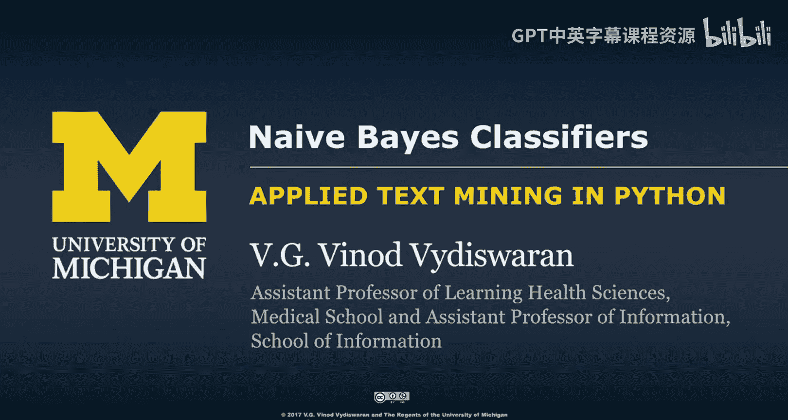
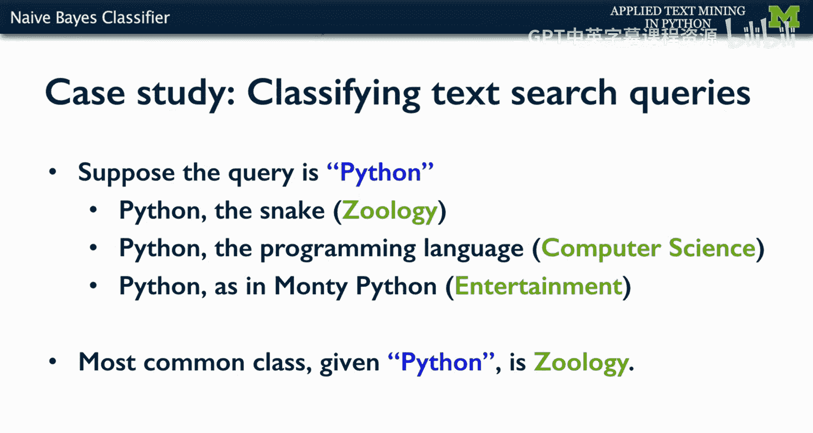
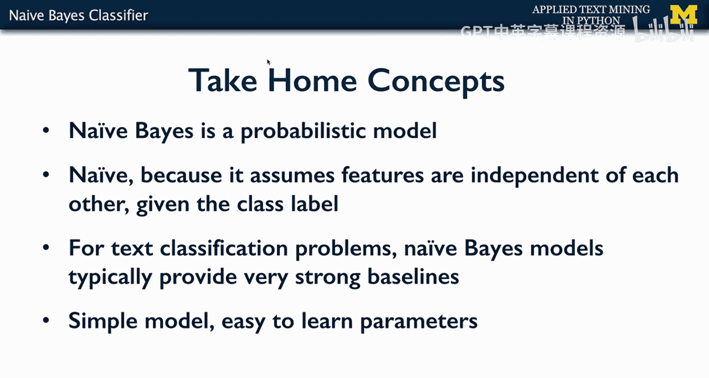

# 12：朴素贝叶斯分类器

在本节课中，我们将要学习一种名为朴素贝叶斯（Naive Bayes）的分类算法。这是一种基于概率的模型，特别适用于文本分类任务。我们将通过一个具体的例子来理解其核心思想、数学原理以及如何在实际中应用它。

## 概述：分类文本搜索查询

为了理解朴素贝叶斯分类器，我们首先设定一个场景：对文本搜索查询进行分类。

假设我们有三个类别：娱乐类、计算机科学类和动物学类。我们预先知道，大多数搜索查询都与娱乐相关。这意味着，在没有任何额外信息的情况下，一个查询属于娱乐类的概率最高。

现在，我们收到一个查询词：“Python”。我们的任务是将“Python”分类到上述三个类别之一。这个词本身具有多义性：
*   如果指“蟒蛇”（蛇），则属于动物学类。
*   如果指“Python编程语言”，则属于计算机科学类。
*   如果指“巨蟒剧团”（Monty Python），则属于娱乐类。

仅仅“Python”这个词无法让我们做出准确判断。然而，如果我们知道在搜索查询中，“Python”这个词本身最常与动物学相关，那么即使总体上娱乐类查询更多，在看到“Python”这个词后，该查询属于动物学类的可能性也会变得更高。

如果我们收到另一个查询“Python download”，情况又会发生变化。此时，该查询属于计算机科学类的可能性变得最高。

这个思维过程体现了朴素贝叶斯分类器的核心：我们有一个先验概率模型，它告诉我们每个类别的初始可能性。当我们获得新的信息（例如查询词）时，我们会根据这个新信息来更新每个类别的可能性。

## 贝叶斯定理：概率更新的数学基础

上一节我们介绍了根据新信息更新概率的想法，本节中我们来看看其背后的数学原理——贝叶斯定理。

我们有以下概念：
*   **先验概率**：在获得任何新信息之前，一个查询属于某个类别 `y` 的概率，记作 `P(y)`。例如，`P(娱乐)` 可能很高。
*   **后验概率**：在观察到输入数据 `x`（例如查询词“Python”）之后，该查询属于类别 `y` 的概率，记作 `P(y|x)`。这是我们最终想要计算的。
*   **似然度**：假设我们知道查询属于类别 `y`，那么观察到特征 `x` 的概率，记作 `P(x|y)`。例如，`P(Python|动物学)` 表示在动物学类查询中看到“Python”这个词的概率。

贝叶斯定理将这些概念联系起来：

**P(y|x) = [P(y) * P(x|y)] / P(x)**

其中：
*   `P(y|x)` 是后验概率。
*   `P(y)` 是先验概率。
*   `P(x|y)` 是似然度。
*   `P(x)` 是证据（观察到 `x` 的总概率），它是一个归一化常数，确保所有类别的后验概率之和为1。

在我们的例子中，当我们看到查询“Python”时，我们计算：
*   `P(娱乐|Python) = [P(娱乐) * P(Python|娱乐)] / P(Python)`
*   `P(计算机科学|Python) = [P(计算机科学) * P(Python|计算机科学)] / P(Python)`
*   `P(动物学|Python) = [P(动物学) * P(Python|动物学)] / P(Python)`

然后我们比较这三个值，选择概率最高的类别作为预测结果。

## 朴素贝叶斯分类器的“朴素”假设与最终公式

上一节我们介绍了贝叶斯定理，但在实际分类中，输入 `x` 通常包含多个特征（例如，一个查询有多个词）。朴素贝叶斯分类器通过一个关键假设来处理多特征情况。

朴素贝叶斯分类器做出一个“朴素”的假设：**在给定类别标签 `y` 的条件下，所有特征（例如单词）之间是相互独立的**。这意味着一个单词的出现不影响另一个单词的出现概率。

基于这个假设，包含多个特征 `(x1, x2, ..., xn)` 的似然度可以简化为每个特征似然度的乘积：

**P(x1, x2, ..., xn | y) = P(x1|y) * P(x2|y) * ... * P(xn|y)**

将这个简化后的似然度代入贝叶斯公式，并忽略对所有类别都相同的分母 `P(x)`（因为它不影响比较大小），我们得到朴素贝叶斯分类器的决策规则：

**预测的类别 y* = argmax_y [ P(y) * ∏_{i=1}^{n} P(xi|y) ]**

这个公式的意思是：对于每个可能的类别 `y`，计算先验概率 `P(y)` 与所有特征似然度 `P(xi|y)` 乘积的乘积。然后，选择使这个乘积最大的类别 `y` 作为预测结果。

以查询“Python download”为例，我们计算：
*   对于 `y = 动物学`：`P(动物学) * P(Python|动物学) * P(download|动物学)`
*   对于 `y = 计算机科学`：`P(计算机科学) * P(Python|计算机科学) * P(download|计算机科学)`
*   对于 `y = 娱乐`：`P(娱乐) * P(Python|娱乐) * P(download|娱乐)`

即使 `P(Python|动物学)` 很高，但 `P(download|动物学)` 极低，且 `P(动物学)` 本身也较低，它们的乘积可能很小。而计算机科学类在三项概率上都有中等或较高的值，其乘积很可能最大，因此预测为计算机科学类。

## 模型参数：我们需要学习什么？

现在我们已经了解了朴素贝叶斯如何做决策，本节中我们来看看构成这个模型的具体参数是什么，以及它们有多少个。

朴素贝叶斯模型的参数分为两类：

1.  **先验概率**：对于数据集中的每一个类别 `y`，我们需要知道 `P(y)`。如果有 `|Y|` 个类别，就有 `|Y|` 个先验概率参数。
2.  **似然度（条件概率）**：对于每一个类别 `y` 和每一个可能的特征 `xi`，我们需要知道 `P(xi|y)`。如果有 `|Y|` 个类别和 `V` 个不同的特征（例如词汇表大小），那么就有 `|Y| * V` 个似然度参数。

**参数总数 = |Y| + |Y| * V**

**练习**：如果你有3个类别（`|Y|=3`）和100个特征（`V=100`），那么朴素贝叶斯模型有多少个参数？
**答案**：先验参数：3个。似然度参数：3 * 100 = 300个。总参数：303个。

## 参数估计：如何从数据中学习？

上一节我们明确了模型参数，本节中我们来看看如何利用训练数据来估计这些参数。方法非常直观：计数。

假设我们有一个已标注类别的训练数据集。

**估计先验概率 `P(y)`**：
计算属于类别 `y` 的文档数量，除以文档总数。
**P(y) = (属于类别 y 的文档数量) / (文档总数量)**

例如，训练集中有4个查询：2个娱乐类，1个计算机科学类，1个动物学类。则 `P(娱乐)=0.5`, `P(计算机科学)=0.25`, `P(动物学)=0.25`。

**估计似然度 `P(xi|y)`**：
对于每个类别 `y`，我们只关注那些属于该类别的文档。然后计算特征 `xi` 在这些文档中出现的频率。
**P(xi|y) = (特征 xi 在类别 y 的文档中出现的次数) / (类别 y 的文档中所有特征出现的总次数)**

例如，为了估计 `P(Python|计算机科学)`，我们查看所有计算机科学类的查询，统计“Python”这个词出现了多少次，然后除以计算机科学类查询中所有单词出现的总次数。

## 平滑技术：处理零概率问题

在参数估计过程中，我们可能会遇到一个严重问题：**零概率问题**。

如果某个特征 `xi` 在类别 `y` 的训练文档中从未出现，那么根据上面的计数方法，`P(xi|y) = 0`。在朴素贝叶斯公式中，只要有一个特征的似然度为0，整个连乘积就会变成0，这将导致模型无法预测包含该特征的文档属于类别 `y`，即使其他特征都强烈支持这个类别。

例如，如果训练数据中没有“Monty Python”这类娱乐查询，那么 `P(Python|娱乐)=0`。任何包含“Python”的查询都会被模型直接排除出娱乐类，这显然是不合理的。

为了解决这个问题，我们使用**平滑技术**。最常用的一种是**拉普拉斯平滑（加一平滑）**。

拉普拉斯平滑为每个特征的计数都加上一个小的常数（通常是1），并为分母加上特征的总数 `V`（词汇表大小）作为补偿：

**平滑后的 P(xi|y) = (特征 xi 在类别 y 中的出现次数 + 1) / (类别 y 中所有特征出现总次数 + V)**

这样，即使一个词在某个类别中从未出现，其概率也不会是0，而是一个很小的正数（`1/(总次数+V)`），避免了零概率导致的决策失效。

**思考**：我们需要对先验概率 `P(y)` 也进行平滑吗？通常不需要，因为除非某个类别在训练集中完全没有样本，否则先验概率不会为0。如果某个类别没有样本，那它本身就不应该出现在分类选项中。

## 总结与关键要点

本节课中我们一起学习了朴素贝叶斯分类器。

*   **核心思想**：它是一种基于贝叶斯定理的概率分类模型，通过结合先验知识和观察到的数据特征来预测类别。
*   **“朴素”假设**：它假设在给定类别条件下，所有特征相互独立。这个假设虽然通常不成立（尤其在文本中），但极大地简化了计算。
*   **决策规则**：预测使 `P(y) * ∏ P(xi|y)` 最大的类别 `y`。
*   **参数学习**：模型的参数（先验概率和似然度）可以通过在标注数据上简单计数来估计。
*   **平滑的重要性**：必须使用平滑技术（如拉普拉斯平滑）来处理训练数据中未出现的特征，防止零概率问题。
*   **应用与地位**：尽管模型简单且假设“朴素”，但朴素贝叶斯分类器在文本分类任务中通常能提供非常强大的基线性能。它计算高效、易于理解和实现，因此通常是尝试解决文本分类问题时首选的第一模型，用于建立性能基准。