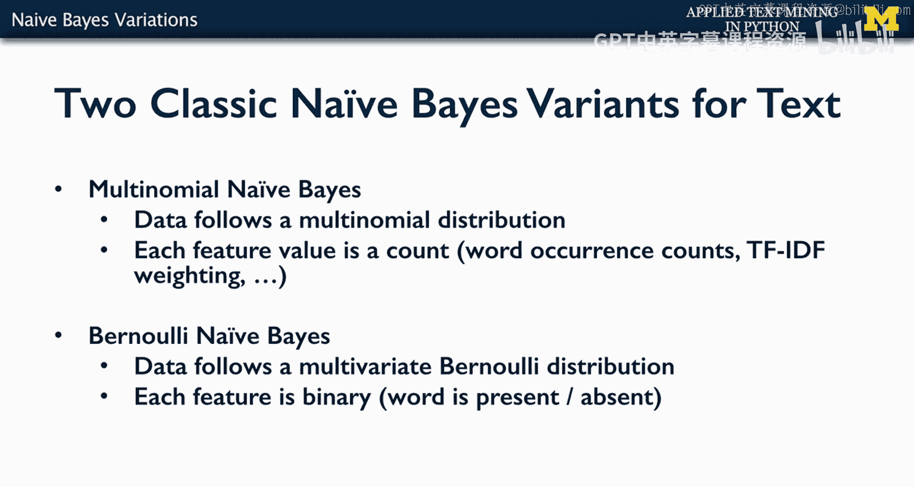

# 13：朴素贝叶斯变体


在本节课中，我们将要学习朴素贝叶斯分类器的两种经典变体：**多项式朴素贝叶斯**和**伯努利朴素贝叶斯**。我们将探讨它们背后的核心假设、适用场景以及它们如何处理文本特征。

上一节我们介绍了朴素贝叶斯模型的基本理论和公式。本节中我们来看看模型如何处理特征，特别是文本特征。朴素贝叶斯模型有两种经典变体，它们对特征的理解和建模方式不同。

## 多项式朴素贝叶斯模型

多项式朴素贝叶斯模型假设数据服从**多项式分布**。这意味着，在定义一个特定数据实例的特征集合时，我们假设每个特征的出现是相互独立的，并且每个特征可以出现多次。

因此，在多项式分布模型中，**计数**变得非常重要。每个特征值都是某种形式的计数或加权计数。例如，单词出现次数或TF-IDF权重。

假设你有一段文本（一个文档），你想找出这个模型中使用的所有单词，这被称为**词袋模型**。如果你只关心单词是否出现，那么每个特征就服从伯努利分布。但如果你认为一个特定单词出现的次数很重要，那么你就需要跟踪每个单词的频率。

例如，对于句子“to be or not to be”，单词“to”出现了两次，单词“be”出现了两次，单词“or”出现了一次。如果你想给予更罕见的单词更高的权重，你可以使用**词频-逆文档频率**加权。这不仅能体现单词的频率，还能衡量该单词在整个文档集合中的常见程度。

例如，单词“the”非常常见，几乎出现在每个句子和每个文档中，因此它的信息量不大。但像“significant”这样的单词则更具信息量，因为它不会出现在每个文档中。因此，你会希望给予包含“significant”这个词的文档更高的权重，相比于包含“the”的文档。这种变化和加权在多项式朴素贝叶斯模型中是可以实现的。

以下是多项式朴素贝叶斯中特征向量的一个简单示例，其中特征值是单词的计数：

```python
# 示例：文档的特征向量（词频）
# 词汇表: [‘to‘, ‘be‘, ‘or‘, ‘not‘]
document_vector = [2, 2, 1, 1]  # 对应句子 “to be or not to be”
```

## 伯努利朴素贝叶斯模型

第二种模型是**伯努利朴素贝叶斯模型**。这里的假设是数据服从**多元伯努利分布**，其中每个特征都是一个二元特征，即一个单词是出现还是不出现。

只有关于单词是否出现的信息是重要的并被建模，而该单词出现了多少次则无关紧要。事实上，单词本身是否常见（如“the”）或不常见（如“significant”）在这种二元特征模型中也无关紧要。当你对每个特征都使用这种二元模型时，整个特征集合就服从所谓的多元伯努利模型。

以下是伯努利朴素贝叶斯中特征向量的一个简单示例，其中特征值表示单词是否出现（1表示出现，0表示未出现）：



```python
# 示例：文档的特征向量（是否出现）
# 词汇表: [‘to‘, ‘be‘, ‘or‘, ‘not‘]
document_vector = [1, 1, 1, 1]  # 对应句子 “to be or not to be”，所有词至少出现一次
```

## 两种变体的比较与应用

这两种是朴素贝叶斯中两种标准的经典变体。你会发现，大多数用于朴素贝叶斯建模的方法和工具都为你提供了这个选项：选择多项式朴素贝叶斯或伯努利朴素贝叶斯。

在文本文档中，使用**多项式朴素贝叶斯**非常普遍。但在某些情况下，你可能会希望采用**伯努利**路线，特别是当你想强调频率无关紧要，而仅仅是单词的存在与否更重要时。

以下是两种模型的核心区别总结：
*   **多项式模型**：特征值是**计数**（如词频），关注“出现了多少次”。
*   **伯努利模型**：特征是**二元**的（出现/未出现），只关注“是否出现”。

本节课中我们一起学习了朴素贝叶斯分类器的两种主要变体。我们理解了**多项式朴素贝叶斯**如何利用特征计数（如词频）进行建模，适用于关注特征频率的场景。同时，我们也探讨了**伯努利朴素贝叶斯**，它仅将特征视为二元变量（出现与否），适用于特征出现本身比其频率更重要的场合。在实际应用中，根据具体任务和数据特性选择合适的变体至关重要。