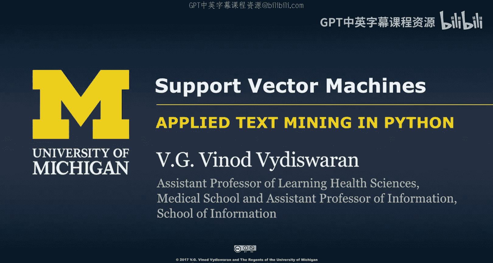
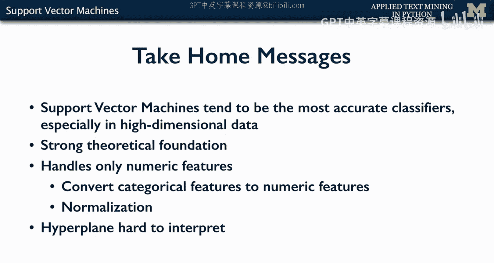

# 14：支持向量机应用

在本节课中，我们将要学习支持向量机（SVM）的基本概念、工作原理及其在分类任务中的应用。我们将从分类任务的基本概念开始，逐步深入到决策边界、线性分类器、最大间隔思想，以及如何将SVM应用于多分类问题。最后，我们会讨论SVM的关键参数和优缺点。

## 分类任务回顾

上一节我们介绍了分类任务的基本概念。本节中，我们来看看分类任务的具体例子。

分类器可以被视为一个作用于输入数据的函数。例如，一个函数F可以处理医学文本，并决定其类别标签是肾病学、神经学还是足病学。另一个函数可以分析电影评论，并判断其是正面（+1）还是负面（-1）评价。通常，我们会为类别分配数值标签，如+1和-1，这是支持向量机等线性分类器的典型做法。

## 决策边界

为了理解支持向量机，我们需要先了解决策边界的概念。

决策边界是用于在特征空间中分隔不同类别的表面。在二维空间中，它可能是一条线；在三维空间中，是一个平面；在更高维空间中，则是一个超平面。

以下是选择决策边界形状时需要考虑的因素：
*   **过拟合问题**：一个复杂的决策边界（如不规则多边形）可能在训练数据上达到100%的准确率，但在未见过的测试数据上表现很差。这是因为模型过于复杂，学习了训练数据中的噪声和特定细节，而非一般规律。
*   **简单模型原则**：相比之下，一个简单的线性边界（如直线）虽然在训练数据上可能犯一些错误，但它更易于学习、评估，并且通常能更好地泛化到新数据上。简单模型往往具有更好的泛化能力。

## 线性分类器与最大间隔

上一节我们讨论了决策边界的选择。本节中我们来看看如何寻找一个最优的线性边界。

寻找线性边界就是寻找权重向量 **w**，使得线性函数 **f(x) = w · x + b** 能够区分不同类别。当 **f(x) > 0** 时，样本被标记为正类（+1）；否则标记为负类（-1）。

然而，对于线性可分的数据，可能存在无数条能够分隔两类的直线。这就引出了一个问题：哪条线是最优的？

支持向量机的核心思想是**最大间隔**。它寻找的不是任意一条分隔线，而是能够创建最宽“隔离带”的那条线。这条“隔离带”的宽度称为**间隔**，位于间隔正中间的超平面就是最终的决策边界。

最大间隔超平面的优势在于它对数据中的小扰动或噪声具有更强的鲁棒性。模型的决策依赖于位于间隔边缘的少数关键样本点，这些点被称为**支持向量**。

## 多类别分类

到目前为止，我们讨论的SVM都是针对二分类问题的。那么如何处理具有多个类别的分类任务呢？

当需要将SVM用于多类别分类时，通常采用以下两种策略之一：

**1. 一对多（One-vs-Rest, OVR）**
为每个类别训练一个二分类器，将该类别的样本作为正例，所有其他类别的样本作为负例。对于N个类别，需要训练N个分类器。对于一个新样本，所有N个分类器都会进行预测，选择置信度最高（或得分最高）的类别作为最终结果。

**2. 一对一（One-vs-One, OvO）**
为每一对类别训练一个二分类器。对于N个类别，需要训练 **N * (N-1) / 2** 个分类器。对一个新样本进行预测时，所有相关的分类器进行“投票”，得票最多的类别即为最终预测结果。

在大多数情况下，一对多策略更常用，因为它需要训练的分类器数量更少。

## 关键参数

在使用支持向量机时，有几个关键参数需要调整：

*   **正则化参数 C**：控制模型对训练数据中个别样本错误的容忍度。
    *   **C值较大**：正则化较弱。模型会尽可能拟合训练数据，对个别样本的错误给予较大惩罚，可能导致过拟合。
    *   **C值较小**：正则化较强。模型允许更多的训练错误，以换取一个更简单、间隔更大的决策边界，可能提高泛化能力。
*   **核函数（Kernel）**：决定数据被映射到的特征空间的类型。
    *   **线性核（linear）**：寻找线性决策边界。公式为：**K(x, z) = x · z**
    *   **多项式核（poly）**：寻找多项式决策边界。
    *   **径向基函数核（rbf）**：寻找复杂的非线性决策边界。这是最常用的非线性核。
*   **多分类策略**：如上所述，可选择 `‘ovr’`（一对多）或 `‘ovo’`（一对一）。
*   **类别权重（class_weight）**：当数据集中各类别样本数量不平衡时（例如80%是垃圾邮件，20%不是），可以给少数类别赋予更高的权重，防止模型忽略它们。

## 总结与要点

本节课中我们一起学习了支持向量机（SVM）的核心内容。

以下是支持向量机的主要特点：
*   **高准确性**：对于像文本这样的高维数据，SVM通常是性能最优秀的分类器之一。
*   **坚实的理论基础**：其最大间隔思想源于优化理论，具有很好的数学解释。
*   **仅处理数值特征**：SVM基于点积运算，因此要求输入特征是数值型的。分类特征需要先进行编码（如独热编码）。
*   **特征缩放很重要**：建议对特征进行归一化（如缩放到[0,1]区间），以防止某些特征因数值范围大而主导模型。
*   **可解释性差**：与逻辑回归或决策树不同，SVM学到的模型（特别是使用非线性核时）难以直观解释为什么一个样本被分到某个类别。
*   **实践建议**：如果模型的可解释性不是首要需求，SVM（尤其是线性SVM）应该是文本分类等任务中优先尝试的算法之一，其性能通常与朴素贝叶斯相当甚至更优。

总而言之，支持向量机通过寻找最大间隔超平面来构建一个强大且泛化能力好的分类器，是机器学习工具箱中一个非常重要的工具。