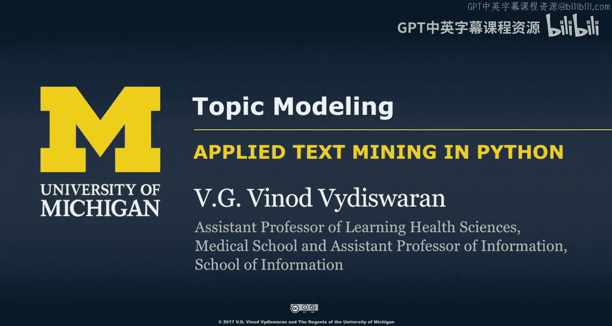
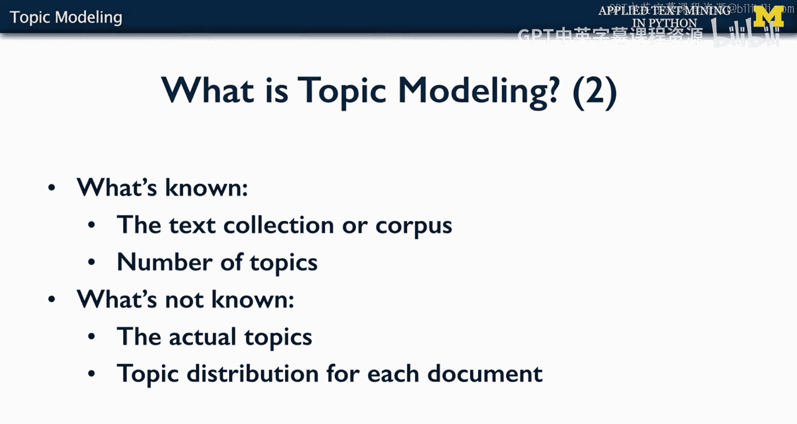
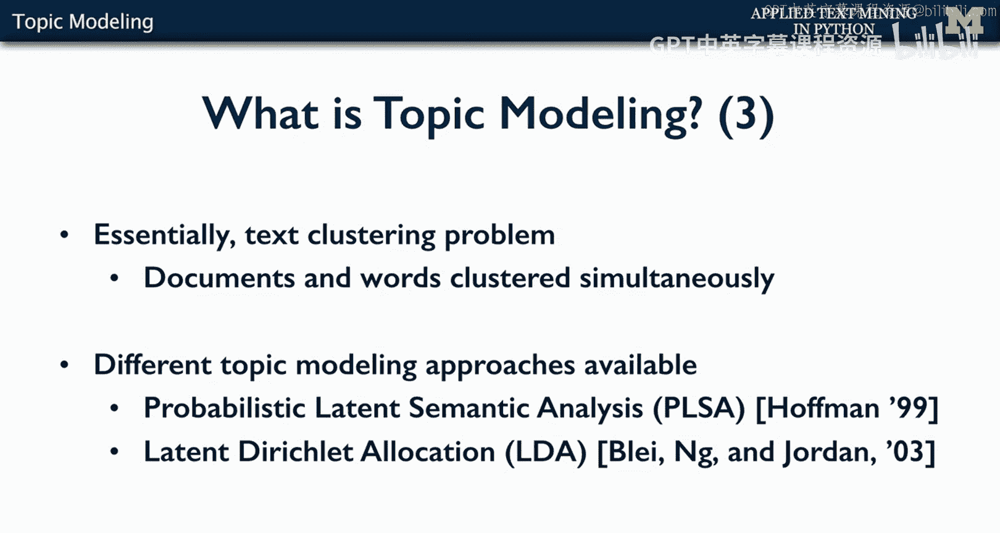

# 18：主题建模技术 🧠

在本节课中，我们将要学习主题建模技术。这是一种用于从大量文本集合中发现隐藏主题的文本挖掘方法。我们将了解什么是主题、文档如何由多个主题混合而成，以及主题建模的基本原理。

## 概述

主题建模是一种对文档集合进行宏观层面分析的技术。当我们拥有一个大型语料库并希望理解其内容时，可以使用主题建模来发现其中隐含的主题结构。这有助于我们组织和理解海量文本数据。

## 什么是主题建模？

让我们以一篇来自《科学》杂志的文章为例，文章标题为“探寻生命的基本遗传需求”。浏览文章时，你会注意到一些单词被高亮显示。

*   黄色高亮的单词，如“基因”和“基因组”。
*   蓝色高亮的单词，如“计算机”、“预测”和“计算分析”。
*   粉色高亮的单词，如“生物体”、“生存”或“生命”。

这演示了任何一篇文章都可能由不同的主题或子单元交织而成，它们无缝地编织在一起构成完整的文章。这是文本挖掘领域一项重要研究——主题建模的基础。

具体来说，这个例子基于潜在狄利克雷分配模型。其中存在三个主题：黄色代表的遗传学、蓝色代表的计算科学，以及粉色代表的生命科学相关主题。这表明文档通常是多个主题的混合体。

*   每个主题本质上是一组更可能出现在该主题下的单词。
*   当你谈论“基因”和“DNA”时，你很可能处于遗传学领域。
*   当你谈论“计算机”、“数字”和“数据”时，你很可能处于计算科学领域。

当一篇新文档（例如这篇关于生命基本遗传需求的文章）出现时，它带有自己的主题分布。对于这篇文章，假设世界上只有四个主题（遗传学、计算科学、生命科学、解剖学），那么这篇文章就是由这四个主题以某种单词组合方式生成的。其中，解剖学主题缺席，计算科学主题出现的概率最高，遗传学主题也有同等体现，生命科学主题则占一小部分。

## 主题与文档的关系

上一节我们介绍了主题建模的基本概念，本节中我们来看看主题和文档的具体定义。

**主题** 是话语的主题或主旨。主题由**词分布**表示，这意味着每个单词在该主题下出现的概率不同。例如，在“体育”主题下，单词“篮球”、“球员”、“场地”或“得分”出现的可能性更高。虽然“团队”也可能出现在社会科学研究中，但在体育主题下出现的**概率**更高。因此，一个主题就是所有单词上的一个概率分布。

**文档** 被假定为多个主题的**混合体**。例如，一个文档可能包含：
*   关于遗传学主题的单词，如“人类”、“基因组”、“DNA”。
*   关于进化主题的单词，如“进化”、“物种”、“生物体”。
*   关于疾病主题的单词，如“疾病”、“宿主”、“细菌”。
*   关于计算机模型主题的单词，如“计算机”、“模型”、“信息”、“数据”。

这些主题就是词分布，例如，一个主题对应一列单词，这些单词可能按概率从高到低排序。在第四个主题中，“计算机”或“模型”是最可能出现的单词。

## 主题建模的任务

当我们进行主题建模时，已知的输入是一个文本集合或语料库，并且我们通常需要指定主题的数量（例如，我们感兴趣的是20个主题）。目标是从这个大型集合中分组单词并找出这20个主题。

以下是未知的部分：
*   **实际的主题内容**：我们并不知道具体会是哪20个主题，我们需要找到的是具有较高**连贯性**的20个主题。
*   **每个文档的主题分布**：我们不知道某个特定文档是完全关于体育的，还是50%关于体育、50%关于遗传学。

本质上，主题建模是一个文本聚类问题。然而，在这个特定场景中，文档和单词是**同时被聚类**的。我们需要弄清楚哪些单词会聚集在一起（即哪些单词在语义上相似或相关），以及哪些文档会聚集在一起（即哪些文档主要关于相同主题），并基于这些文档推导出单词的分布。

## 常见的主题建模方法

不同的主题建模方法层出不穷，计算机科学文献中会定期提出新的模型。

以下是两种最常见且开创该领域的方法：
1.  **概率潜在语义分析**：于1999年首次提出。
2.  **潜在狄利克雷分配**：于2003年提出。

LDA 是目前最流行的主题模型之一，我们将在下一个视频中更详细地讨论它。

## 总结

本节课中我们一起学习了主题建模技术。我们了解到文档是多个主题的混合体，而每个主题则是一个单词的概率分布。主题建模的目标是从给定的文本语料库中，自动发现隐藏的主题结构以及每个文档的主题构成，这是一个文档与单词同时聚类的过程。LDA 是其中最具代表性的方法之一。