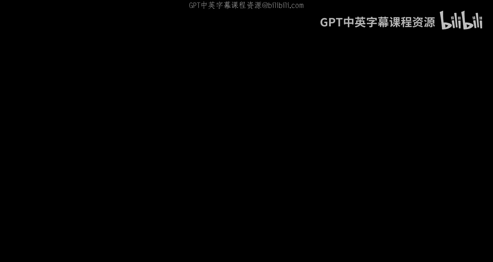
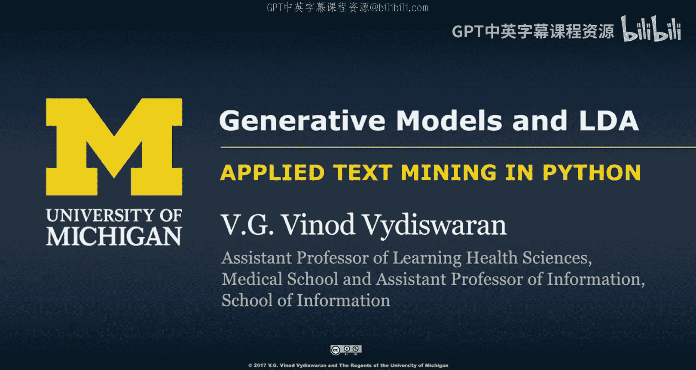
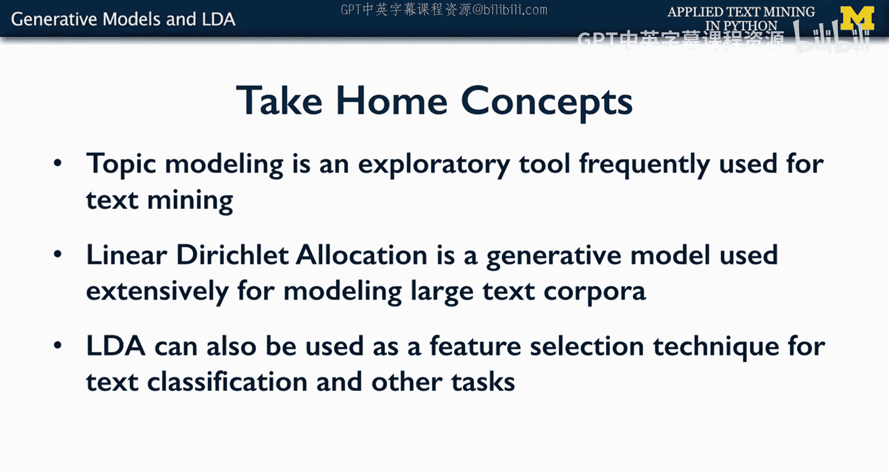

# 19：生成模型与LDA算法





在本节课中，我们将详细探讨生成模型以及LDA（潜在狄利克雷分布）算法。我们将从生成模型的基本概念入手，逐步理解LDA的工作原理及其在文本分析中的应用。

## 概述

生成模型是一种用于描述数据生成过程的统计模型。在文本分析中，生成模型假设文档是由一个或多个“主题”生成的，每个主题又对应一个特定的词语分布。LDA是一种广泛使用的生成模型，它能从文档集合中自动发现潜在的主题结构。

## 生成模型详解

上一节我们概述了生成模型，本节中我们来看看其具体的工作机制。

文本的生成模型基本上从这个神奇的箱子开始。假设你有一个箱子，词语会神奇地从里面出来。你从这个箱子里挑选词语来创建你的文档。当你开始取出词语时，你开始看到像“Harry”、“Potter”、“is”这样的词，然后你还有其他词如“movie”、“and”、“the”等等。仅仅通过看前两个词，你就知道这个箱子给出的词与哈利·波特有关。这是一个倾向于给出哈利·波特相关词语的词语分布。然后，你可以使用这些出来的词语来创建这个文档，生成的文档可能是这样的：“The movie Harry Potter is based on books from JK Rowling。”

在生成过程中，你有一个输出词语的模型，然后你使用来自该模型的词语来生成文档。

但是，你也可以反过来操作。你可以从文档开始，查看单词“the”出现了多少次，“Harry”出现了多少次，“Potter”出现了多少次。然后创建一个词语的分布。也就是说，你创建一个概率分布，描述在这个文档中看到单词“Harry”或单词“movie”的可能性有多大。你注意到，当你推断这个模型时，单词“the”是最频繁的。它的概率是0.1，这意味着每十个词中就有一个是“the”。然后你有“is”，接着是“Harry”和“Potter”等等。

请注意，因为文档是关于哈利·波特的，所以模型倾向于使用“Harry”和“Potter”这些词。在任何其他主题模型或任何其他文档语料库中，你不太可能看到“Harry”和“Potter”如此频繁地出现。

这里你有一个非常简单的生成过程：你有一个主题模型，你从那个主题模型中取出词语来创建你的文档。这是一个生成故事。

## 混合主题模型

然而，在大多数情况下，生成故事可能非常复杂。假设你不是有一个，而是有四个主题模型，四个箱子。你有一顶神奇的帽子，它随机地从这些箱子中取出词语，或者它有自己的策略来选择其中一个箱子而不是另一个，然后你得到这些出来的词语，你仍然用它们创建这个文档。

现在你的模型更复杂了，因为你需要学习四个模型。生成过程几乎就像你决定词语来自哪个箱子，一旦你做出了选择，那么你就有来自那个箱子的词语的不同分布。你仍然创建相同的文档。但是，当你使用这些文档来推断你的模型时，你需要推断四个模型，并且需要以某种方式推断来自这四个箱子（即这四个主题）的词语组合。因此，你不仅必须以某种方式弄清楚各个主题模型（即各个词语分布）是什么，还要弄清楚这个混合模型，即你如何使用这四个主题模型并将它们组合起来创建一个文档。

这通常被称为混合模型。我们在上一张幻灯片中看到的第一个模型是Unigram模型，你有一个主题分布并从那里获取词语，而这里是一个主题的混合，所以同一个文档由四个不同的主题生成，其中一些主题以较高的比例表示，而另一些则不是。这应该让你想起我们开始讨论主题模型时的例子，那是关于科学文章中的基本需求，你看到了一个关于计算的主题模型，另一个关于遗传学的主题模型，第三个关于解剖学的主题模型在文档中表现得不太好，等等。所以这里的模型是类似的。

## LDA生成模型

LDA是另一个这样的生成模型。文档D的生成模型是：你选择文档的长度，你首先决定要生成的文档的长度是多少。然后你为该文档选择一个主题混合。然后你使用该主题的多项分布（即词语分布）来输出词语以填充该配额，即该主题的配额。假设你决定对于某个特定文档，40%的词语来自主题A，那么你使用主题A的多项分布来输出那40%的词语。

这是对LDA的一个非常简化的解释。你们中的一些人可能见过更复杂的数学符号，称为板符号，用来定义主题模型，这我们留待以后学习，我可以在阅读列表中指出一些相关内容。但现在，理解LDA也是一个生成模型，它基于文档长度、文档中主题的混合以及各个主题的多项分布这些概念来创建这些文档，这就足够了。

## 实践中的考虑

在实践中，当你创建像LDA这样的模型时，你需要问的问题是：你想要多少个主题？没有一个好的答案，找到甚至猜测这个数字实际上非常困难。所以你必须以某种方式说，好吧，我相信可能有五个主题，或者我宁愿学习五个不同的主题，而不是25个彼此非常相似的主题。

因此，你可能只是基于对这些主题可能有多独特的猜测来做出选择。但如果你在一个对这些主题有点了解的领域，例如，你拥有所有医学文档，并且你知道这些医学文档来自放射学、病理学、神经学等这些分支，那么你可能会说，好吧，我对医学的这七个分支感兴趣，这些就是我的主题，这样你对应该有多少个主题就有了一些概念。

另一个大问题是解释主题。你会得到主题，但主题只是词语分布。它们只是告诉你哪些词语在特定主题中更频繁、更可能出现，哪些不那么可能出现。但理解这一点或为主题生成一个连贯的标签是一个主观的决定。有一些研究致力于为这些主题生成名称，但很可能，每当你在主题模型中看到一个名称时，它都是手动产生的，人们只是看着这些词，比如“genetics”、“genes”等等，然后说这是遗传学主题，或者说“computation”、“model”、“data”、“information”，然后说与计算或计算机科学或信息学有关的东西。所以这些名称是相当主观的。但你从LDA中学到的实际主题基本上是一个优化函数的解，因此在这个意义上，它更偏向于确定性。

## 主题建模的应用与步骤

总结来说，主题建模是探索性文本分析的一个强大工具，它帮助你回答这些文档是关于什么的、这个语料库是关于什么的问题。你可以把它看作是一堆推文、评论或新闻文章的语料库，所以你可能会得到一大堆推文，然后说人们在推文中谈论什么？推文中出现了哪些不同的主题？

有许多工具可以在Python中相当轻松地完成这项工作。让我们举一个如何做的例子。有许多可用的包，其中一些是gensim、LDA等等。我们将在接下来的几张幻灯片中讨论gensim。

但在使用任何这些包之前，你需要预处理文本，我鼓励你回想一下我们在本课程早期，即在第一个模块中关于预处理文本的讨论：你需要对文本进行分词和规范化，这意味着将它们转换为小写（决定是否应该转换为小写），移除停用词。停用词是在特定领域中频繁出现且没有意义的常见词语，例如，在通用英语中，“the”、“is”等可能是你想要移除的词。而如果你在医学文档领域，比如说临床笔记，你总是看到“patient”和“doctor”等词，它们可能不像其他词如“medication”和“disease”那么重要，那么你可能想说“patient”和“doctor”是该上下文中的停用词。

另一个预处理步骤是词干提取，这意味着你需要移除派生相关形式，以某种方式将派生相关形式规范化为同一个词，例如“meet”、“meeting”、“met”都应该称为“meet”。一旦你完成了预处理步骤，你将这个分词后的文档转换为文档-词项矩阵，即从“哪个文档有哪些词”到“哪些词出现在哪些文档中”，得到那个文档-词项矩阵将是重要的第一步，用于LDA的工作。

然后，一旦你完成了这些，一旦你构建了这个文档-词项矩阵，你就在其上构建LDA模型。

## 使用Gensim实现LDA

一旦你在词项和文档之间建立了映射，那么假设你在这个变量`doc_set`中有一组预处理过的文本文档。

以下是使用Gensim学习LDA的方法：

```python
import gensim
from gensim import corpora, models

# 创建词典（词语到ID的映射）
dictionary = corpora.Dictionary(doc_set)

# 创建语料库（文档-词项矩阵的表示）
corpus = [dictionary.doc2bow(doc) for doc in doc_set]

# 构建LDA模型
lda_model = models.LdaModel(corpus=corpus,
                            id2word=dictionary,
                            num_topics=4,
                            passes=10)
```

首先，你导入Gensim，特别是导入`corpora`和`models`。首先你创建一个词典，词典是ID和词语之间的映射。然后你创建语料库，通过遍历`doc_set`中的所有文档并创建一个文档的词袋模型来创建语料库，这是创建文档-词项矩阵的步骤。

一旦你有了这些，然后你将其输入到LDA模型调用中，这样你使用Gensim的`models.LdaModel`，在这里你还需要指定你想要学习的主题数量，在这个例子中我们设主题数为4，你还指定这个ID到词语的映射，即前两步学到的词典。

一旦你学习了模型，就这样了，你可以指定它应该进行多少次遍历，还有其他参数我鼓励你去阅读。但一旦你定义了这个LDA模型，你就可以使用LDA模型来打印主题。在这个特定情况下，我们学习了四个主题，你可以说给我这四个主题的前五个词，然后它会为你打印出来。

LDA模型也可以用于查找文档的主题分布。所以当你有一个新文档并对它应用LDA模型时，即你推断它，你可以说对于这个新文档，在这四个主题上的主题分布是什么？

## 总结与核心概念

本节课中我们一起学习了主题建模的核心概念和应用。

这里的核心概念是：主题建模是文本挖掘中常用的探索性工具。LDA是一种生成模型，广泛用于对大型文本语料库进行建模。还有其他可用的主题模型，PLSA是另一个。

除了作为探索性工具，LDA还可以用作文本分类或任务的特征选择技术。例如，如果你想移除语料库中非常常见的词语带来的所有特征，或者你想将特征仅聚焦于来自特定主题的那些特征，那么你会想先训练一个LDA模型，然后基于主题，仅从感兴趣的主题中产生的词语，你实际上可以那样生成特征。



总的来说，LDA是一个非常强大的工具和文本聚类工具，通常作为理解语料库内容的第一步。

希望你已经学会了如何使用主题建模，这为你提供了对主题模型的简要介绍，其中有很多内容你可以更深入地研究，但对于本课程，我们就讲到这里。