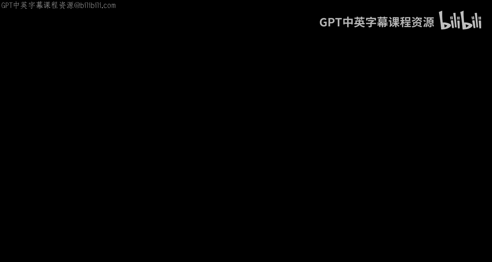
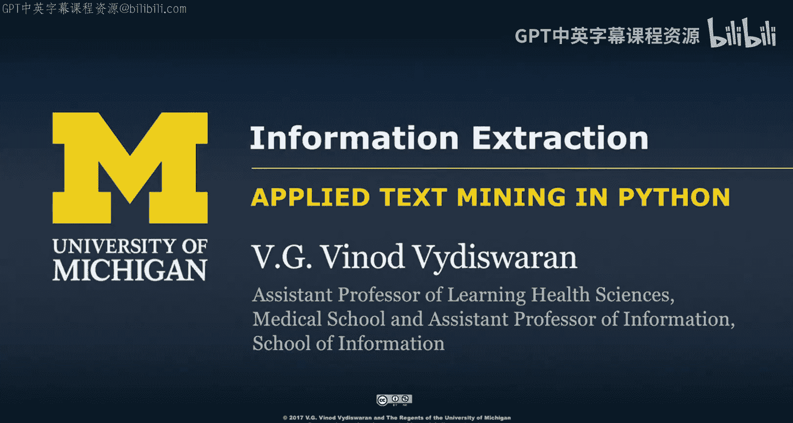
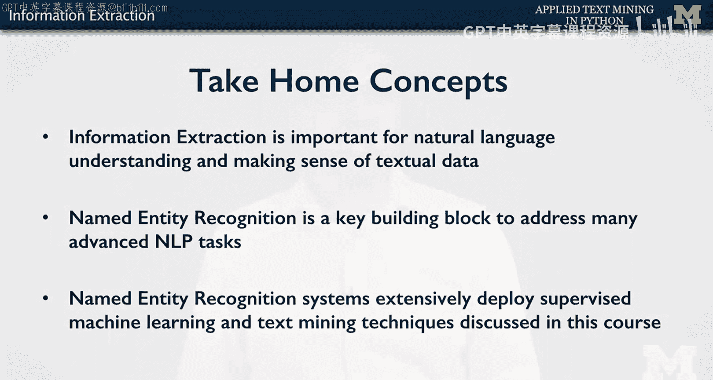

# 20：信息抽取技术

在本节课中，我们将深入学习如何将本课程所学的知识整合起来，应用于一项非常重要的自然语言处理任务——信息抽取。这项任务对于理解自由文本至关重要。

## 概述：从非结构化文本中提取信息

正如我们多次所见，信息以非常有趣的方式隐藏在自由文本中。传统的交易信息通常是结构化的，而如今大量信息以非结构化的自由文本形式存在。正如课程开始时介绍的，大约80%的数据（如博客、网站内容等）都是非结构化的，并且随着推特等社交媒体的发展，这类数据还在不断增长。

因此，核心问题就变成了：如何将非结构化文本转换为结构化形式？我们并非必须转换所有文本，更重要的是如何从中提取相关信息。为了使信息可搜索或后续可用，通常需要将其放入传统的结构化形式中。这就是信息抽取发挥作用的地方。

信息抽取的目标是从自由文本中识别并提取感兴趣的字段。

## 信息抽取的核心概念

上一节我们介绍了信息抽取的基本目标，本节中我们来看看其核心组成部分。

### 命名实体识别

命名实体识别依赖于所谓的“命名实体”。命名实体是具有特定类型、指代特定个体、地点、组织等的名词短语。命名实体识别任务是一系列技术和方法，旨在帮助识别文本中所有预定义命名实体的提及。

例如，识别一个提及时，需要知道该提及从何处开始、在何处结束。这是命名实体识别中的**边界检测**子任务。确定边界后，下一个任务是将其**分类**或**标记**为你感兴趣的命名实体类型之一。

以下是一个在医学文档上下文中的命名实体任务示例：

> 患者为63岁女性，因双手偶发性麻木就诊于神经科。检查显示C5-6椎间盘突出。

以下是可能感兴趣的命名实体：
*   **疾病/症状**：双手麻木、偶发性无力、C5-6椎间盘突出。
*   **年龄**：63岁。
*   **性别**：女性。
*   **医学专科**：神经科。
*   **医疗程序**：检查、MRI。
*   **身体部位**：手、脚。

需要注意的是，这些命名实体可能相互嵌套。例如，“双手麻木”本身是一个有效的命名实体，而“手”也是一个值得关注的实体。因此，在定义命名实体任务时，需要决定标注的粒度。例如，可以决定只关注诊断、年龄、性别、执行过的程序和专科，而不单独标注身体部位。

### 关系抽取

关系抽取任务是识别命名实体之间的关系。

以我们之前看到的句子为例：“Herbites helps treat advanced lung cancer.” 这个句子包含两个命名实体之间的关系：“Herbites”（一种治疗方式，标记为黄色）和“lung cancer”（一种疾病，标记为绿色）。它们之间通过一个**治疗关系**相连，表明“Herbites是肺癌的一种治疗方法”。这是一个非常简单的二元关系。

### 共指消解

共指消解任务是消除文本中提及的歧义，并将指向同一实体的提及分组。

例如：“Anita在市场上遇到了Joseph。他送了她一朵玫瑰，让她很惊喜。” 这里有两个命名实体：Anita和Joseph。第二句使用代词“他”指代Joseph，“她”指代Anita。共指消解就是推断出“Joseph送了Anita一朵玫瑰”。

## 信息抽取的应用

以上这些任务共同构成了更高级应用的基础，例如**问答系统**。要正确回答问题，通常需要结合命名实体识别、关系抽取和共指消解。

例如：
*   **问题**：“Herbites治疗什么？”
    *   首先需要识别“Herbites”是一种治疗方式（命名实体识别）。
    *   然后找到“治疗”关系（关系抽取）。
    *   最后填充关系中的空位，得出答案：“肺癌”。
*   **问题**：“谁送了Anita玫瑰？”
    *   需要进行共指消解，识别出“他”指代Joseph。
    *   结合关系理解，得出答案：“Joseph”。

## 实现方法

现在我们已经了解了任务本身，接下来看看人们通常使用哪些方法来识别命名实体。这很大程度上取决于我们处理的实体类型。

以下是主要方法：

*   **规则方法（如正则表达式）**：适用于格式规范的字段，如日期和电话号码。我们在第一周课程中学习的日期正则表达式就是一个非常有效的命名实体识别任务。
*   **机器学习方法**：对于其他字段，使用机器学习方法非常普遍。即使是日期和电话号码，也可以使用机器学习方法，将正则表达式作为特征之一，并结合其他上下文特征（例如，区分“电话：”和“传真：”前的数字）来训练模型。

标准的自然语言处理NER任务通常是一个四分类模型，包括**人物（PERSON）、组织（ORGANIZATION）、地点（LOCATION）** 和**其他（OUTSIDE）**。

例如，对于句子“John met Brenda.”：
*   John → PERSON
*   met → OUTSIDE
*   Brenda → PERSON

命名实体识别系统使用我们在课程中讨论过的监督式机器学习方法和文本挖掘方法。例如：
*   如果要识别的实体是日期，通常使用第一周讨论的**正则表达式**。
*   如果要提取人名或组织名，不仅会使用机器学习模型来识别实体及其标签，还会使用第二周讨论的特征，例如：单词是否大写、**词性**（是名词还是动词）、在句子上下文中的**语义角色**等。

NLTK内置了一个NER模型，该模型在新闻数据集上针对标准的人物、组织、地点任务进行了训练。但正如本视频所示，命名实体识别问题远不止于新闻领域。当扩展到金融，尤其是医学领域时，它完全是一个开放性问题，需要综合运用本课程所讨论的所有主题。

## 总结

本节课中我们一起学习了信息抽取技术。我们了解到，信息抽取是自然语言理解和处理文本数据的一项重要任务，是将非结构化文本转换为更结构化形式的第一步。命名实体识别是解决这些任务及高级NLP任务的关键基石。通过结合规则方法、机器学习模型以及词性、语义等特征，我们可以从文本中有效地提取出有价值的结构化信息。