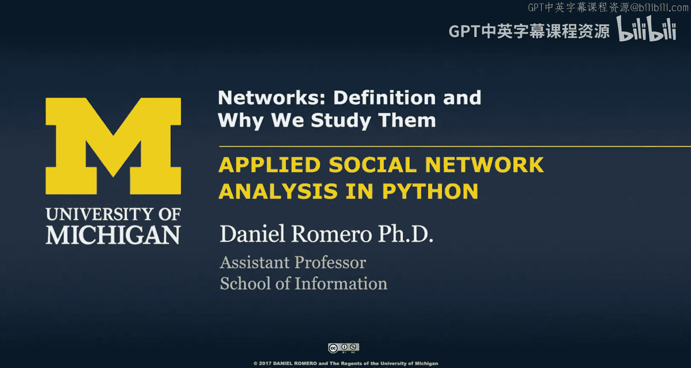
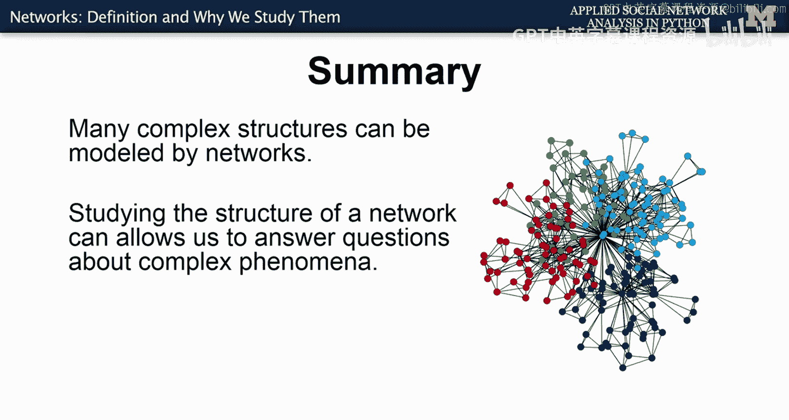

# 21：网络定义与研究意义

在本节课中，我们将学习网络的基本概念，并探讨研究网络的意义。我们将从网络的定义开始，然后了解网络在现实世界中的各种表现形式，最后讨论通过分析网络结构可以解决哪些实际问题。

## 什么是网络？🤔

网络是一个由对象及其相互关系构成的集合。我们将这些对象称为**节点**，将对象之间的关系称为**边**。一个网络可以形式化地表示为：

**G = (V, E)**

其中，**V** 代表节点集合，**E** 代表边集合。

## 为什么研究网络？🌐

研究网络的首要原因是网络无处不在。接下来，我们将展示网络在不同领域中的具体表现。

以下是网络在不同场景下的几个例子：

*   **社交网络**：在社交网络中，节点是人，边代表人与人之间的关系。例如，一个由34名空手道俱乐部成员组成的网络，边代表他们之间的友谊。在这个例子中，1号节点是俱乐部教练，其他节点是学员。
*   **电子邮件通信网络**：网络也可以基于线上关系构建。例如，一个由436名惠普员工组成的网络，边代表他们之间的电子邮件通信。
*   **交通与移动网络**：这类网络描述了实体在空间中的移动。例如，一个显示全球不同机场间直达航班的网络。另一个例子是基于美元钞票追踪数据构建的人类移动网络，通过钞票的流转路径形成网络。此外，还有安阿伯市的公交网络，边代表从一个公交站到下一站的直达路线。
*   **信息网络**：节点是信息单元，边是它们之间的链接。例如，一个政治博客网络，节点是博客，边代表通过URL建立的博客间链接。该网络显示，左翼博客主要链接其他左翼博客，右翼博客亦然，这种现象称为**聚类**。另一个例子是关于气候变化的维基百科文章网络，边代表文章间的直接链接，同样可以看到按子主题形成的聚类。
*   **生物网络**：网络在生物学中也很常见。例如，一个蛋白质相互作用网络，节点是蛋白质，边表示它们之间是否相互作用。还有一个代表食物链的网络，描述动物之间的捕食关系。

网络还出现在金融、贸易、引文等众多领域。这充分说明网络存在于各种不同的情境中。本课程将主要关注社交网络，但网络分析的方法在许多其他领域同样适用。

## 网络分析能做什么？🔍

网络无处不在，但这足以成为我们研究它的理由吗？当我们把复杂现象表示为网络时，我们能做些什么？通过研究网络结构，我们能否更好地理解这些现象？

答案是肯定的。通过分析网络结构，我们可以解答许多问题。

以下是几个具体例子：

*   **分析电子邮件网络**：在一个由436名员工组成的电子邮件通信网络中，我们可以研究：如果谣言从网络的某个部分开始，它是否可能传播到整个网络？谁是组织中最有影响力的人？与从网络边缘节点开始的谣言相比，从网络中心区域（如某个核心人物）开始的谣言是更容易还是更难传播？
*   **分析空手道俱乐部网络**：观察空手道俱乐部成员间的友谊网络，我们可以预测：这个俱乐部是否可能分裂成两个不同的俱乐部？事实上，这个故事真实发生了。如果你试图猜测分裂后每个成员会加入哪个俱乐部，你可以观察网络结构做出有根据的推测。从图中可以看出，俱乐部的分裂大致发生在这里，这条线左侧的节点加入一个俱乐部，右侧的节点加入另一个俱乐部。
*   **分析全球航班网络**：观察全球直达航班构成的交通网络，我们可以回答：如果世界上爆发流行病或病毒，是否有某些机场需要我们给予比其他机场更多的关注？或者，如果世界上某些地区通过航空运输难以到达，我们可以建立哪些关键连接来改善可达性？

这些都是通过研究网络结构可以探讨的问题，其中许多问题我们将在课程后续部分再次提出，并为你提供理解这些问题所需的工具。

## 总结 📝

本节课中，我们一起学习了网络的基本概念及其研究意义。

许多复杂结构都可以通过网络来建模，我们看到了来自社交网络、生物网络、交通网络等领域的例子。

通过研究这些网络的结构，我们可以开始解答涉及复杂关系的、相当复杂的问题。网络通过将复杂现象表示为节点和边的集合，并借助特定的分析工具，使我们能够简化并理解这些现象。

在本课程中，我们将介绍一些研究社交网络的基本技术，并解答关于它们的一些非常有趣的问题。