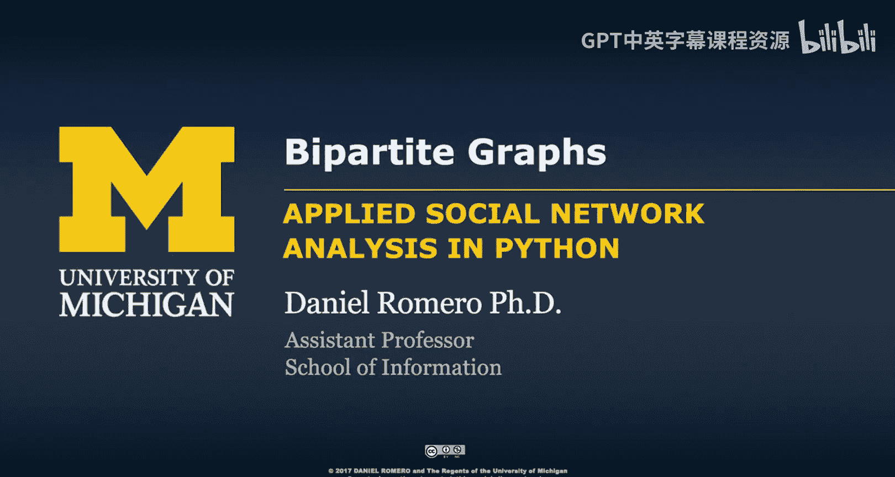
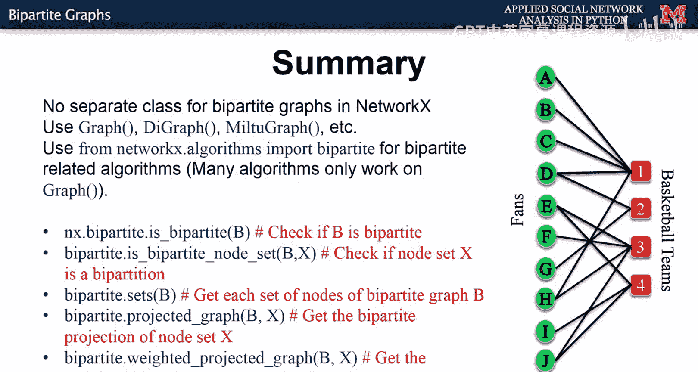

# 24：二分图结构




在本节课中，我们将学习一种特殊且非常有用的图结构——二分图。我们将了解它的定义、如何构建它，以及如何使用NetworkX库来分析它，包括检查图的二分性、获取二分划分以及计算投影图。

## 什么是二分图？🤔

在之前的课程中，我们学习了不同类型的图，包括无向图、有向图、多重图、带符号图和带权图等。我们尚未学习一种对特定应用非常有趣和有用的图类型，即二分图。

在给出二分图的正式定义之前，我们先通过一个例子来感受它在哪些情况下是重要的。下图展示了一个关于特定篮球队球迷的例子。


图中绿色的节点A、B、C、D、E代表喜欢篮球队1、2、3、4的球迷。边代表某个球迷是某个球队的粉丝。

这个图的一个特点是，你无法想象在球迷之间添加边是合理的，因为球迷不是其他球迷的粉丝，他们是球队的粉丝。同样，在篮球队之间添加边也不合理，因为篮球队拥有球迷，它们本身并不是其他球队的粉丝。

因此，这个图具有特定的结构：所有的边都从一组节点连接到另一组节点。在这个例子中，一组节点是球迷，另一组节点是篮球队。这正是二分图的定义。

## 二分图的定义 📖

更具体地说，如果一个图拥有两组节点（我们称之为L和R），并且**每一条边都连接一个L组的节点和一个R组的节点**，那么这个图就是一个二分图。这意味着没有边连接L组内的两个节点，也没有边连接R组内的两个节点。

用公式表示，对于一个图 `G = (V, E)`，如果存在节点集 `V` 的一个划分 `V = L ∪ R`，且 `L ∩ R = ∅`，使得对于所有边 `(u, v) ∈ E`，都有 `u ∈ L` 且 `v ∈ R`，或者 `u ∈ R` 且 `v ∈ L`，则 `G` 是二分图。

在上述例子中，两组节点分别是球迷集合（作为L组）和篮球队集合（作为R组）。

## 在NetworkX中构建二分图 🛠️

NetworkX没有为二分图提供单独的类，但它提供了一系列算法来研究、分析并操作它们。我们需要导入 `bipartite` 模块来使用这些算法。

```python
import networkx as nx
from networkx.algorithms import bipartite
```

要构建二分图，我们仍然使用 `Graph` 类。首先，我们添加节点。这里我们使用 `add_nodes_from` 函数，它可以一次性从列表中添加一组节点，而不是逐个添加。我们为这组节点添加一个名为 `bipartite` 的属性，并将其值设为 `0`。这实际上是告诉NetworkX，这组节点将构成我们二分图的一侧（例如左侧）。

```python
B = nx.Graph()  # 使用B代表二分图
# 添加左侧节点（例如球迷）
left_nodes = [‘A‘, ‘B‘, ‘C‘, ‘D‘, ‘E‘]
B.add_nodes_from(left_nodes, bipartite=0)
# 添加右侧节点（例如球队）
right_nodes = [1, 2, 3, 4]
B.add_nodes_from(right_nodes, bipartite=1)
```

接着，我们添加边。同样，使用 `add_edges_from` 函数可以一次性添加一个边列表。

```python
edges = [(‘A‘, 1), (‘B‘, 1), (‘B‘, 2), (‘C‘, 1), (‘C‘, 2), (‘D‘, 1), (‘D‘, 2), (‘E‘, 2), (‘E‘, 4), (‘H‘, 1), (‘H‘, 3), (‘J‘, 4)]
B.add_edges_from(edges)
```

## 二分图的基本操作 🔍

现在我们已经构建了二分图 `B`，让我们看看在NetworkX中可以对它进行哪些操作。

首先，我们可以检查一个图是否是二分图。

```python
print(bipartite.is_bipartite(B))  # 输出：True
```

如果我们添加一条连接左侧节点（如A和B）的边，就会破坏二分图的规则。

```python
B.add_edge(‘A‘, ‘B‘)
print(bipartite.is_bipartite(B))  # 输出：False
```

让我们移除这条边以保持图的二分性。

```python
B.remove_edge(‘A‘, ‘B‘)
```

其次，我们可以检查一组节点是否是图的一个二分划分。所谓二分划分，就是指这组节点是否是满足“所有边都从一组连向另一组”条件的两组节点之一。

```python
# 假设右侧节点集是一个二分划分
X = set([1, 2, 3, 4])
print(bipartite.is_bipartite_node_set(B, X))  # 输出：True

# 左侧节点集也是一个二分划分
Y = set([‘A‘, ‘B‘, ‘C‘, ‘D‘, ‘E‘, ‘H‘, ‘J‘])
print(bipartite.is_bipartite_node_set(B, Y))  # 输出：True

# 混合的集合则不是
Z = set([1, 2, 3, 4, ‘A‘])
print(bipartite.is_bipartite_node_set(B, Z))  # 输出：False
```

第三，如果我们不知道图的两组二分划分具体是什么，我们可以让NetworkX输出它们。

```python
# 获取图的二分划分
left_set, right_set = bipartite.sets(B)
print(“左侧集合:“, left_set)
print(“右侧集合:“, right_set)
```

如果图不再是二分图（例如我们添加了A-B边），那么调用 `sets` 函数将会报错，提示图不是二分图，因此无法找到这样的两组节点。

## 投影图：从二分图到单模网络 🔄

让我们看一个稍大一点的二分图例子，它具有相同的含义：一侧是球迷，另一侧是篮球队。


假设你感兴趣的是在球迷之间创建一个网络，用边来表示他们在支持球队方面的某种亲和性，比如他们是否倾向于支持相同的球队。这种网络对于病毒式营销可能很重要。如果两个人倾向于支持相同的球队，他们可能也会喜欢同一种其他产品。因此，了解谁可能影响谁（就其他产品而言）会很有用，而他们支持同类球队的事实可能提供了这种线索。

要构建这样的网络，你可以通过计算**二分图的投影图**来实现。具体来说，**L侧投影图**是在二分图一侧（本例中是L侧，即球迷）节点之间构建的网络，其中如果两个节点在二分图的R侧（球队侧）至少有一个共同的邻居，那么它们之间就有一条边。

因此，在这个例子中，将会得到一个球迷之间的网络，如果两个球迷至少共同喜欢一个球队，他们就被连接起来。

类似地，可以定义**R侧投影图**，那将是一个篮球队之间的网络，如果两个球队至少有一个共同的球迷，它们就被连接起来。

下图展示了球迷投影图的样子：



在这个网络中，边A-H出现是因为A和H都是球队1的球迷。边J-E出现是因为他们都是球队4的球迷。

在NetworkX中，你可以使用 `projected_graph` 函数来获取这个投影网络。

```python
# 定义球迷集合
fans = set([‘A‘, ‘B‘, ‘C‘, ‘D‘, ‘E‘, ‘H‘, ‘J‘])
# 计算L侧（球迷）投影图
P_fans = bipartite.projected_graph(B, fans)
```

如果你想要球队的投影图，只需将节点集合定义为球队集合。

```python
# 定义球队集合
teams = set([1, 2, 3, 4])
# 计算R侧（球队）投影图
P_teams = bipartite.projected_graph(B, teams)
```

在这个投影网络中，节点1和2是相连的，因为它们至少有一个共同的球迷（C）。实际上，它们还有B和D作为共同球迷。而边1-3出现在投影图中，是因为球队1和3有共同的球迷H。

## 加权投影图：量化连接强度 ⚖️

注意到，边1-2和边1-3虽然都存在，但它们的“强度”不同：球队1和2有3个共同球迷，而球队1和3只有1个共同球迷。我们可能希望用权重来捕获这种差异。

这就是**加权投影图**。在加权投影图中，不仅当两个节点在另一侧有至少一个共同邻居时添加边，还会为边添加权重，权重与它们共同邻居的数量成正比。

下图展示了篮球队的加权投影图，边上的数字代表共同邻居的数量，边的粗细也与此权重成正比。


在NetworkX中，你可以使用 `weighted_projected_graph` 函数来获取加权投影图。

```python
# 计算R侧（球队）加权投影图
W_teams = bipartite.weighted_projected_graph(B, teams)
# 同样可以计算球迷侧的加权投影图
W_fans = bipartite.weighted_projected_graph(B, fans)
```

加权投影图的边具有 `weight` 属性，表示共同邻居的数量。

## 总结 📝

本节课我们一起学习了二分图。

*   **定义**：二分图包含两组节点（L和R），所有边都连接一组的一个节点和另一组的一个节点，组内没有边。
*   **构建**：在NetworkX中，我们使用普通的 `Graph` 类来构建二分图，并通过为节点设置 `bipartite` 属性（如0或1）来标识它们属于哪一侧。我们利用 `bipartite` 模块中的算法进行分析。
*   **基本操作**：我们可以检查一个图是否是二分图（`is_bipartite`），检查一组节点是否构成一个有效的二分划分（`is_bipartite_node_set`），以及获取图的两组二分划分（`sets`，仅在图为二分图时有效）。
*   **投影图**：这是从二分图衍生出的单模网络，连接了同一侧中拥有共同邻居的节点。我们学习了如何生成普通投影图（`projected_graph`）和加权投影图（`weighted_projected_graph`），后者用权重量化了连接的强度（即共同邻居的数量）。

二分图是表示两类实体间关系的强大工具，而投影图则能帮助我们发现同类实体之间通过另一类实体产生的间接关联，这在社交网络分析、推荐系统等领域有广泛应用。


本节课到此结束，我们下节课再见。