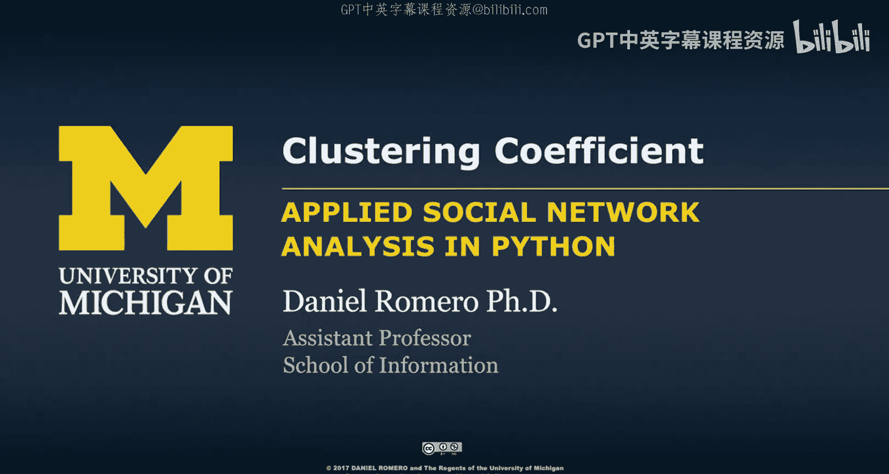
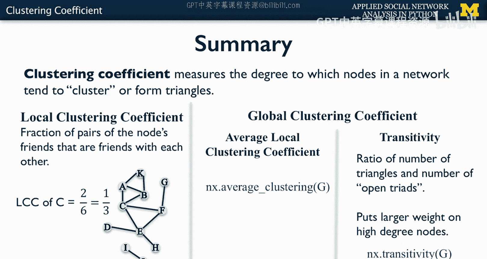

# 26：聚类系数分析 📊




在本节课中，我们将要学习网络分析中的一个重要概念——三元闭包，以及如何通过聚类系数来量化网络中节点形成三角形的倾向。我们将从单个节点的局部视角开始，逐步扩展到整个网络的全局度量，并使用Python的NetworkX库进行实际计算。

## 三元闭包与聚类

上一节我们介绍了网络的基本概念。本节中我们来看看三元闭包。三元闭包是指，拥有大量共同连接的人倾向于彼此之间也形成连接。例如，拥有许多共同朋友的人，他们自己成为朋友的可能性会增加。

虽然导致这一过程的机制有很多，但本节课的重点是学习如何在网络中测量它。

假设你有一个网络，并被问及哪些边最有可能在未来出现。三元闭包理论认为，那些能够“闭合三角形”的边是很好的候选边。在下图中，所有红色的边都能形成闭合的三角形，因此它们更有可能出现。

然而，我们并不总是拥有时间戳数据，或者知道边进入网络的顺序。有时我们只有一个静态网络，而我们想知道这个网络中是否存在三元闭包，即它是否包含许多三角形。因此，本视频将探讨如何测量网络中三元闭包的普遍程度。

三元闭包的另一种说法是聚类。我们今天要介绍的许多定义都与聚类有关。

## 局部聚类系数

我们将从测量聚类的局部版本开始，即从单个节点的视角进行测量，这被称为局部聚类系数。它的定义是：一个节点的朋友之间彼此也是朋友的比例。

展示局部聚类系数如何工作的最好方式是通过一个例子。假设你想计算节点C的聚类系数。

你需要做的是计算节点C的朋友中，彼此是朋友的对数，与节点C所有可能的朋友对总数之比。

节点C在这个网络中有四个朋友，这意味着节点C的度为4。度是指一个节点拥有的连接数，我们用 **`d_c`** 表示。在这里，**`d_c = 4`**。

那么，节点C有多少对朋友呢？节点C有四个朋友。如果你有四个人，那么总共有六种可能的配对。因此，节点C的朋友对总数是6。当朋友数量较多时，直接计算可能比较困难。你可以使用以下公式来计算可能的朋友对数量：

**`d_c * (d_c - 1) / 2`**

在这个例子中，结果是 **`4 * 3 / 2 = 6`**。这就是分母。

分子是节点C的朋友中，彼此是朋友的对数。在这个网络中，只有两对朋友彼此是朋友：A-B 和 E-F。所以分子是2。

因此，节点C的局部聚类系数是 **`2 / 6 = 1/3`**。这意味着，在节点C所有可能成为朋友的朋友对中，有三分之一实际上已经是朋友。

让我们再计算节点F的局部聚类系数。同样，我们需要计算节点F的朋友中彼此是朋友的对数，与所有可能的朋友对总数之比。

节点F的度为3，所以可能的朋友对总数是 **`3 * 2 / 2 = 3`**。
实际上，节点F的朋友中只有一对彼此是朋友：C和E。
因此，节点F的局部聚类系数也是 **`1/3`**。

最后，计算节点J的局部聚类系数。节点J只有一个朋友，即节点I。这意味着节点J有零对朋友。由于分母不能为零，对于这种朋友数少于两个的节点，我们定义其局部聚类系数为0。这与NetworkX库的处理方式一致。

## 使用NetworkX计算局部聚类系数

了解了理论后，我们来看看如何在代码中实现。假设我们已经按照已知的方式加载了这个图（记为`G`）。

我们可以使用`clustering`函数来计算单个节点的局部聚类系数。

以下是计算示例：
```python
# 计算节点F的局部聚类系数
clustering_coeff_F = nx.clustering(G, 'F')  # 结果约为 0.33
# 计算节点A的局部聚类系数
clustering_coeff_A = nx.clustering(G, 'A')  # 结果约为 0.66
# 计算节点J的局部聚类系数
clustering_coeff_J = nx.clustering(G, 'J')  # 结果为 0.0
```
这允许你计算图中每个节点的局部聚类系数。

## 全局聚类系数

我们最初的目标是判断三元闭包在整个网络中是否普遍存在。那么，如何从每个节点的局部度量，得到整个网络的全局度量呢？我们将讨论两种不同的方法。

第一种方法简单直接：计算图中所有节点局部聚类系数的平均值。

你可以在NetworkX中使用`average_clustering`函数来实现。
```python
avg_clustering = nx.average_clustering(G)  # 在这个例子中，结果是 0.29
```
这是第一种全局度量方法。

第二种方法如下：我们尝试测量网络中“开放三元组”形成“三角形”的比例。

*   **三角形**：由三条边完全连接的三个节点。
*   **开放三元组**：只由两条边连接的三个节点。

需要注意的是，一个三角形实际上包含三个不同的开放三元组。例如，考虑一个三角形ABC（边AB, BC, CA）。它可以衍生出三个开放三元组：缺少边BC的(A,B,C)、缺少边CA的(A,B,C)、缺少边AB的(A,B,C)。

因此，在这种被称为“传递性”的第二种聚类系数测量方法中，我们计算：
**`(三角形数量 * 3) / 开放三元组数量`**

这代表了实际上形成三角形（即闭合三元组）的开放三元组的比例。

你可以在NetworkX中使用`transitivity`函数来获取网络的传递性。
```python
trans = nx.transitivity(G)  # 在这个例子中，结果是 0.41
```

## 两种全局度量方法的比较

我们现在有两种测量全局聚类系数的方法。它们相同吗？哪个更好？两者之间存在差异。

它们都试图测量边形成三角形的倾向，但传递性会给连接数更多（度更高）的节点赋予更高的权重。通过例子可以最好地理解这一点。

**例一：轮状图**
这个图看起来像一个轮子。外围的大多数节点局部聚类系数都很高（为1），因为它们只有两个朋友，而这对朋友彼此相连。然而，中心的节点度很高，但局部聚类系数非常低，因为它的大多数朋友彼此之间并不相连。
在这个图中：
*   平均聚类系数相当高（0.93），因为大多数节点系数很高。
*   但传递性很低（0.23），因为它更重视那个高度数但低聚类系数的中心节点，从而拉低了整体分值。

**例二：另一种结构**
在这个网络中，大多数外围节点局部聚类系数为0（度数为1或2但朋友彼此不连），这样的节点有15个。内部少数节点（5个）度数高且局部聚类系数高。
在这个图中：
*   平均聚类系数很低，因为大多数（15个）节点系数为0。
*   但传递性较高，因为那些高度数的节点恰好具有高聚类系数，而传递性更重视这些节点。

这两个图展示了平均局部聚类系数和传递性之间的区别：传递性更重视高度数节点。

## 总结

本节课中我们一起学习了聚类系数，它衡量了网络中节点倾向于聚类或形成三角形的程度。

有几种方法可以测量这一点：
1.  **局部聚类系数**：基于单个节点进行测量。其定义为：一个节点的朋友中，彼此是朋友的对数占所有可能朋友对的比例。例如，节点C的局部聚类系数为1/3。
2.  **全局聚类系数**：衡量整个网络层面的聚类程度。
    *   **第一种方法（平均聚类）**：计算所有节点局部聚类系数的平均值。在NetworkX中可使用 `average_clustering` 函数。
    *   **第二种方法（传递性）**：计算网络中三角形数量与开放三元组数量的比值（`3 * 三角形数 / 开放三元组数`）。与平均聚类相比，它给高度数节点赋予了更大的权重。在NetworkX中可使用 `transitivity` 函数。




理解这些差异有助于你根据分析的具体网络和问题，选择合适的度量指标。