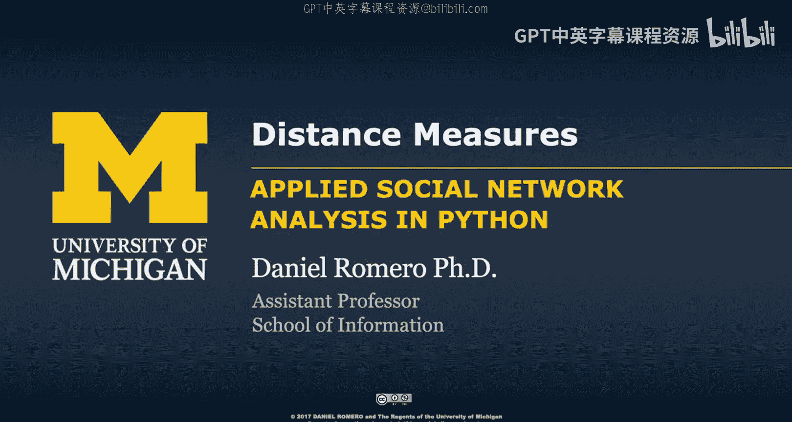
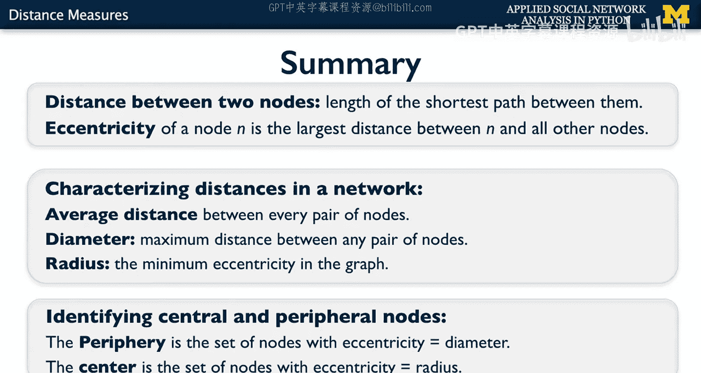

# 27：网络距离度量 📏




在本节课中，我们将学习社交网络中“距离”的概念。我们将探讨如何量化网络中节点之间的远近关系，并介绍一系列用于描述网络整体距离特性的度量指标。

---

## 路径与最短路径

上一节我们引入了网络的基本概念，本节中我们来看看如何定义节点间的距离。要定义距离，首先需要理解“路径”的概念。

**路径**是指由边连接起来的一系列节点序列。例如，从节点G到节点C可以找到路径 `G -> F -> C`。

对于一条路径，我们定义其**路径长度**为从起点到终点所经过的“跳数”。例如，路径 `A -> B -> C -> E -> H` 的长度为4。

两个节点之间的**距离**，则定义为它们之间所有可能路径中最短路径的长度。因此，节点A到节点H的距离是4。

在 NetworkX 中，可以使用以下函数计算：
```python
# 查找最短路径
nx.shortest_path(G, source='A', target='H')
# 计算最短路径长度
nx.shortest_path_length(G, source='A', target='H')
```

---

## 广度优先搜索算法

当我们需要计算从一个节点到网络中所有其他节点的距离时，手动计算在大型网络中会非常繁琐。此时，我们可以使用**广度优先搜索**算法来高效地完成此任务。

该算法从一个起始节点（例如节点A）开始，逐层“发现”网络中的节点：
1.  第0层：起始节点A（距离为0）。
2.  第1层：发现与A直接相连的节点B和K（距离为1）。
3.  第2层：处理B和K，发现它们未发现的邻居节点C（距离为2）。
4.  依此类推，直到所有节点都被发现并分配了距离。

在 NetworkX 中，可以使用 `nx.bfs_tree(G, source='A')` 函数来获取广度优先搜索生成的树结构。若只需距离信息，可使用 `nx.shortest_path_length(G, source='A')` 获取一个包含所有距离的字典。

---

## 网络层面的距离度量

了解了节点对之间的距离后，我们可以从整体上描述网络的距离特性。以下是几个关键的度量指标：

**平均路径长度**：网络中所有节点对之间距离的平均值。它反映了节点间联系的紧密程度。
```python
nx.average_shortest_path_length(G)
```

**直径**：网络中任意两个节点之间距离的最大值。它代表了网络的“跨度”。
```python
nx.diameter(G)
```

**节点离心率**：一个节点到网络中所有其他节点距离的最大值。它衡量了该节点的“偏远”程度。
```python
nx.eccentricity(G)
```

**网络半径**：所有节点离心率中的最小值。它代表了网络中最核心节点到其他节点的最远距离。
```python
nx.radius(G)
```

---

## 网络中心与外围

基于上述度量，我们可以识别出网络中处于核心或外围位置的节点。

**网络外围**：离心率等于网络直径的节点集合。这些节点通常位于网络的边缘。
```python
nx.periphery(G)
```

**网络中心**：离心率等于网络半径的节点集合。这些节点到网络中其他节点的最大距离最小，通常处于核心位置。
```python
nx.center(G)
```

---

## 案例分析：空手道俱乐部网络

让我们将所学概念应用到一个真实网络——空手道俱乐部友谊网络中。该网络记录了俱乐部成员间的友谊关系，其中节点1是教练，节点34是助理，两人因分歧导致俱乐部最终分裂。

加载并分析该网络：
```python
G = nx.karate_club_graph()
```
分析结果如下：
*   **平均路径长度**：约2.41
*   **半径**：3
*   **直径**：5
*   **网络中心**：包括教练（节点1）及其一些高度连接的学生。
*   **网络外围**：一些连接较少的节点，且均未与教练直接相连。

值得注意的是，助理（节点34）虽然连接较多，但因与节点17的距离为4（大于网络半径3），而未能被归入中心节点。这说明了基于离心率的中心性定义可能对网络中微小的距离变化非常敏感。

---

## 总结

本节课中我们一起学习了网络距离度量的核心概念：
1.  **节点对层面**：定义了**节点间距离**（最短路径长度）和**节点离心率**（到所有其他节点的最大距离）。
2.  **网络整体层面**：引入了**平均路径长度**、**直径**（最大距离）和**半径**（最小离心率）来描述网络全局的距离特征。
3.  **节点位置识别**：利用上述概念定义了**网络外围**（离心率=直径的节点集）和**网络中心**（离心率=半径的节点集）。




通过这些工具，我们可以量化分析社交网络中节点间的远近关系，并识别出处于核心或边缘位置的关键节点。