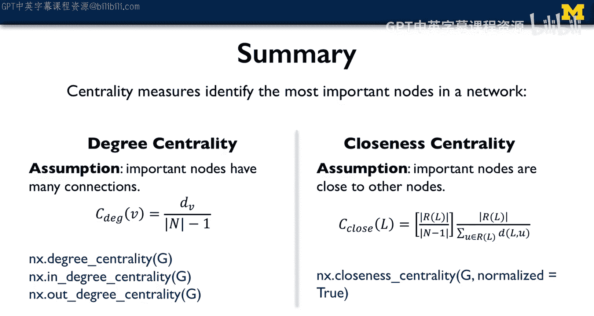

# 31：度中心性与接近中心性 📊


在本节课中，我们将学习如何在网络中识别重要的节点。我们将介绍两种衡量节点重要性的方法：度中心性和接近中心性。这两种方法基于不同的假设，帮助我们理解网络中哪些节点扮演着关键角色。

## 概述

网络分析中的一个核心问题是识别网络中的重要节点。例如，在一个社交网络中，我们可能想知道哪些人是信息传播的关键人物。本节课将介绍两种常用的中心性度量方法：度中心性和接近中心性，并通过具体示例和代码演示如何计算它们。

## 识别重要节点

上一节我们介绍了网络的基本概念，本节中我们来看看如何衡量节点的重要性。考虑一个由34人组成的空手道俱乐部友谊网络。基于网络结构，你认为哪五个节点最重要？这个问题有多种思考方式。

### 度中心性

一种方法是认为拥有许多连接的节点是重要的。如果我们使用这个定义，那么最重要的五个节点是节点34、1、33、3和2。度中心性假设重要的节点拥有许多邻居或朋友。

在无向网络中，我们直接使用节点的度。在有向网络中，我们可以选择入度、出度或两者的组合。度中心性的计算公式如下：

**公式：**
`C_degree(v) = degree(v) / (n - 1)`

其中，`degree(v)` 是节点 `v` 的度，`n` 是网络中的节点总数。这个值介于0和1之间，1表示节点连接到网络中的所有其他节点。

以下是使用 NetworkX 计算度中心性的代码示例：

```python
import networkx as nx

# 加载空手道俱乐部图
G = nx.karate_club_graph()
# 计算所有节点的度中心性
degree_centrality = nx.degree_centrality(G)
# 查看节点34的度中心性
print(degree_centrality[34])  # 输出: 0.515
```

节点34的度中心性是0.515，因为它有17个连接，而网络中有34个节点，所以计算为 `17 / 33`。

对于有向网络，我们可以分别计算入度中心性和出度中心性：

```python
# 假设 G_directed 是一个有向图
in_degree_centrality = nx.in_degree_centrality(G_directed)
out_degree_centrality = nx.out_degree_centrality(G_directed)
```

### 接近中心性

另一种衡量重要性的方法是认为重要的节点距离网络中的所有其他节点都很近。接近中心性基于节点到其他所有节点的最短路径长度之和。

接近中心性的计算公式如下：

**公式：**
`C_closeness(v) = (n - 1) / (∑_{u ≠ v} d(v, u))`

其中，`d(v, u)` 是节点 `v` 到节点 `u` 的最短路径长度。这个值越大，表示节点越接近网络中心。

以下是使用 NetworkX 计算接近中心性的代码示例：

```python
# 计算所有节点的接近中心性
closeness_centrality = nx.closeness_centrality(G)
# 查看节点32的接近中心性
print(closeness_centrality[32])  # 输出: 0.541
```

节点32的接近中心性是0.541。我们可以验证这个计算：首先计算节点32到所有其他节点的最短路径长度之和，假设和为61，那么接近中心性为 `(34 - 1) / 61 ≈ 0.541`。

### 处理不连通网络

在现实网络中，并非所有节点都能相互到达。例如，在有向图或存在多个连通分量的无向图中，某些节点可能无法到达其他节点。在这种情况下，我们需要调整接近中心性的计算。

以下是两种处理方式：

1.  **仅考虑可达节点**：只计算节点能够到达的那些节点的距离之和。但这种方法可能导致只能到达少数节点的节点具有很高的中心性，这不太合理。
2.  **归一化处理**：在考虑可达节点的同时，乘以节点能够到达的节点比例。这样，只能到达少数节点的节点中心性会较低。

NetworkX 中的 `closeness_centrality` 函数提供了归一化选项：

```python
# 不归一化
closeness_no_norm = nx.closeness_centrality(G, normalized=False)
# 归一化（默认）
closeness_norm = nx.closeness_centrality(G, normalized=True)
```

## 总结

本节课中我们一起学习了两种中心性度量方法：度中心性和接近中心性。度中心性基于节点拥有的连接数量，适用于快速识别高度连接的节点。接近中心性基于节点到其他节点的距离，适用于识别网络中的核心节点。这两种方法在不同类型的网络分析中都有广泛应用，帮助我们理解网络结构和节点重要性。



通过本节课的学习，你应该能够使用 NetworkX 计算这两种中心性，并根据具体网络选择合适的方法。下一节课我们将继续探讨其他中心性度量方法。