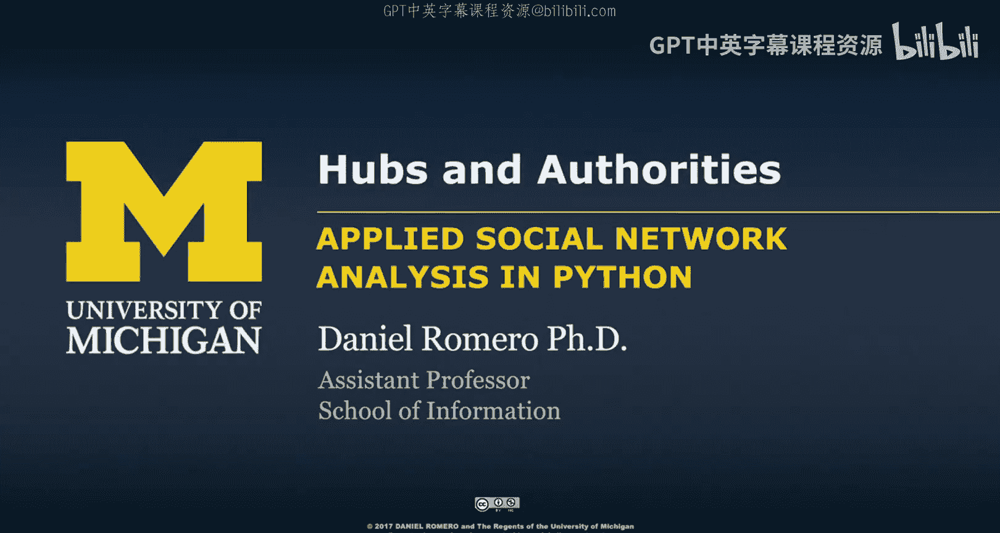
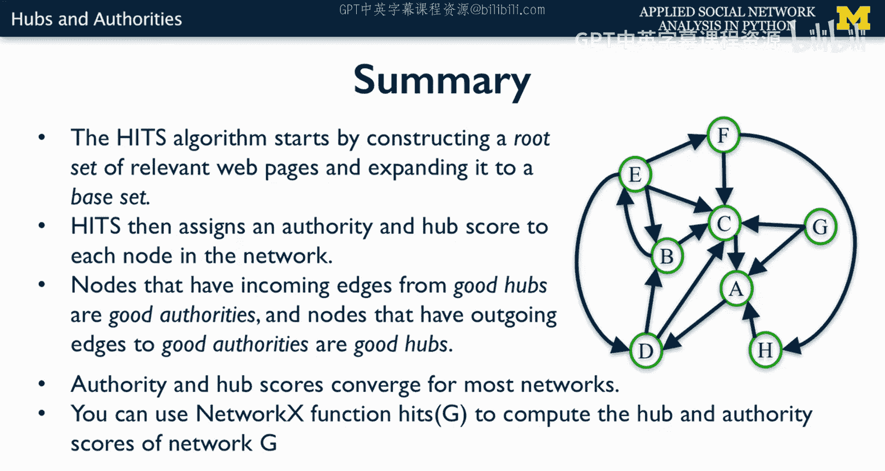

# 35：枢纽与权威节点分析 🧭




在本节课中，我们将学习另一种在网络中寻找中心节点的方法——HITS算法。与PageRank类似，HITS算法也诞生于搜索引擎的背景下，旨在利用网页的超链接结构，从一组相关网页中找出最重要的页面。我们将了解算法的核心思想、计算步骤，并通过一个具体例子演示其工作原理。

## 概述

上一节我们介绍了PageRank算法，本节中我们来看看另一种基于链接分析的重要算法：HITS。HITS算法通过计算每个节点的两种分数——**权威分数**和**枢纽分数**，来评估网页的重要性。权威页面是内容本身重要的页面，而枢纽页面则是善于链接到重要权威页面的页面。

## 算法步骤详解

HITS算法的执行分为几个关键步骤。

### 第一步：构建基础集合

首先，算法需要确定一个待分析的网络子集。

1.  **确定根集**：根据用户查询，找到一组可能相关的网页（例如包含查询关键词的页面）。这些页面被称为“根集”，是潜在的权威页面。
2.  **扩展为基础集**：找到所有链接到根集中任一页面的网页。这些页面是潜在的枢纽页面。根集与这些新发现的页面共同构成“基础集”。
3.  **构建分析网络**：考虑基础集内所有节点之间的超链接，忽略指向集外或从集外指向的链接。这样就得到了一个用于HITS算法分析的子网络。

与PageRank分析整个网络不同，HITS从一个相关的子网络开始分析。

### 第二步：初始化与迭代更新

接下来，我们在构建好的网络上运行HITS算法。算法通过多次迭代更新每个节点的分数。

1.  **初始化**：为网络中的每个节点赋予初始的权威分数和枢纽分数，通常都设为1。
    ```python
    auth_score[node] = 1
    hub_score[node] = 1
    ```
2.  **迭代更新**：在每次迭代中，按照以下两个规则更新所有节点的分数：
    *   **权威分数更新规则**：一个节点的权威分数等于所有指向它的节点的枢纽分数之和。
        ```python
        new_auth[node] = sum(hub_score[neighbor] for neighbor in in_neighbors(node))
        ```
    *   **枢纽分数更新规则**：一个节点的枢纽分数等于它指向的所有节点的权威分数之和。
        ```python
        new_hub[node] = sum(auth_score[neighbor] for neighbor in out_neighbors(node))
        ```
3.  **归一化**：每次更新后，对所有的权威分数和枢纽分数分别进行归一化处理，防止其无限增长。例如，权威分数的归一化方法是将每个节点的分数除以所有节点权威分数的总和。
    ```python
    total_auth = sum(new_auth.values())
    normalized_auth = {node: score/total_auth for node, score in new_auth.items()}
    ```
4.  **重复**：将归一化后的分数作为下一轮的“旧分数”，重复步骤2和3，进行K次迭代。

## 实例演算

为了更直观地理解，让我们在一个简单的网络上手动计算两轮HITS迭代。

假设我们有一个小型网络，其根集包含节点A、B、C。经过扩展后，基础集包含节点A、B、C、D、E、F、G、H，它们之间的链接关系如图所示。

以下是第一轮迭代的计算过程：

*   **更新权威分数**：由于所有节点的初始枢纽分数均为1，此时节点的权威分数就等于其**入度**（有多少节点指向它）。
*   **更新枢纽分数**：由于所有节点的初始权威分数均为1，此时节点的枢纽分数就等于其**出度**（它指向多少节点）。
*   **归一化**：将所有权威分数和枢纽分数分别求和（本例中两者总和均为15），然后每个分数除以总和。

第一轮迭代后，我们得到了归一化的权威分数和枢纽分数，它们将作为第二轮迭代的“旧分数”。

现在进入第二轮迭代，计算会变得更有趣，因为节点的分数不再相同。

以下是第二轮迭代中节点A的分数计算示例：

*   **计算A的新权威分数**：找出指向A的节点（C, G, H），将它们的旧枢纽分数相加。
*   **计算A的新枢纽分数**：找出A指向的节点（D），取该节点的旧权威分数。

对所有节点完成上述计算后，再次分别对权威分数和枢纽分数进行归一化，即得到第二轮迭代后的最终分数。

## 收敛性与结果解读

就像PageRank一样，我们关心当迭代次数K不断增大时，分数是否会收敛到一个稳定值。

对于大多数网络，HITS算法的权威分数和枢纽分数确实会收敛到唯一的值。在我们的例子中，经过足够多次迭代后：
*   具有最高**权威分数**的节点是B和C。这符合预期，因为B和C本身就是根集中的“潜在权威”页面。
*   具有最高**枢纽分数**的节点是D和E。观察网络结构可以发现，D和E都链接到了B和C这两个重要的权威页面，因此它们被认为是优秀的“枢纽”。

## 使用NetworkX实现

在实际应用中，我们可以使用Python的`networkx`库轻松计算HITS分数。

```python
import networkx as nx

# G 是构建好的网络图
hubs, authorities = nx.hits(G)
# hubs 是一个字典，键为节点，值为枢纽分数
# authorities 是一个字典，键为节点，值为权威分数
```

`nx.hits()`函数接收一个图作为输入，并返回两个分别包含所有节点枢纽分数和权威分数的字典。

## 总结



本节课我们一起学习了HITS算法。我们了解到，HITS算法首先构建一个相关网页的根集，并扩展为基础集。然后，它为网络中每个节点分配一个权威分数和一个枢纽分数：**拥有来自优秀枢纽的入链的节点被认为是好的权威**；**拥有指向优秀权威的出链的节点被认为是好的枢纽**。对于大多数网络，这两种分数都会收敛。我们可以使用`networkx`库中的`hits()`函数来计算任何网络的这些分数。