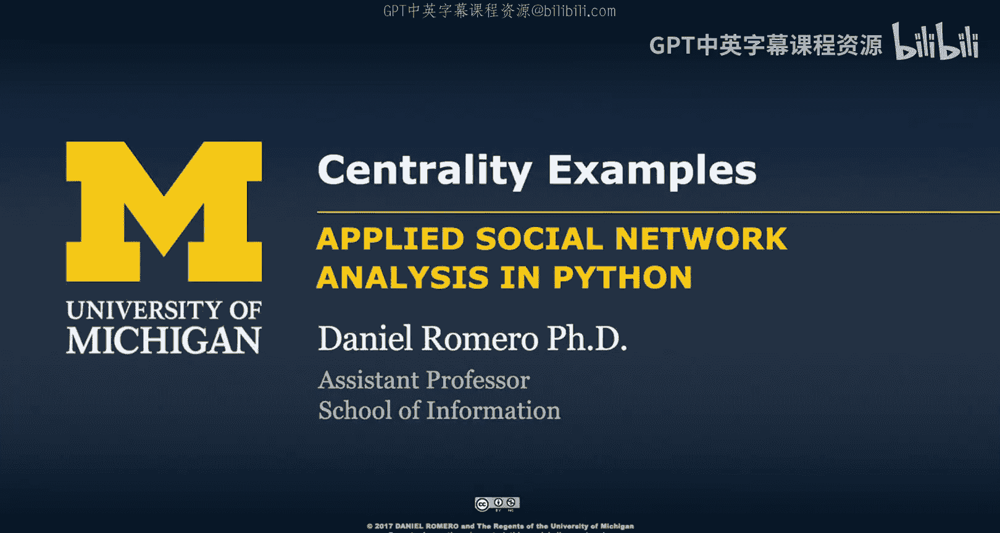
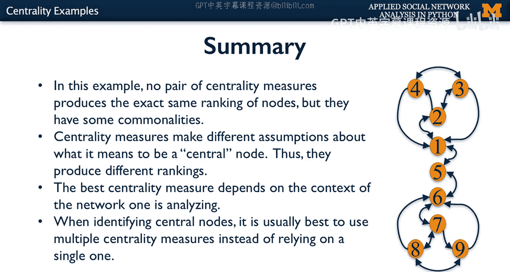

# 36：中心性度量应用实例与比较

在本节课中，我们将通过一个具体的网络实例，比较之前学过的几种中心性度量方法如何对节点进行不同的重要性排序。我们将看到，不同的度量标准基于不同的假设，因此会产生不同的排名结果。

上一节我们介绍了多种识别网络中关键节点的方法，本节中我们来看看如何在一个具体网络中应用并比较这些方法。

## 网络结构与初始分析

我们将分析上图所示的特定网络。首先，从最基础的网络中心性概念——入度中心性开始。

入度中心性衡量的是有多少节点指向你。在这个网络中，应用此度量标准会发现，节点1和节点6拥有最高的入度值。

以下是基于入度中心性的节点排名：
*   节点1和节点6：入度为4，排名最高。
*   其他所有节点：入度为2，并列第二。

入度中心性只能区分出节点1和6最为重要，而其他节点的重要性相同。接下来，我们将逐一查看其他度量方法。与入度中心性类似，我会将节点按重要性从高到低排列，并用红色横线表示排名出现分界的位置。

## 接近中心性分析

现在让我们看看接近中心性。请记住，接近中心性认为，中心节点应该与网络中所有其他节点的距离都很短。

使用此度量，我们发现节点5是最中心的节点。这很合理，因为节点5位于网络中心，大多数节点只需少量跳数即可到达节点5。对于其他节点（如节点3或4），到达它们需要更多跳数。例如，从节点8到节点3需要多跳，因此节点5具有较高的接近中心性是合理的。

以下是基于接近中心性的节点排名：
*   节点5：排名最高。
*   节点1和6：其次。
*   节点2和7：比节点4、3、8、9更接近中心，但不如5、1、6重要。
*   节点4、3、8、9：接近中心性最低，且此度量无法区分它们之间的差异。

节点3和4具有相同的接近中心性，因为要到达其中任一节点，都必须先经过节点2，然后只需一跳即可到达节点3或4。节点8和9的情况类似。然而，节点3和4存在结构差异：从节点3可以直接到达节点2，但从节点4到节点2必须经过节点3。接近中心性无法捕捉这种差异。

## 中介中心性分析

接下来我们分析中介中心性。中介中心性认为，中心节点是那些出现在网络中不同节点对之间最短路径上的节点。

使用此度量，节点5具有最高的中介中心性。这很合理，因为它在网络中位置居中，出现在许多节点对的最短路径上。

以下是基于中介中心性的节点排名：
*   节点5：排名最高。
*   节点1和6：其次。
*   节点2和7：再次。
*   节点3和8：随后。
*   节点4和9：中介中心性最低。

与接近中心性不同，中介中心性能够捕捉节点3和4之间的结构差异。如前所述，从节点2到节点4必须经过节点3，而节点3可以直接到达节点2，因此节点3的中介中心性高于节点4。中介中心性的结果与接近中心性相似，但它能捕捉到接近中心性忽略的结构差异。

## PageRank分析

现在让我们看看PageRank。PageRank有一个有用的解释：如果你在这个网络上进行随机游走，中心节点就是你经常经过或最终停留的节点。

在这个网络中，PageRank的结果与中介中心性有所不同。

以下是基于PageRank的节点排名：
*   节点1和6：排名最高。
*   节点5：其次。
*   节点2、7、3、8、4、9：随后的排名。

为什么会出现这种情况？请注意，节点5将其所有“声望”都传递给了节点1和6，而节点1和6除了传递部分声望给节点5，还传递给其他两个节点。这是节点5排名次于节点1和6的部分原因。PageRank的结果与中介中心性相似，但颠倒了节点1、6与节点5的次序。

## HITS算法权威值分析

最后，我们看看HITS算法计算的权威值。该算法为每个节点计算权威值和枢纽值。

权威值的结果起初可能令人惊讶。

以下是基于HITS权威值的节点排名：
*   节点1和6：排名最高。
*   节点4和9：其次。
*   节点3和8：随后。
*   节点2和7：再次。
*   节点5：权威值最低。

节点5的权威值最低，尽管在其他许多中心性度量中它都非常重要。为什么会这样？要理解HITS算法的结果，必须同时查看权威值和枢纽值。在这个网络中，节点2、5和7拥有很高的枢纽值。HITS算法将此网络解释为：节点1和6是权威节点，而节点2、5和7是具有高枢纽值的节点。因此，要合理解释这些分数，必须将它们放在一起看。

## 总结与比较

本节课中我们一起学习了如何在一个网络实例中应用并比较不同的中心性度量方法。

我们在这里看到，所有这些度量方法给出了不同的节点排名，尽管存在一些共同点。例如，它们通常都认为节点1、5和6具有较高的中心性，但也存在一些差异。

总结来说，在这个例子中，没有一对中心性度量产生了完全相同的排名，但存在一些共性，使我们能够识别出一些非常中心的节点。当然，这些中心性度量对“什么是中心节点”做出了不同的假设，因此它们产生了不同的排名。

要确定哪种中心性度量最好，实际上取决于你所分析网络的具体背景。通常，识别中心节点的最佳做法是采用多种中心性度量，找出在多种度量中都表现重要的节点，而不是仅仅依赖某一种方法。

希望这个例子能帮助你理解这些不同中心性度量方法的比较方式，并看清它们之间的差异。本节内容到此结束，我们下次再见。