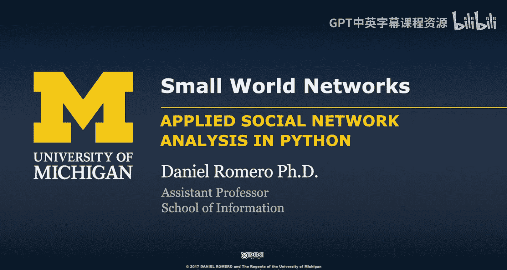
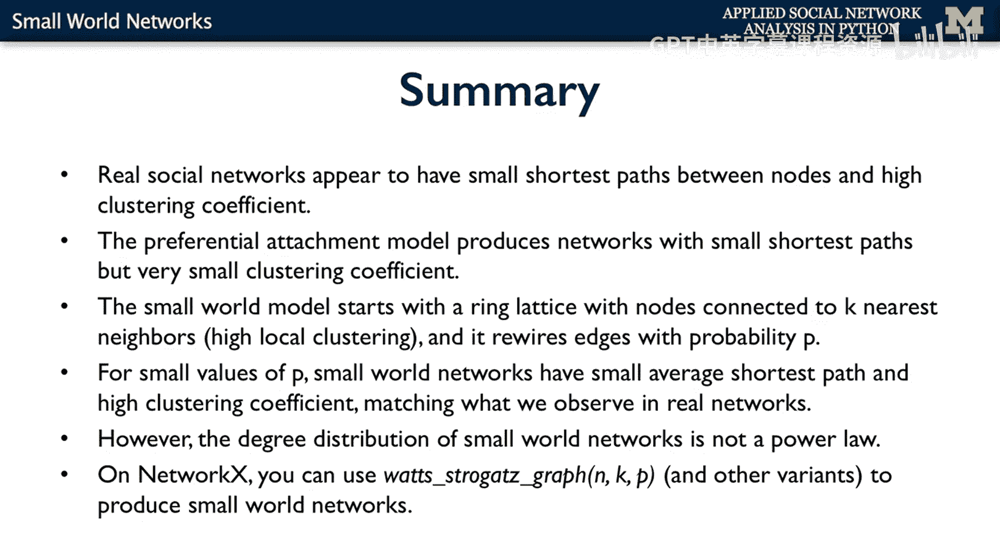

# 38：小世界网络




在本节课中，我们将要学习“小世界现象”，并探讨如何通过数学模型来生成具有“短平均路径”和“高聚类系数”这两个关键特性的网络。

## 概述

“小世界现象”指出，尽管世界人口众多，但人与人之间通常通过很短的路径相连。本节课我们将首先回顾验证这一现象的经典实验，然后分析真实社交网络的数据，最后介绍一个能同时生成短平均路径和高聚类系数的网络模型——小世界模型。

## 小世界实验

上一节我们提到了小世界现象，本节中我们来看看如何通过实验来验证它。

在20世纪60年代，研究员斯坦利·米尔格拉姆设计了一个实验来测量人际网络中的路径长度。实验选取了296名遍布美国的随机参与者作为“发件人”，要求他们将一封信转发给波士顿的一位股票经纪人“目标人物”。规则是：如果发件人认识目标，则直接寄出；如果不认识，则需将信寄给自己认识的、且更可能认识目标的人。信件中包含目标所在城市和职业等信息。

实验结果如下：在296封信中，有64封最终送达了目标。成功送达的信件所需的中转次数（路径长度）中位数为6。这与“六度分隔”的说法相符。下图展示了成功送达信件的路径长度分布直方图，可见路径长度在1到10次之间，中位数为6。


以下是该实验的关键发现：
*   首先，考虑到参与者是随机选取的且可能中途放弃，超过20%的信件最终送达目标，这个比例相对较高。
*   其次，对于成功送达的信件，其路径长度相对较短。在拥有数百万人的网络中，中位数仅为6，这显得非常“小”。
*   另一个有趣的现象是，人们似乎有能力找到这些短路径，而不仅仅是这些路径存在。

## 现代数据验证

近年来，研究者尝试利用大规模网络数据来验证小世界现象，而无需进行实体实验。

一项研究分析了微软即时通讯网络中2.4亿活跃用户的数据。如果两个用户在一个月内进行过双向通信，则在他们之间建立连接，从而构成一个巨大的网络。该网络中，任意两个用户之间最短路径长度的中位数估计为7，这与米尔格拉姆实验得出的6非常接近，并且同样很小。下图是该网络的距离分布直方图。


另一项基于Facebook数据的研究发现，全球网络的平均路径长度在2008年约为5.28，到2011年则降至4.74。这表明路径长度不仅短，而且随着时间推移似乎在变得更短。如果仅观察美国这样的区域性子网络，平均路径长度则更小。

综上所述，在拥有数百万节点的真实社交网络中，节点对之间的平均最短路径长度往往非常小。这是我们要讨论的第一个特性。

## 聚类系数特性

接下来，我们讨论第二个特性：聚类系数。我们之前介绍过，节点的局部聚类系数衡量的是其邻居之间彼此也相连的比例，粗略反映了网络中三角形的多少。所有节点局部聚类系数的平均值即为网络的平均聚类系数。

在真实网络中，例如2011年的Facebook网络，平均聚类系数往往相当高。下图展示了节点度数与平均聚类系数的关系：随着节点度数增加，其平均聚类系数会下降，但对于拥有20到50个朋友的用户，其聚类系数仍在0.3左右。

在微软即时通讯网络中，平均聚类系数为0.13。在我们之前讨论过的演员合作网络中，平均聚类系数甚至高达0.78。

这些聚类系数之所以被认为是“高”的，是因为如果网络是完全随机的（即随机连接节点），其平均聚类系数会低得多。高聚类系数表明，网络的形成过程中可能存在某种机制，促进了三角形（即紧密的社交圈）的产生。

## 现有模型的局限性

我们已经注意到社交网络的两个特性：高聚类系数和短平均路径长度。那么，是否存在一个模型能生成同时具备这两种特性的网络呢？就像我们之前为幂律度分布寻找生成模型一样。

首先，很自然地会想到检查已有的网络形成模型——偏好依附模型。让我们创建一个包含1000个节点、参数 `m=4`（每个新节点连接4个现有节点）的网络，并查看其平均聚类系数和平均最短路径长度。

```python
# 示例：检查偏好依附模型的特性
# 注意：此为概念性代码，实际需使用networkx等库实现
average_clustering = 0.02  # 假设计算得到
average_shortest_path = 4.16  # 假设计算得到
```

在这个例子中，平均聚类系数仅为0.02，远低于我们之前观察到的真实网络值。而平均最短路径长度为4.16，确实很短。这表明偏好依附模型能产生短平均路径，但无法产生高聚类系数。

如果我们改变节点数 `N` 和参数 `m` 来观察路径长度和聚类系数的变化，会发现：随着网络规模增大，平均最短路径保持较小，但平均聚类系数会持续下降并变得非常小（例如在2000个节点时约为0.05）。原因在于，偏好依附模型中没有促进三角形形成的机制，因此无法产生高聚类系数特性。

## 小世界模型

既然偏好依附模型不能满足要求，我们现在来介绍一个新的模型——**小世界模型**，它能够生成同时具备短平均路径和高聚类系数的网络。

### 模型机制

首先，让我们讨论这个模型是如何工作的。

1.  **初始化环形格点**：首先，将 `N` 个节点排列成一个环。每个节点与其左右各 `K/2` 个最近邻节点相连（共 `K` 条边）。`K` 是一个偶数参数。
2.  **随机重连**：定义一个重连概率参数 `p`（取值范围0到1）。对于第一步中创建的每一条边，以概率 `p` 进行“重连”。具体操作是：对于边 `(u, v)`，以概率 `p` 随机选择网络中的另一个节点 `w`（`w ≠ u`），并将边重连为 `(u, w)`。以概率 `1-p` 则保持原边不变。

我们通过一个例子来演示。假设有12个节点，参数 `K=2`（每个节点连接左右各1个邻居），`p=0.4`。我们遍历每条边，根据概率决定是否重连。经过一系列随机决策和重连操作后，最终得到一个小世界网络实例。



### 参数 `p` 的影响

参数 `p` 是模型中更有趣的参数，让我们思考它如何影响网络特性。

考虑两种极端情况：
*   **当 `p = 0` 时**：没有边被重连。网络是一个规则的环形格点。由于局部连接紧密，会形成很多三角形，因此**聚类系数非常高**。但是，要从环的一侧到达另一侧，只能一步步“跳”过去，缺乏“长桥”连接，因此**平均路径长度会很长**。
*   **当 `p = 1` 时**：所有边都被重连。网络变得近似完全随机。随机连接创造了许多“长桥”，因此**平均路径长度变得很短**。但同时，最初的局部结构被完全破坏，三角形大量减少，因此**聚类系数变得非常低**。

**当 `p` 介于0和1之间时**：部分边被重连，创建了一些“长桥”，这能显著降低平均路径长度。同时，根据 `p` 的大小，相当一部分局部结构得以保留，从而可以维持较高的聚类系数。因此，存在一个 `p` 的“甜蜜点”，可以同时获得短平均路径和高聚类系数。

### 特性分析

小世界网络的平均聚类系数和平均最短路径长度取决于参数 `N`、`K` 和 `p`。

下图展示了随着 `p` 从0增加到0.1（注意这里 `p` 值很小），平均最短路径长度迅速下降，而平均聚类系数虽然也下降，但下降速度要慢得多。

例如，一个 `N=1000`、`K=6`、`p=0.04` 的小世界网络实例，其平均最短路径长度为8.99，平均聚类系数为0.53。对于这类 `p` 值，我们确实可以同时获得短的平均路径（个位数）和较大的平均聚类系数。

在 NetworkX 库中，可以使用 `watts_strogatz_graph` 函数来生成小世界网络，该函数以研究者命名。

```python
import networkx as nx
# 生成一个小世界网络
N = 1000  # 节点数
K = 6     # 每个节点的初始近邻连接数
p = 0.04  # 重连概率
G = nx.watts_strogatz_graph(N, K, p)
```

### 度分布

小世界网络的度分布是怎样的？让我们用之前可视化度分布的代码，来观察一个 `N=1000`、`K=6`、`p=0.04` 的网络。

我们发现，其度分布大致如下：大多数节点的度数为6，少数为5或7，极少数为4或8。这是合理的，因为重连概率 `p` 很小，大多数边未被重连，节点保持了初始的度数 `K`。由于模型中没有让某些节点积累大量连接的机制，所以不会出现幂律分布。

因此，小世界模型虽然成功捕获了高聚类系数和短平均路径这两个特性，但它**无法产生真实网络中常见的幂律度分布**，而这是偏好依附模型所具备的。

### 模型变体

NetworkX 中还提供了一些小世界模型的变体：
*   **`connected_watts_strogatz_graph`**：标准小世界模型可能产生不连通的网络。此函数通过多次尝试（最多 `t` 次），确保生成一个连通的小世界网络。
*   **`newman_watts_strogatz_graph`**：与标准模型类似，但不同之处在于，它以概率 `p` **添加**新边，而不是重连旧边。即保留原始边，并额外添加随机边。

## 总结

本节课中，我们一起学习了小世界网络的相关知识。

1.  我们首先回顾了米尔格拉姆的经典实验和现代大数据分析，发现真实社交网络普遍具有**短的平均最短路径**和**高的平均聚类系数**。
2.  接着，我们检验了之前学过的偏好依附模型，发现它虽然能产生短平均路径，但无法产生高聚类系数。
3.  为此，我们引入了**小世界模型**。该模型始于一个每个节点连接 `K` 个最近邻的环形格点（具有高聚类特性），然后以概率 `p` 对边进行随机重连。
4.  我们发现，当 `p` 取值很小时（如0.04），生成的小世界网络既能通过新增的“长桥”获得短平均路径，又能保持较高的聚类系数，这与真实网络的观察结果相符。
5.  然而，小世界网络的度分布并非幂律分布，这与真实网络的另一个常见特性不符。
6.  最后，我们介绍了在 NetworkX 中使用 `watts_strogatz_graph` 函数及其变体来生成小世界网络的方法。


小世界模型为我们理解社交网络的结构提供了一种简洁而有力的工具。