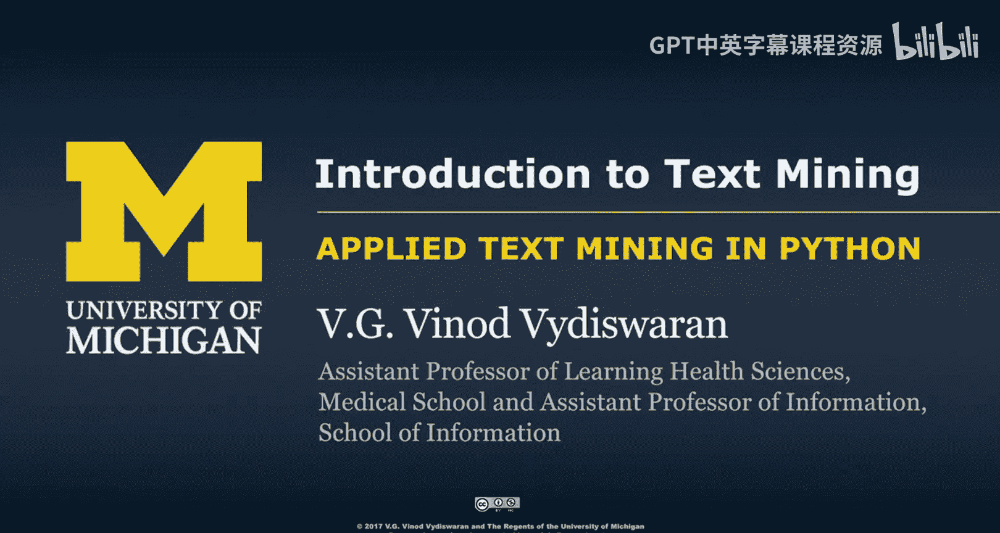
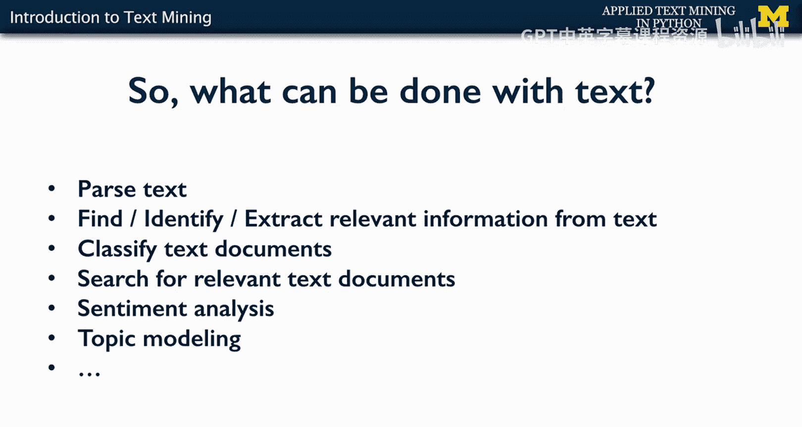

# 密歇根大学《Python用于数据科学实践（4-5课）｜Applied Data Science with Python 》中英deepseek翻译 p01 0_文本挖掘导论.zh_en -BV1DTtueTEwf_p1-

Welcome to the course on App textex mining in Python。I'm glad you are here。Today。

 we are going to start with working with text。

Text is everywhere。You'll see them in books and in printed material， you have newspapers。

 you have Wikipedia and other encyclopedia。You have people talking to each other in online forums and discussion groups and so on。

 you have Facebook and Twitter that's most text too。And this text data is growing really fast。

It grows exponentially and continues to grow so。And it's estimated to be about 2。5 exabytes。

 that is 2。5 million terabytes a day。It will grow to about 40  zabytes。

 according to recent estimates， that is 40 billion terabytes by 2020。

 and that is 50 times that of what was just 10 years ago。

Approximately 80% of all of this data is estimated to be unstructured and free text。

That includes over 40 million articles in Wikipedia， over 5 million of them are in English。Actually。

 just 5 million of them are in English， 4。5 billion web pages。

 about 500 million tweets a day that constitutes about 200 billion tweets a year。😊，And over 1。

5 trillion queries on Google in a year。So when we look at data and look at what is hidden in text in plain sight。

 youll see that it says a lot。So for example， this is the tutor profile of UN spokesperson。

 so you have the author there and you have description， a location of where they are。

 you have the tweets themselves， the actual content if you think about it。

 that has the topic and the sentiment around each of them。For each tweet。

 you have the timest when it was sent out。You have the popularity of how many times is retweeted or liked by others。

And in general， this also gives you some idea of the social network about how many people are following this account。

 how many people or how many accounts are being followed by this particular account of UN spokesperson。

So what can be done with all of this text？You could pass the text， try to understand what it says。

 find and extract relevant information from text。You even define what information is。

Youre to classify the text documents。You have to search for relevant text documents。

 this is information retrieval。You had to also do some sort of sentiment analysis。

 you could see whether something is positive or negative。Something is happy， something is sad。

 something is angry， they are all sentiments associated with a particular piece of text。

And then you could do topic modeling， identify what is a topic that is being discussed。

 how many topics are being discussed in this document and so on。

We are going to talk about each of these in the next few modules and see what we can do using text mining in Python。

