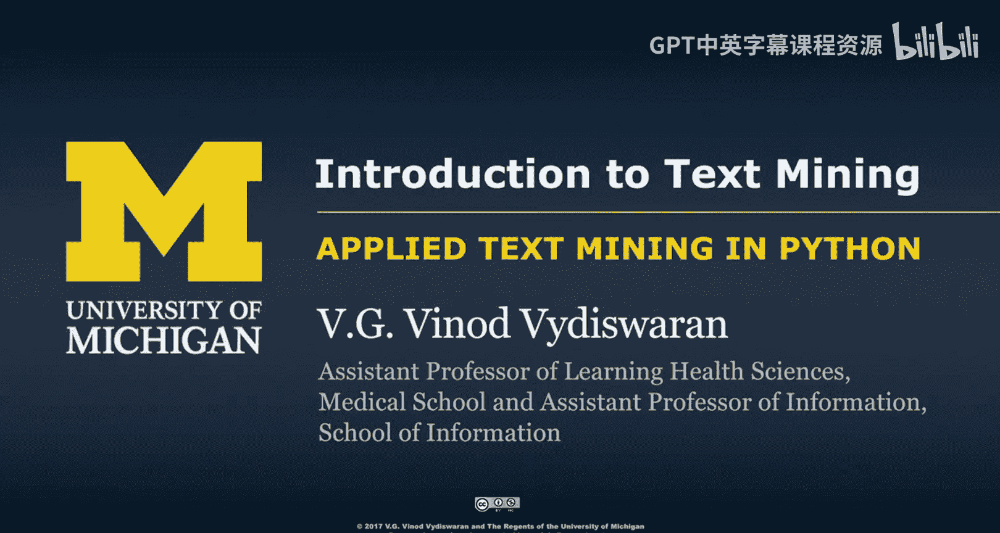
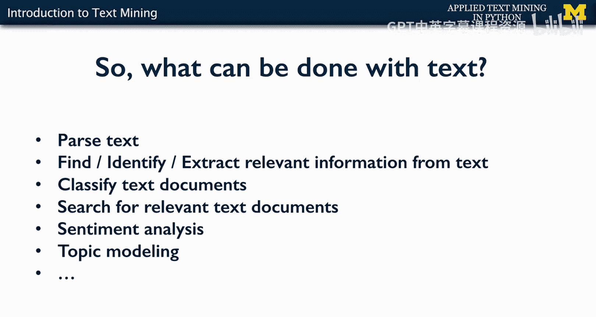

# Python数据科学应用：第4-5课：文本挖掘导论

## 概述

在本节课中，我们将要学习文本挖掘的基础知识。文本数据无处不在，从书籍、报纸到社交媒体，其数量正以惊人的速度增长。我们将探讨文本数据的特点、其蕴含的丰富信息，以及文本挖掘可以解决哪些实际问题。

## 文本数据无处不在

文本存在于我们生活的方方面面。你可以在书籍和印刷材料中看到它们，例如报纸。维基百科和其他百科全书也由文本构成。人们在在线论坛和讨论组中相互交流，这些也是文本。Facebook和Twitter上的内容大部分也是文本。

## 文本数据的爆炸式增长

这些文本数据正在飞速增长。它呈指数级增长，并且持续增长。据估计，每天产生的文本数据约为2.5艾字节，即250万太字节。根据最近的估计，到2020年，这一数字将增长到约40泽字节，即400亿太字节，这大约是10年前的50倍。

## 非结构化文本的主导地位

大约80%的数据被估计为非结构化的自由文本。这包括维基百科中超过4000万篇文章，其中超过500万篇是英文文章。实际上，仅英文文章就有500万篇。此外，还有45亿个网页，每天约5亿条推文（每年约2000亿条），以及谷歌每年超过1.5万亿次的搜索查询。

## 文本中蕴含的信息

当我们审视数据，观察隐藏在文本中的信息时，你会发现它揭示了大量内容。例如，这是联合国发言人的推特个人资料。这里有作者信息、个人描述、所在地点。推文本身，即实际内容，包含了主题和每条推文的情感倾向。对于每条推文，都有其发送时间戳。还有其受欢迎程度，即被转发或点赞的次数。总的来说，这也能让你了解其社交网络状况，例如有多少人关注这个账号，以及这个联合国发言人账号关注了多少其他账号。

## 文本挖掘能做什么

那么，如何处理所有这些文本呢？你可以解析文本，尝试理解其含义，从中查找并提取相关信息。你甚至可以定义什么是相关信息。你需要对文本文档进行分类。你需要搜索相关的文本文档，这属于信息检索领域。你还需要进行某种情感分析，判断内容是积极的还是消极的，是快乐的、悲伤的还是愤怒的，这些都是与特定文本片段相关的情感。此外，你还可以进行主题建模，识别正在讨论的主题是什么，以及文档中讨论了几个主题等。

## 课程预告

在接下来的几个模块中，我们将逐一讨论这些内容，并看看如何使用Python进行文本挖掘。

## 总结

本节课中，我们一起学习了文本数据的重要性及其海量规模。我们了解到，大部分数据是非结构化的文本，其中蕴含着主题、情感、网络关系等多维度信息。文本挖掘技术，如信息提取、分类、检索、情感分析和主题建模，是解锁这些信息价值的关键。在后续课程中，我们将深入探索如何使用Python工具来实现这些功能。