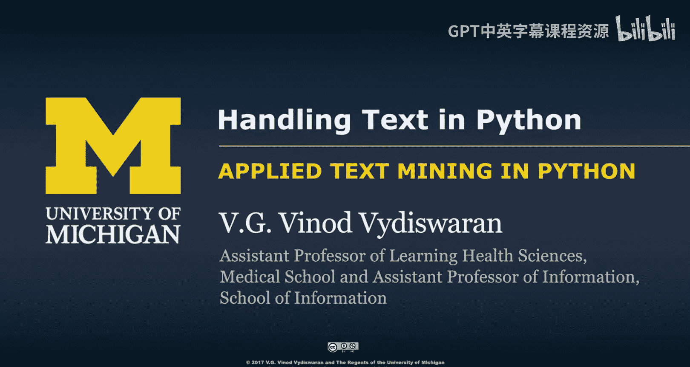
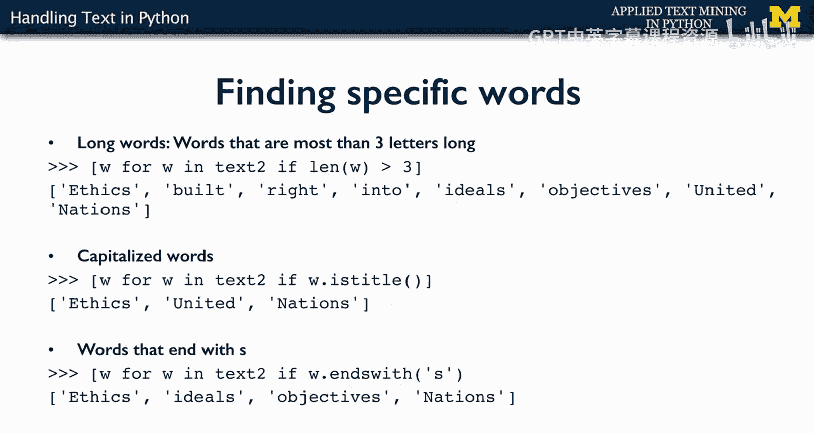
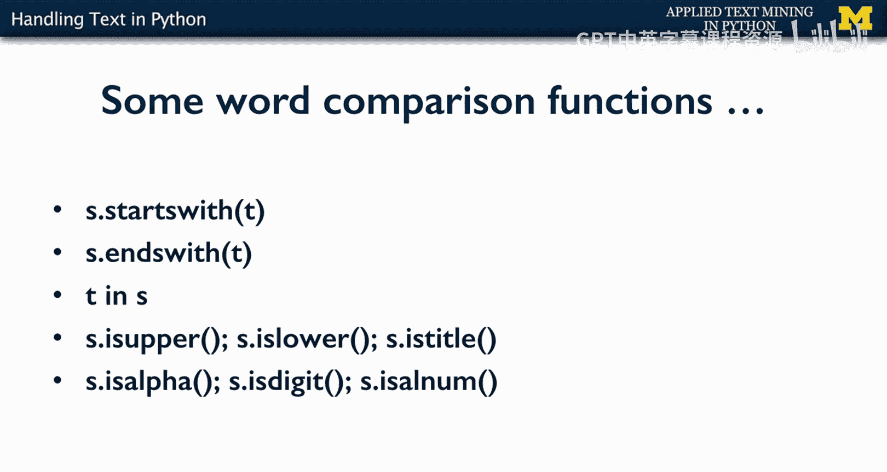
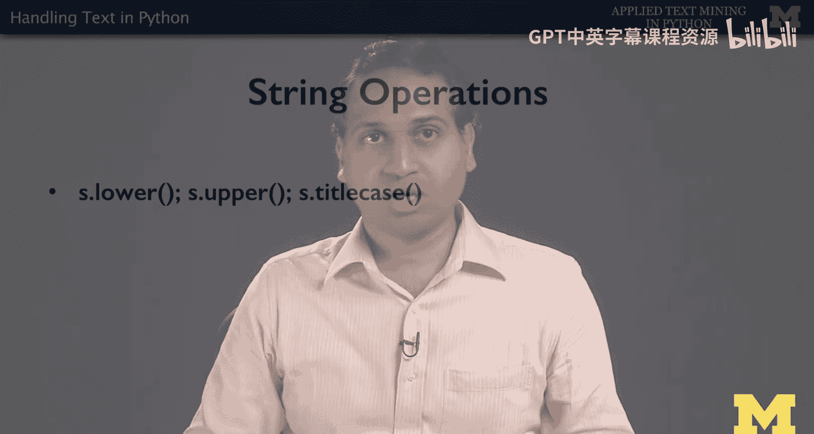
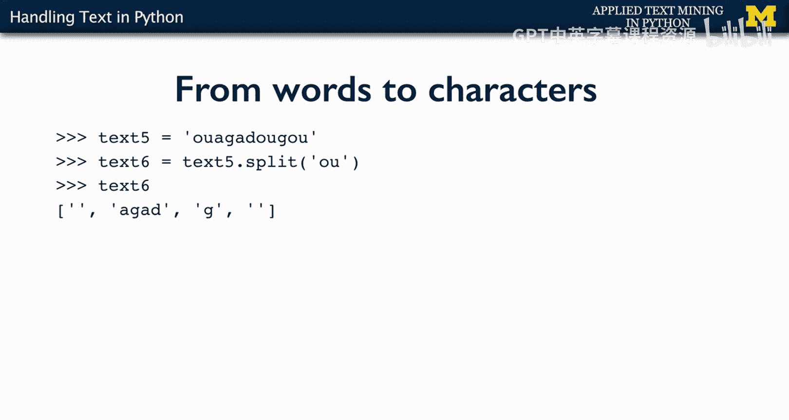
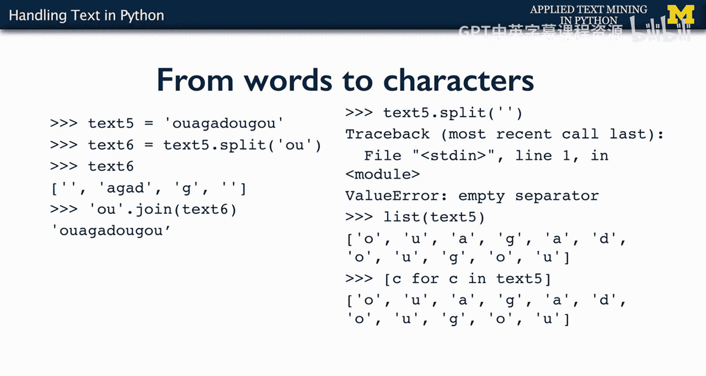
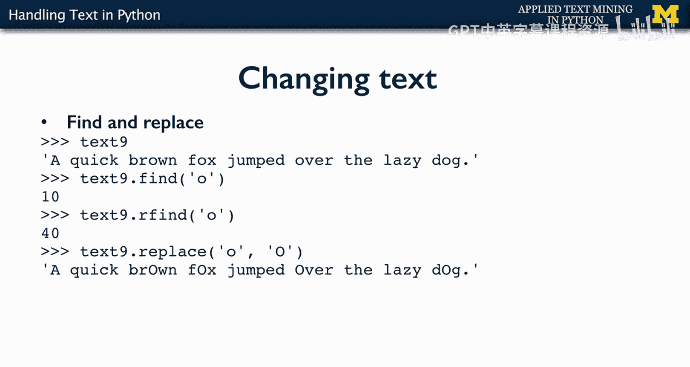
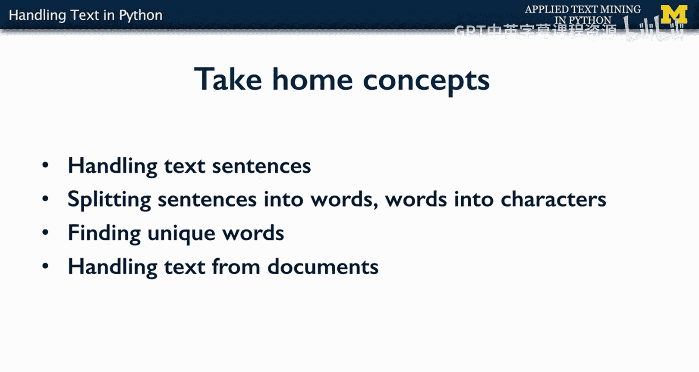

# 密歇根大学《Python用于数据科学实践（4-5课）｜Applied Data Science with Python 》中英deepseek翻译 p02 1_Python文本处理.zh_en -BV1DTtueTEwf_p2-

In this video， we are going to talk about handling text in Python。

Let's first start looking at primitive constructs in text。You have sentences or strings。

And they are formed out of words or tokens。And words are formed out of characters。On the other side。

 you have documents and larger files， and we are talking about all these constructs and their properties。

So， let's try it out。Let's pull out a sentence from the UN spokesperson's tutor profile and say that is text 1。

 so text 1 here is ethics are built right into the ideals and objectives of the United Nations。

If you find out the length of text 1， it will tell you how many characters are there in this string。

 that's 76。What if you want to know the words。So you have to split this text。On space。

 let's say that is our primitive tokenization。So you split this sentence on space to find out words or tokens。

And the length of that is 13。 There are 13 tokens in this sentence。And what are those。

 their ethics are built right into and so on。So these all look very good。 They all are valid words。

 so this is great。 looks like this splitting works。😊，Now， if you are to find specific words。

 for example， long words that are more than three characters long。

You would say W for W in text 2 where or if the length of W is greater than 3。

And that will give you all these words that are more than three characters long in this text too。

Ethics built right into and so on。What if you want to find out capitalist words。

Capitalize words are those that start with a capital letter， A to z。

But you could use something like is title because is title is a function that checks whether the first character is capitalized and the others are small。

 So W for W in text 2， if W dot is title。We tell you that W do is title is true for words like ethics。

 United and Nations， and its false otherwise。What if you want to find out words that end with S。

You can say W for W in text 2 if w dot ends with S。It'll give you ethics， ideals， objectives。

 nations。

Great。😊，So now we have found out how to find individual words。Now let's look at finding unique words。

 and we are to use set function for that。Let's take another example， text 3。

 that is this famous phrase to be or not to be。

If you split it in space， you're going to get six words。To be or not to be 6 of them。Now。

 if you use set function， it's going to find out all the unique words in this list。

So when you say set of text 4， it' going to find out unique words that will be 2 B or not。

 right so we expect 4， but we get answer of 5， what happened？If you look at the set text4。

 you'll see that you do have to be or not， but you have two occurring twice。

 one with the capital T and other with the small t。

That's a problem because you don't want to have these two variants just because one was the first word and was capitalized。

So to fix that we should lowercase the text， so we say w dot lower for w in text 4 and then find set of that and the length of that and that will give you4。

 so if you print the entire set it is indeed to be or not in some order。Great。

 now let's look in more detail on some of the word comparison functions。We have starts with。

We have ends width， as we solve with ends width S。We can also use a function called T in S to find out substrs if a particular substr is in a larger string。

And then， you have these。Functions that check whether a particular string is capitalized。

 So is upper。Is all small case， lower case is lower or title case where the first one is capitalized and the others are small using S dot is title。

The same way you can check for other patterns， you can check for is alpha。

 which is whether a particular string is alpha numeric。Is digit。

If it is actually is alpha is if this thing is just made of alphabets。

Is digit if the string is just made of digits 0 to 9。

 and is al nu is if the string is made of alphabets or numerals or digits。 So that's Al is al nu。

Once we have done this checking operations， you can look at more on the string operations。

We have already seen as dot lower where it takes in a string S and gives out the lower case version of that string。

We could use S dot upper to make the inest string uppercase or title case to make it title case。

You can split a sentence， S。On a smaller string T。 So if you split something on space， let's say。

 then T becomes that space，1 character。 And we have seen that that will give out words。

From a sentence。Same way you could use split lines。

 So S dot split lines is going to split a sentence on the new line character or end of line character back slash n。

In some cases。As do join is the opposite of。😡，splitlitting。

 so you have S dot join on T would say that you take the words represented by an array or a set in T and join it using a string That is S。

You can also do some cleaning operations on string as dot stripip is going to take out all the white space characters。

 which means spaces and tabs from the front of the string。

And R strip is something that will take out these spaces and white space characters and tabs and so on from the end of string。

Let's take an example， in fact， as Do Strip is going to take out these white characters from the front and the back。

S dot find is going to find a particular substring。T in S。From the front。

 while s dot R find is going to find the string T from S from the end of the string。Finally。

 S dot replace。It takes two parameters U and V。Where every occurrence of U。

 a smaller string in S is going to be replaced by V。Another small string。

So let's take these example and see how it works。 So first look at words to characters。

Text 5 is avogaougo for those who know this is the capital city of Burkina Faso。

And I like this word in general， because of this repetitions of characters。

So you split that sentence or word in this case， text 5。on Ou。What do you expect to see。

Well see that in text 5， when you split it with O U， you're going to get。😊，4。Groups。

 the first is an empty string because the string textify starts with OU。

 So there is nothing before that。 That's what that empty means。

 And then between the first occurrence of O U and the second occurrence of OU。 You have A G A D。

 That's the second element in this set。 And then you have G and the the third。And then finally。

 O U is the last set。 last set of characters in a workdo go。 So there is nothing after。

 So that fourth one is also empty。 So when you have a particular string。

 O U occurring three times in text in this case， text 5。😊。

When you split it， you're going to get four parts。Before the first， between the first and the second。

 between the second and the third and after the third。😊，So that's why you have this four。

And now， if you join。Text 6， that is this this array of four elements using this string O U。

 you're going to get back a vgaougo。 That's where we started to split and join arch opposites of each other。

Now， suppose we want to find characters， all the characters in a word。

We would imagine that we have to split on something， so let's split on empty。

 so text5 do split on an empty string should give you all the characters。But actually。

 what they get is an error。It says that it is's an empty separator。 So it doesn't work。

 So what should we do。The way to do that is to find list of text 5。So when you have text P。

 which is a string， list of text P gives you all the characters。

And then you could also the other way to do that would be for C in text 5。

So you that will also give you this string with sorry the array with individual characters。

 So there are two ways really to get characters out of words。

 one would be to use list function and the other is to say C for C in text 5。

Now， let's take some examples of cleaning text。So we take an example text8， that is a string。

 a quick bound fox jumped over the lazy dog。😊，But it has some white space characters before and after。

When you split on space， because there are white space characters before and after you are going to get these empty strings at the start or a tab at the start and so on。

 because there are indeed。Multiple spaces and tabs up in front and there's also a space at the end。

 so you have this empty string at the end。This is not how we want to get all the words when you have just stray spaces around some text。

So what we will do is we say text a dot strip note that strip strips out widespread characters both from the start and the end。

 so then if you split on space you are going to get the sentence as it is。

And you basically get the words right， a quick brown fox and so on。

What if you want to change the text like finding and replacing。 So remember， text 9 was this。

 A quick brown fox jumped over the lazy dog。 And let's say we want to find。The character O。

So in this string， when you say find do text 9 dot find0 is going to give you the offset。

 the character offset of where it found the first0。

 so in fact that was a character 10 because a is character 1 and then space is character 2 and so on。

 in fact a would be character 0。Because its zero bond of 0，1， and then quick becomes 2，3，4，5，6。

 then the space at 7， and 8，9 and 10， so brown， the O in middle of brown would be character number 10。

The same way you could do R find that's reverse find。

 and that will give you the character of 40 because if you start from the first A as0 and go to the O in dog。

 that's character number 40。Finally， you can replace and let's replace the small O with a capital O。

 and that will give you the same sentence a quick brown fox jumped over the lazy dog。

 but every occurrence of O that's four of them has been replaced by capital O。

So this demonstrates how you can use find and R find and replace to change text。

What about handling larger texts？Larger texts are typically going to be in files。

 so you are going to read the files and you're to read them， let's say line by line。😊。

And in this case， let's take an example of a file that I have called UNhdR dot textext。

 this is the United Nations Declaration of Human Rights。😊，I say that you had to open it using。

F open UNDHR dot text and have open it in Read mode。So that is R。

Once you have that and you say F dot read line is going to read the first line and that is in a universal Declaration of human rights with the backslash end to indicate that is the end of the line。

If you are the reading the full file， you can either do it in a loops， read the line one by one。

And because we have already opened it and I want to go reset the reading pointer。

 let's say to the start of the file， I'm going to say f dot seek0 so that resets the reading and then I could just use F dot read and F dot read is going to read this entire file and give it back as text 12。

SoThen if you look at length of text2， it has read the entire file so there are 10。

891 characters there that would be your length， so it's not just one sentence。

 one line out of this file。And then you can split lines on text 12 to basically give you 158 sentences。

In fact， they are not sentences， I should say that they are lines that are delimited by a back slash n。

 so new line character， so for all purposes here when you say line。

 you mean something that ends with a back slash n， so there are 158 such lines。

The first line is University Declaration of Human Rights。

You will notice that when you do split lines and read the line that way。

 the backslash n goes missing because you split it on backlash n。

 so when you split on a particular character that character is not included in the result whereas the f dot read line up at the top was reading the line one line line so it has this backslash n at the end。

In general， these are the file operations that you would want to use。

You have open it has a final name and a mode， so read mode would have an R。

 write mode would have a W and so on。You can read the line using F dot read line or F dot read。

Or have not read with N that will read N characters。rather than the entire file。

For you can use a loop， say for line and F， do something line。

You can say f dot c that will reset the reading pointer， let's say reading position。

 so f dot seek of0 will reset the reading position back to the start of the file。

F dot right would be how you would write a particular message into a file if you opened it in the appropriate mode in the right mode。

 it's say。And then once you have done all the operations， the counterpart of opening is closing。

 so F dot close will close that file handle。And you can check whether something is closed with a particular file hand isd by using F dot closed。

So when you read this， you notice that F dot red line gave you this backslash n at the end。

That is not necessarily something we want to keep。 So how would you take that out。

 how would you take that last new land character out。You could do our strip。Remember our strip。

Use to is used to remove white spaced characters and Bsl is one of them from the end of the string。

 so our strip would just remove that and give you universal declaration of human rights。

And this R strip works for Do new line characters that show up as back slash R or backlash R and back slash n and so on。

 so it is universally the function that you would want to use rather than saying find back slash n because that may not be the character in the kind of encoding you have。

So the take home messages here is we looked at how to handle text sentences。

We saw how to split a sentence into words and words into characters， we saw two ways to do that。

We've said and looked at how you could find unique words and look briefly into how to handle text from documents or from large files。

Next， we are going to go in more detail about how we could process the text to find out some interesting concepts from within the text。

