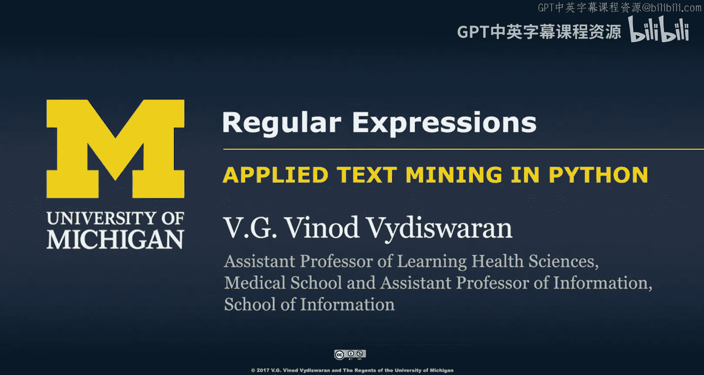
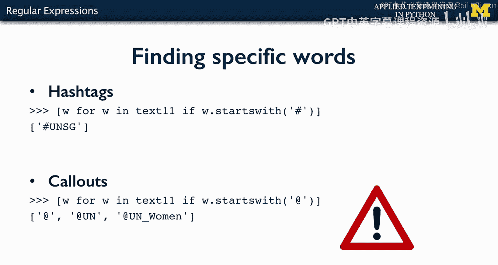
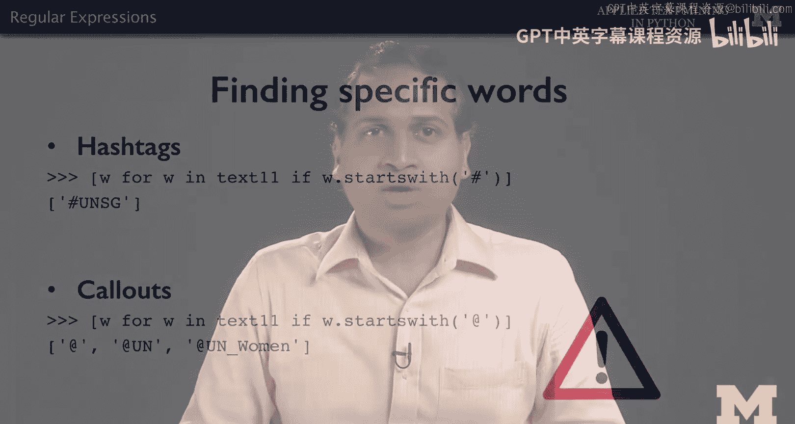
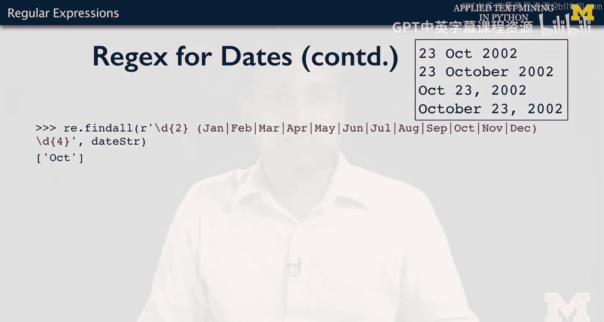
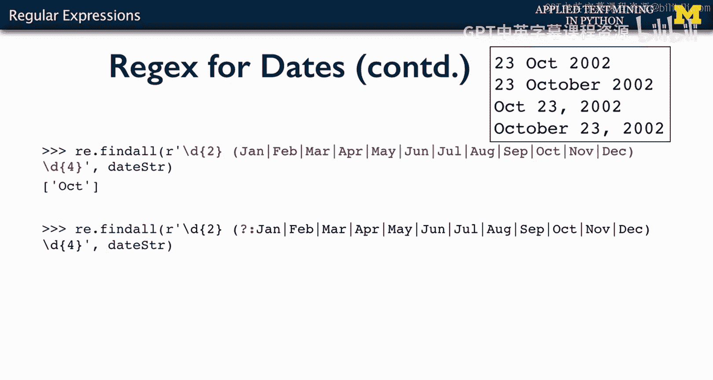
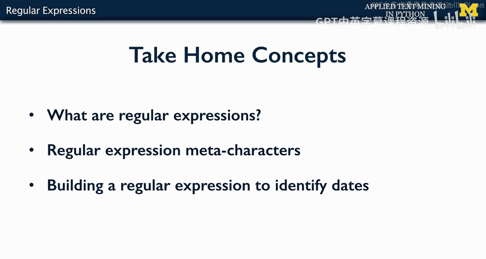

# 密歇根大学《Python用于数据科学实践（4-5课）｜Applied Data Science with Python 》中英deepseek翻译 p03 2_正则表达式应用.zh_en -BV1DTtueTEwf_p3-

In this video， we are going to talk about regular expressions。 So when you're processing free text。

 we come across a lot of places where regular expressions or patterns play a role。

So let's take an example。This is one of the tweets from the UN spokesperson's account and this is ethics are built right into the ideals and objectives of the United Nations you have seen this earlier today and then you have hashtag UNSG and there is another little piece of text like at New York Society for ethical culture。

 there is a URLl there and then two callouts to at UN and at UN Women。Okay， so from this tweet。

 if you are to find out all callouts and hashtags。How would you do it First， of course。

 you have to split it on space to get these individual tokens。 So you have that。 Okay。

 so now you know that you have all of these individual tokens。

 and now this is in a better position to find out where callouts are or hashtags are。

Why don't you give it a try？So when you're finding out specific words such as callouts or hashtags。

You may want to see what patterns these hold。 So for example。

 hashtags start with the hash symbol or the pound sign right So you have you can use something like this。

 you can say w for W in text 11 if w starts with the hash symbol。Okay， great。 you get hashtag UNSG。

 That's exactly what you want， great。What about comeouts？Same way as hashtags。

 you can say callouts are strings that start with the symbol at the rate。

The at symbol right so you can say w for W and text 11 if W starts with at。

And you get the response as at you and at you and women。 But there is also this at separately。

 recall that there was this at New York Society。 and that would that at as a separate token comes in。

 That's not really a call out。

So this doesn't really work。 So now what should we do。

It's not sufficient to say that something starts with an at。

 the callouts are tokens that begin with at。

They have to follow that up with something。 So for example。

 these are valid callouts at UN spokesperson or at Katy Perry or at Coursera。

So what you can see is there is something that has to match after at。

 like alphabets or numbers or special symbols like the underscore。

So what you're saying is the pattern is at and then capital letters or small letters and numbers and underscore occurring one or more times。

That is the pattern that defines callouts。So let's try this one out。So you have the text in text 10。

And then you can split it on space。And then you do just check for the first character to be at。

 so when you say text for all words in text 11 that start with at。

 you get at and at U and and at U in women。But if you first use a regular expression and import R。

 that is the input a regular expression package and say all words where words in text 11。

 if R dot search， that means if you can search and find this pattern at then8 to z8 to z0 to and underscore occurring one or more times in the word then。

That is a valid doken， and that would give you the two callouts from that tweet。Okay。

So let's look at this color re more detail。 we set at。

 and then we had this square bracket that at A to C。A to z0 to an underscore。

 And then after the square bracket， we had a plus。 What does that mean。

 So it says that you have to start with an a。 And then it has to follow one or more times。

 That's what that plus means。One or more times。That's at least once。

 but maybe more of something that is in between the square brackets。

 and that the one that was in between the square brackets is any alphabet。

 uppercase or lowercase or a digit or underscore or any special symbol that is allowed in a call out expression。

 So in this regular expression， you saw that we used some。😊。

Notation and nomenclature and meta characters that you already defined now。So in regular expressions。

 a dot is a wild card character that matches a single character。Any character， but just once。

When you use the carrot symbol， that indicates the start of a string。

 so even though not all strings start explicitly with the carrot sign。

The scart matches an empty character。At the start of the string。

The counterpart of that is dollar symbol that represents the end of the string。

So if your string has a backslash n， the dollar comes after the backslash n。

 so there's a back slash n and a dollar dollar is truly the end of this string。

 the way it was represented。The square brackets match one of the characters that are within the square bracket。

You have A to Z。For example， within square bracket that will match one of the range of characters A B up to z。

There are some changes there when you have square brackets， but carrot ABC。

It means something different。 It means it matches a character that is not A or B or C。

 So it is again the inverse of it。 So when I said that。

Opening bracket and closing square bracket indicates that it matches any of the characters within it。

 this particular expression with a character at the start doesn't mean that it matches a character an A or B or a C。

 but it says explicitly that it is it matches any other character， but A B or C。

A or B would match either A or B where A and B are themselves strings。

You can use this normal braces to say scoping for operators。

You use this back slash as an escape character， especially for special characters like max slash T and max slash n。

And you could use special character symbols， just like back slash T is for tab。

 you have backslash B to match a word boundary。You have back slash D to match any digit。

 any single digit0 to 9。 that's any equivalent to square bracket0 to 9。

A back slash capital D is any non digit， anything that is not0 to9。

 So that's the equivalent representation there， square brackets not0 to 9。

Backslash S is any white space character that is matches a space or a tab or a new line or back slash R or back slash F and backslash V。

😊，Capital S， so backslash capital S matches any non white space character。

 just the way D and capital D are opposites of each other。

 S and capital S are opposites of each other。Same way you have W。

 backslash W matches any alpha numeric character， whereas backslash capital W matches any non alpha numeric character。

Then we look at repetitions。When you have star that says that anything that occurs before that matches zero or more times。

 so it may not happen at all， or it can happen multiple times。T th th or so。If it's plus。

 it has to happen once， at least once， but it can happen more than once two。If it's a question mark。

 it means that it has to match once or does not match at all， so it matches zero times or once。

And now you have this curly braces。 So when curly braces and n。

 it means it matches exactly n times where n is more than 0。 So if you have curly braces 3。

 it means that this has to match thrice and only thrice。If it's n comma。

 it means it is at least n times， and if it's comma n it means it is at most n times。

If its a combination of both of them is m comma n， it means that it has to match at least m times and at most n times。

So let's look back at the color expression。When we use the colored expression using this R dot search。

 we do get at U and at U women。But then， if you say。For for W， when our research is。

You know that backslash W actually matches a to z a2 z0 to an underscore score。

That would also give you the same answer。To any alpha numeric and symbol character。

Let's look at some more examples。If you are to find some special characters， for example。

 if you have the text avagadago， again， the capital city of Burkina Faso。

 and you are to find all vows。😊，You will say R dot find all。

And the regular expression is in square brackets， A E。 I O U。 and that will give you all the。

Vs that are there。Same way if you are to find out everything that is not however， that's a consonant。

 Then you could use the carrot AeIOU option， and that will give you G， D and G。

 These are the only three consonants in our Odo go。Okay。

 so now let's take a look at a special case to find regular expressions for dates。😊。

Dates are unique in the sense that they have multiple variants in free text。

Let's take a date on the top of my head， let's say 23rd， October 2002。

 and look at different variants of how you could write this date。You could write as date。

 month and a year。Either with the hyphen or the slash。With two digits for the year rather than four。

If you are in the US， then you would use month。Date year format。

You might use words for October rather than the number 10。

 so 23oct 2002 or 23 October and again change the order where you have month first before date。

So you can see that there are so many variants and suppose you have to write a regular expression to match it and write something like this where you have two digits with a slash or a dash。

 two digits， a slash or a dash， and then four digits， that are just going to match some of them。😊。

So suppose you have all of these variants and you use just the first four。

 you could use this regular expression of two digits followed by slashing a dash。Two digits。

 slash in or dashash and then4， and then that will give you three of them because it doesn't match the one that said yours could be two digits。

So then you have to fix that so you say it could years could be two digits or four digits。

 and then it will match all four。😊，And then you could say the dates it so happens in this case is October it's 10。

 what about September and it being9？You have to kind of address that as well。 or third of October。

 That will be just one single digit for that。 So in general。

 you'll have to have one or two characters。 Sorry， digits for the date，1 or2。

Digits for the month and two or four digits for the year。 that'll give you all of them here。

 but that is more general than what we had earlier。Okay。

 now let's look at the other variant where you have October written out， spelleled out。Then。

 then you have to say that you have to have two digits at a start， a space。 and then Jann， Feb。

 March， April， as in J and FEB， and so on。 one of them occurring。 So you use this。

Pippe symbol to indicate。Disjunctions between them and then you have four digits at the end of the year。

That will match just October， what happened， shouldnn't it match the whole thing？

It did match the hole with the date and so on。Well， the difference here is that this bracket sign。

Has two meanings in regular res when you use the bracket， it also indicates scoping。 So it says。

 I want to pull out only something that matched that part。 So it does match the whole string。

 but it pulls out and gives you back only the thing that matched there between Jann Feb Marchsh up December。

 That's where it gave you October as O C T。😊。

So for you to find and give the entire string you say this is a scoping operator。

 but don't pull out just what you've matched here and you'll use this question mark colon special character sequence to indicate that。

😊，So when you use that， you'd get the entire string 23 October 2002。

Great， why didn't others match。Well， because the other the next string was October spelt out completely。

 we didn't have that and the other two had a comma there and we didn't have that。

 so you to somehow say that we are going to use the same string。

 but then we can extendoct to October by saying it starts with these three characters。

 but then it could have a to z multiple times。

Why not a plus there because May is there with just May there's nothing up for that follows May。

 so you'll have that will kind of match both of them 23oct 2002 and 23 October 2002。And then finally。

 we have the two remaining。😊，Cases where you' say that。

I don't necessarily have to have data at the start。 I might have data at the end。

 so the first occurrence of date is you have a question mark after that。

And then you add a date option at the end and then a year after that。

 So you have a question mark colon back slash D to comma cockckering both at the start and at the end before you have the year backlash D4 written there。

That will match all four， so you see that when you are building these E expressions you have to keep working on them to finally get the pattern that you really want。

And note that all of these did not handle this thirdrd October case or 23rd of September case。

 so you have to do all of that with one or two digits for the date and the month。

So that has to change and in fact， you may also want to do a backsledlash G2 comma 4 for the year if that is a pattern that you want to fix。

Great， so what did we learn we in this video we learned about regularal expressions。

 we saw what they are， why they are useful， what are the re meta charactersact and how do you build a regular to identify dates but in general to identify any particular pattern string that you want to identify。

😊。

In next videos， we are going to see more information about how do you handle other variants of text that youll see。

