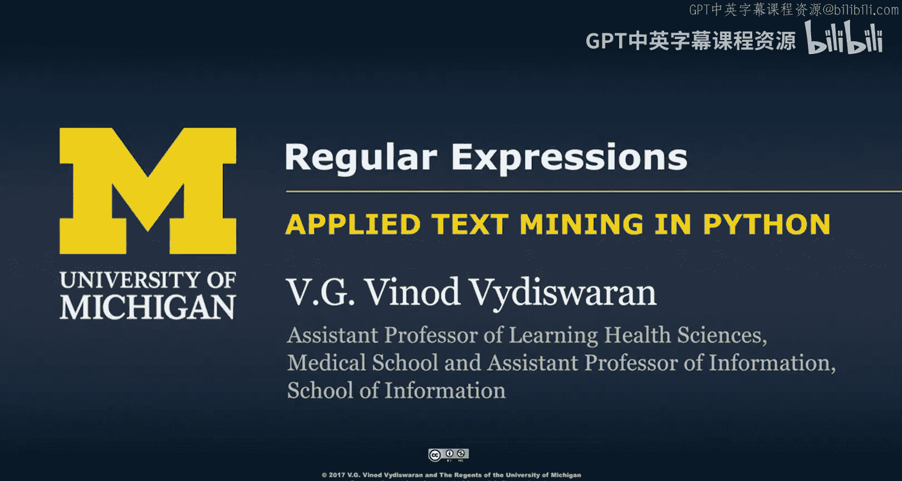
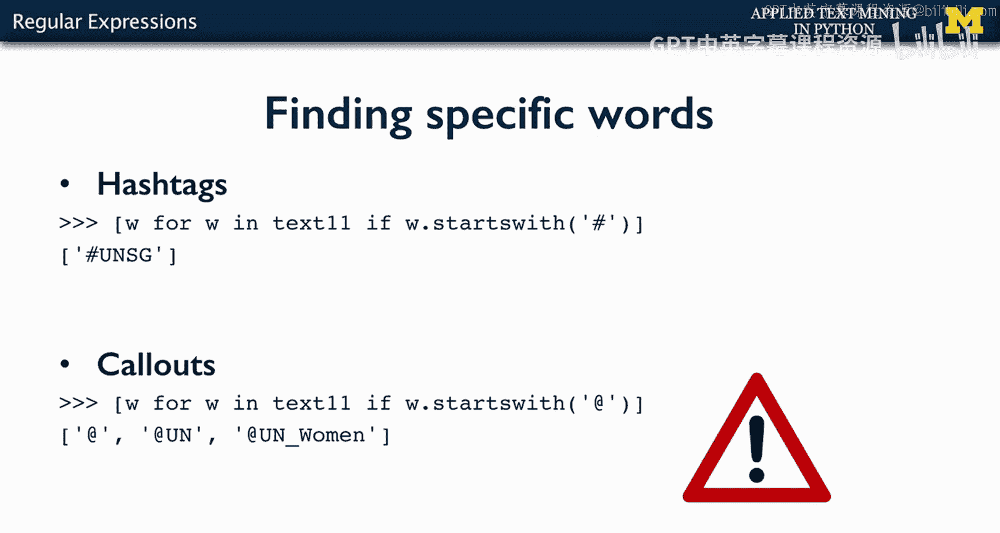
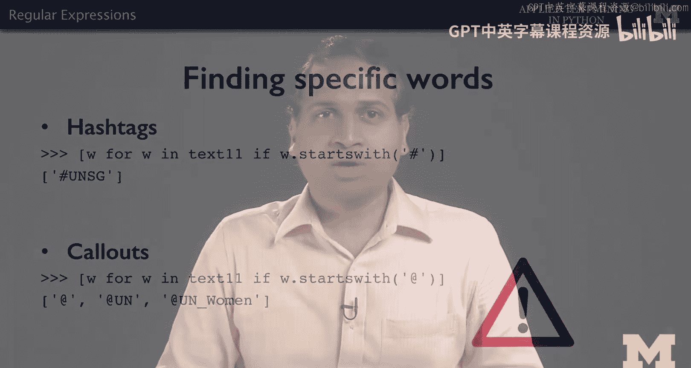
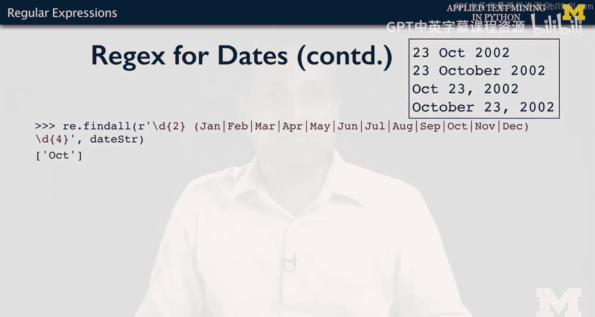
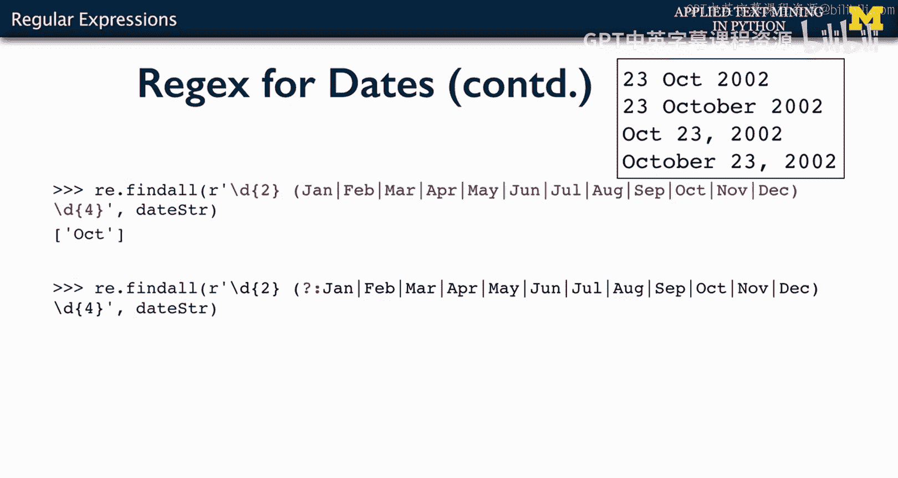
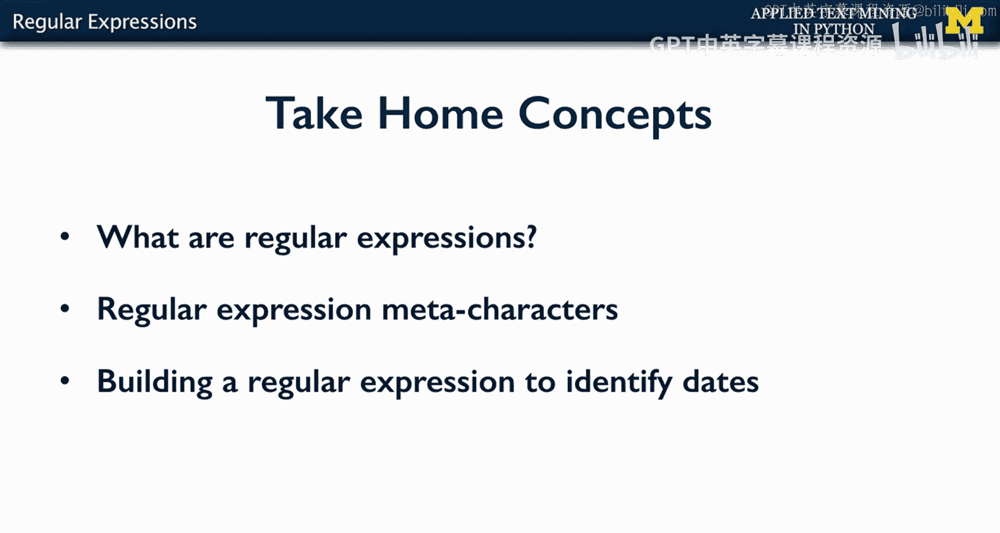

# Python用于数据科学实践：P03：正则表达式应用





在本节课中，我们将要学习正则表达式。在处理自由文本时，我们经常会遇到需要使用正则表达式或模式匹配的场景。

## 为什么需要正则表达式？🤔

让我们来看一个例子。这是一条来自联合国发言人账户的推文：
> Ethics are built right into the ideals and objectives of the United Nations you have seen this earlier today and then you have hashtag #UNSG and there is another little piece of text like at New York Society for ethical culture, there is a URL there and then two callouts to @UN and @UN_Women.





从这条推文中，如果我们想找出所有的提及（@）和话题标签（#），该如何操作？首先，当然需要按空格分割文本，得到独立的词元。完成这一步后，我们就处于一个更有利的位置来识别提及和话题标签了。


你可以尝试一下。当寻找特定词汇如提及或话题标签时，你可能需要观察它们遵循的模式。例如，话题标签以井号（#）开头。你可以使用类似这样的代码：
```python
[w for w in text.split() if w.startswith('#')]
```
很好，你得到了 `#UNSG`，这正是我们想要的。

那么提及呢？同理，提及是以“@”符号开头的字符串。所以你可以写：
```python
[w for w in text.split() if w.startswith('@')]
```
你会得到 `@UN` 和 `@UN_Women`。但请注意，文本中还有一个单独的“at”单词（来自“at New York Society”），它也被分割成了一个独立的词元“at”。这并非一个真正的提及。

## 构建更精确的模式 🎯

仅仅以“@”开头并不足以定义一个有效的提及。有效的提及（如 `@UN_Spokesperson`、`@katyperry` 或 `@Coursera`）在“@”符号后必须跟随一些内容。

观察这些例子，你会发现“@”后面需要匹配字母、数字或特殊符号（如下划线）。因此，模式是：以“@”开头，后跟一个或多个大写字母、小写字母、数字或下划线。

让我们用正则表达式来尝试。首先导入 `re` 模块，然后使用 `re.search` 来搜索符合该模式的词元：
```python
import re
pattern = r'@[A-Za-z0-9_]+'
callouts = [w for w in text.split() if re.search(pattern, w)]
```
这样，你就能从推文中正确提取出两个提及。

## 正则表达式元字符详解 📖

在上面的正则表达式 `@[A-Za-z0-9_]+` 中，我们使用了一些特殊符号（元字符）：
*   `[A-Za-z0-9_]`：方括号表示匹配其中任意一个字符。这里匹配任意字母（大小写）、数字或下划线。
*   `+`：加号表示前面的元素（即方括号内的字符集）必须出现**一次或多次**。

正则表达式拥有丰富的元字符来表达复杂的模式。以下是核心概念的总结：

**基本匹配**
*   `.`：通配符，匹配**任意单个**字符（除换行符）。
*   `^`：匹配字符串的**开始**。
*   `$`：匹配字符串的**结束**。

**字符集**
*   `[abc]`：匹配方括号内的**任意一个**字符（a、b 或 c）。
*   `[a-z]`：匹配指定范围内的**任意一个**字符。
*   `[^abc]`：匹配**不在**方括号内的任意一个字符（非 a、b、c）。
*   `(a|b)`：匹配 a **或** b（a 和 b 本身可以是字符串）。

**特殊序列**
*   `\`：转义字符，用于匹配特殊字符本身，如 `\.` 匹配句点。
*   `\t`, `\n`：匹配制表符、换行符。
*   `\b`：匹配单词边界。
*   `\d`：匹配**任意数字**，等价于 `[0-9]`。
*   `\D`：匹配**任意非数字**，等价于 `[^0-9]`。
*   `\s`：匹配**任意空白字符**（空格、制表符、换行符等）。
*   `\S`：匹配**任意非空白字符**。
*   `\w`：匹配**任意字母数字字符**，等价于 `[A-Za-z0-9_]`。
*   `\W`：匹配**任意非字母数字字符**。

**重复匹配**
*   `*`：匹配前面的元素**零次或多次**。
*   `+`：匹配前面的元素**一次或多次**（至少一次）。
*   `?`：匹配前面的元素**零次或一次**（可选）。
*   `{n}`：匹配前面的元素**恰好 n 次**。
*   `{n,}`：匹配前面的元素**至少 n 次**。
*   `{n,m}`：匹配前面的元素**至少 n 次，至多 m 次**。

## 正则表达式实践：查找元音 🔍

让我们看更多例子。假设我们要在单词“Ouagadougou”（布基纳法索首都）中查找所有元音。
```python
re.findall(r'[AEIOUaeiou]', 'Ouagadougou')
```
这将返回所有元音字母 `['O', 'u', 'a', 'a', 'o', 'u', 'o', 'u']`。

如果想找辅音（非元音），可以使用：
```python
re.findall(r'[^AEIOUaeiou]', 'Ouagadougou')
```
这将返回 `['g', 'd', 'g']`。

## 挑战：匹配多种日期格式 📅

日期在自由文本中有多种变体，是练习正则表达式的绝佳案例。以“2002年10月23日”为例，它可能有以下写法：
*   23-10-2002
*   23/10/02
*   10/23/2002
*   23 October 2002

如果我们想写一个正则表达式来匹配它们，可能会从简单的模式开始：`\d{2}[/-]\d{2}[/-]\d{2,4}`。这个模式可以匹配前三种格式（两位数的日、月，以及两位或四位的年）。




但要匹配“23 October 2002”这种月份为英文的情况，模式需要更复杂：
```python
pattern = r'\d{2} (Jan|Feb|Mar|Apr|May|Jun|Jul|Aug|Sep|Oct|Nov|Dec)[a-z]* \d{4}'
```
这里，`(Jan|Feb|...|Dec)` 使用管道符 `|` 表示“或”，匹配月份的缩写。`[a-z]*` 匹配月份缩写后可能跟的小写字母（如“October”中的“ober”）。



**注意**：默认情况下，圆括号 `()` 不仅有分组作用，还会**捕获**匹配到的内容。如果我们只想分组而不捕获，可以使用 `(?:...)` 语法。例如，`(?:\d{2} )?(Jan|Feb|...|Dec)[a-z]* (?:\d{2,4})` 可以更灵活地处理日期和年份可能缺失或格式不同的情况。


构建一个能覆盖所有可能日期变体的正则表达式是一个迭代过程。你需要不断测试和调整模式，以处理像“23rd October”中的“rd”序数词、月份的单/双位数、年份的两位/四位数等各种边界情况。

## 总结 📝

本节课中，我们一起学习了正则表达式。我们了解了它们是什么、为何有用，并详细介绍了核心的元字符及其含义。通过从推文中提取提及和话题标签、查找元音辅音，以及尝试匹配多种日期格式的实践，我们掌握了如何构建正则表达式来识别文本中任何你想要的特定模式字符串。



在接下来的视频中，我们将学习如何处理其他类型的文本变体。