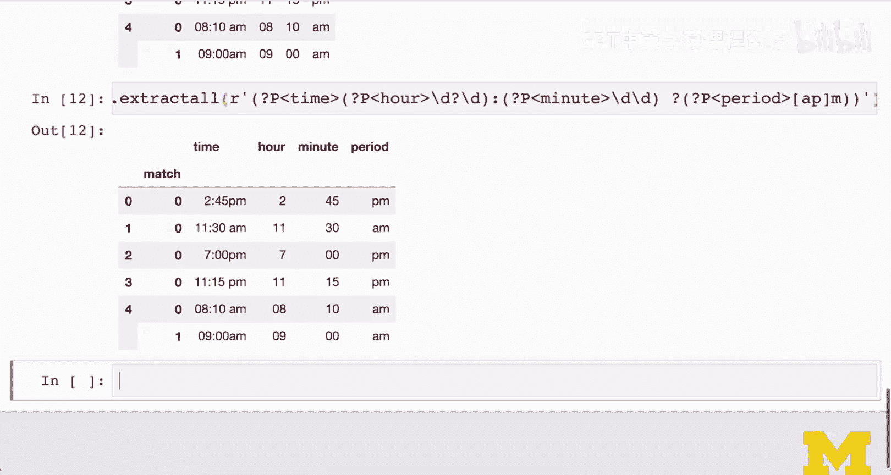

# 密歇根大学《Python用于数据科学实践（4-5课）｜Applied Data Science with Python 》中英deepseek翻译 p04 3_演示：带命名组的Pandas正则表达式.zh_en -BV1DTtueTEwf_p4-

Hi， everyone。 Today we'll be looking at working with text data and pandas。First。

 let's take a look at our data frame。It currently only has the one column text。

 and each entry is a string containing a day of the week and a time。Using the STR attribute。

 we are able to access the set of string processing methods which make it easy to operate on each element in the series。

For example， applying STR L to the text column shows the number of characters for each string in the series。

Similarly， we could use STR split to split each string on white space。

 then use STR L to find the number of tokens for each element of the series。

To check if a string contains a pattern， we can use STR contains。

Here we can see which entries contain the word appointment。Using STR count。

 we can count occurrences of a pattern in each string of the series。

Here we are finding how many times the digit occurs in each string。

We can find out what these occurrences are using STR Find all。

We can also use regular expression capturing groups to group patterns of interest。

Suppose we wanted to pull out the hour and minutes from each string。

By capturing these different groups with parentheses， STR Findal is able to return the groups to us。

Next， let's take a look at how to use STR replace on our series。

Let's replace any instances of a weekday with three question marks。To do this。

 we pass in irregular expression that finds the words that end in day。

And we pass in the three question marks。Suppose you wanted to use STR replace to make a change that was based on the original。

This is possible using STR replace and Lambda expressions。

Let's take a look at an example where we want to take the weekday from each string。

And replace it with the three letter abbreviation。First。

 we' use the expression that finds the weekday for us。

And we can create a group by placing it in parentheses。Then for the replacement parameter。

 we can pass in a lambda expression。In this case， we use groups to get a tuple of the groups。

 index0 to get the first， and in this case， only group。

And slice the first three letters from the group。Looking at the results。

 we can see Monday has been replaced with MON Tuesday with TUE and so on。

The next method we're going to look at is STR extract。

 which allows us to quickly create new columns using the extracted groups。For example。

 if we use extract with the hour and minutes pattern from the find allll example。

 we get a data frame with two columns。One for the hours and one for the minutes。

Note that STR extract only extracts groups from the first match of the pattern。To get all matches。

 use STR extracttract all。Let's try an example with extractol that uses a more complex pattern with more groups。

We'll add a capturing group for AM or PMm following the hours and minutes。

And add parentheses to the entire regular expression to capture the whole pattern as another group。

Looking at the data frame returned， we have a multi index where the level match indicates the order of the match。

Here we can see there are two matches from the last entry of DF text。

The columns correspond to the capturing groups with the whole pattern returned in column 0。

 the hours in column 1， the minutes in column 2， and the period in column 3。

One last thing I'd like to show you is name groups in regular expressions。

We can name a group by adding question mark， uppercase P。

 and the name in angled brackets after the first parentheses of the group。

Extract all will then use the group names as the column names of the return data frame。

Here we've added the name time to the first group， hour to the second group。

 minute to the third group， and period to the fourth group。

Paands provides many additional methods for text data。

 so be sure to check the pandas working with text data documentation。

By using and combining these methods， you'll be able to do some very powerful text processing of your own with pandas。

Thanks for watching。 Hope to see you again next time。

