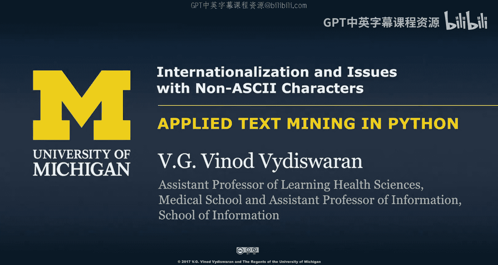
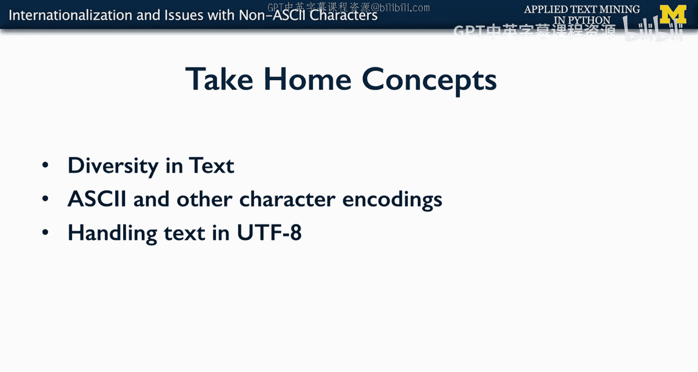

# 密歇根大学《Python用于数据科学实践（4-5课）｜Applied Data Science with Python 》中英deepseek翻译 p05 4_国际化与非ASCII字符处理.zh_en -BV1DTtueTEwf_p5-

In this video， we are going to talk about internationalization。😊。

The world is a mix of multiple languages。We talk about English almost all the time。

 but English is going more and more as a minority language in over the internet。

English is very well kind of encoded using ASI。 ASI stands for American Standard Code for information Interchange。

 and this was the encoding scheme that kind of captures all characters。😊，It has it's 7 bit long。

 so you have 128 valid characters， a valid codes that you could use and in hexaadeimal form it ranges from00 to 7 f so if you think about it it is it takes these seven bits out of 8 bits and uses this lower half of the8 bit encoding。

This model and this encoding scheme has been in use for quite some since the start of computing really。

It includes alphabets， both uppercase and lowercase， it has all 10 digits， all punctuations。

Our common symbols like brackets， for example， are percentage sign and the dollar symbol and the hash symbol。

It has some control characters， some characters to describe， let's say。

 end of the line or a tab or some other control characters that are needed to kind of see the paragraph ends。

 for example， is different from a line end。😊，And it has worked relatively well for English typewriting。

I say relatively because even in English， it doesn't really capture everything。😊。

Let's think about diaritic marks。Resum aim。 What is resume。TheIf you ignore the diritics。

 they are the same word。 They have the same six characters R E S U M E。

 but the E is different in resume。And that is not really encoded in the ASI scheme of things。

 and this is not the only one naive with I and anumla on top of it is another example of that。

So is cafe or something with an E dietary on E。It's fairly common in other languages though。

 And as we have seen that English is not necessarily the majority language anymore。

 you have to be more sensitive to those changes as well。 So for example， the names of cities。

 Quebec or Zurich。Or the names of organizations like the Federation International Football Association or FIA。

 which is the leading Football Association。😊，But then you have other languages that have completely different encoding scheme。

 completely different characters like Chinese or Hindi or Greek or Russian。

But then you have languages of music， and you have the musical symbols that are also relevant。

 especially if you are using the digital form to now create music。

And you heard to somehow encode the music symbols。And then， you have。The， the very famous emoticons。

 you have the smiley faces。 and in fact， now many， many more emoticons。

That are available and and all of these need to be encoded in some way。

 So what used to be enough for English。😊，Let's say barely enough for English is definitely not enough when you're including diretic marks and the。

Multtude of languages that are available。In fact， there are quite a few different written scripts that need encoding。

For example， Latin， which which is based for English， is 36% of data and about 2。6 billion people。

36% of people use Latin based languages and when I say Latin based languages I'm including Italian in it because it's the same kind of language or French and so on。

If you kind of ignore the diritics， but then there are completely different written scripts in Chinese。

😊，Or they now agree that that is a basis for a lot of Indian languages or Arabic。

 or Cyyriic and Reviin， which is other Indian language in the south of India。😊。

So this map kind of shows you how different scripts are used across the world。

You have a lot of character encodings that have developed now to somehow encode them in computing schemes。

 so you have the IBM EBC DIC， which is an 8 bit encoding。

 you have Latin one encoding which is slightly different from the ASCI encoding you have individual country specific standards like JIS for Japanese industrial standards and the CC II there's a Chinese character code for information exchange just like ASI。

😊，You have the extended Uni code E you see。And there are numerous other national standards。

But then there was a need to kind of standardize it and bring it all together。

 and that's what Unicode and UTF8 encoding does。😊，As you see。

There have been a lot of interest in in converting the the pages to UDF 8。

 the ASI only encoding has significantly dropped and consistently dropped over the last 10，12 years。

While UTF 8 has kind of was not really that popular until 2004 and 2006 and then just shot up and by far the most common encoding used on web pages currently。

What artist is Unicode？Unicodeode is an industry standard for encoding and representing text。

It has over 128，000 characters from 30 odd scripts and symbol sets。

 so when I'm saying symbol sets I include Greek symbols， for example。

 or symbols for the four suits in a card deck and so on。

It can be implemented using different character endings。

 but UTF 8 is one of them and by far the most common one。

 UTF 8 is an extendable encoding set it it goes from1 byte up to 4 bytes you have UTF 16 which uses1 or 216 bit codes the UTF 8 is 8 bit sets。

 so that's 8 bit is a byte so you have1 byte is as the minimum and then it goes up to 4 bytes while UTF 16 is in 16 bit sets that's one or two of them UTF 32 is 132 bit encoding。

 So even though you have all of these kind of using up to 32 bit UTF 8 kind of uses one big 32 B encoding for all。

Characters。So what is UTF 8。UTF 8 stands for Uniicor transformational format，8 Bs。

To distinguish it from the 16 bit 1 32 bit and UTF8 UTF formats。You have variable length encoding。

 it goes from one byte to four bytes。And it is also backward compatible with ASI。 So， for example。

 all ASI codes that were 7 bit codes and use the leading0 of。😊，In ASI are the same codes in UTF 8。

 So all those that were encoded using ASI use one。Bte of information in UTF 8 and uses one byte that is similar to what ASI says。

But then ask sorry UTF A because it is it can be extended to four bytes， it has a lot of other。😊。

Schemes to kind of do that and keep on extending it。

UTF 8 is the dominant character in coding for the web。And， in fact， it is。Inently kind of handled。

 well， its default in Python 3。If you are one of those who are using Python2。

 then you have to give this kind of statement in the start of your Python script that tells the interpreter that the coding that you are using is UT of 8。

So let's see an example。Let's see the word resume in both Python 3 and Python 2。

So if you enter the same way as text 1 as resume。And you find the length of that word。In Python 3。

 you're going to see that it is six character long。Or I should say it's six characters， yeah。

While in Python 2， you get8。So why is that。Let's see the text itself and you'll see that for Python 3。

 it kind of gives back the word resume。But then in pattern 2， if you print it out。

 you will see that you have these special hexadeimal codes。

 so theres an hex disal code C3 a9 in place of the diatic E。Or again， you have the C3。

 A 9 at the end of the word。So you would know that these two symbols together。

 the C3A9 is a representation for the ditic E。And it is represented as two separate bytes in Python 2。

So explicitly if you want to say if you want to give out all of these characters。

 you're going to see that it is the six characters come out very well in Python 3 while in Python 2 youre going to get this M8 separate characters so C3 is one character and a9 is1 because it's one byte each。

So how would you do it， How would you handle U TF8 strings in Python 2。

 You're going to use the U before you write。Your resume and that would then give the length as6。

 it will tell the interpreter in a way that you have this as a Uniiode string。

 a UTF8 string and if you actually put out individual characters you are going to see that you get R but then you have the X E9。

And then you have these characters again， and that he segmentism code E9 is the unor equivalent of the ditic E。

So the take on concept here is that there is a lot of diversity in text。

 especially text that you will see。😊，And hence， it is important for us to recognize that and for computer systems and encodings to capture that。

AsI and other character encodings were used extensively earlier and because there was no standardization。

😊，The UTF8 encoding kind of became popular and is used almost exclusively now and it's the most popular encoding set。

We saw that in Python 3 it is handled by default， so you don't have to do anything specific while for for Python 2。

 you may have to do something to let the interpreter know that you are using UTF 8 encoding。

