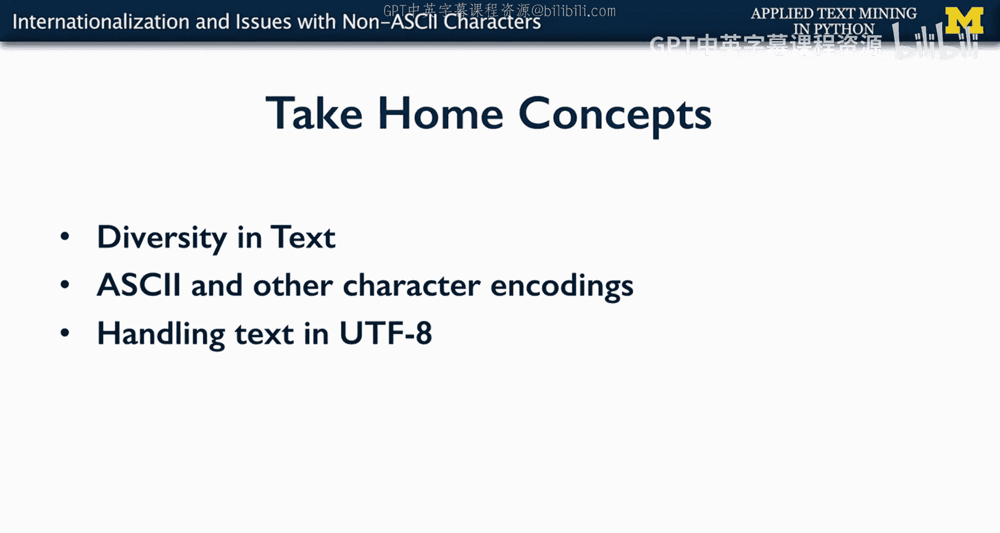

# Python用于数据科学实践：4.5：国际化与非ASCII字符处理 🌐

在本节课中，我们将要学习如何处理国际化文本和非ASCII字符。随着互联网的发展，英语已不再是网络上的主导语言，处理多种语言和字符集变得至关重要。我们将探讨字符编码的历史、Unicode标准，以及如何在Python中正确处理这些字符。

## 字符编码的演变

上一节我们介绍了数据科学中文本处理的重要性，本节中我们来看看字符编码是如何发展的。

世界由多种语言构成。我们几乎总是在谈论英语，但英语在互联网上正逐渐成为少数语言。英语通常使用ASCII编码。ASCII代表美国信息交换标准代码，这是一种捕获所有字符的编码方案。它有7位长，因此有128个有效字符或有效代码。在十六进制形式中，其范围从00到7F。这意味着它从8位中取出这7位，并使用8位编码的低半部分。

这种模型和编码方案自计算开始以来已经使用了相当长的时间。它包括大写和小写字母、所有10个数字、所有标点符号。常见的符号如括号、百分号、美元符号和井号。它还有一些控制字符，用于描述行尾、制表符或其他控制字符，例如段落结束与行结束的区别。对于英文打字来说，它工作得相对较好。

之所以说相对，是因为即使在英语中，它也不能真正捕获所有内容。让我们思考一下变音符号。例如，“resume”和“résumé”。如果忽略变音符号，它们是同一个单词。它们有相同的六个字符R E S U M E，但“résumé”中的E是不同的。这在ASCII编码方案中并未真正编码。这并非唯一例子，“naïve”中的“i”和上面的分音符号是另一个例子。咖啡馆“café”中带变音符号的“e”也是如此。

这在其他语言中相当常见。正如我们所看到的，英语不一定是多数语言，因此我们也必须对这些变化更加敏感。例如，城市名称如魁北克或苏黎世。或者组织名称，如国际足球联合会或FIFA，这是领先的足球协会。

但还有其他语言具有完全不同的编码方案和完全不同的字符，如中文、印地语、希腊语或俄语。此外，还有音乐语言，音乐符号也很重要，特别是如果你使用数字形式创作音乐。你需要以某种方式编码音乐符号。然后，还有非常著名的表情符号，如笑脸。事实上，现在有更多可用的表情符号，所有这些都需要以某种方式编码。

因此，过去对英语来说足够（勉强足够）的编码，在包含变音符号和多种可用语言时，绝对不够。实际上，有许多不同的书写文字需要编码。

以下是不同书写文字在全球使用情况的概述：

*   拉丁文字（英语基础）占数据的36%，约26亿人使用。36%的人使用基于拉丁语的语言，包括意大利语、法语等（如果忽略变音符号）。
*   中文有完全不同的书写文字。
*   梵文是许多印度语言的基础。
*   阿拉伯文。
*   西里尔文。
*   泰米尔文，这是印度南部的另一种印度语言。

这张地图展示了不同文字在世界各地的使用情况。

## 字符编码标准的发展

上一节我们了解了全球文字的多样性，本节中我们来看看为在计算方案中编码它们而发展出的多种字符编码。

现在已发展出许多字符编码，以便在计算方案中编码它们。因此，你有IBM EBCDIC，这是一种8位编码。你有Latin-1编码，它与ASCII编码略有不同。你有各个国家特定的标准，如JIS（日本工业标准）和CCII（中文信息交换码），就像ASCII一样。你有扩展的Unicode。还有许多其他国家标准。

但后来需要将其标准化并整合在一起，这就是Unicode和UTF-8编码所做的。正如你所见，将页面转换为UTF-8的兴趣很大。纯ASCII编码在过去10到12年中显著且持续下降。而UTF-8在2004年和2006年之前并不那么流行，之后急剧上升，成为目前网页上最常用的编码。

## 什么是Unicode？

上一节我们提到了Unicode，本节中我们来详细了解一下它。

Unicode是编码和表示文本的行业标准。它包含来自30多种文字和符号集的超过128，000个字符。当我说符号集时，我包括例如希腊符号，或一副纸牌中四种花色的符号等。它可以使用不同的字符编码实现，但UTF-8是其中之一，也是最常见的一种。

以下是Unicode的一些关键编码实现：

*   **UTF-8**：一种可扩展的编码集，从1字节到4字节。
*   **UTF-16**：使用1个或2个16位代码。
*   **UTF-32**：使用32位编码。

UTF-8是8位集，8位是一个字节，因此最小为1字节，然后最多到4字节。UTF-16是16位集，即一个或两个这样的集。UTF-32是32位编码。因此，尽管所有这些编码都使用最多32位，但UTF-8对所有字符使用一种大的32位编码。

## 深入理解UTF-8

上一节我们介绍了Unicode的多种编码方式，本节我们重点看看最常用的UTF-8。

UTF-8代表Unicode转换格式，8位。以区别于16位和32位的UTF格式。它具有可变长度编码，从一字节到四字节。它还与ASCII向后兼容。例如，所有7位代码并使用前导0的ASCII代码在UTF-8中是相同的代码。因此，所有使用ASCII编码的字符在UTF-8中使用一个字节的信息，并且使用与ASCII相同的字节。

但由于UTF-8可以扩展到四字节，它有许多其他方案来实现这一点并不断扩展。UTF-8是网络的主导字符编码。事实上，它在Python 3中默认处理得很好。如果你使用的是Python 2，则必须在Python脚本开头添加此类语句，以告诉解释器你使用的编码是UTF-8。

## Python 2与Python 3中的处理示例

上一节我们了解了UTF-8的原理，本节中我们通过一个具体例子来看看它在Python中的不同表现。

让我们看一个例子。让我们看看单词“résumé”在Python 3和Python 2中的情况。如果你以文本1的形式输入“résumé”并查找该单词的长度。在Python 3中，你会看到它是6个字符长。而在Python 2中，你得到8。为什么会这样？

让我们看看文本本身，你会发现对于Python 3，它返回单词“résumé”。但在Python 2中，如果你打印它，你会看到这些特殊的十六进制代码。因此，变音符号E的位置有十六进制代码C3 A9。或者，在单词末尾又有C3 A9。因此你会知道，这两个符号C3A9一起代表了变音符号E。在Python 2中，它被表示为两个独立的字节。

明确地说，如果你想输出所有这些字符，你会看到在Python 3中六个字符很好地显示出来，而在Python 2中你会得到这8个独立的字符，所以C3是一个字符，A9是一个字符，因为每个是一字节。

那么，你该怎么做呢？如何在Python 2中处理UTF-8字符串？你将在编写“résumé”之前使用“u”。这样就会将长度给出为6。它会以某种方式告诉解释器你有一个Unicode字符串，一个UTF-8字符串。如果你实际输出单个字符，你会看到你得到R，然后得到\xe9，然后再次得到这些字符，那个十六进制代码e9是变音符号E的Unicode等效表示。

## 总结

本节课中我们一起学习了文本处理中的国际化问题。核心概念是文本中存在大量多样性，尤其是你将看到的文本。因此，对我们来说，认识到这一点以及计算机系统和编码能够捕获这一点非常重要。

ASCII和其他字符编码早期被广泛使用，但由于缺乏标准化，UTF-8编码变得流行起来，现在几乎被独家使用，并且是最流行的编码集。我们看到在Python 3中它是默认处理的，因此你不需要做任何特定的事情，而对于Python 2，你可能需要做一些事情来让解释器知道你正在使用UTF-8编码。