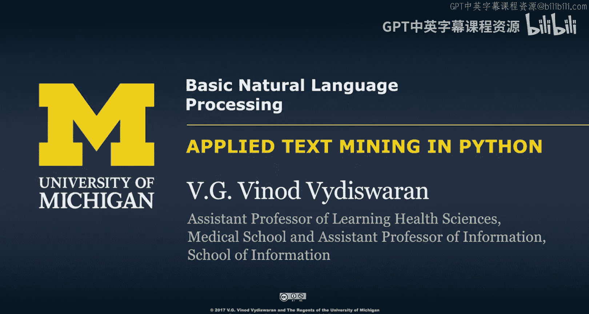
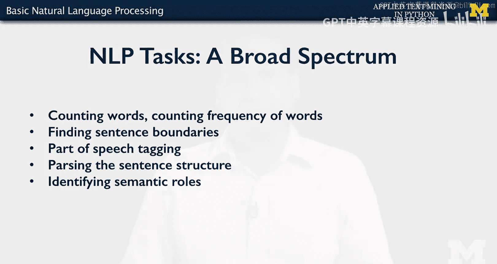
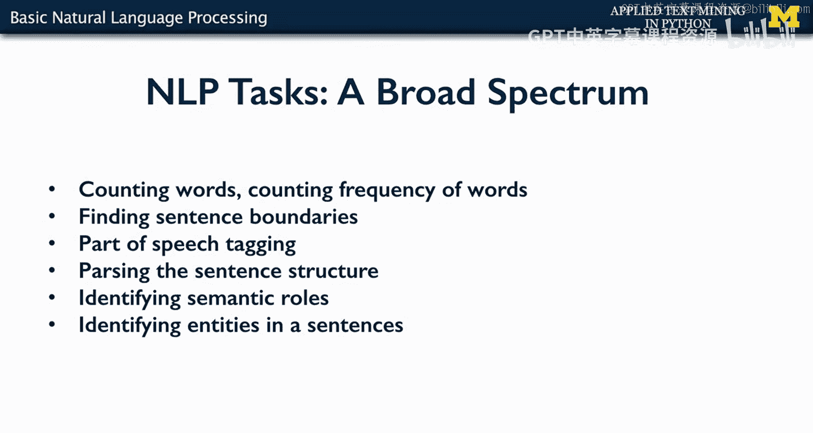
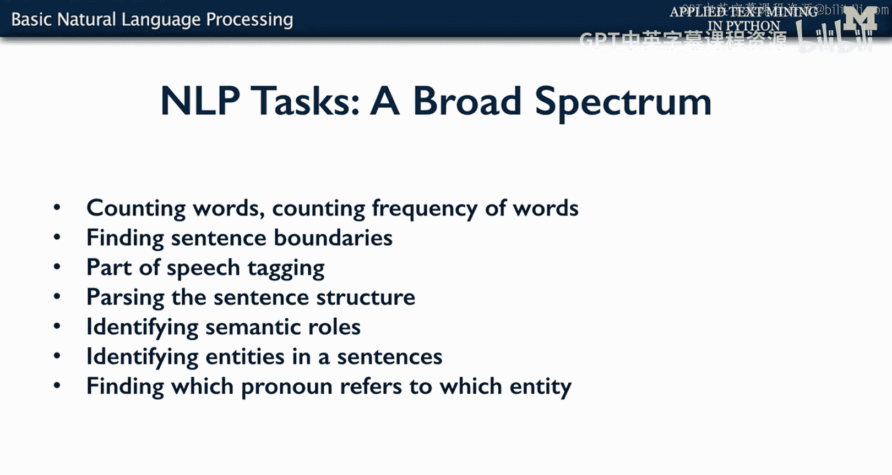

# 密歇根大学《Python用于数据科学实践（4-5课）｜Applied Data Science with Python 》中英deepseek翻译 p06 5_自然语言处理基础.zh_en -BV1DTtueTEwf_p6-

Welcome back。This module， we are going to talk about basic natural language processing and how it relates to the text mining in Python that we have been talking about。

So what is natural language Well any language that is used in everyday communication by humans is natural language as compared to something that is artificial language or a computer language like Python languages such as English or Chinese or Hindi or Russian or Spanish are all natural languages。

 but you know also the language we use in short text messages or on tweets is also by this definition natural language isn't it？

😊，So then we have to kind of address these as well。So then what is natural language processing。

 any computation or manipulation of natural language to get some insights about how words mean and how sentences are constructed is natural language processing？

One thing to consider when we look at natural language is that these evolve。For example。

 new words get added， like selfie。Or photo bomb。Old words lose popularity。How often have you used。

 thou shalt。Meanings of words change。Words that as learn in old English went exactly opposite of what it means now。

 it used to mean teach。And then language rules themselves may change。 So， for example。

 in old English， the position of the verb was at the end of the sentence rather than the middle as we come to know today。

So when we talk about NLP tasks， what do we mean？It could mean as simple as counting the words or counting the frequency of a word or finding unique words in a corpus。

And then build on to find sentence boundaries or parts of speech。

So tag a sentence with its parts of speech。Passse the sentence structure。

 try to understand more grammatical constructs and see whether they apply for a particular sentence。

Identify semantic roles of how these words play， for example。

 if you have a sentence like Mary loves John， then you know that Mary is the subject。

 John is the object and love is the verb that connects them。

You have the other NLP tasks like identifying entities in a sentence。

So this is called named entity recognition。 And in our previous example of Mary Love's John。

Mary and John are the two entities。Both persons。

In that sentence。And then， you could have more。Complicated， more complex tasks。

 like finding which pronoun refers to which entity。

This is called Co reference resolution or Co referenceence resolution。

And there are many， many more tasks that you would do for on free text。

The challenge is how to do that in an efficient manner and how it applies to overall text mining。

 and they're going to see some of those in the next few videos。

