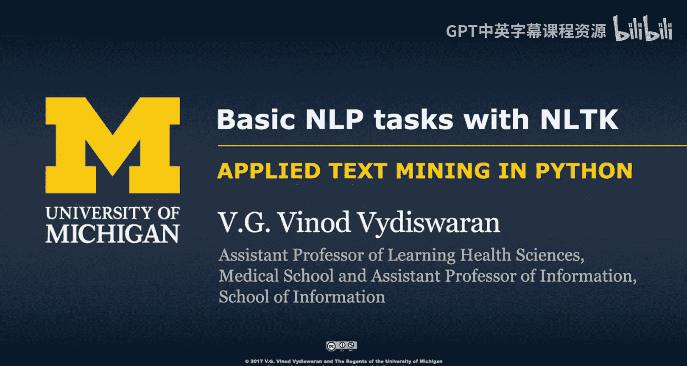
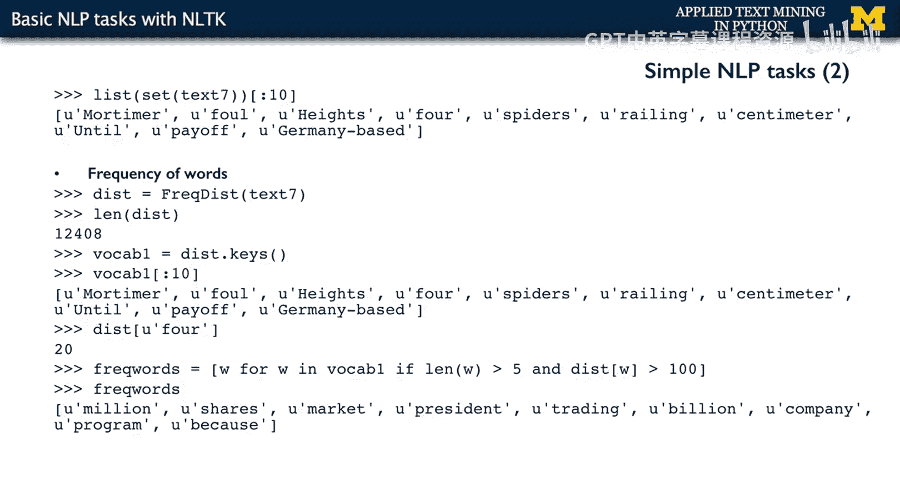
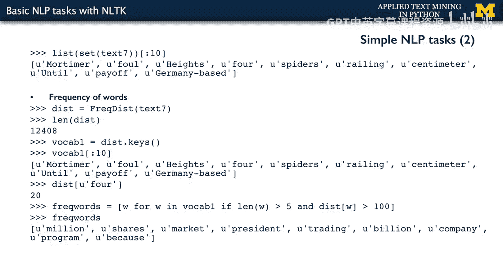
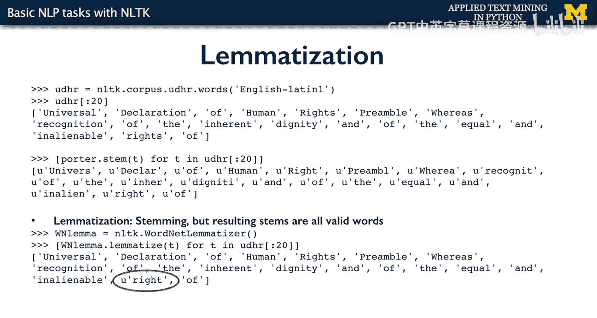
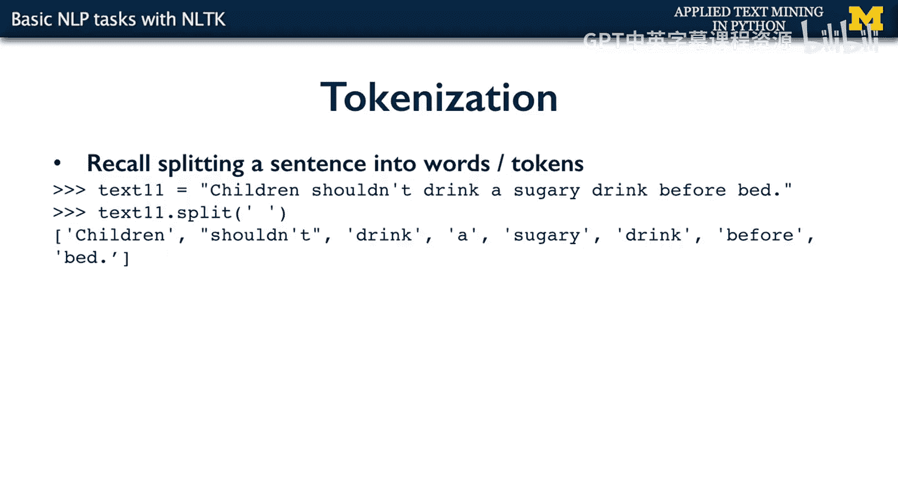
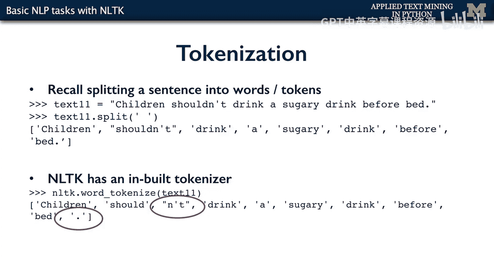
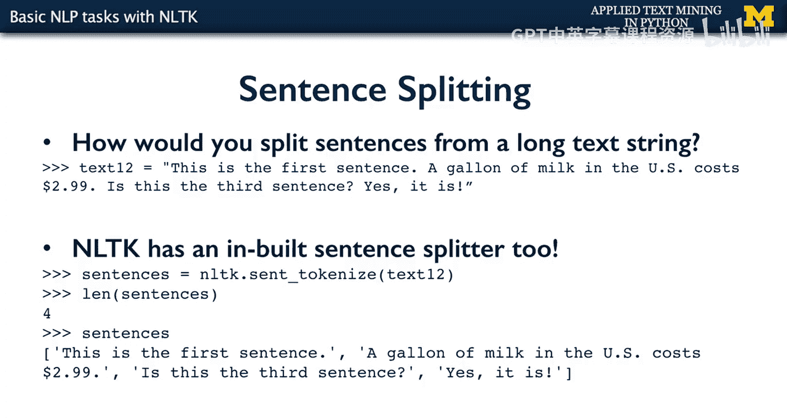
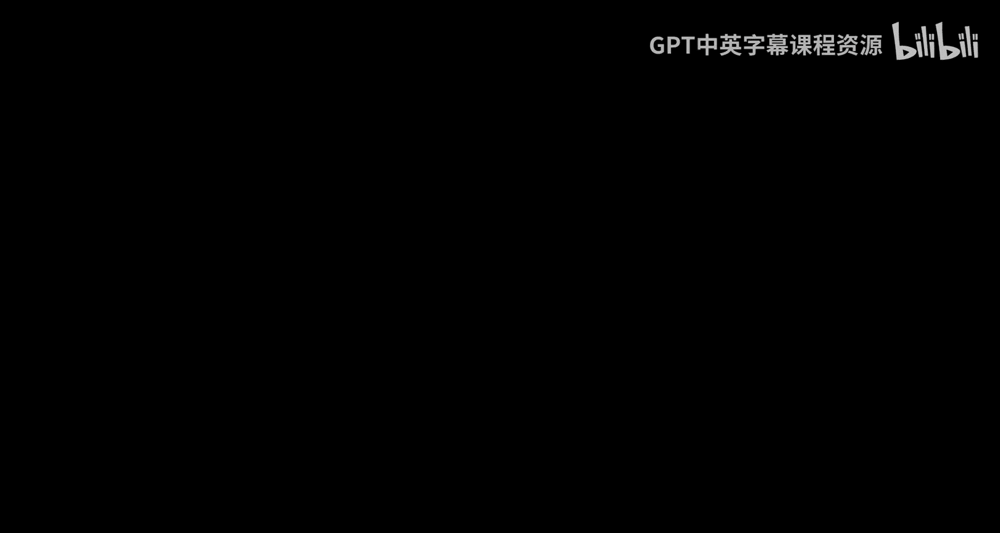

# 密歇根大学《Python用于数据科学实践（4-5课）｜Applied Data Science with Python 》中英deepseek翻译 p07 6_使用NLTK进行基础NLP任务.zh_en -BV1DTtueTEwf_p7-

In this video， we are going to talk about basic NLP tasks and introduce you to NLTK。

So what is NLTK NLTK stands for Natural Language toolkit。

 it is an open source library in Python and you're going to use it extensively in this video in the next。

The advantage of NLTK is that it has support for most NLP tasks and also provides access to numerous text corpora。

So let's set it up。😊，We first get NLTK N using the import statement， you have import NLTK。

And then we can download the text corpora using NTK do download。It's going to take a little while。

 but then once it comes back， you can issue a command like this from nltk。book import star。

 and then it's going to show you the corepoa that it has downloaded and it made available。

You'll see that there are nine text corpora， text 1 stands for Moby Dick。

 T 2 is sense and sensibility， you have a Wall Street journal corpus in T 7。

 you have some personals in text 8 and chat corpus and text 5， so it is quite diverse here。

So as I said， text one is Mobi Dickig。If you look at sentences。

 it will show you one sentence each from these nine text corpoum and sentence one called me Ishmael is from text1。

And then if you look at how sentence1 looks， it's sent one。

 and you'll see that it has four words called me Ishmael and a full stop。

Now that we have access to text corpus and multiple text corpora。

 we can look at counting the vocabulary of words。So text7， if you recall， was Wall Street Journal。

And sent 7， which was one sentence from T 7， is this Pier Wilkin 61 years old will join the board as a non executive director November 29th。

You have already these words passed out so you have comma separate and have full stop separate。

 so the length of cent7 is a number of tokens in this sentence and that's 18。

But if you look at length of text 7， that's the entire text corpus。

 you will see that Wall Street Journal has 100676 words。

It's clear that not all of these are unique we can see in the previous example that comma is repeated twice and full stop is there and words such as the and and so on are so frequent that they are going to take up a bunch of words from this 10000 count so if you see the unique number of words using the command length of set of text7。

You will get 12408。 That means that Wall Street Journal corpus has really only 12400 unique words。

 even though it is 100，000 word corpus。Now that we know how to count words。

 let's look at these words and understand how to get the individual frequencies。

So if you want to type out the first 10 words。From this set， first 10 unique words。

 you'll say list set text 7 and in square brackets have colon 10 that will give you the first 10 words and in this corpus the first 10 words really in the set are Mortimer and foul and heights and4 and so on。

You can notice that there is this U and a quote before each word。Do you recall what it stands for？

You recall from the previous videos that you here stands for the UTF 8 encoding。

 so these have been automatically UTF 8 encoded， so each token is represented as a UTF 8 string。Now。

 if you want to find out frequency of words， you are going to use。

This command frequency distribution， FR EQ， DIST。And when you create this frequency distribution from T 7。

 that is a Wall Street journal corpus and store it in this variable called D。

 you can start finding statistics from this data structure。

 So you have length of disk and that will give you 12408。

 these are the set of unique words in this word corpus in this wall Street journal corpus。

Then you have this dot keys that gives you the actual words and that would be your vab one。

And then if you take the first 10 words of vocab1， you'll get the same 10 words as we saw up there in the top of the slide。

And then if you want to find out how many times a particular word occurs。

 you can say give me the distribution of this word4 that is UTF encoded。

And I'll get the response of 20， that means in this Wall Street journal corpus。

 you have for appearing 20 times。What if you want to find out how many times a particular word occurs。

And also have a condition on the length of the word。

 so if you were to find out frequent words and say that I would call a word as frequent if that word is at least length5 and occurs at least 100 times。

 then I can use this command sayingW for w in vab 1。

 if length of w is greater than 5 and disk of w is greater than 100。

And then I'll get this list of words that satisfy both conditionss and you'll see million and market and precedent in trading are the words that satisfy this。

Why did we have a restriction on length of the word。Because if you don't。

 then words like the or comma or full stop are going to be very。

 very frequent and those will occur more than 100 times and they would come up as frequent words。

 So this is one way to say， oh， you know the real unique words are ones that are fairly long。

 at least five characters and occurs fairly often。 there are of course， other ways to do that。

Now， if you look at the next task， so we know how to count words， how to find unique words。

The next task becomes normalizing and stemming words。

So what is normalization and stemming。Normalization is to find out different forms of a single word and to bring them to the same form。

 to normalize them to the same form。 There are multiple ways to do that。

First would be to bring them to the same casing。 So bring them all to lowercase。

 Let's say let's take this example for this string input 1， we have five words。

 They are all slight variations of the word list。You have list and then the plot form lists。

 you have listing and listings， and then you have a verb form， which is listed。

So the first step we would do is to take this input string and use the function lower to bring that string to the lower case form。

Why would we do that， that is to remove the upper casing and lower casing so that we don't distinguish the capitalized word list and the lower case word list。

So if you run this function lower on input1 and then split it on space。

 the words would be all lowercase， but just the list of these five words list， listed， lists。

 listing and listings。So that is step one。😡，Another step you could do as part of normalization is what is called stemming。

Stemming is when you are taking a word and removing all common suffixes。

To bring the word to the root form， to the base form。

There are multiple existing algorithms to do that。 N LTK already provides different ways to stem a particular string or a word。

One example is the Porter stemmer， so if you use NLTK dot Porter Stemer and put that as a variable porter。

 then you can run this porter stemmer on all words in words1。So for every word in words one。

 for T in words one。Run this Porter dot stem on that word tea。When we do that。

 we see that each of these five words converts into the word list because Portertmer knows that ED is a common suffix that is associated with verbs or plurals have an S or ING is a common suffix as well。

 and all of these get removed。Now， it is still up to us as developers of these pipeline modules。

 these NLP modules to decide whether we want to do it that way， right。

 so should we actually remove the variation that is between list and listing。

 They actually have different meanings。 So how do we try to remove them is still a decision that we have to make。

 but we can use Porter stemmer and think about that as a way to do it when we decide to do so。😊。

A slight variant of stemming is lematization。Lematization is where you want to have the words that come out to be actually meaningful。

 Let's take an example。NLTK has a corpus of the Universal Declaration of Human Rights。

As one of its corpus。 So if you say。NlTk。 corpus。 udhr。

 that is the universal Declaration of Human Rights dot words。

 and then they are encoded with English Latin。This will give you all the entire declaration as a variable UDHR。

So if you just print out the first 20 words， you'll see that universal Declar of human rights and there's a preamble。

 and then it starts as well recognition of the inherent dignity and of the equal and inel rights of people and so on。

 so it continues that way。Now， if you use the porter stemer on these words。

And get this stemmed version。 Youll see that it。Takes out these common of exist。

 So universal became universal without really E the end。

 a declaration became declare an office of and human rights。 the same rights became right and so on。

Okay， but now you see that universe and declare are not really valid words。

So lematization would do that stemming， but really keep the resulting stems to be valid words。😊。

It is sometimes useful because you want to somehow normalize it。

 but normalize it to something that is also meaningful。😊。

So we could use something like a word net limitmatizer that NlTK provides， so you have nltk。

 word netlematizer。And then if you leitize the word。😊。

From this from the set that we have been looking so far。

 what you get is universal Declaration of human rights， preamble。

 whereas recognition of the inherent dignity。 So basically all these words are valid。

How do you know that leitizer has worked if you look at the first string up there and then the last string down here rights has changed to write。

 so it has limititized it。But you will also notice that the fifth word here。

 Uni Dec of human rights is not lamatized because that is with capital R。

 it's a different word that was not lamatized to write， but if you had done a lowercase。

 then the rights would become right again so there are rules of why something was lamatized and something was kept as this。

Once we have handled stemming and lematization。Let's take a step back and look at the tokens stem。

 the task of tokenizing something。

So recall that we looked at how to split a sentence into words and tokens and we said we could just split on space right so if you take a text string like this text11 is children shouldn't drink a sugary drink before bed。

And you split on space， youll get these words children shouldn't， as one word。

 drink a sugary drink before bed， but unfortunately you have a full stop that goes with bed。

 so it's bed full stop。Okay， so you got 1，2，3，4，5，6，7，8。 You got8 words out of this sentence。

But you can already see that it is not really doing a good job because， for example。

 it is keeping full stop with the word。😊。

So you could use the NLTK inherent or in built tokenizer。

The way to call it would be N LTK dot word tokenize and you can pass the string there and youll get this nice tokenized sentence and in fact it differs in two places。

 not only is fulltop taken away as a separate token。

 but you will notice that shouldn't became should and thist。That is that stands for naught。

 And that is important in quite a few NLP tasks because you want to know negation here。

 And the way you would do it would be to look for tokens that are a representation of not。

 So int is one of one such representation。But now， you know that this particular sentence does not really have8 tokens。

 but 10 of them because you got in and full stop as two new tokens。 So we talked about。

Tokenizing a particular sentence。 and the fact that these punctuation marks have to be separated。

 there are some unique words like an apostrophe T that should also be separated and so on。

But there is even more fundamental question of what is a sentence and how do you know sentence boundaries。

And the reason why that is important is because you want to split sentences from a long text sentence right so lets suppose this example of text 12 is this is the first sentence a gallon of milk in the US cost $2。

99 and is this a third sentence a question mark and yes it is with an exclamation。So already。

 you know that a sentence can end with a full stop or a question mark or an exclam mark and so on。

But not all full stops and sentences， so for example， U dot S dot that stands for US。

Is just one word has two full stops， but neither of them end the sentence。The same thing with $2。

99 by that full stop。Is an indicator of a number but not end of a sentence。

We could use anLT case in built sentence splitter here and if you say something like nLTK do send tokenize instead of word tokenize send tokenize and pass the string is give it will give you sentences if you count the number of sentences in this particular case we should have four yay we got four the sentences thens are exactly what we expect this is the first sentence is the first one a gal of milk in the US cost 2910 cents that's the second one is this the third sentence thats the third one and yes it is is the fourth one。

So what would we learn here？N LTK is a widely used toolkit for text and natural language processing。

 It has quite a few。Tools and very handy tools to tokenize and split a sentence and then go from there leitize and STE and so on。

 it gives access to many text cor as well。And these tasks of sentence splitting and tokenization and lemmatization are quite important preprocessing tasks。

 and they are non- trivialvi， so you cannot really write a regular expression in a trivial fashion and expect it will work well。

 and anga gives you access to the best algorithms or at least the most suitable algorithms for these tasks。

