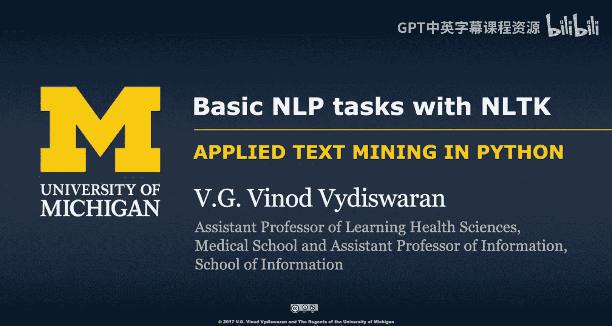
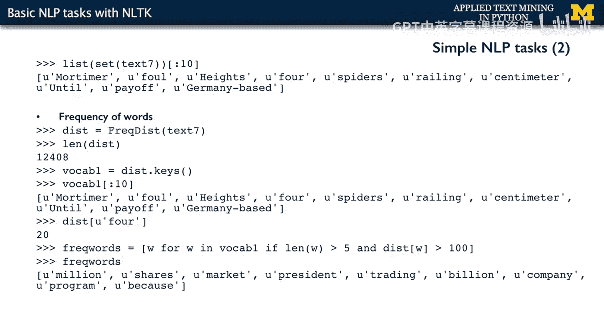
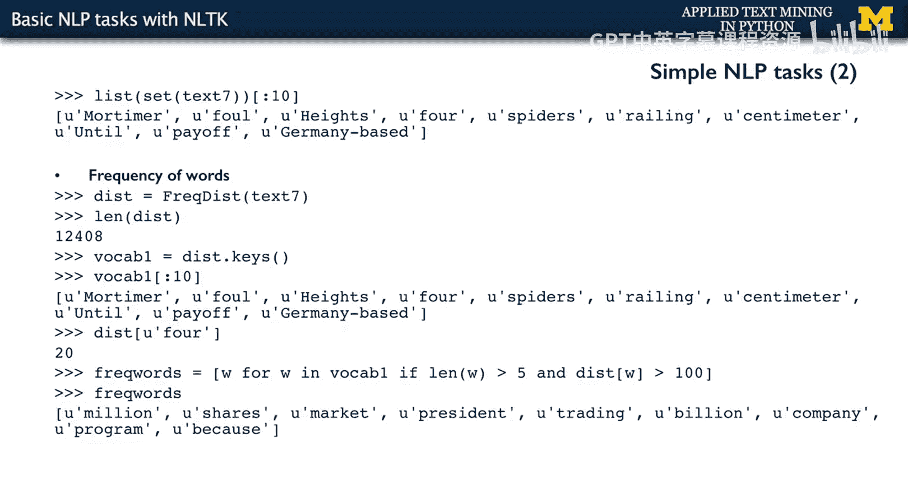
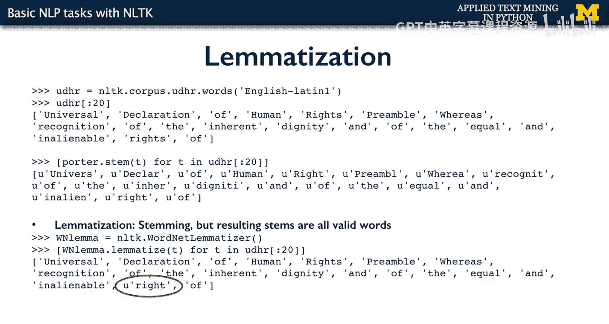
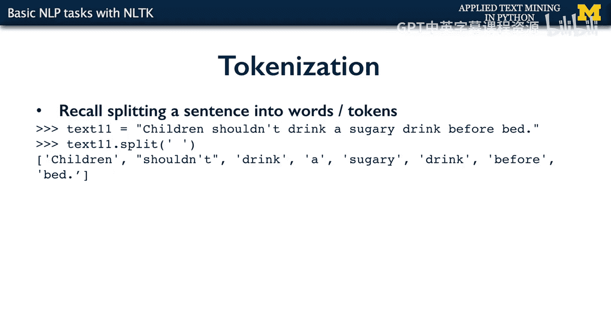
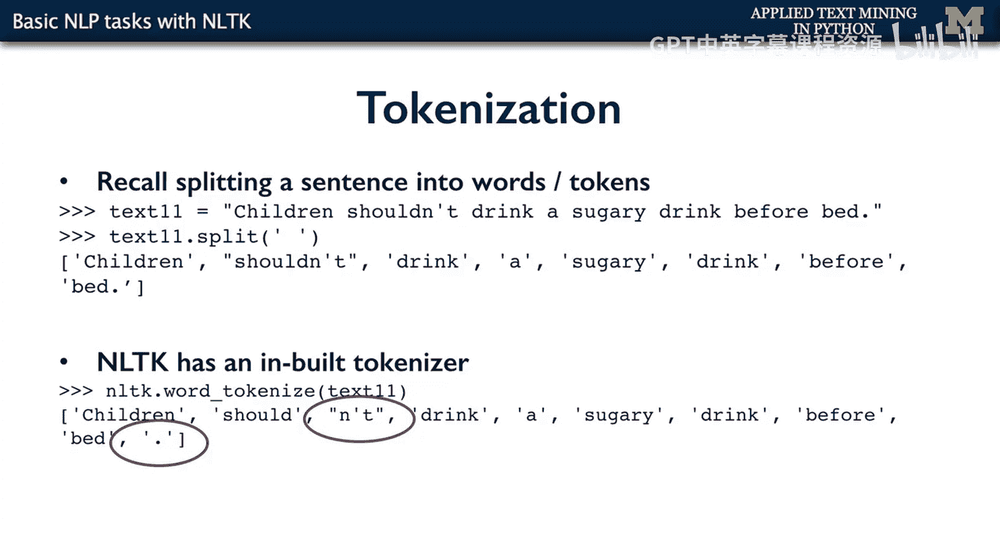
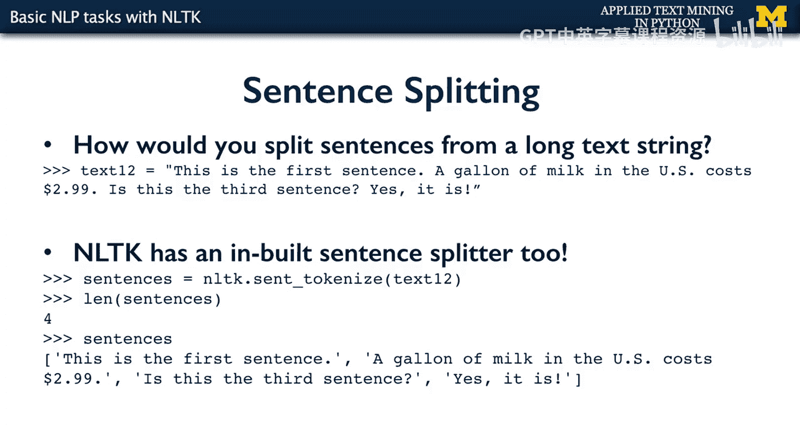

# Python用于数据科学实践：4-5：使用NLTK进行基础NLP任务





在本节课中，我们将学习如何使用NLTK（自然语言工具包）执行基础的NLP（自然语言处理）任务。我们将涵盖NLTK的安装、文本语料库的访问、词汇统计、词频分析、以及文本预处理中的关键步骤，包括归一化、词干提取、词形还原、分词和句子分割。

## 概述

NLTK是一个开源的Python库，广泛用于自然语言处理。它支持大多数NLP任务，并提供了对众多文本语料库的访问。本节将引导你完成NLTK的基本设置，并演示如何利用它进行文本分析。

## 安装与设置NLTK

首先，我们需要导入NLTK库并下载其文本语料库。

```python
import nltk
nltk.download()
```

下载完成后，我们可以导入预置的书籍语料库。

```python
from nltk.book import *
```

执行此命令将显示九个可用的文本语料库，例如：
*   `text1` 代表《白鲸记》（Moby Dick）。
*   `text2` 是《理智与情感》（Sense and Sensibility）。
*   `text7` 是《华尔街日报》语料库。
*   `text5` 和 `text8` 包含聊天和个人广告语料。

## 词汇统计与词频分析

上一节我们导入了语料库，本节中我们来看看如何分析文本中的词汇。

### 计算词汇量

我们可以查看单个句子和整个语料库的词汇数量。例如，`text7`（《华尔街日报》）中的一个句子`sent7`包含18个词元（token）。而整个`text7`语料库则包含100,676个词元。

然而，并非所有词元都是唯一的。通过计算唯一词的数量，我们可以得到语料库的实际词汇量。

```python
len(set(text7))
```

对于`text7`，唯一词的数量是12,408，这意味着这个10万词的语料库中只有约1.2万个不同的单词。



### 分析词频分布

要分析单词的出现频率，我们可以使用`FreqDist`函数。





```python
fdist = FreqDist(text7)
```

创建频率分布对象`fdist`后，我们可以进行多种查询：
*   `len(fdist)` 返回唯一词的数量。
*   `list(fdist.keys())[:10]` 返回前10个唯一词。
*   `fdist[‘word’]` 返回特定单词（如`’for’`）的出现次数。

有时，我们希望找到既常见又有一定长度的“实义词”。以下是筛选长度至少为5个字符且出现次数超过100次的单词的方法：

```python
vocab1 = fdist.keys()
frequent_words = [w for w in vocab1 if len(w) >= 5 and fdist[w] > 100]
```

设置单词长度限制是为了过滤掉像“the”、“,”、“.”这类非常高频但信息量较少的词。

## 文本归一化：词干提取与词形还原

在统计了词汇之后，我们常常需要将不同形式的单词归一化，以便进行更准确的分析。这主要涉及词干提取和词形还原。

### 归一化第一步：大小写转换

最基本的归一化是将所有文本转换为小写，以避免因大小写不同而将同一个词视为两个不同的词。

```python
input1 = “List listed lists listing listings”
words1 = input1.lower().split()
```

### 词干提取

词干提取是通过去除常见的后缀（如 -ed, -ing, -s），将单词还原到其词根或基本形式。NLTK提供了多种词干提取器，例如波特词干提取器。

```python
from nltk.stem.porter import PorterStemmer
porter = PorterStemmer()
stemmed = [porter.stem(t) for t in words1]
# 结果：所有单词都可能被提取为 ‘list’
```

需要注意的是，开发者需要决定是否进行词干提取，因为像“list”（列表）和“listing”（挂牌）这样的词在含义上可能有重要区别。

### 词形还原

词形还原是词干提取的一个变体，其目标是返回一个字典中存在的、有意义的词元（lemma）。例如，使用NLTK的WordNet词形还原器：

```python
from nltk.stem import WordNetLemmatizer
lemmatizer = WordNetLemmatizer()
udhr = nltk.corpus.udhr.words(‘English-Latin1’)
lemmatized = [lemmatizer.lemmatize(word) for word in udhr[:20]]
```




词形还原器会将“rights”还原为“right”，但会保留“Rights”（首字母大写）不变。通常，结合小写转换和词形还原能获得更好的效果。

## 分词与句子分割



在进行了词汇层面的处理后，我们需要回到更基础的步骤：如何将一整段文本切分成有意义的单元。


### 分词

简单的空格分割对于自然语言来说通常不够精确。例如，句子“Children shouldn’t drink a sugary drink before bed.”用空格分割会得到“shouldn’t”和“bed.”这样的词元，其中包含了标点符号。

NLTK内置的分词器可以更智能地处理这种情况：



```python
text11 = “Children shouldn’t drink a sugary drink before bed.”
tokens = nltk.word_tokenize(text11)
```


NLTK分词器会将“shouldn’t”正确地分割为“should”和“n’t”（表示否定），并将句号“.”分离为独立的词元。这对于后续检测否定等语义信息非常重要。

### 句子分割

确定句子边界是另一个关键任务。句子可能以句号、问号或感叹号结束，但并非所有句号都表示句子结束（例如“U.S.”或“$2.99”中的句号）。

NLTK的句子分割器可以有效地解决这个问题：

```python
text12 = “This is the first sentence. A gallon of milk in the U.S. costs $2.99. Is this the third sentence? Yes, it is!”
sentences = nltk.sent_tokenize(text12)
```



该分割器能够正确识别出上述文本中的四个句子，忽略“U.S.”和“$2.99”中的句号。

## 总结


本节课中我们一起学习了NLTK工具包的基础应用。我们了解了如何安装NLTK并访问其丰富的文本语料库。接着，我们探索了如何对文本进行词汇统计和词频分析。然后，我们深入研究了文本预处理的核心步骤：归一化（包括小写转换、词干提取和词形还原），这些步骤有助于将文本数据标准化。最后，我们学习了如何使用NLTK进行准确的分词和句子分割，这是任何NLP流水线的基础。NLTK提供了强大的工具来处理这些非平凡的任务，使我们能够更有效地进行后续的自然语言处理分析。