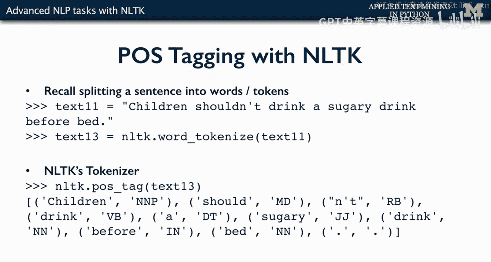
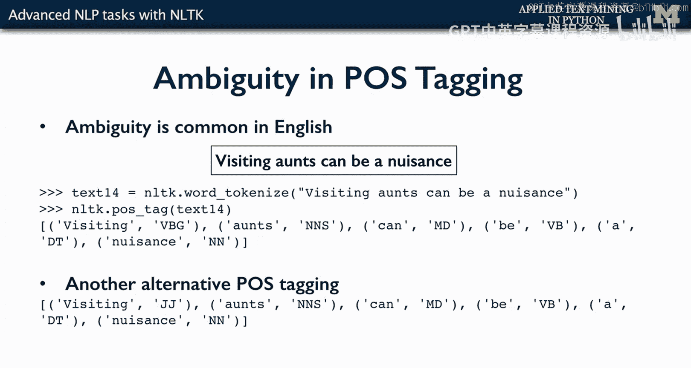
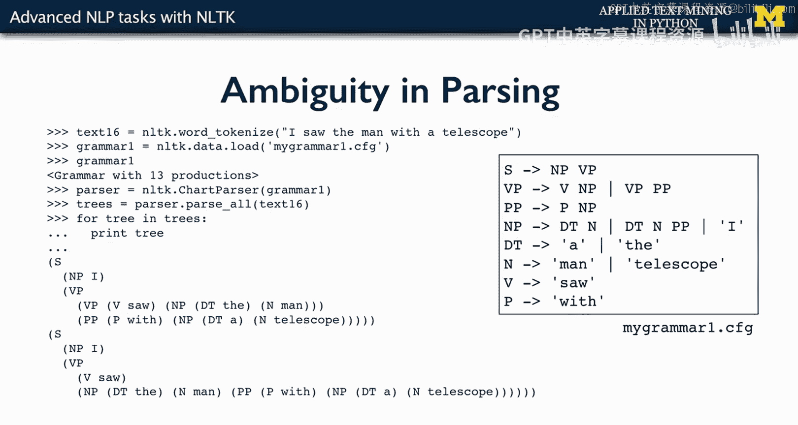
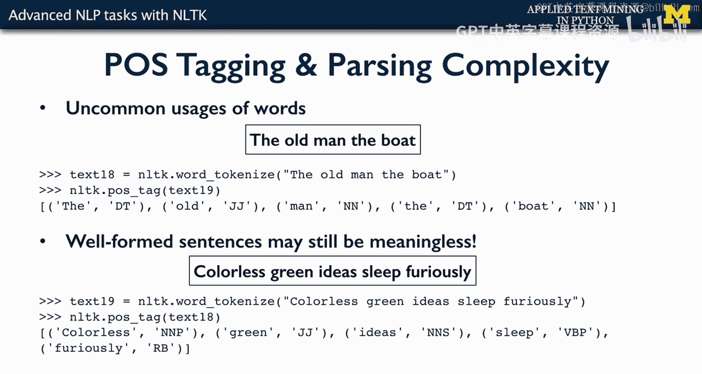
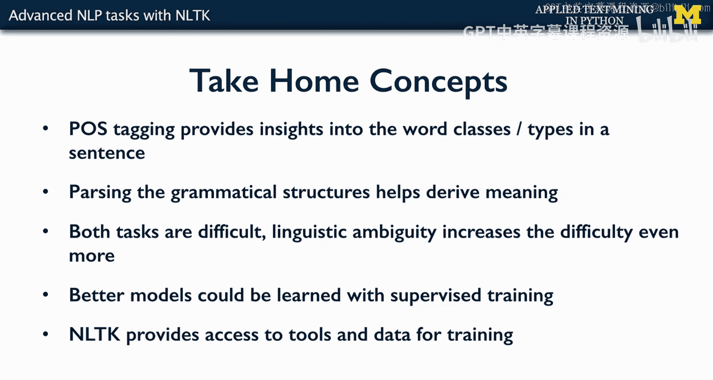

# 密歇根大学《Python用于数据科学实践（4-5课）｜Applied Data Science with Python 》中英deepseek翻译 p08 7_使用NLTK进行高级NLP任务.zh_en -BV1DTtueTEwf_p8-

In this video， we are going to move on from basic NLP tasks to advanced NLP tasks using NLTK。

If you recall。The NLP tasks that we have looked so far are counting words and counting frequency of words。

 finding unique words， finding sentence boundaries， even finding tokens and stemming。In this video。

 we can talk about part of speech taging。And passing the sentence structure。

There are other Npy tasks like semantic row labeling and name indeed recognition that we'll cover later on。

Let's start with part of speech tagging or pause tagging。

Recall from your high school grammar that part of speech are these verb classes。

Like nouns and verbs and adjectives。There are many many more tags than these。

 you will see that you have conjunctions and cardinals， cardinals are if you have a number。

 then you want to kind of assign that word class， you have determiner， you have propositions。

 you have modal words， you have nouns， again， nouns could be single nouns and plural nouns and proper nouns。

You have possesss and pronouns again of multiple types， you have adverbs， symbols。

 and then verbs and verbs themselves are multiple classes。 you have verbs in ges and past tenses。

 verbs and so on。How to get them recall that in an LTK， you need to import NLTK first。

And then you can get more information about these word classes by issuing a help command， so nltk。

help youend tag set， this comes from Uend tag so if you say Uen tag set and then give the tag there。

 MD， it will tell you that MD stands for modelal auxiliary and these are the words that are modelal words。

Can cannot could， couldn't May mightaught shall should shouldn't will wood and so on。

So how do you do post tagging with NLTK？Recall that you have to split a sentence into words。Okay。

 so this example is something that we have seen， children shouldn't drink a sugary drink before bed。

Youre to first split it into words so you could use a word underscore tokenize。

From NlTK package that and T 13 then becomes these individual words recall that there were 10 words here。

Children should。And apostropity as a separate token。

 then drink a sugary drink before bed and a full stop as the last token。

Then if you run the pause tagggger。So by using this command nltk。po tag on this tokenized form。

You'll get the tags。 So children is a plural noun。 should is a model word。

And apostrophe tea is staed as an adverb。 Drink is a verb。 E is a determiner。 Suy is ajective。

 and so on。So that is how youll get the part of speech Now why do you want part of speech Because if you are trying to club all nouns together because they all have some sort of a similar form or all model words together。

 then using the part of speech tag gives you one class or one。Pluster for all of these words。

 And then you don't have to address them individually。

 So when you are doing some feature engineering or feature extraction， that is very useful。

We'll talk about features and how to use it next week。Now that we know how to do post tagging。

 we should talk about ambiguity in post tagging。In fact， ambiity is very common in English。

Let's take this example， visiting ants can be a nuisance。What do you think it means。

Does it mean visiting ant can be a nuisance， that is going to visit andt can be a nuisance or ants who are coming in。

A nuisance。So if you tokenize the word， visiting aunt can be nuisance。And do a pause tag on that。

 You'll get one tag。 So when you say visiting is a g verb。And then oranges is noun。A plural noun。

YouThis representation shows that you are doing the act of visiting。

 So visiting is the verb for the aunt。 You are going to visit your aunt。

The alternate post tag would be visiting as an adjective for on。

So that would mean that the aunts are the ones who are visiting you。

So you can see that this particular sentence is ambiguous the way it is written。😊。

Post tagging is not。 and， in fact， anque gives the first version and not the second。

And that is because you don't really have a way to say。

 give me all possible variants and sometimes the ones that take precedence are the ones where youll most likely see the word visiting in the context of usages in a large corpus。

 So visiting is more often used as a continuous or a g form of a verb rather than using it as an adjective。

So the probability of finding visiting as an adjective is lower and so the first one wins up。

 but this is a valid alternate representation of postt。

Okay。So that was post tagging。Once we have done some pause tagging。

 we can look at passing the sentence structure itself。Okay。

 now that we have looked at how you would find out the parts of speech of a sentence。

 let's look at the sentence structure itself and pars out the sentence structure。

Making sense of sentences is easy if you follow a well defined grammatic structure。

So when you have a sentence like this， but Alice loves Bob。

You want to know which is the noun and which is the verb and so on。

 but we also want to know how are they related in this sentence。

 how how did they come together to form the sentence？So in NlTK， you will use nltK。

 word organize Alice loves Bob that will give you these three words in the sentence right Alice loves Bob。

 those are the three words。😊，But the sentence itself is constituted of two things。

You have noun phrase and verb phrase。The verb phrase itself can be a verb followed by a nounce phrase。

That is the gramatic structure in English。And for this particular sentence。

 this is the grammar structure that is used。😊，Now that you have that。

 noun trees itself can be a noun， so Alice can be a noun， and then Bob is the other noun。

And there is one verb that is loves。So by doing this structure and writing out this grammar where you have this grammar rules on the right。

Saying S gives NP， VP， VP is V and NP， and then Alice and Bob can be NPs and loves would be a V。

You have created what is called a context free grammar。

And then you can use NLTK context for grammar import statements like nlTk。cfg。

 from string and then you write the string out， that will give you the grammar。

And you can use this grammar to parse the sentence， so you can use an L or chart parcel。

 you create a parscel using the grammar that you have defined。St it as parcel， and then。

Pase the sentence so you parse text 15 and when you parse it it gives you parse trees and then you can print that tree so youll print the tree as this。

 so the way you will parse it out for a lackop paper word is you have S that's the sentence that constitutes two brackets。

 the NP bracket that has Alice and a VP bracket where a VP bracket has a V bracket for loves the verb and an NP bracket for Bob exactly the way we draw the we have drawn the tree。

As with part of speech tagging。Passing also is ambiguous and ambiguity may exist even if sentences are grammatically correct。

So let's take this example。This is the very famous example。 I saw the man with a telescope。Now。

 did you see with the telescope or did you see the man who was holding a telescope？😊。

There are two meanings， and the meaning is with respect to where this preposition with the telescope gets attached。

 So this is a typical preposition attachment problem。And if you look at the grammar。

 you will see where that ambiguity comes in。 The fact that this is grammatically correct is because you have the sentence that is verb non phrase and ver verb phrase。

 But then this verb phrase。Can be split into two things。 So noun phrase is I。 That is clear。

 but verb phrase could either be a verb followed by a noun phrase。

As in saw the man with the telescope。Or it could be a verb phrase followed by a preposition phrase where you have the verb phrase is So man because verb phrase could still be verb and a noun phrase。

 that's what the southern man is， and then you have preposition phrase which is preposition in a noun phrase with and telescope。

So these are the two alternatives， the bold red and the dotted red。

 and those are the two trees that distinguish the two meanings of how you would parse out the meaning from this sentence。

We can do the same thing， and it becomes apparent when you use N LTK parser as well。

 So you first tokenize the sentence。 N L T K dot word tokenize。 I saw the man with a telescope。

And you can load a grammar so if you write your own file， my grammar 1。cfg that has these lines。

That the sentence is no phrase in verb phrase， that verb phrasese could be a verbal noun phrase or a verb phrase in a preposition phrase。

 preposition phrase itself can be a preposition and a noun phrase and so on。

And then if you load this up as a grammar using nltk。data。 load。That would create a grammar。

Then you can create a the grammar has 13 rules。The third in productions at a dis call。

And then you can create a chart parser using this grammar， so you can say N L TK or chart parser。

 grammar one exactly the same way we did it a few slides back。

And then print out all trees from this par from that that comes of this parure。

 you will see that there are indeed two trees， one， which is。

Noun phrase and a verb phrase where verb phrase has verb phrase and a preposition phrase。

And then another one， which is a noun phrase and a verb phrase。

 where verb phrase is a verb and a noun phrase， and the noun phrase itself has a preposition with it。

So these are the two parse three structures that you'll get when you passse using this context be grammar。

Now， we。Gave examples of simple grammars and said we will create a context for grammar out of it。

 but we cannot do that every time， in fact， generating the grammar and general grammar rules itself is a learning task that you could learn and you need a lot of training data for that and a lot of manual effort and our have gone into creating what is known as a tree bank basically a big collection of past trees。

From Wall Street Journal。So you could， and in fact， you we have access to three bank through N LTK。

 so if you say from NlTK corpus import3 bank。And say three band do par sentences。

 this particular first sentence from Wall Street Journal。And you print it out。

 you will see this sentence and youll realize that you have seen it before。

 This is that Pere Wilkin sentence。 So Pere Wilkin 61 years old。

 will join the board as an non executivecutive director November 29th。 So。

 so that sentence has been passed using this structure using in the tree bank and it is have you have that available。

Just to conclude， you'll see that there are complexities in part of speech tagging and parsing。

Beyond just how to do it。 So， for example， there is this usage and uncommon usage of words。

An example is the old manda boat。When you read it， you feel that the old man is actually a man who is old。

 but then you cannot finish the sentence and parse it properly。

The correct parts would make man the verb。That is to man something。However。

 when you do a word tokenize on the sentence and do a post tag。

You'll get man as a noun and old as an adjective， and this particular sentence is not grammatically。

 there's no pastory for this structure。Sometimes even well formed sentences that have pastory structures may still be meaningless。

 so there is no semantics or meaning associated with that。

The great example is colorless green ideas sleep furiously When you read this。

 you can see that the sentence structure seems right。But it does not make any sense， meaningwise。

And that is because when you do when you find out the word tokens。

 you say word tokenize and do part of speech tag on that。

 you will see that it doesn't really do a good job。

 it says colorless is a proper noun and then green is an adjective rather than saying colorless and green and both adjective so there there is an error there。

 but if you even if you remove the word colorless， say green idea sleep furiously you will have the perfect post tag there green is an adjective idea is a noun。

 sleep is a verb and then you have furiously that's an averb and this particular order is perfectly fine。

But it still doesn't make any sense， meaningwise。

So there are many more layers of complexity in language that pass trees and part of which tags don't address so far。

，So to conclude what are the take home concepts here。

 we looked at pause tagging and saw how it provides insight into the word classes and word types in the sentence。

Passing the grammatical structure helps derive meaning。

Both tasks are difficult and there is linguistic ambiguity that increases the difficulty even more。

 and you need better models and you can learn those using supervised learning。

NLT provides access to these tools and also has data in terms of tree bank， for example。

 that could be used for training。

Next module， we are going to go into more detail about how do you train these models。

 how do you build a supervised method and supervised technique for this， but that's for another time。

