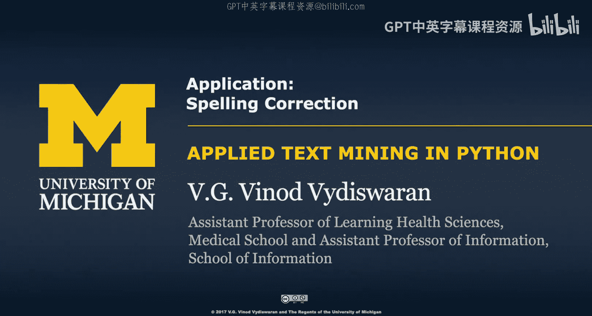
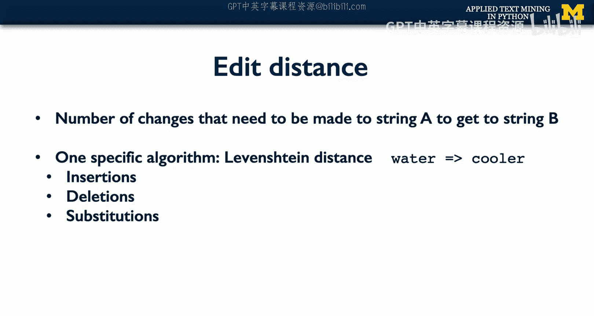
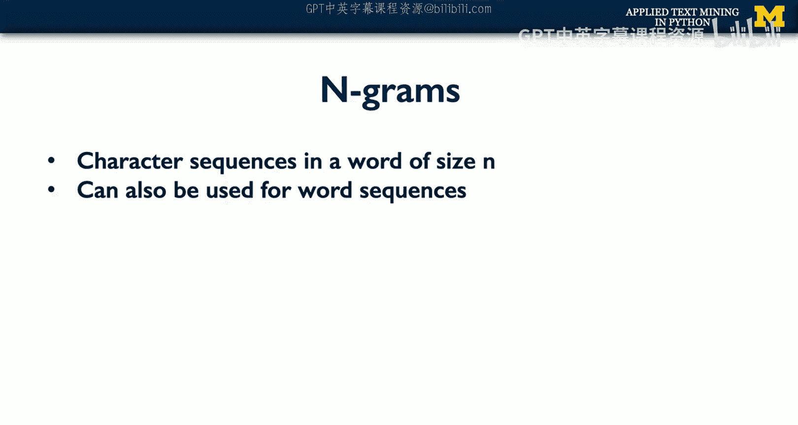
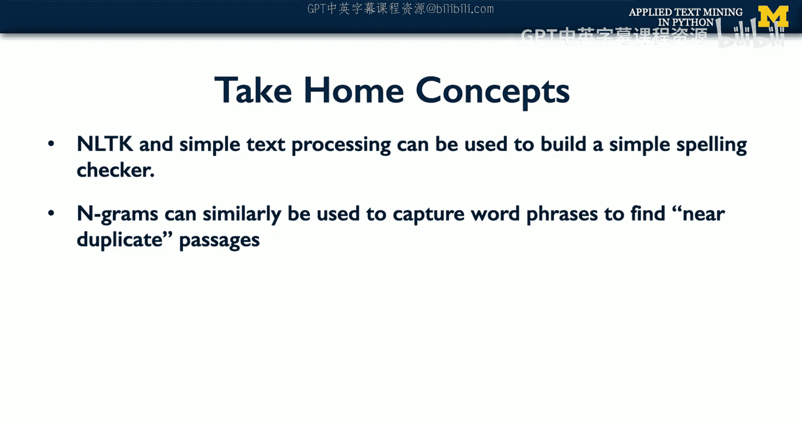
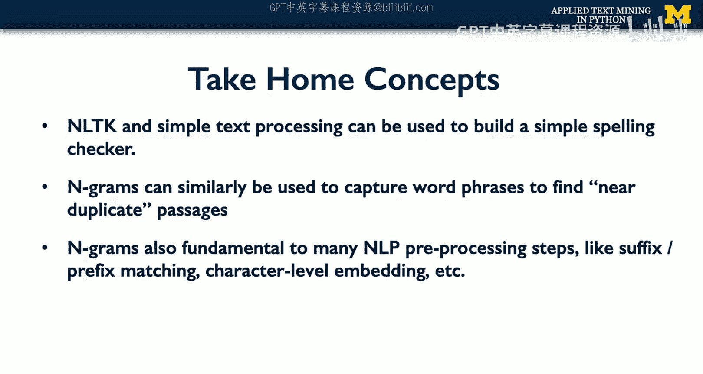

# 密歇根大学《Python用于数据科学实践（4-5课）｜Applied Data Science with Python 》中英deepseek翻译 p09 8_应用实例：拼写检查器.zh_en -BV1DTtueTEwf_p9-

In this video， we are going to look at one specific application of text processing。

 and that is the spelling correction task。😊。

Sppeing correction is a task where when someone types a word that is misspelled。

 how do you find out the correct spelling for that word and replace that existing word。

A common way to check for misspellt words in correcting them is to find valid words in dictionary that share similar spelling。

So to identify that， we have two requirements， one that there is a dictionary of valid words。

What can you replace a misspellt word with。Here， NLt comes to our rescue again。

There is a particular component called words， a corpus called words。

 which are English language words that is already there in N K corpus。

So if you include this words package from NTk do corpus， you can get the dictionary of English words。

Second requirement is some way to measure a similarity between words。

 So how do you measure spelling similarity， right。There it becomes a little bit more complicated。

 so we can use something called an edit distance between two strings。

 You can consider these two words as strings and then find edit distance between these strings。

What it at the distance。Every distance is the number of changes that need to be made to go from string A to string B。

What all do we need to make changes to get the correct word。In this case。

 string A would be the misspellt word， and string B would be the most appropriate word。

The fewer those changes， the closer these two words are。

One specific algorithm to do that is called the Levinchstein distance。For 1 strength distance。

 three possible operations are allowed。 you can insert or delete or substitute a character。

So for example， if you want to go from the word water to the word cooler， now。

 I'm not saying that cooler is a miss a water is a misspellt word and cooler is the right pill。

 is just works for any two strings。

One way to do that would be to kind of lay them on top of one another and see how many changes do we need to make。

So we could substitute W with C， and then the next A with O， the next t with O and so on。

 so if you align them one over the other， we can make five substitutions and then because cooler is one character longer。

 we can insert the last R and that would make six edits。We have five substitutions。

 and one insertion。On the other hand。One of the advantages of La 10 distance is to find that combination that can reduce the edit distance as much as possible。

So this is not the best way we could convert water to cooler。

We could actually realize that E is common for both of these words。

 and hence you don't have to actually change them if you can align everything else。

 so we can keep the ER R at the end， the suffix the same and only substitute W with C A with O T with O。

 and then insert L。So we only need to do four things。 and then suddenly both of these align。

So added distance for water to cooler using this lae1 algorithm would be 4。

There are many other ways to compute at a distance， but this is one we would we could go with。

Another way would be to find n gras。Water n grams， n grams in this context are character sequences in a word of size n。

 So the character sequences size is n， and you find all such character sequences in a word。

Ngrams are also used in the context of word sequences。

 so when you're talking about multiple words that occur one after the other。

 that would be Ngram at the word level。

An example would be， let's say this is a girl， you can have bigrams that means two grams where you have this is is one bigram and is a is another bigram and a girl is a third bi。

In the context of characters， we can do the same thing。

And then how can we use these engrams for spelling check that is done by realizing that when two words have very similar spelling。

 they share many engrams together。 So an example is this。 So for a word like peerers。

You can have five bigrams， character bygrams， that means you're looking at two character long substrs。

P， I， I。e。 E， R， R， C， and C， E。For a mispeelt word where somebody was trying to type pis and mistyped it。

 let's say with the IESE。The same bigrams would give you P I，e， I。e， E， R， R， S， and S， E。

Then looking at these two sets of2 grams of bigrams。

We can compute the what is called a Jaquard similarity。

 a Jaard similarity is used to measure similarity of sets。

And this Jaar coefficient is computed by looking at the intersection of two sets A and B and divided by the union of those two sets A and B。

So in this example of pierce and peererce， so we have five bigrams in from pierce and five from the second one。

 but three of them are common， and hence the intersection between the two is3。

And the union of these two sets is 7。 And so the Jakquard distance or Jaquard similarity between these two words is 3 over 7。

We can use this now as a measure to find what is a valid word that has the least distance or the maximum similarity with the misspellt word and use that as an alternative spelling。

😊，These are the two things that you are going to explore in the assignment this week。So to summarize。

NLTK and simple text processing can be used to build a very simple naive spelling checker。

Ngrams can be used to capture these word phrases to find near duplicate passages。

 so in addition to just these strings， if you now look at words。

 then you can use the same idea of ngrams and bigrams and trigrams to find almost similar passages。

In fact， Ngrams are also fundamental to many NLP prepossessing tasks like identifying suffixes and prefixes。

 doing suffix matching， doing some sort of character level embedding that is used in advanced machine learning and deep learning models。

 so this is a very interesting concept to learn about and understand。

