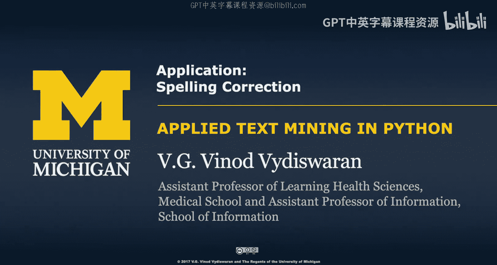
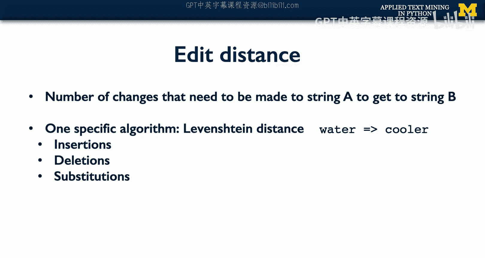
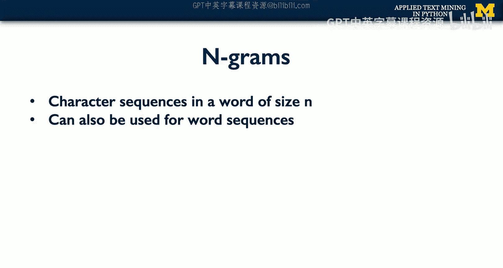
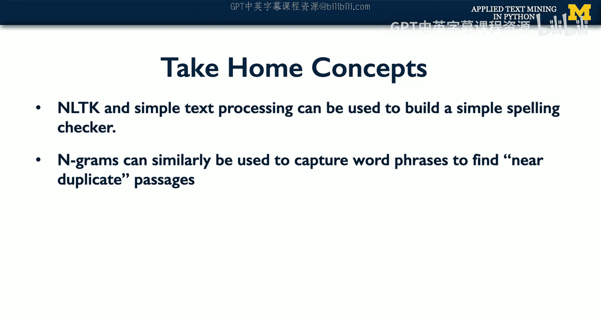
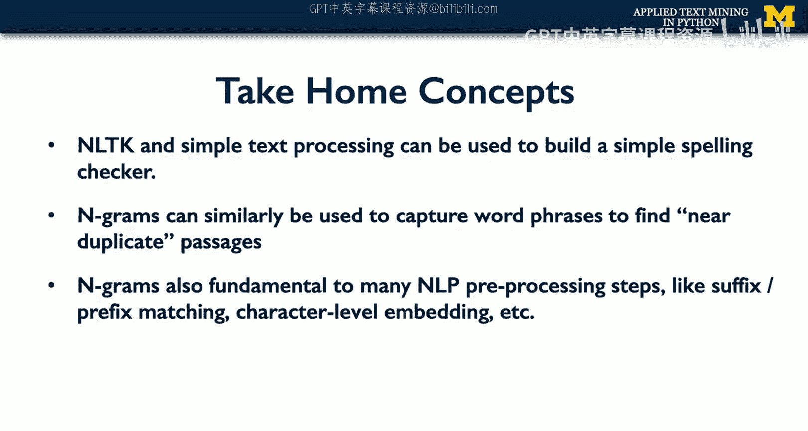

# Python用于数据科学实践：4-5课：应用实例：拼写检查器





在本节课中，我们将学习文本处理的一个具体应用：拼写检查任务。我们将探讨如何识别和纠正拼写错误的单词，并介绍两种衡量单词相似度的核心方法。

## 概述

拼写检查的任务是，当用户输入一个拼写错误的单词时，如何找到该单词的正确拼写并进行替换。

一种常见的方法是，在词典中查找与错误单词拼写相似的合法单词。要实现这一点，需要满足两个条件：首先，需要一个合法单词的词典；其次，需要一种衡量单词间相似度的方法。

## 构建词典

第一个要求是拥有一个合法单词的词典。NLTK库再次为我们提供了帮助。它包含一个名为`words`的语料库，其中收录了英语单词。通过导入NLTK的`words`包，我们可以获得一个英语词典。

```python
from nltk.corpus import words
word_list = words.words()
```

## 衡量单词相似度

第二个要求是衡量单词相似度的方法。这稍微复杂一些。我们可以使用两个字符串之间的**编辑距离**。




**编辑距离**是指将字符串A转换为字符串B所需的最小操作次数。操作通常包括插入、删除或替换一个字符。在本场景中，字符串A是拼写错误的单词，字符串B是候选的正确单词。所需的操作次数越少，两个单词就越相似。

### 莱文斯坦距离

一种具体的算法是**莱文斯坦距离**。它允许三种操作：插入、删除或替换一个字符。

例如，将单词“water”转换为“cooler”。一种直观的方法是逐个字符替换（W->C, A->O, T->O, E->L, R->R），然后插入一个‘L’，总共需要6次编辑（5次替换+1次插入）。

然而，莱文斯坦距离算法的优势在于寻找最优对齐方式以最小化编辑次数。我们可以发现“ER”是共有的后缀，因此只需将“WAT”替换为“COO”，再插入一个‘L’。这样，编辑距离就减少到了4。

**公式**： 莱文斯坦距离 `LD(A, B)` 是将字符串A转换为字符串B所需的最少单字符编辑（插入、删除、替换）次数。

### N元语法方法



另一种衡量相似度的方法是使用**N元语法**。在字符层面，N元语法是指单词中长度为n的连续字符序列。

例如，对于单词“pierce”，其字符级别的二元语法（bigrams）为：`{‘pi’， ‘ie’， ‘er’， ‘rc’， ‘ce’}`。


对于一个拼写错误的单词“peererce”，其二元语法为：`{‘pe’， ‘ee’， ‘er’， ‘re’， ‘rc’， ‘ce’}`。

#### 雅卡尔相似度

我们可以通过计算两个单词N元语法集合的**雅卡尔相似度**来衡量它们的相似性。雅卡尔系数通过计算两个集合的交集大小除以并集大小得到。

**公式**： `J(A, B) = |A ∩ B| / |A ∪ B|`

在上面的例子中，两个集合的交集为 `{‘er’， ‘rc’， ‘ce’}`，大小为3。并集大小为7。因此，雅卡尔相似度为 `3/7`。

我们可以利用这个度量，在词典中寻找与错误单词具有最高雅卡尔相似度的合法单词，并将其作为纠正后的拼写。

## 应用与总结

以下是本周作业中你将探索的两个核心任务。



1.  **构建简单拼写检查器**：结合NLTK的词典和编辑距离或N元语法相似度算法，可以构建一个基础的拼写检查器。
2.  **查找近似重复段落**：N元语法的概念不仅适用于字符，也适用于单词。通过计算文档中单词级别的N元语法（如二元组、三元组）及其相似度，可以用于检测近乎相同的文本段落。


事实上，N元语法是许多自然语言处理任务的基础，例如识别词缀、进行后缀匹配，以及在先进的机器学习和深度学习模型中构建字符级嵌入表示。因此，理解和掌握这个概念非常有益。



本节课中，我们一起学习了拼写检查的基本原理，并介绍了两种关键的文本相似度度量方法：基于编辑操作的莱文斯坦距离和基于集合比较的N元语法雅卡尔相似度。这些是构建基础文本处理工具的重要组件。