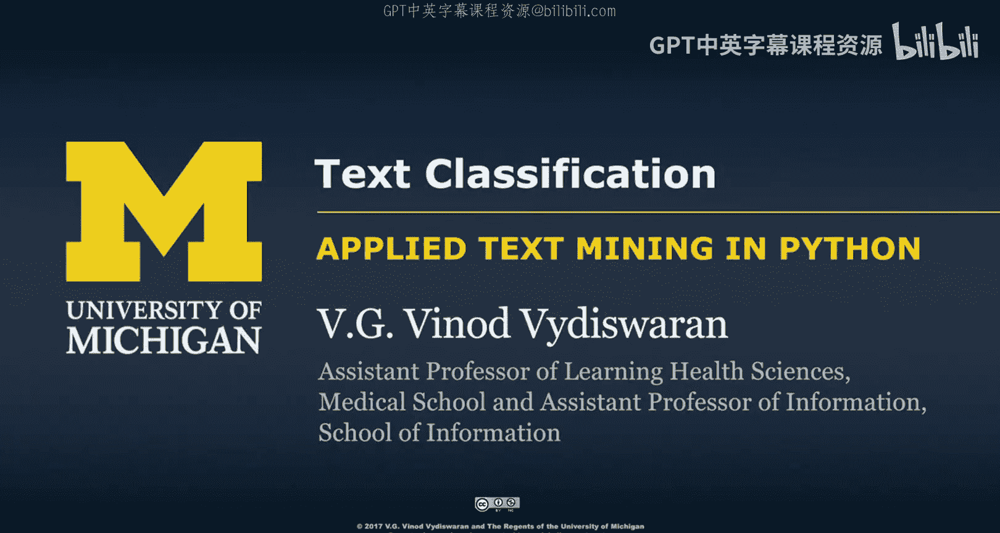
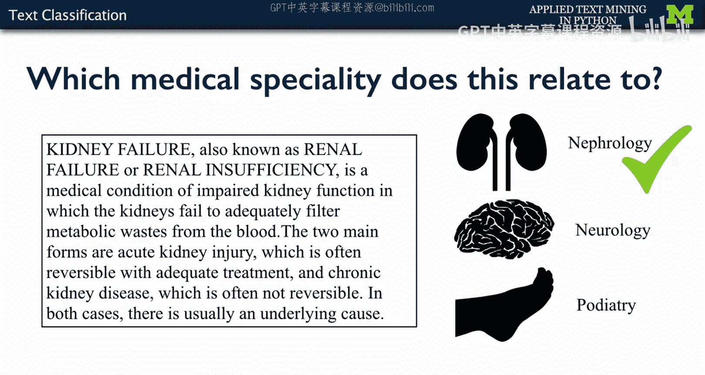
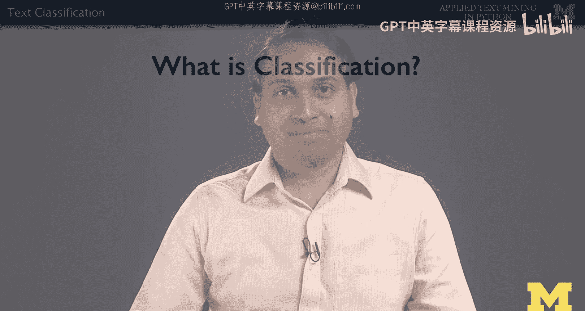
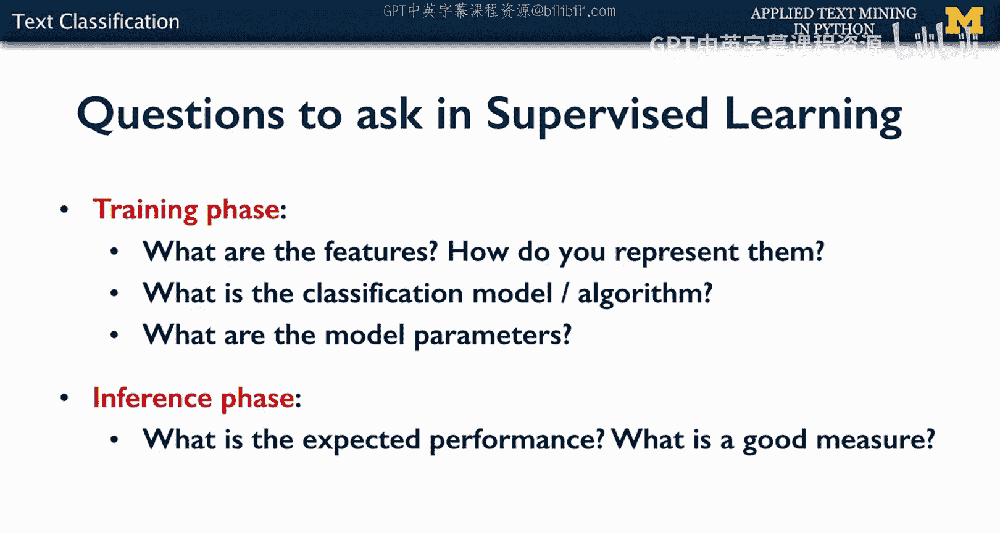

# 密歇根大学《Python用于数据科学实践（4-5课）｜Applied Data Science with Python 》中英deepseek翻译 p10 9_文本分类技术.zh_en -BV1DTtueTEwf_p10-

Welcome back。In this module， we are going to talk about text classification。

Or supervised learning for text。To start and set up the case。I wanted to look at this paragraph。

It is about a medical document， and I wanted to think about the specialty that this relates to。

Is it nephrology。Neurology。Or podiary。Looking at the words。

 you would think that it's podiay because you have foot there。

 you have something to do with fungal infection and skin infection and so on。

 and nephrology which is the science of kidneys or neurology that is about the brain。

 this is more closely related to the study of foot， so that's podiay。Now。

 given the three classes that you have already， that's nephrology， neurology or podiatry。

 let's look at another paragraph。Here you will see that it talks about kidney failure。

And just by looking at the first few words， you would know that this probably belongs to nephrology。

Now think about how you made that decision。Did you use the word nephrology anywhere？It's not there。

 in text。Then how did you know about his nephrology。The icon is important。

 but when you are talking about text classification， you don't have that icon。

 I just put it up there。

So you're looking at the words， so kidney failure or renal failure。

 and you somehow magically know that nephrology relates to kidneys and renal diseases and so on。

This is an important characteristic of identifying a class based on text。

And what he just did is classification。😊。

So what is classification？You have a given set of classes。In this particular case。

 we had these three classes。And note that I don't even have to tell you the name like nephrology or neurology。

 I could just give them class 1，2，3 or these three icons。

But you know that there are these three concepts， these three classes that you want to classify them into。

And then the task is to assign the correct class label to a given input。

There are a lot of examples of text classification when you look at it。 for example。

 if youre looking at a news article and depending on which page of the newspaper it belongs to。

 you would want to categorize it as politics， sports or technology。

There are many more classes of course， but in this case。

 let's say we want to distinguish them into one of these three classes。Or you get an email。

And you want to label them that email as a spam or not a spam。Should it go into spam folder？😊。

How does any male client decide that it should go in the spam folder？Basically。

 what is happening is there's a text classification model running behind。

Or think about sentiment analysis， you read a movie review and just by reading it。

 you want to decide whether it's a positive review or a negative review。

The text classification can actually be at various scale。

 all of these are really at the scale of a document and you could call a paragraph a document or a news report as a document or an email or document。

😊，But you could also have text classification at a word level。

So think of the problem of spelling correction。And you have weather written two ways。

 one means the climate， the other is a construct for the sentence。

Which is the right spelling when you are writing a sentence， oh， the weather is great。😊。

Is it the first one or the second one？What about the word color and the way that is spelled in British English or American English？

😊，Depending on all the other words and if I suppose you're writing a BBC news article or reading one。

 you are more likely to see the second spelling and the first spelling in that context would appear as a error。

😊，So you need to understand and correct for those， and that would be the spelly correction problem。

All of these tasks are in general what are known as supervised learning tasks。😊。

It's supervised because just like humans learn from past experiences， machines。

Learn from past instances。So for example， in a supervised classification task。

 you have this training phase where information is gathered and a model is built。😊。

And an inference phase where that model is applied。So for example。

 you will have a set of inputs that we call the labeled input where you know that this particular instance is positive。

 this one is negative and so on。 So in this case let's take just two examples。Green and red or。

Light and dark are positive and negative。And you take that set。

 that the labeled set of instances and feed it into a classification algorithm。😊。

This classification algorithm will learn which instances appear to be more positive than negative。😊。

And build a model。For what it learns。Once you have the model。

 you can use it in the inference phase where you have unlabeled input。

And then this model will take it and give out labels for those inputs for those input instances。

In this supervised learning。You have you learn a classification model。On properties。

 so when we say instances， you are really looking at properties or features of these instances and the model that is learn is basically an importance of sort or weight to those that is given to those properties。

And all of this is basically learned from the label instances given to you。More formally。

 the set of attributes or features that represents the input is denoted by x。

 usually written as bold x because it's a vector， it is a set of individual features and in this particular case let's say there are n features。

What would these n features be， Let's take an example of email and you have to detect whether it's spam or not。

You would say， where does it come from？Does it have kind of interesting words like Nigeria or a prints or deposit money or something like that。

 So those would be your attributes on which youll make a decision whether this email should go in the spam folder or not。

Then you have this class label。The set of class labels is y。Let's say there are K classes。

 if if it's just two classes like positive and negative， then K will be 2。

If it was this medical specialty example we saw where it's nephrology， neurology or podiatry。

 then case3。One of those classes is the class label assigned to the instance。

 and that is united by small Y。Once we have learned this classification model。

We apply that model to new instances to predict the label。So when you look at these。

 there are some terminology of data sets that you would see very commonly。So again。

 there are two phases， the training phase and the inference phase。

The training phase has labeled dataset。And in general， in the inference phase。

 you have unlabeled dataset set。😊，Unlabeled dataset is where you have all instances and you have the X defined。

But you don't have a y， you don't have a label， whereas in the label data set。

 you have the x and the y for every instance given to you。😊，However， in training。

You don't use the entire label set for training purposes because then you will not know how well your model is learned。

So what you would want to do is to use a part of it as training data where you actually learn the parameters。

 learn the model， but leave some aside as a validation dataset or its sometimes called holdout dataset so that in the training phase you can learn on the training data。

 but then test or evaluate。Or set parameters on the validation data。

And then you want another data set to really test how well you do that you never see during training you you don't set your parameters based on that。

 but you just evaluate on that so that you can judge whether the model was really good or not。

On completely unseen data。You have seen all of these concepts in previous courses within this specialization like Co 3。

 but I want to kind of bring them here so that we have the context in which we' are going to talk about。

One last thing about classification and that's classification paradigms。

We talked about cases when the set of possible labels are two。

Po and negative or green and red or yes and no or spam or not spam right all of these tasks are called binary classification tasks because the number of possible classes is2。

When that increases when why the number of examples is more than two。

 number of instant number of classes， I'm sorry， is more than two。😊。

It's called a multi class classification problem。And in some instances， you might want to label。

With more than one labels and when those when that happens when the data instances are labeled by two or more labels。

 then it is called a multi label classification problem。

Typically we would look at binary classification or multiclass classification。

 but there are some instances within this module in this course where we would look at multilabel classification too。

But in general we are going to when we talk about classification。

 were talking about binary or multiclass classification when you look at what questions you ask in a supervised learning scenario in the training phase。

 the questions that you need to answer are what are the features， how do you represent them。

 how do you represent the input given to you。😊，What is the classification model or the algorithm you are going to use？

And what are the model parameters， depending on the model you use。These are the ones。

 these are the questions that you will answer while you are building your model。You need to know。

 how do you represent input。How are you going to train or what model are you going to train and then what is the output of that training process？

And in the inference phase， you need to define。What are the expected performance measures。

 What is a good measure， How do you know that you have built a great model。

What is the performance measure you use to determine that。

And these are the questions you want to answer whenever you're building a supervised learning model。

The same thing applies to text and in the next few videos we are going to answer these one by one。

