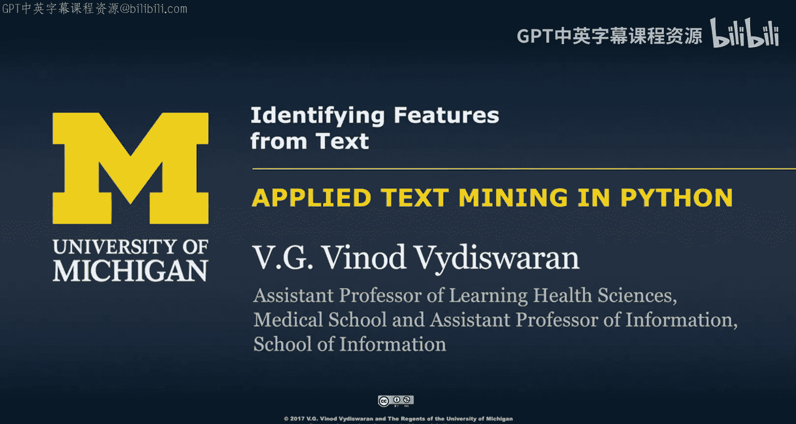
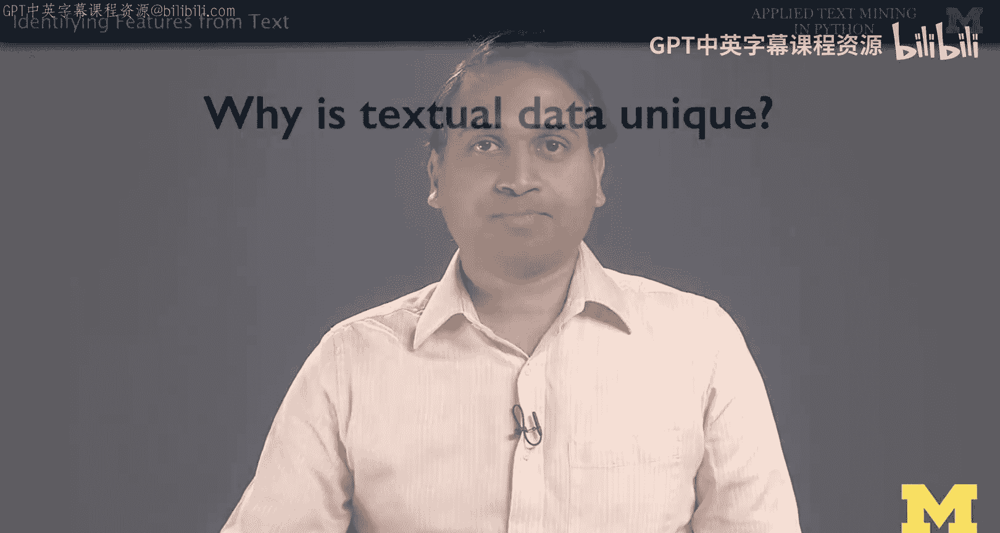
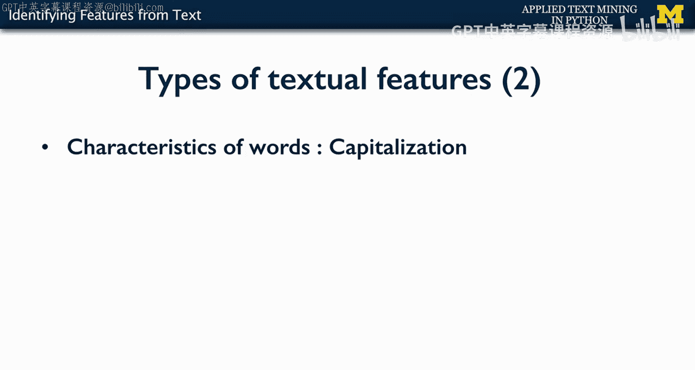
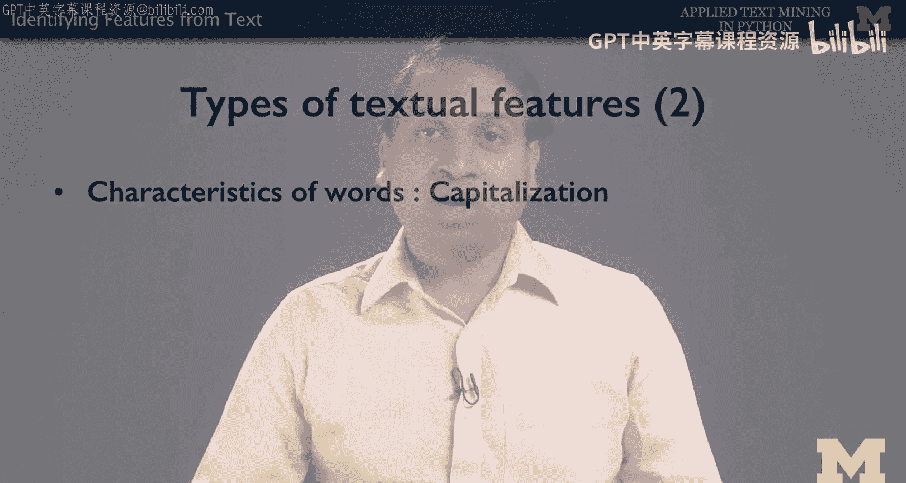
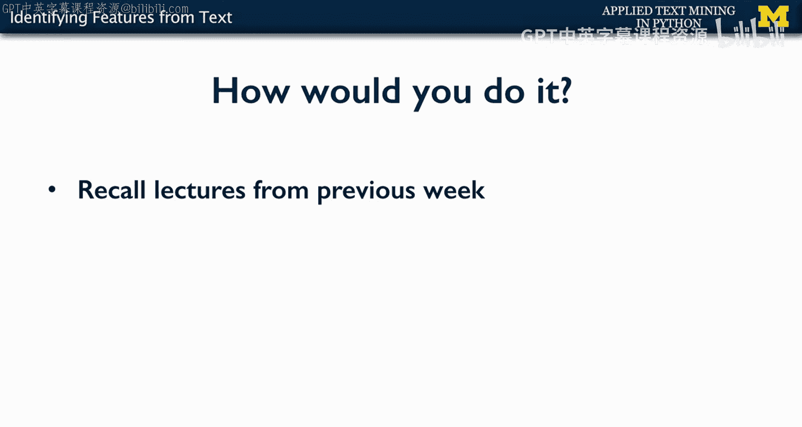

# 密歇根大学《Python用于数据科学实践（4-5课）｜Applied Data Science with Python 》中英deepseek翻译 p11 10_文本特征识别.zh_en -BV1DTtueTEwf_p11-

In this video， we are going to answer the first of the three questions on what to think about in a supervised learning scenario。

And that is feature identification。How do you identify features from text。

So why is text data so unique？The text data presents very unique set of challenges when you're looking at in the supervised learning scenario。

All the information that you need or that you have in cases is all in text。

But text is a very weak concept。 There are different ways you could pass a text document。

The features can be pulled from text in different gra narrativeities。

So let's take an example of the type of textual features that you will get。

The basic constructs in text is the set of words。So these are by far the most common class of features and add a significant number of features when you add to it。

 so for example， in English language there are about 40，000 unique words。

 so just looking at that in common English you would have 40，000 features。

If you're looking at social media or some other genres of data。

 you might get very many more number of features because you could have unique words spellings and so on。

 and all of those would be words。When you get these many features。

 one of the questions here to start answering is， how do you handle commonly occurring words。

In some cases， they are called stop wordss。Words like the。That occurs very commonly。

 And that's the most frequent word in English language。 and every document。

 every sentence would probably have the word the。But more generally。

 the word the is not as important for a classification task than any other word。

 Let's say the word of if you're talking about politics and you have Parliament as a word。

 Parliament as a word is more。Important than the word the to determine whether the document belongs to the politics class。

The next step is normalization。Do you make all words lowercase so that Parliament with a capital P and a small P are treated the same or as the same feature？

Or should we leave it as is？US capitals would be in the United States。

 whereas if you make it lowercase， it would be indistinguishable from the word us。

So in some cases you want to leave it as， in some cases you want to lowercase。

 so how do you make that choice？😊，There are also issues about stemming and lematization。

 so for example， you don't want plurals to be different features。

So you would want to limititize them or to stem them。Then all of this is still about words。

 let's go beyond words。You can actually identify features or characteristics of words， for example。

 capitalization。

The word。

As I said， US is capitalized。White House with a W capitalized and an H capitalized is very different than White House。

 a White House， right， So capitalization is important feature to identify certain words and that meanings。

You could use parts of speech of words in a sentence。And those could be your feature。 So。

 for example， if you want， if it's important to say that this particular word had a。

A determinant in front。Then that word is so then that becomes an important feature。

 an example would be the weather weather example， recall that we talked about a spelling correction problem where you want to determine whether the correct spelling is whether as in WHE THER or whether as in WEA THER。

If you see a determinant， like the。In front of that word。

It most likely would be the weather as in WEA DHGR。

So that particular part of speech before this word becomes a very important feature。😊。

You also might want to know the grammatical structure or pass the sentence and get the sentence pass structure to see what is the verb associated with a particular noun。

 how far is it from the associated noun and so on。And then you may want to group words of similar meaning to have one feature to represent a set of words。

An example would be by purchase and so on。 these are all synonyms。

And you don't want to have two different features， one for by one for purchase。

 you may want to group them together because they are they mean the same。

 they have the same same semantics。But it could also be other groups like titles or honorifics like Mr。

 M， doctor， professor， and so on。Or the set of numbers or digits because you don't want to specifically have a feature for0 or another feature for one and so on。

 all the numbers so you might want to say if it's a number anywhere between 0 to 10。

00 I'm just going to call it something called number right so suddenly you have reduced 10。

000 features into one。the same with dates， if you are able to recognize dates using regular expressions for example。

 and you do a very good job of it， then you may want to say you know what maybe all dates would be identified and called one feature as a date because I don't want to learn something that is for every individual date possible and it's an infinite list。

😊，Other type of features would be depending on the classification tasks， so for example。

 you may have features that come from inside the words or have features with word sequences。

An example would be bigrams or trigrams。 The White House example comes to mind where you want to say White House as a two word construct as a bigram is conceptually one thing。

As compared to white and houses， two different features， two different。Things。

You may also want to have character subequs， such as IN G or I O N。 And just by looking at it。

 you know that I N G is basically saying it is a verb in its continuous form， right。

 So just looking at I N G in a verb in a word would call it you would be able to call it as a verb。

An IO， more likely at the end of his word would be a noun in O some form。

So just these character subs can help you identify some classes if that is important for this particular classification task that you have。

So how would you do it？We have talked about some of these features and I would suggest you recall the lectures from previous week that was about natural language processing and basic NLP tasks and we have addressed some of these things there。

 you just want to identify them now and make it available as features for your classification task。

We'll see more examples of features soon。