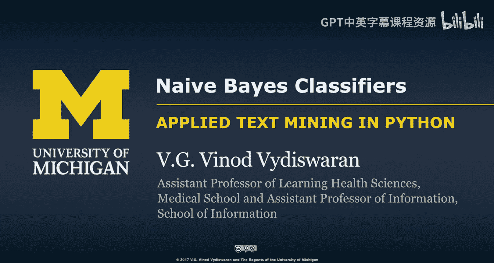
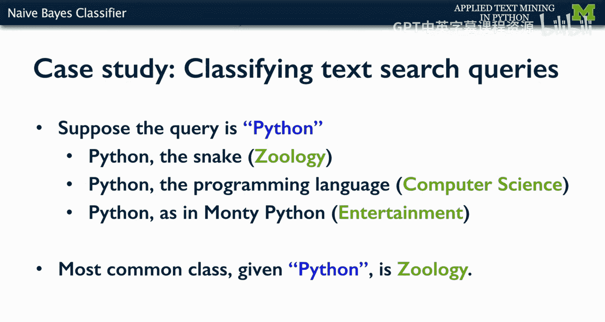
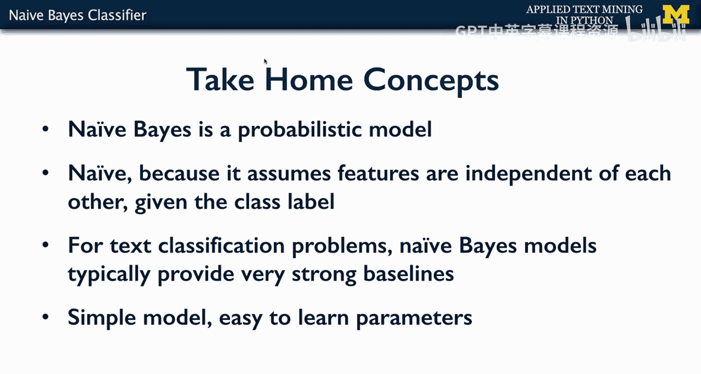

# 密歇根大学《Python用于数据科学实践（4-5课）｜Applied Data Science with Python 》中英deepseek翻译 p12 11_朴素贝叶斯分类器.zh_en -BV1DTtueTEwf_p12-

In this video， we are going to talk about one of the classification algorithms called the knife base Classifier。

Let's take a case to set up the scenario。This is the task of classifying text search queries。

So suppose you are interested in Class F search queries and you have three classes。

The entertainment class。The computer science class and the zoology class。The three subjects。

And then you know that most of the search queries are about entertainment。

 So that's that's what you know coming in that if you don't know anything else。

 the chances that it's an entertainment related query is pretty high。😊，Then you get the  query。

And the query is Python。And the the task is still the same。 The task is。

 can you classify Python as entertainment， computer science or zoology？Is it Python the snake。

If that is the case， then it is a zoology document。

But what if it is actually Python the programming language。Like applied data mining in Python， right？

Then it belongs to computer science。But if it is Python as in Monpyython， then it is entertainment。

So just the word Python could still mean one of these three。But then you think that Python as itself。

 the most common class。

Becomes zoology。So even though generally the queries are entertainment queries。

When you see the word Python and if that is your query。

 then the chances that it is actually zoology becomes higher。

Then you have another word and this time just Python download。

And then you can say that the most probable class is， in fact， computer science。

So what just happened there？You had。A model， in this case， a probabilistic model。

That tells you the likelihood of a class。Before you cut any information。

And then when you were given new information， you updated that likelihood of the class。

So you had a model that said entertainment is typically what any standard query。

 typical query would be， but then given the new information about the word Python。

 you said oh the likelihood of it being zoology is higher and it is not likely to be entertainment anymore even though there are cases of Python as in Mon Python where it would be entertainment。

So this change is what is in the crux of this naive base classifier。

You have something called prior probability that is the prior knowledge or the prior belief。

That the label belongs to entertainment。Or the label is computer science。 or the label is zoology。

 This is one of the three options you have。So you have a prior probability for。

Each of them and by basic probability you know that these are the only three options so the sum of these two probabilities should be one it's definitely one of the three it's either entertainment or computer science or zoology。

 but among the three entertainment is more likely。And then when you have new information， like。

The X is Python， where the input is Python。 So when you have new information。

 your probability like and likelihood changes your probability of entertainment。

 given the input is Python is suddenly lower。And the probability of why being computer science given excess Python is higher。

And probability of Y given zoology is even higher。That's why you would say that given the input Python。

 the label is zoology。So this is encapsulated in what is called base rule or base theorem。

And that says that the posterior probability depends on your prior。

But then also depends on the likelihood of that happening， of that event happening。

And it's divided by the evidence。 so in in mathematical terms。

 it comes to probability of y given x is probability of y which is the prior probability and probability of x given y。

 which is the likelihood of having the data as x given y。

 that means if you know that the label is zoology， the probability of seeing Python is so。

In in zoology documents， let's say。Or if you know that the label is entertainment。

 the probability of seeing Python in entertainment is。So and so， and that is lower。

Get significantly lower than the other one than if the class was zoology。So then I base classifier。😊。

Looks at this computation。 Look at what is the probability of a class。Like computer science。

 given the input as Python。And it computes saying what is the chance that it was computer science in general。

 what is the likelihood of it being computer science。

 what is the prior probability and then what is the likelihood of seeing the word Python in documents that were computer science。

😊，The same thing with zoology， so the probability of the class being zoology given Python。

Is what is the prior probability of the class being zoology without knowing any information and then given that it is the zoology class document。

 what is the chance that you will see， what is the likelihood of seeing Python？😊。

And then you'll say that if probability of YS CSs given Python is higher than Y zoology。

 the label as zoology given Python， then I'm going to call the label as computer science。

So in general， you're saying that probability of y given x is computed this way。

But then the Nive based classification model just is interested in which of the three labels is more likely。

So you know that y belongs to one of the three classes， entertainment， computer science or zoology。

It's only important to know which among those three is higher。

 and so the true label or the predicted label， I should say。

 y star is the y that maximizes probability of y given x。And in that computation。😊。

It does not matter what the probability of x itself is。

 so what's the probability of seeing a query like Python？

And you can remove it10 because it does not matter， it doesn't change with the label assigned to it。

This， in addition to what is called the naive assumption of Bayian classification forms the naive based classifier and the naive assumption is that given the class label。

 the features themselves are independent of each other。That is。given。The labelbel is Y。

 probability of capital X given Y is just individual feature probabilities， Pro of X I。

 given Y and a product of all of those。 That's the product that goes from the first feature to the n feature。

This is the final formulation of an na basease classifier。So the formula stands like this。

 the predicted label Y。Is。The why that maximizes the argument that maximizes。

This computation of probability of y given x。Which is computed using base rule as probability of y that is the prior。

Dme steep。Independent products of individual features given y。

 So that is the likelihood of probability of capital x given y。So for example。

 if the query is Python download。You're going to say the predicted y is the y that maximizes probability of y。

Probty of Python given y and probability of download given y。So for example， if it is zoology。

 you know that probability of zoology is low， people don't typically ask zoology queries。

But then probability of Python given zoology is very high。However。

 probability of download given Python is very low。However， in the case of computer science。

 probability of computer science queries in general is somewhere in the middle。😊。

Probty of Python given computer sciences。Not up there， but also significant。

Whereas probability of download given computer science is very significant。

 and a product of all of the three makes computer science as to be the the best predicted label。

So in nowB， we saw the model is just individual probabilities that you multiply together。

So what are the parameters there？You have the prior probabilities。

The prior probabilities are these probabilities for each of the classes in your set of classes。

So that's probability of y for all y in capital y。And then you have the likelihood。

 and that is probability of seeing a particular feature in。Documents of class Y。

The probability of X given y that is important or that is that is needed for all features Xi and all labels Y in y。

 So it's a combination of every feature in each of these classes that you have。😊。

So let's take an exercise。If you have three classes， that means the capital Y is 3。

And you have 100 features in your x。 That means x goes from x1， x2 up to 00。

Can you compute how many parameters are there in the naive base model。Give it a try。Now。

 once you know what are the parameters that you learn in a naive based model。

 let's see how do you actually learn that？So you have prior probabilities like probability of y for all y in this set of labels。

How do you identify that， How do you know that the the common most common class of search queries is entertainment。

Well， you have training data。So you have the set of documents or all the queries that are labeled。

As which class they belong to， so you have a query such as Ashton Kcher and that query would be entertainment or Lady Gaga。

 and that is also entertainment。😊，Or tiger。 And in the context of zoology， it's as an animal。

 and that would be zoology。Or something like C plus plus。 And that is。Comp science， and so on。

So you can just count the number of instances you have in your training data in each of these classes。

In the example I gave， I gave you two examples of entertainment and one each of computer science and zoology。

 so your class distribution just with four instances， would be half for entertainment。

 one quarter for zoology and one quarter for computer science。😊，In general。

 if there are n instances and small n of those are belonging to a particular class y。

 then your probability of class y is small n over capital n。

The next set of parameters you have is likelihood。So recall that likelihood is probability of X given y for all features Xi and for all labels y。

So it's a combination of there are many， many features here。

So how do you count those So the way you do that would be you'll count the number of times featured Xi appears in instances labeled as class Y。

So you only focus on the instances that were labeled class y。And among those。

 see how many times the feature X occurs。 So for example。

 you will only look at documents that belong to the computer science class and among those。

 you would scout how many times Python appears。Or you would look at all the queries that were called entertainment and then look for word like actor and see how many times the word actor occurs in those queries。

😊，So that would be probability of word actor given the class entertainment。

So if there are P instances of class y and X， the feature Xi appears in k of them。

 then the probability of X Q and y would be k over P。When you do this counting。

 there is a slight problem。And that problem is， what happens if the probability becomes 0。

 So for example。If you have never seen the word actor。In queries that were labeled entertainment。

Or let's say you never saw the word Python in the queries that were labeled entertainment because for some reason in your data。

 you never saw Mon Python。Then the probability the way you compute it would be0。😊。

But that is a problem because if you have the probability to be 0 and it is multiplied to all the other probabilities。

 the overall probability will end up being0。😊，So when a feature Xi never occurs in documents labeled y。

 it can never be the case that whenever you see the word the feature Xi， that the label is y。

You don't want to be that strict。 So you don't want to say that the posterior probability of y given Xi will be 0。

 because that would make any document that has Python to never be called。An entertainment class。

 right？So what you would want to do instead is to smooth the parameters。

And then you smooth the parameters。 One of the options to do it would be just add a dummy count。

 you say。It's never the case that the count is 0。 So I'll add count of one。

To every word in every class。This does not change the orura probability significantly because this。

 the， the way we have computed these probabilities， These are called maximum likelihood estimations。

 They are typically good when you have large numbers。

 but they are not so good when you have very small numbers。 So by adding count of one。

You don't really significantly change the larger numbers there。

 because what you do now is you say probability of X given y instead of K over p。

 you're going to say I'm going to add 1 to every word。

 so it's going to be K plus1 over p plus n because in all I have added n words。As dummies。

So that would be your way by which now you will never have a probability of zero here because。

If k indeed was 0， the probability would still be 1 over p plus n。So this way。

 how kind of avoided this problem with zero counts？

Now you might imagine and wonder if you would want to do something similar to the prior probabilities。

Think about it and we'll talk about it in one of the queries， the in video questions soon。

So to bring it all together。😮，The big take home messages from this video is that naivebase is a probabilistic model and it is called naive because it assumes that features are independent of each other given the class label。

It is naive because。It's actually not necessarily true even for text。 So for example。

 the fact that you have White House as two words， but together having a significantly different meaning。

If you see the word white with a capital W， the chance that it is followed by house is very high。

 so these two features of white and house are not really independent of each other。

But naive base models kind of ignore that。 They say that given the class label。

 I'm assuming all features are independent because the math on how do you kind of compute the probabilities becomes easy。

Even so。The for text classification problems， now Bay models actually typically provide very strong baseline。

 It is traditionally the first one you should try because it'll give you the benchmark or a baseline that is pretty strong。

 And then you can look at other models that you will see soon。

For how well it improves over 9 base models。It's a very simple model to learn the parameters are very easy to understand and to learn because they are just counts and they just counts counted in different ways and so on。

😊。

So the big message is nowIB is a very important classifier for text classification and should be the first one you should try。

