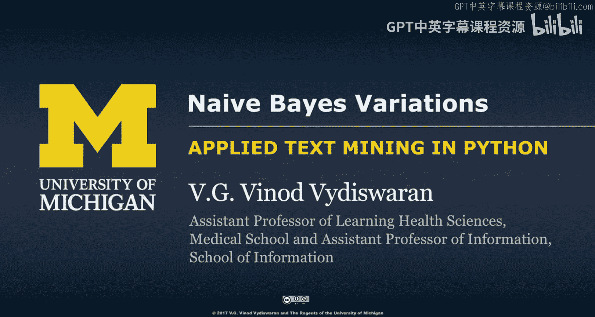
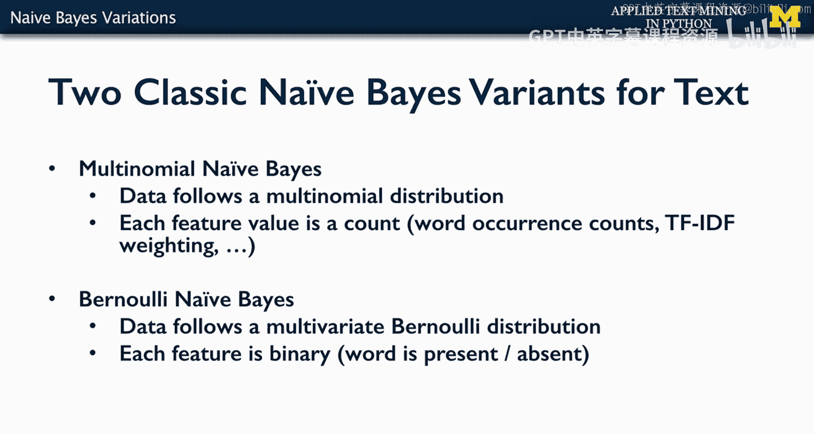

# 密歇根大学《Python用于数据科学实践（4-5课）｜Applied Data Science with Python 》中英deepseek翻译 p13 12_朴素贝叶斯变体.zh_en -BV1DTtueTEwf_p13-

When we talked about the naive based model and the theory and the formulation behind it。

We didn't really focus on the features and what do features represent？

There are two ways in which database based features could be learned。

This is the two classic variants of naive base for text。You have the multinomian na base model。

And the other one would be a Bnoli model， and we are going to talk about it soon。

The multinoial life based model。😊，Is one in which you assume that the data follows a multinoial distribution。

So what does that mean？It means that when you have the set of features that define a particular data instance。

You're assuming that these each come independent of each other and can also have multiple occurrences or multiple instances of each feature。

 So counts become important in this multinoial distribution model。

So you have each feature value is some sort of count or a weighted count example would be word occurrence counts or TFIDF weighting and so on。

So suppose you have a piece of text， a document， and you are finding out what are the all the words that were used in this model that will be called a bag of words model。

And if you just use the words， whether they were present or not。

 then that is a Bernoulli distribution for each feature。

 So it becomes a multivaried Bernoulli when you're talking about it for all the words。

But if you say that you the number of times a particular word occurs is important。 So for example。

 if the statement is to be or not to be and you want to somehow say that the word2 occurred twice。

 the word B occurred twice， the word or。Occurd just once and so on。

 you want to somehow keep track of what was a frequency of each of these words。

And then if you want to give more importance to more rare words。😊。

Then you would add on something called a term frequency inverse document frequency weighting。

 so you don't not only give importance to the frequency but say how common is this word in the entire collection and that's what the IDF waitinging comes from。

So for example， the word the is very common。 it occurs on almost every sentence。

 it occurs in every document， so it is not very informative。But if it is the word like significant。

 it is significant because it' is not going to be occurring in every document。😊。

So you want to give higher importance to a document that has this word significant。

As compared to the word the。And that is that kind of variation and weighting is possible when you're doing a multinial life based model。

😊，The second model is the Bernoulli knife base model。

Here the assumption is that the data follows a multivariate Brnoulli distribution where each feature is a binary feature that is a word is present or not present。

 and it's only that information about just a word being present that is significant and modeled and it does not matter how many times that word was present。

In fact， it also does not matter whether the word is significant or not in the sense that it is the word the which is fairly common in everything or is the word something like significant which is less common in all documents。

😊，So when you have just the binary features for。I mean， just a binary model for every feature。

 then the entire data， the set of features follows what is called a multivariate Brnoulli model。

So these are the two standard classic variance in nau base。 And you'll see that most of the。

Approaches and most of the tools that have that you have for nab modeling use give you that option。

 give you the option of multinoial livebase or beernoulli knifebase。

 It's very common for in text documents to use the multinomial live base。

 but there are instances where you would want to go the beernoulli route。

 especially if you want to somehow say that the frequency is immaterial。

 and it's just whether the presence or absence of a word that is more important。

