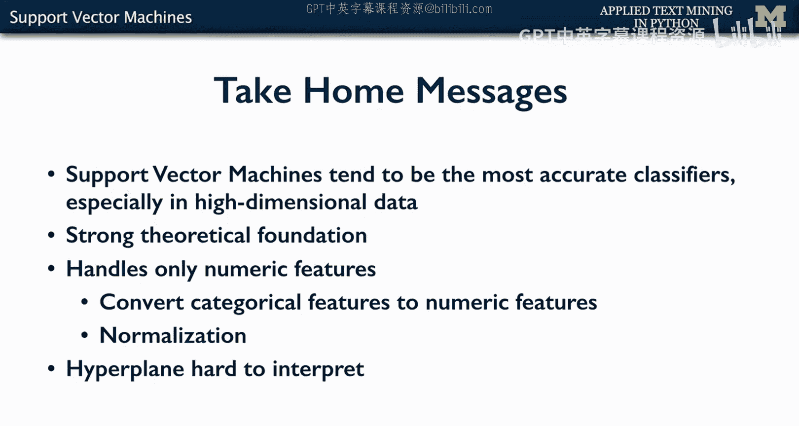

# 密歇根大学《Python用于数据科学实践（4-5课）｜Applied Data Science with Python 》中英deepseek翻译 p14 13_支持向量机应用.zh_en -BV1DTtueTEwf_p14-

In this video， we are going to talk about support vector machines。

Let's think again about the classification task we first saw。

This is a passage about some medical condition， and we need to decide whether it is nephrology。

 neurology， or podiatry。Looking at the words like athlete's foot and inspection of the foot and so on。

 we would know that this is podiatry。Let's take another example。

 and this is about sentiment analysis。This is somebody's review for a movie and you could guess which movie it is sense and sensibility。

And you can see that the author or the reviewer here has given some stars and so on。

 but then used words like wow and great movie and so on。Using those words。

 we could then identify that this particular review is positive。😊。

If you had seen words like boring or lame or worst and so on， it would be a negative review。

 So again， this is a sentiment classification task where looking at the words we had to determine whether it's positive or negative。

So in general， a classifier can be said to be a function on the input data。

So you have some function F that works on medical passages and labels or decides that what the class label should be nephrology。

 neurology or pory。Or another function looks at this review。

 a movie review and decides it's positive one that stands for positive review or negative one that stands for negative review。

It's typical to actually have numbers like positive one or negative one assigned to classes。

 and that's what support vector machines or any other linear classifier typically use。

When we're talking about support vector machines， we need to talk about decision boundaries。

What is a decision boundary。Let's take this example。 There are just two dimensions， x1 and x2。

 and there are points， data points in this two dimensional space。 Some of them are marked star。

 others are marked circle。Let's call the circle ones as class A and the stars as class B。

Now you need to somehow make a boundary around one of the classes。

To separate that from the other class。You could use any decision boundary。

 you could use a one that is a circle。Or you could use one。 That's a square。

Or you could have any other random shape in this case， that's shape of a heart。

A classification function is represented by this decision surface or decision boundary。

And this choice of what shape you should use is completely dependent on this application。

If you think that points in this two dimension space are well represented using a circle。

 you'd use that。Whenever you use a decision boundary。

 the main purpose is when you get a new point that is unlabeled。

 depending on the decision boundary you have learned， you can label it as one of the classes。

 so in this particular example this point that is unlabeled will be marked as a star。Or class B。

 because that is outside this boundary that was learned around class A。

But when you' are choosing a decision boundary there are other factors that should be considered and let's take another example where here you have positive and negative points。

 so positive is one class， negative is the other class and all the red positives and negatives define this training data that we have。

Looking at this data， you could learn a boundary like this。 It's an irregular shaped Pentagon。

Or in general any other polygon， a closed surface that puts all the positive class or the positive points inside this polygon and all the negative points are outside。

This is a perfectly great decision boundary。 The accuracy on the training data is 100%。

 Every point is labeled correctly。😊，But then when you look at the test data represented by black positives and negatives here。

 you would start seeing that， yes， in general， there are positive points near positive points that you saw earlier in general negative points are near negative points。

 but then because of the way we defined the decision boundary， there are many。

 many more mistakes that we have done here。 there are many。

 many positive points outside of the polygon。The outside sphere is supposed to be negative。

And there are points within this polygon that are negative。😊，So in general， in unseen test data。

 this decision boundary has not worked very well。This problem is called data overfitting when you have learned a decision boundary that works very well on training data but does not generalize to test data。

So instead of a regular shape boundary， let's consider a linear boundary or a straight line。

 so in a two dimensional space it is a straight line in a three dimensional space。

 it would be a plane in general in an n dimensional data representation， it would be a hyperplane。

So in this particular case， you have a line that separates the positive region that's one half of this two dimension space as positive and the other half as negative。

As you can see， it's not accurate。 it's not 100% accurate。

 You have three negative points on the positive side and you have one positive point on the negative side。

 So yes， it has made some mistakes in the training data。But it's very easy to find。

Because you have to basically learn a line that maximally separates these two points that that makes as fewer errors as positive as possible。

 and you can see that there is no one line that could have separated the positives from negatives completely。

So this is as good as you can get。Right。It's also very easy to evaluate because now you have a very simple rule that any point in this entire half space。

 entire half region that's on the positive side is going to be called positive and any point on the other side is going to be called negative。

In general， this idea of using a simple classifier or simple model。

To fit the data is called a caraer， and the rule of thumb here is simple models generalize well。

You want to use something that is simple to explain that would work very well in the test data。

 and as you can see if you apply the test points on top of this。

 you would notice that all test points have been correctly classified。

Except for one positive that's on the negative side。

 So the error is really just one point on the test data。 And， of course。

 there are four points in the training data that were misclassified as well。 But overall。

 this is still a much better model than this irregular shade boundary where we had seen earlier that quite a few positive points have been misclassified and two of the negative points were misclassified in the test data。

So how do you find this linear boundary？You could use a lot of algorithms and methods to do so。

Typically， when you're finding a linear boundary， you' are finding W or the slope of the line。

You basically want to find out the coefficients that are the weights associated with the dimensions x1 and x2。

 so w is typically of the same dimension same size as your data points。

And you are going to use a linear function to see which point would be called positive or negative。

There can be many methods per seron or linear discrimin analysis or linear least square techniques and so on。

There are many methods to use， so you could use perceptrons。

 you could use linear discriminative analysis or linear least squares。And in one particular case。

 in this case， we are going to talk about support vector machines。😊。

The problem is that whenever you have a linear boundary that separates the positive points and negative points。

 if there is one line that splits the positives and the negatives from each other that are in fact infinitely many lines。

 so you could have a line like this or the line like this or the line like this。

 they all separate the positive points from the negative points。Then the choice becomes。

 what is the best line here？So let's take another example， very similar to what we have seen before。

 again， two dimensions， positives and negatives。😊，And consider this line。

This line is one that goes from the farthest positive to the farthest negative by farthest， I mean。

 the ones that are kind of the most confusing。That is closest to the boundary。

 And this line perfectly splits the data as best as you can。 I mean， it's not really 100% accurate。

 as you can see there are negative points on the positive side and two positive points on a negative side。

But if you learn this line。You could have actually you learn any other line and the question becomes。

 what is a reasonable boundary？😊，So instead of the blue line， if you consider this red band。

You would see that the points that are in the confusion are low， what do I mean by that？

So in the previous example， when you had just this blue line。

Any small change to the positive point or a negative point will make an error。

 If you make a small perturbation on the positive point。

 let's take an example here and say this point is moved a little bit。Here。Suddenly。

 you're either making a mistake or this line has to change to now。Get here。

So you can see that a small change in a data point can actually lead to a big change in the classifier。

😊，However， if you use。A line like this。Where you have a big band separating the points。

You would notice that。Any small change the same small change that you found here。

Would still be on the same side as the hyperplane as what you would expect it to be。

 So small change in your data points would still not change the label that this particular classifier will assign that。

So a small change， actually so it's more resistant to noise or perturbations。

This idea is called maximum margin。You would want to learn the thickest band that you can fit that separates the positive points from negative points。

This band or the thickness is called the margin， and the middle line between them is called the actual hyperplane。

 so that's the maximum margin hyperplane。The idea here is that you are not basing your classifier on two points。

 a positive and negative point， but a set of points called support vectors。And in general。

 the support vector machines is this maximum margin classifier。

Where it's not just one or two points that will make a big difference。

 you actually have a lot of support to learn this margin or this band and these support vectors are the points that are the most sensitive to shift。

 but even then small changes or perturbations to support vectors still would not change the classification because classification happens with respect to this maximum margin hyperplane。

So now the question becomes， how do you find it？Support vector machines uses optimization techniques to do it。

These are linear classifiers that find the hyperplane to separate these two classes of data。

 the positive and a negative class， and basically given training data of the type x1。

 y1 x2 y2 and so on， where x are the representations of the data in terms of its features。

 suppose it's an n dimensional feature representation。And you have the Y as the class label。

 which is one of two labels here， -1 and plus 1。Then SM will find a linear function W。

 a weight vector such that the function of F of X is this dot product of w and X。

 so w dot X with some bias term， but the idea is that if the value for a new X if the function leads to a positive value if f of X is greater than0。

 then the label is positive1， otherwise the label is negative1。

You have seen that this SVM then works only for binary classification problems。

 and we have seen an example of this positive one a negative one so far。

But then what happens when you have multiple classes。

 Let's take this example of the three classes podiatry， nephrology， neurology。In general。

 when you have to use the SVM in a multi class classification setup。

 you would want to learn it in one of two scenarios。One is called one versus rest。

Where you are actually learning binary classifiers between one class and all the other classes together。

 for example， this is the classifier between nephrology and all documents that are not nephrology。

Okay， assume that D1 to D9 are all nephrology documents。

 So this classification is a perfect classification to learn nephrology。😊。

As these nine documents and anything that is not nephrology is on the other side。

Then we learn another classifier this time for neurology。😊。

Where the documents D10 to D15 are neurology documents and everything else。

 D1 to D9 and D16 to D21 are all not neurology。And then we do the same thing with podiatry。

 you have the documents D16 to D21 that has labeled po and everything else that's D1 to D15 is going to be not podia。

😊，So in general， we are learning three classifiers， or for N class set up。

 we are learning n classifiers such that all the points in one region。 let's take the region as。

This D 9 D16 to D21。It's going to be not nephrology。Yes， on po。And。What's the other one， Yes。

 it's not on。Neurology， so it's not neurology， it's not nephrology， and it's podiatry。

 So this is going to be podiatry。Right。Let's take another setup and this setup is where instead of learning one versus rest。

 we are going to do one versus one。😊，That means that you are going to learn classifies between。

Let's say nephrology and neurology。So in this case you look at only documents that will label nephrology or neurology。

 that's D1 to D9 and D10 to D15 and separate them， so the red line just separates these two points。

These two classes， I'm sorry。And then you learn another classifier。

 this is between neurology and podiatry。😊，That works on a smaller set again。

 it's between D1 to D9 as the neurology documents and D16 to D21 as the proprietary document。

And again， the third one， which is between nephrology and pory。

When you have these three classes together， you can see that in general for an n class setup。

 there are N choose2， a combinatorial number and square number of classifiers。

It so happens that for three classes， it is three classifiers。

 but for four classes it likely be six classifiers and so on。

But then you can still use the same idea where you have。These points。Going to be called。

Between the class labels podiatry and neurology， it's podiatry。Between the classes。

 podia and nephrology is po。And between the classes， nephrology and neurology。

 it's basically nothing because it's right in the middle right but you still see that sometimes it' is going to be called nephrology。

 sometimes it's going to be called neurology， but the overall votes are still in favor of podiatry because you have two that all of these points are going to get two votes on podiatry because of the other two classes and maybe one additional vote for nephrology or neurology in any case all of these points are still going to be classified correctly as podiatry。

So both of these in this particular toy dataset have been labeled the right way。

 but just the ID and the approach is very different in one case you are learning one class against all the other classes and in the other case it's one versus1 and do n square number of classes order of n square number of classes this。

😊，So let's let's look at what are the parameters when you learn a support vector machine。

 One of the most critical parameters becomes parameter C， and that defines regularization。

Regularization is a term that denotes how important it is for individual data points to be labeled correctly as compared to all the points in the general model。

 So how much importance should we give to individual data points。This parameter， for example。

 if you have a larger value of C， that means the regularization is less。

And that means that you are fitting the training data as much as possible。

 You are giving the individual points a lot of importance。And every data point becomes important。

 you want to get them right， even if the overall accuracy is low or generalization error is high。😊。

Whereas smaller values of c means there are more regular where you are tolerant to errors on individual data points as long as in the overall scheme you are getting simple models。

 let's say。So the generalization error is expected to be low。

The default values in most of the packages is1。But you could change that parameter。

 depending on how important you want your individual data point classifications to be。

The other parameters are typically with respect to what is the type of decision boundary you would want to learn。

We talked about linear kernels a lot here， linear decision boundaries。

 but you could have a polynomial kernel or a radal basis function kernel and so on。

 in fact we have talked about these in Co 3 as part of this specialization so I would refer you to some of the slides and discussion around that in the previous course in the course 3。

TheAnother parameter for SVM is whether it's multiclass or not。

 and if it is multiclass which one would you use so OVR would be the parameter setting for one versus rest and there are other parameter options possible as you can see with one versus rest you are learning fewer number of classifiers so that's preferred over one versus1。

The other important factor and a parameter would be class weight。

So different classes could get different weights， for example， if you want a particular class。

 let's say spam or not spam and you know that the spams are usually like 80% of ems somebody gets so then you would want because it's such a skewed distribution where one of the classes 80% and the other classes 20% you would want to give different weight to these two classes。

😊，In general， these parameters are possible to make a set in Python models and we'll talk about exact parameter settings in another video。

But to conclude the big take home messages from support vector machines is that these tend to be most accurate classifiers for text。

 especially when you're talking about high dimensional data as text data typically is。

There are a strong theoretical foundations for support vector machines。

 it's based out of optimization theory， which you are not talked about in any detail in this video。

But I would encourage interested folks to go and check it out。

 We'll add some of them in the reading list for this video。

Support vector machine handles only numeric data so what would you do with other data you typically convert these categorical features into numeric features as you can see this is a dot product based tech algorithm so it uses numbers to define whether the it should be boundary on one side or the other so it uses works only on numeric features。

You would also want to normalize the features that means you don't want some dimensions to be very high numbers and other dimensions to be very low。

 you would want to put them all in a0 to one range so that each feature gets enough importance and you can learn the relative importance that way。

But in general， the hyperplane that you learn， even if they are very easy to learn and easy to test。

 they are hard to interpret， which means that you don't really know why particular point has been labeled as positive or negative。

 it's a combination of multiple factors but in general。

 if explanation is not a critical requirement for your classifier。

 support vector machines to give you very high very accurate classifier very similar to naive base in fact for a lot of text classification problems support vector machines should be one of the first ones you should try。

