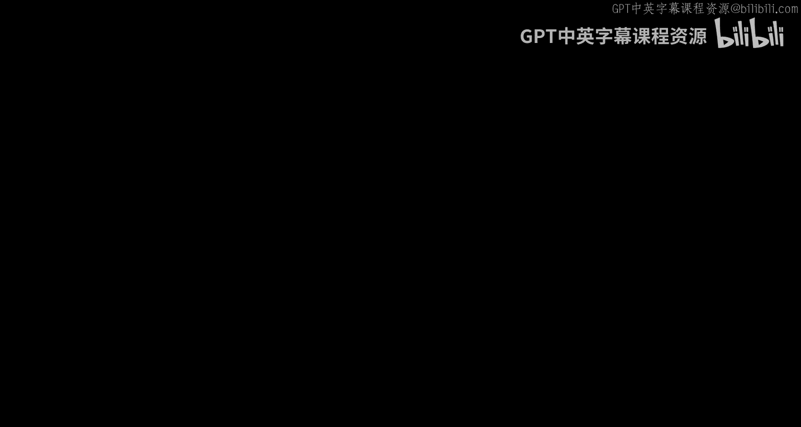
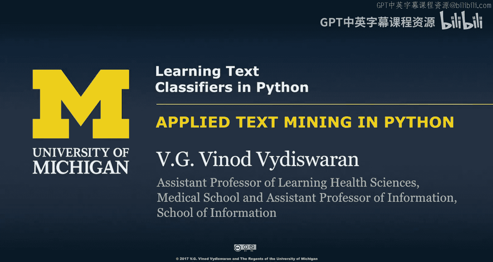
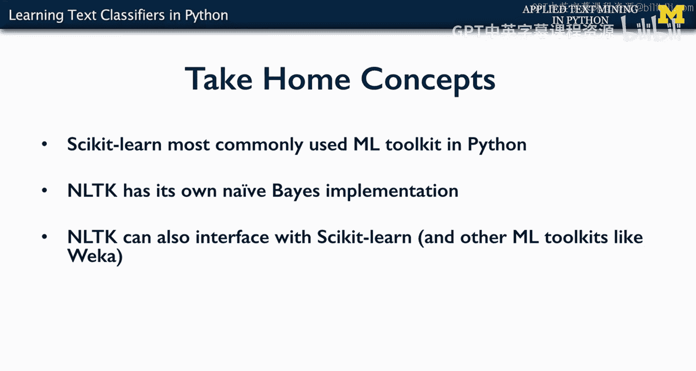

# 密歇根大学《Python用于数据科学实践（4-5课）｜Applied Data Science with Python 》中英deepseek翻译 p15 14_Python文本分类器构建.zh_en -BV1DTtueTEwf_p15-

Okay， so now that we know what is the theoretical understanding of text classification。

 let's see how to build one in Python。There are quite a few toolkits available for supervised text classification。

Psychic Learn is one of them。For those of you who have gone through course  three of the specialization。

 you have seen I could learn before。The other toolkit is something that we have seen in this course。

 that's NLTK。And in fact， NLTK interfaces with PsychicLn and also has interfaces for other machine learning toolkits like VACCA。

We will not be covering VA in this course， but I would encourage you to check it out as well。

Let's first start with Psyit learn。PsyitLearn is an open source machine learning library。

It started as a Google summer of code in 2007， but it has very strong programmatic interface。

 especially when you compare it again WiCA， which is a more graphical user interface or primarily driven as a user interface model。

ButsitLn is used extensively as a machine learning library in Python。

CcuitLn has predefined classifiers， the algorithms are already there for you to use so you could use the knife base classifier if you want to learn that。

 so let's go through some steps about what functions you'd use。

 what calls you'd use when you' are using the Nive basease classifier。First。

 you need to import knife basease from SKL。Then you are going to call this Nive base dot multiomial knife basease classifier。

 and that would be your base classifier。Now we have seen earlier that there are two big ways in which naive based models can be trained。

 one is a multinomial model， another one is a Bernoulli model and you also have a Bernoulli model here you have Nive based do Bernoulli in V if you want to use that model。

Once you have defined a base classifier， you can train that classifier on the training data。

You would use classifier dot fit and then give the data and label as the two parameters。If you are a。

Fairly comfortable with this。 you could actually merge them to together。

 You could say knife base dot multinomial knife base。😊，Dot fit。

 train and train data and train labels。Once you have trained the model。

 you would predict the label for a new data set using Pre function。

 so you'll have classifiedify do predict and pass the test data that has been you have already extracted the features and so on and then when you call it with Pre you are going to get the labels。

And then once you have the labels， you can see how well you have done in your classification。

 especially if you have labeled test data， you would use metrics。

 F1 score that is one of the measures that we use and give the test labels that is the gold set。

 the actual labels， the predicted labels， and define what kind of averaging you want to do。

 micro averaging and macro oververaging。😊，You have covered some of these concepts already in course 3。

 so I'll not repeat them here， but I would point to some of the reading material around what kind of measures you could use instead of F1 score。

 What does F1 mean and what kind of averaging you could do。

 like micro averaging and macro averaging and so on。SK learn thatsy learn also has SVM classifier。

 So how would you do how would you train a support vector machine an SVM。Well。

 the calls are very similar。😊，In this case， you are going to import SVM from SKlon。

And call SVM dot SV C。As the classifier， SVC stands for support vector classifier， let's say。

For as we see， you need to pass some parameters。Typically for text classification models。

 you are going to focus on linear classifiers， so it's a linear kernel。

 so you can see kernel is linear。😊，And then you can specify the C parameter。

 We have talked about that earlier in one of the earlier videos。

And that is the parameter for soft margin。The default values for kernel is RBf。

 a radial basis function kernel， and the default value for c is 1 where you are neither too hard nor too soft on the margin。

Once you have defined this base classifier， you can fit or you can train it the same way as you train the na base one。

 so you're going to say classifier dot fit and pass the data and labels as two separate parameters。

And then you're going to predict the same way as last time you have classified or predict or test data。

Now we need to talk briefly about model selection。😊。

You'd recall that there were multiple phases in supervised learning task and we talked about it earlier。

 there's a training phase and in this inference phase you have labeled data that is that is already labeled so in this case it's green and red and you split that labeled data into the trained dataset and the holdout or validation dataset and then you have the test data that that could also be labeled that would be used to say how well you have performed on unseen data。

 but typically the test data is not labeled， so you are going to train something on a label set and then you need to apply it on an unlabeled test set。

So you need to use some of the labeled data to see how well these models are。

Especially if you are comparing between models or if you are tuning a model。

 So if you have some parameters， for example， you have the C parameter and SVM。

 you need to know what is a good value of C。So how would you do it？

That problem is called the modelal selection problem。And while your training， you need to somehow。

 make sure that you have ways to do that。There are two ways you could do model selection。

 one is keeping some part of training the label data set separate as they hold out data。

And the other option is cross validation。So for the first one， you if you are doing it in SitL。

 you' are going to say from SitL import model selection。

 so that will give you the options available to you and then first we'll see how you could use the train test split。

So you're going to say model selection。train test split。

 give the train data and train labels and then specify how much should be your test size。

So for example， suppose you have these data points in this case I have 15 of them and I say I want to do a 2 third。

 one third split， so my test size is 1 third or 0。333。

That would mean 10 of them would be the train set and five of them would be the test set。

Now you could shuffle the training data， the label data so that you have a randomly uniform distribution around the positive and negative class。

But then you could say， I want to keep。Let's say 66% in train and 33% in test or go 8020 if you want to。

 let's say four out of five should go in my train set and the one out of five， the fifth part。

As a desert。When you do it this way， you are losing out a significant portion of your training data into test。

 Remember that you cannot。See the test data when you're training the model。

 So test data is used exclusively to tune the parameters。

 So your training data effectively reduces to 66% in this case。

The other way to do model selection would be cross validation。😊。

So the cross validation with5fold cross validation would be something like this where you split the data into five parts。

These are called folds。And then， you train on。Train five times basically。

 you train every time where four parts are in the train set and one part is in the test set。

So you' are going to train five models， let's see。First， you're going to train on。

Parts one to four and test on five。The next time you're going to say， I'm going to train on。2 to 5。

 and test on one。And so on。 So you have one iteration where。5。Is the test。

Another equation where one is the test。A third iteration where2 is the test and so on。

So when you're doing it in this way， you get five ways。Of splitting the data。

Every data point is in the test once in in these five folds。

And then you can average out the five results you get on the test set on the wholedo data set to see how will perform。

 how the model performs in un unseen data。The cross validation folds is a parameter in this explanation I took it as 5。

 it's fairly common to use tenfold cross validation。

 especially when you have a large data you can keep 90% for training and 10% as the cross validation holdout dataset but because you are doing it 10 times you are also averaging and over multiple runs and in fact it's fairly common to run cross validation multiple times so that you have reduced variances in your results。

Both these models trained as split cross validation are fairly commonly used and critical when you are doing any model selection。

Okay， now let's move to N LTK。How do you do supervised text classification in the National language toolkit that we have seen in fair detail in this course？

And Lter has some text classification algorithms， so for example， it has a na based classifier。😊。

It also has decision trees and conditional exponential models and maximum entropy models and so on。😊。

But the real interesting thing is it has something called VA classifier or Sk learn classifier that gives。

😊，Users of N L T K， a way to call the。Underlying Psyit learn classifier or underlying VA classifier through their coding in Python。

So specifically， if you are using the native naive based classifier that is available in an LTK。

 we are going to say from N LTK dot classify， input the N based classifier。😊。

You're going to say the classifier is this nabaseclass do train。

 so you're directly going to train on the train set。

 so note that there are no two functions really as is common insic learn where you have a model a base model and then you have a training function here you're going to say that you have this na baseaseclassifier dot train and you train this model。

And you're going to classify using the classify function。

 so you're using classifiedifyclassify unlabeled instance。

 if it's one instance you're going to use the classify function， if there are many。

 you're going to say classify many and give a set of unlabeled instances。

You can also calculate the accuracy or the performance of the learn classifier using anator classify u function and then call the accuracy function there where you are giving in the classifier and the test set。

 and that will give you how well what is accuracy of this classifier that you have trained。

You can also use other utility functions like labels。

 so classifiedify that label tells you all the labels that are there that this classifier has trained on。

And you can use some features like this where you have show most informative features that gives you the top few features and you can see how many features you want。

 say top five or top 10 features that are most important or informative for the classification task。

It's especially useful in N based classifiers when you want to know which features have the most kind of information in them or which ones are most informative for the final classifier。

For support vector machines， there is no native NLTK function， but as I said。

 you can use thesit learn SVM function through NlTK。

 So here you are going to say anlTK or classify imports learn classifier so SK learn classifier and then youre going to you can actually use both na base models froms learn using SQ learn do na basease import multinoial live basease。

Or Bni base。 And you can use the SVM model that we have seen earlier。

 So from Scallon dot SVM import SVc。You'll call the function very similar way to how you do it in checkL。

 so you have SK learn do classifier， give the classifier there。

 the name of the classifier and dot train and give the train set。Now for multinmal live base。

 there was no parameters that you need to pass。 That's okay。 but for support vector machine。

 there is one right so you you need to specify the kernel for example。

 so you can specify that inside this SqN classifier function。

 You're saying that I'm going to call SVc and I'm going to pass parameter where it linear kernel and the C parameter for example。

 can also be specified here。And then you're going to say dot train， dot train set。

The rest are very similar to how you do in EcalL。 you can use the credit function and so on。

So the take home messages here are that psyic LED is most commonly used machine learning toolkit in Python。

😊，But NLTK has its own implementation of knife basease。

 and it has this way to interface with psychitL and other machine learning toolkits like VA by which you can call those functions。

 those implementations through NLTK。😊。

