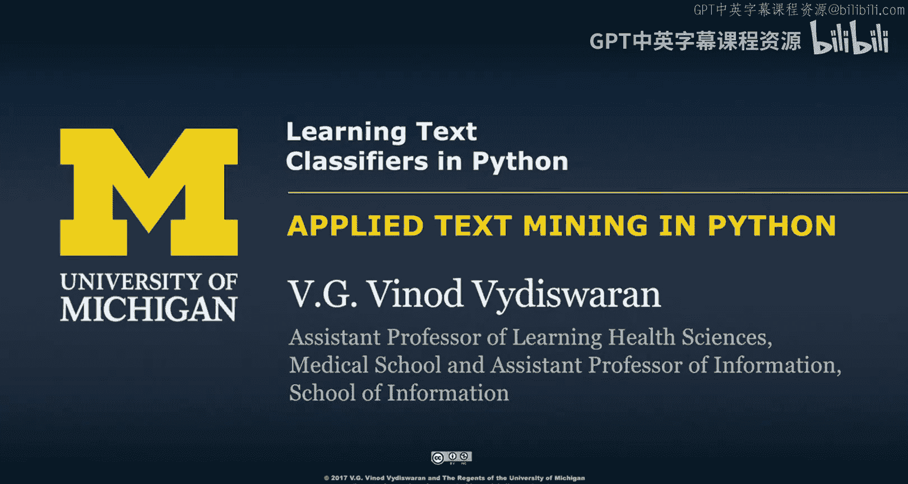
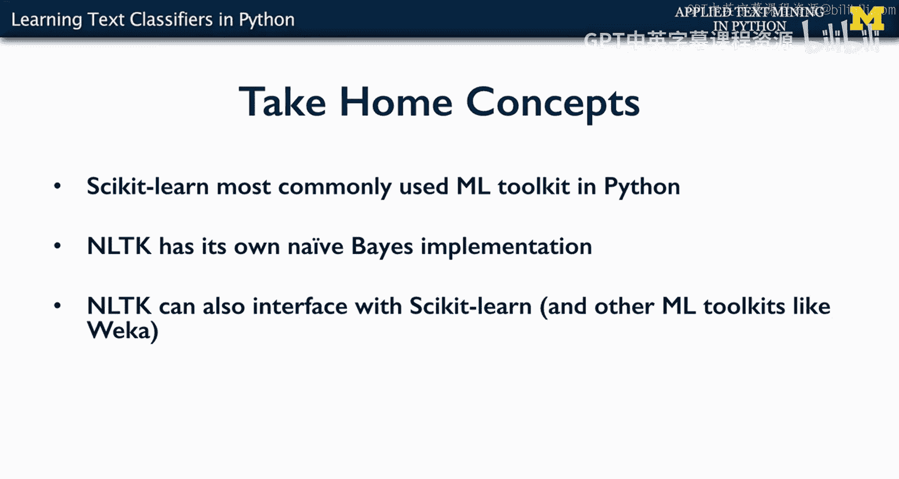

# Python用于数据科学实践：4-5：Python文本分类器构建 🐍




在本节课中，我们将学习如何在Python中实际构建一个文本分类器。我们将介绍两个主要的工具包：Scikit-learn和NLTK，并详细说明如何使用它们来训练和评估分类模型。

---

## 理论回顾与工具选择

上一节我们介绍了文本分类的理论基础。本节中，我们来看看如何在Python中实现它。

构建监督式文本分类器有多个工具包可用。Scikit-learn是其中之一。对于已完成本专项课程第三门课的同学，你们已经接触过Scikit-learn。另一个工具包是我们在本课程中见过的NLTK。实际上，NLTK可以与Scikit-learn交互，也支持与其他机器学习工具包（如Weka）的接口。本课程不会涵盖Weka，但鼓励你自行探索。

---

## 使用Scikit-learn构建分类器

Scikit-learn是一个开源的机器学习库。它始于2007年的Google编程之夏项目，拥有非常强大的编程接口。与Weka更偏向图形用户界面不同，Scikit-learn在Python中被广泛用作机器学习库。

Scikit-learn预定义了多种分类器算法，可以直接使用。例如，你可以使用朴素贝叶斯分类器。

以下是使用朴素贝叶斯分类器的步骤：

首先，需要从`sklearn`导入朴素贝叶斯模块。
```python
from sklearn.naive_bayes import MultinomialNB
```
然后，调用`MultinomialNB()`来创建你的基础分类器。
```python
classifier = MultinomialNB()
```
我们之前提到，朴素贝叶斯模型主要有两种训练方式：一种是多项式模型，另一种是伯努利模型。Scikit-learn也提供了伯努利模型，你可以使用`from sklearn.naive_bayes import BernoulliNB`。

定义好基础分类器后，你可以在训练数据上训练它。
```python
classifier.fit(train_data, train_labels)
```
如果你对此很熟悉，也可以将创建和训练合并为一步。
```python
classifier = MultinomialNB().fit(train_data, train_labels)
```
模型训练完成后，你可以使用`predict`函数为新数据集预测标签。
```python
predicted_labels = classifier.predict(test_data)
```
得到预测标签后，你可以评估分类效果。如果你有带标签的测试数据，可以使用`metrics.f1_score`等指标。
```python
from sklearn import metrics
f1 = metrics.f1_score(test_labels, predicted_labels, average='micro')
```
`average`参数可以指定为`‘micro’`或`‘macro’`，用于计算F1分数。这些概念在第三门课中已涵盖，此处不再重复，但建议你阅读相关材料以了解不同评估指标和平均方法的含义。

---

## 使用Scikit-learn的SVM分类器

Scikit-learn也支持支持向量机分类器。那么如何训练一个SVM呢？其调用方式非常相似。

在这种情况下，你需要从`sklearn`导入SVM模块。
```python
from sklearn import svm
```
然后调用`svm.SVC()`作为分类器。`SVC`代表支持向量分类器。
```python
classifier = svm.SVC(kernel='linear', C=1.0)
```
如你所见，需要传递一些参数。对于文本分类模型，通常关注线性分类器，因此设置`kernel='linear'`。你还可以指定`C`参数，我们在之前的视频中讨论过，这是软间隔的参数。`kernel`的默认值是`‘rbf’`（径向基函数核），`C`的默认值是1，此时对间隔既不“太硬”也不“太软”。

定义好这个基础分类器后，你可以用与训练朴素贝叶斯相同的方式训练它。
```python
classifier.fit(train_data, train_labels)
```
预测方式也与上次相同。
```python
predicted_labels = classifier.predict(test_data)
```

---

## 模型选择

现在我们需要简要讨论一下模型选择。

回想一下，监督学习任务有多个阶段，我们之前讨论过。有训练阶段，在推理阶段，你拥有已标注的数据（例如绿色和红色）。你将这部分标注数据分割为训练数据集和保留（或验证）数据集。然后你还有测试数据，它也可能被标注，用于评估模型在未见数据上的表现，但通常测试数据是未标注的。因此，你需要在标注集上训练模型，然后将其应用于未标注的测试集。

你需要使用部分标注数据来评估这些模型的表现，特别是在比较不同模型或调整模型参数时。例如，对于SVM中的`C`参数，你需要知道什么值是好的。这被称为模型选择问题。在训练过程中，你需要确保有方法来解决它。

有两种方法可以进行模型选择：一种是将部分标注训练数据集单独留出作为保留数据；另一种选择是交叉验证。

对于第一种方法，在Scikit-learn中，你可以这样做：
```python
from sklearn import model_selection
train_data_split, test_data_split, train_labels_split, test_labels_split = model_selection.train_test_split(train_data, train_labels, test_size=0.333)
```
例如，假设你有15个数据点，你想进行2/3和1/3的分割，那么`test_size`就是1/3或0.333。这意味着其中10个将成为训练集，5个将成为测试集。你可以打乱训练数据（标注数据），以便正类和负类有随机均匀的分布。你可以选择保留66%在训练集，33%在测试集，或者如果你想，也可以按80/20分割。

当你这样做时，你会将相当一部分训练数据“损失”到测试集中。请记住，在训练模型时，你不能“看到”测试数据。因此，测试数据专门用于调整参数，所以你的训练数据实际上减少到了66%。

另一种模型选择的方法是交叉验证。

以5折交叉验证为例，你将数据分成五部分，这些部分被称为“折”。然后，你基本上训练五次，每次其中四部分在训练集，一部分在测试集。你将训练五个模型。第一次，你在第1到4部分上训练，在第5部分上测试。下一次，你在第2到5部分上训练，在第1部分上测试，依此类推。这样，每个数据点在这五折中都会在测试集中出现一次。然后，你可以平均在这五个测试集上得到的结果，来评估模型在整个数据集上对未见数据的表现。

交叉验证的折数是一个参数，在这个例子中我设为5。当你有大量数据时，使用10折交叉验证相当常见，这样你可以保留90%用于训练，10%作为交叉验证保留数据集。因为你做了10次，你也在多次运行中进行了平均。实际上，多次运行交叉验证以减少结果的方差是相当常见的。

这两种模型选择方法——训练集分割和交叉验证——都非常常用，并且在执行任何模型选择时都至关重要。

---

## 使用NLTK构建分类器

现在让我们转到NLTK。如何在我们本课程中已详细见过的自然语言工具包中进行监督式文本分类呢？

NLTK有一些文本分类算法。例如，它有一个朴素贝叶斯分类器。它还有决策树、条件指数模型和最大熵模型等。但真正有趣的是，它有一个叫做`WekaClassifier`或`SklearnClassifier`的东西，这为NLTK用户提供了一种方式，可以通过他们的Python代码调用底层的Scikit-learn分类器或底层的Weka分类器。

具体来说，如果你使用NLTK中可用的原生朴素贝叶斯分类器，你会这样做：
```python
from nltk.classify import NaiveBayesClassifier
classifier = NaiveBayesClassifier.train(train_set)
```
请注意，这里没有像Scikit-learn中那样常见的两个独立函数（一个基础模型和一个训练函数）。在这里，你直接使用`NaiveBayesClassifier.train`来在训练集上训练模型。

你可以使用`classify`函数进行分类。
```python
label = classifier.classify(unlabeled_instance)
```
如果是一个实例，你使用`classify`函数；如果是多个，你可以使用`classify_many`并给出一组未标注的实例。

你也可以使用`nltk.classify.util.accuracy`函数来计算学习到的分类器的准确性或性能。
```python
from nltk.classify.util import accuracy
acc = accuracy(classifier, test_set)
```
你还可以使用其他实用函数，如`labels`，它告诉你分类器训练过的所有标签。以及像`show_most_informative_features`这样的功能，它可以给出最重要的几个特征，你可以指定查看前5个或前10个对分类任务最重要或信息量最大的特征。这在朴素贝叶斯分类器中尤其有用，当你想知道哪些特征包含最多信息或对最终分类器最具信息量时。

对于支持向量机，NLTK没有原生函数，但正如我所说，你可以通过NLTK使用Scikit-learn的SVM函数。这里，你会这样做：
```python
from nltk.classify import SklearnClassifier
from sklearn.svm import SVC
classifier = SklearnClassifier(SVC(kernel='linear', C=1.0)).train(train_set)
```
对于多项式朴素贝叶斯，你不需要传递参数。但对于支持向量机，你需要指定内核，例如，你可以在这个`SklearnClassifier`函数内部指定。你说你将调用`SVC`，并传递参数，例如线性内核和`C`参数也可以在这里指定。然后你说`.train(train_set)`。其余部分与在Scikit-learn中的做法非常相似，你可以使用`classify`函数等。

---

## 总结

本节课中我们一起学习了在Python中构建文本分类器的核心方法。

主要收获是：Scikit-learn是Python中最常用的机器学习工具包。但NLTK有其自己的朴素贝叶斯实现，并且它提供了与Scikit-learn及其他机器学习工具包（如Weka）交互的方式，使你能够通过NLTK调用这些函数和实现。



通过掌握这两个工具包的基本用法，以及模型选择的关键技术（如交叉验证），你已经具备了构建和评估基本文本分类模型的能力。