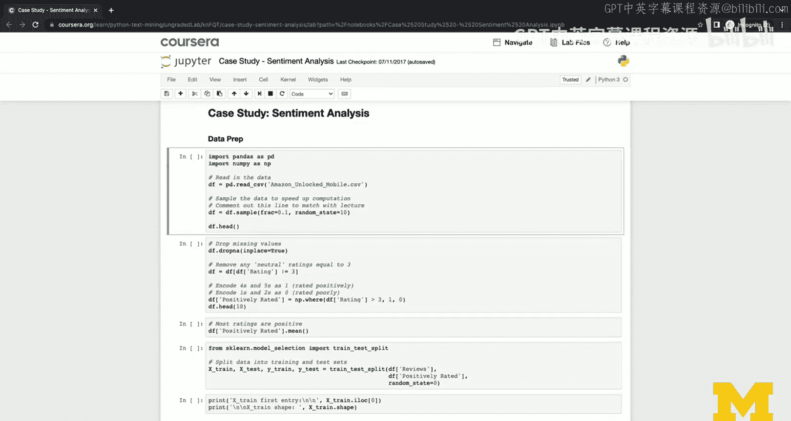
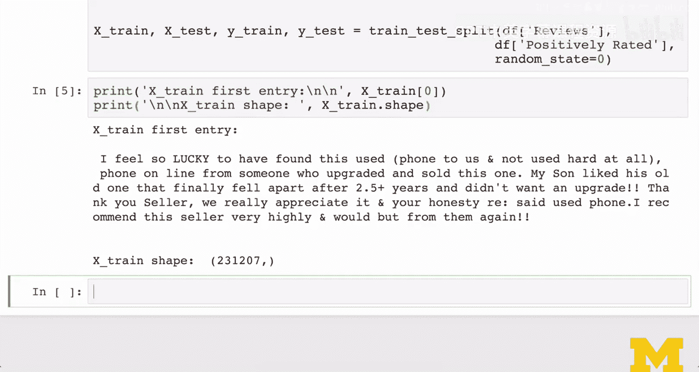
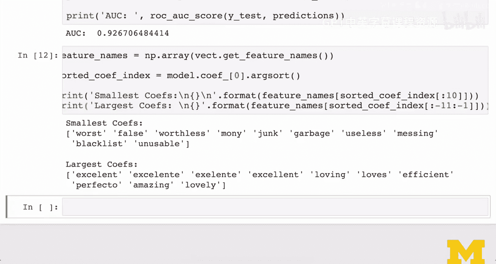
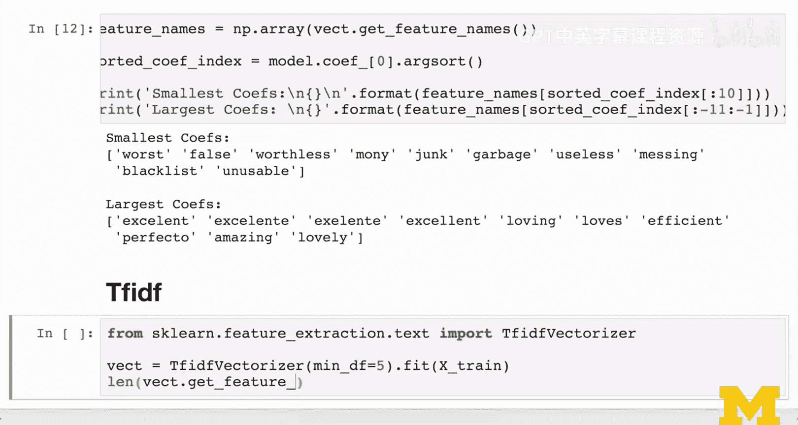
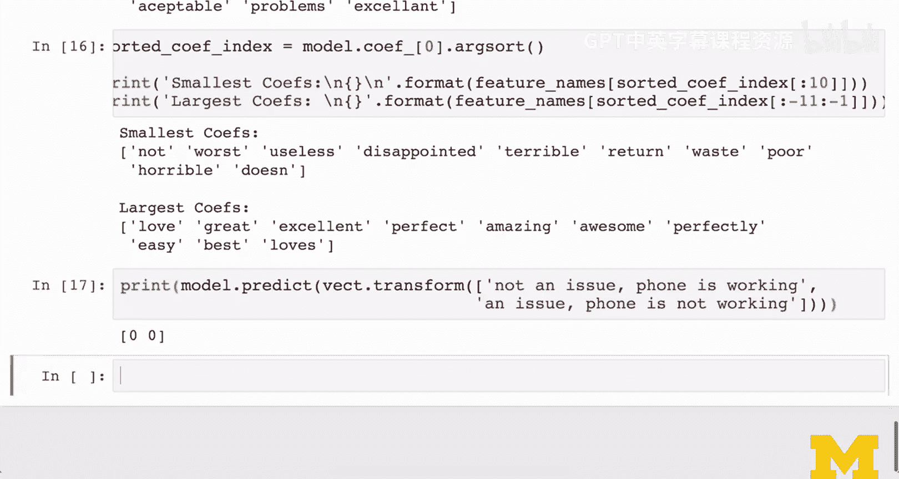
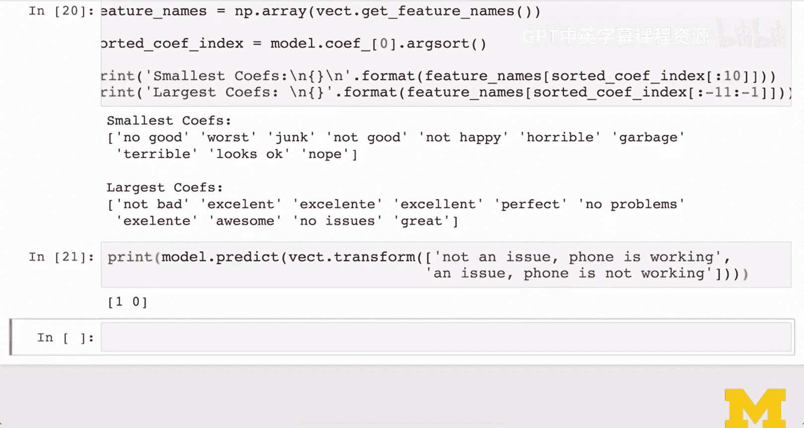

# 密歇根大学《Python用于数据科学实践（4-5课）｜Applied Data Science with Python 》中英deepseek翻译 p16 15_案例演示：情感分析研究.zh_en -BV1DTtueTEwf_p16-

In the Jupiter notebook provided。You may want to。Comment out the line that samples the given data。

Before you walk along the video by removing this line of code。

 we would be running the code on all of the data and it might take some time。

 but the results will match what is provided in the video。

Today we'll be going through an example of usingsKtLn to perform sentiment analysis on Amazon reviews。

The data set we'll be working with today is the Amazon Review on unlocklocked mobile phones dataset set。

Looking at the head of the data frame， we can see we have the product name， brand。Price， rating。

 review text， a number of people who found the review helpful。For our purposes。

 we'll be focusing on the rating and reviews columns。Let's start by cleaning up the data frame a bit。

First， we'll drop any rows with missing values。Next， let's remove any ratings equal to3。

 we'll assume these are neutral。Finally， we'll create a new column that will serve as our target for our model。

 where any reviews that were rated more than three。Will be encoded as a one。

 indicating it was positively rated。Otherwise， it will be encoded as a0。

 indicating it was not positively rated。Looking at the mean of the positively rated column。

 we can see that we have imbalanced classes。Now let's split our data into training and test sets using the reviews and positively rated columns。

Looking at X train， we can see we have a series of over 231000 reviews or documents。

We'll need to convert these into a numeric representation that SKtLn can use。

The bag of words approach is a simple and commonly used way to represent text for use in machine learning。

 which ignores structure and only counts how often each word occurs。

Count vectorizer allows us to use the bagg of Words approach by converting a collection of text documents into a matrix of token counts。

First， we instantiate the count vectorizer。And fit it to our training data。

Vting the count vectorizer consists of the tokenization of the training data and building of the vocabulary。

Fitting the count vectorizer tokenizes each document by finding all sequences of characters of at least two letters or numbers。

 separated by word boundaries。Converts everything to lowercase。And builds a vocabulary。

 using these tokens。We can get the vocabulary by using the get feature names method。

This vocabulary is built on any tokens that occurred in the training data。

Looking at every 200th feature， we can get a small sense of what the vocabulary looks like。

We can see it looks pretty messy， including words with members as well as misspellings。

By checking the length of get feature names。We can see that we're working with over 53000 features。

Next， we use the transform method to transform the documents in X train to a document term matrix。

Giving us the bag of word representation of X train。

This representation is stored in a sip pi sparse matrix。

 where each row corresponds to a document and each column， a word from our training vocabulary。

The entries in this matrix are the number of times each word appears in each document。

Because the number of words in the vocabulary is so much larger than the number of words that might appear in a single review。

Most entries of this matrix are zero。Now let's use this feature matrix X train vectorized to train our model。

We'll use logistic regression， which works well for high dimensional sparse data。Next。

 we'll make predictions using X test and compute the area under the curve score。

We'll transform X test using our vectorizer that was fitted to the training data。

Note that any words in X test that didn't appear in X train will just be ignored。

Looking at our AUC score， we see we achieve a score of about 0。927。

Let's take a look at the coefficients from our model。

Soaring them and looking at the 10 smallest and 10 largest coefficients。

We can see the model has connected words like worst， worthless and junk to negative reviews。

And words like excellent， loves and amazing to positive reviews。

Next， let's look at a different approach which allows us to rescale features called TF IDF。

TF IDF or term frequency， inverse document frequency allows us to weight terms based on how important they are to a document。

Highway is given to terms that appear often in a particular document。

But don't appear often in the corpus。Features with low TF IDF are either commonly used across all documents。

Or are rarely used and only occur in long documents。

Features with high TF IDDF are frequently used within specific documents。

 but rarely used across all documents。Similar to how we used count vectorizer。

We'll instantiate the TF IDF vectorizer and fit it to our training data。

Because TF IDF Eizer goes through the same initial process of tokenizing the document。

We can expect it to return the same number of features。However。

 let's take a look at a few tricks for reducing the number of features that might help improve our model's performance or reduce overfitting。

Count vectorizer and TFIDF vectorizer both take an argument， Min D F。

Which allows us to specify a minimum number of documents in which a token needs to appear to become part of the vocabulary。

This helps us remove some words that might appear in only a few documents and are unlikely to be useful predictors。

For example， here we'll pass in MinDF equals 5。Which will remove any words from our vocabulary that appear in fewer than five documents。

Looking at the length， we can see we've reduced the number of features by over 35。

000 to just under 18，000 features。Next， when we transform our training data， fit our model。

 make predictions on the transform test data and compute the AUC score。

We can see we again get an AU of about 0。927。No improvement in AU score。

 We were able to get the same score， using far fewer features。😊。

Let's take a look at which features have the smallest and largest TFIDF。

The list of features with the smallest TF IDDF either commonly appeared across all reviews or only appeared rarely in very long reviews。

List of features with the largest TF IDF contains words which appeared frequently in review。

 but did not appear commonly across all reviews。Looking at the smallest and largest coefficients from our new model。

 we can again see which words our model has connected to negative and positive reviews。

One problem with our previous bag of words approach is word order is disregarded。So not an issue。

 phone is working， it seen the same as an issue phone is not working。

Our current model sees both of these reviews as negative reviews。

One way we can add some context is by adding sequences of word features known as Ngrams。For example。

 bigrams， which count pairs of adjacent words could give us features such as is working versus not working。

And trigrams， which give us triplets of adjacent words， could give us features such as not an issue。

To create these ungram features， we'll pass in a tuple to the parameter Ngramm range。

 where the values correspond to the minimum length and maximum length of sequences。For example。

 if I pass in the tuple 1 comma 2， count vectorizer will create features using the individual words as well as the bigrams。

Let's see what kind of AU score we can achieve by adding bygrams to our model。

Keep in mind that although Ngrams can be powerful in capturing meaning。

 longer sequences can cause an explosion of the number of features。Just by adding diagramgrams。

 the number of features we have has increased to almost 200，000。

And after training our logistic regression model on their new features， looks like by adding bygrams。

 we're able to improve our AUC score to 0。967。If we take a look at what features our model connected with negative reviews。

 we can see that we now have diagramograms such as no good and not happy。While for positive reviews。

 we have not bad and no problems。If we again try to predict not an issue。

 phone is working and an issue， phone is not working。

We can see that our newest model now correctly identifies them as positive and negative reviews respectively。

The vectorizers we saw in this tutorial are very flexible and also support tasks such as removing stop wordss or limititization。

 so be sure to check the documentation for more info。

As always， thanks for watching。