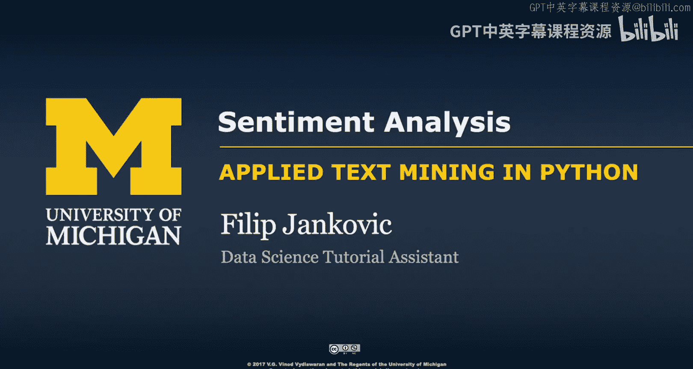
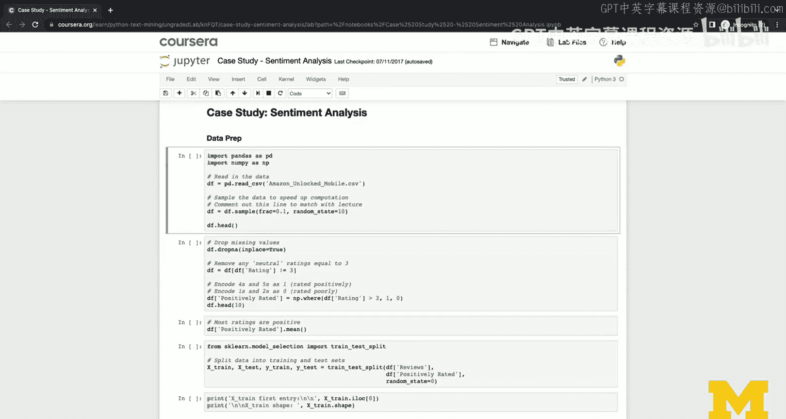
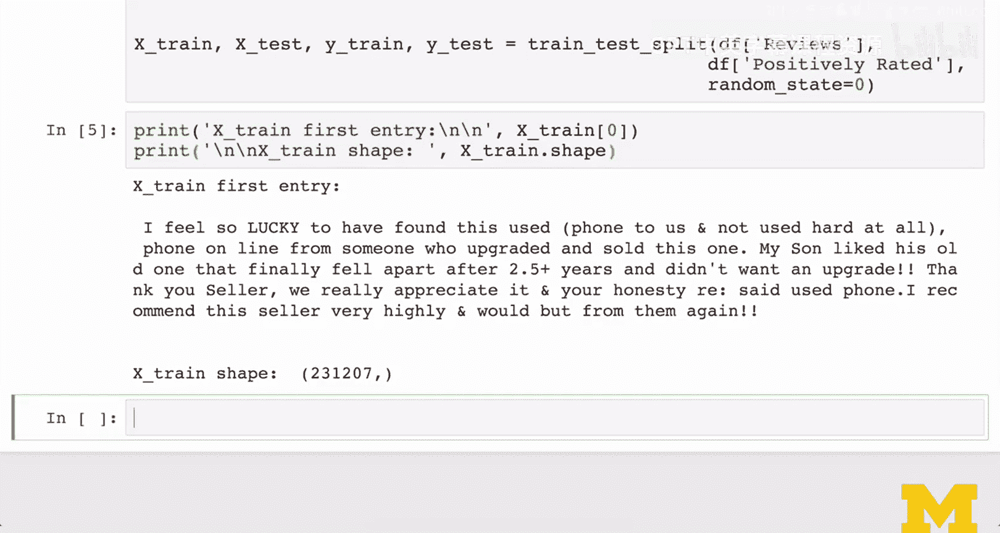
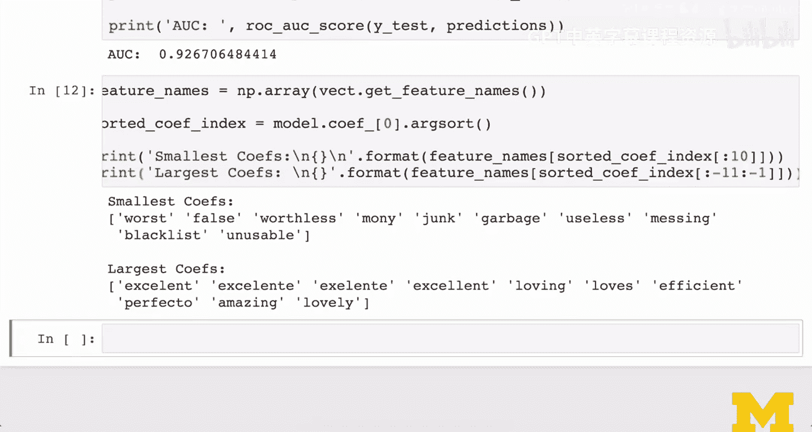
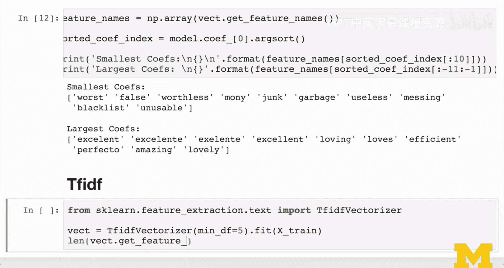
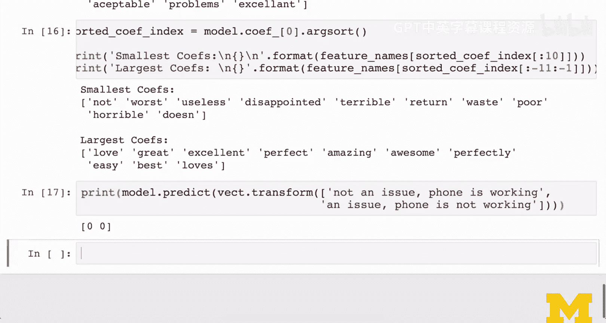
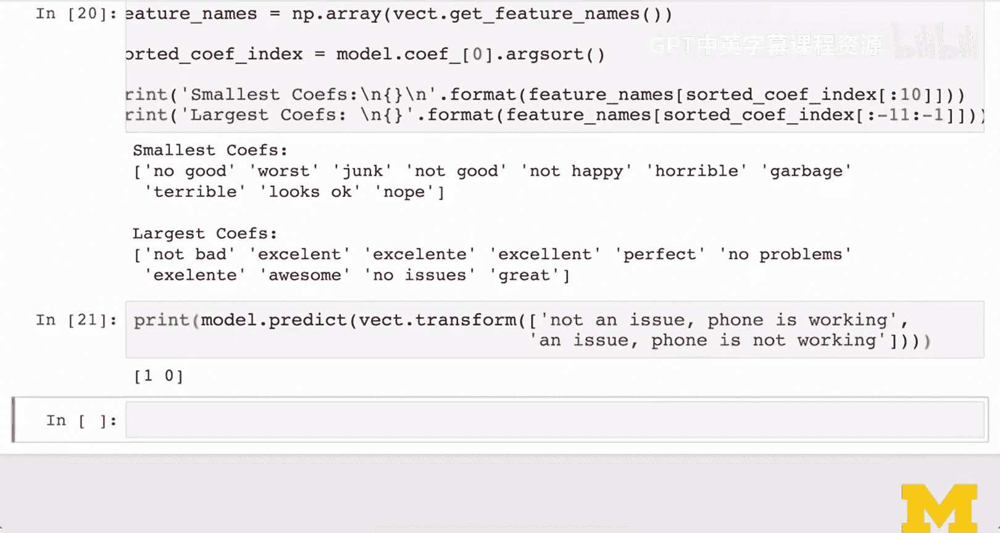

# Python用于数据科学实践：4-5课：案例演示：情感分析研究 📊




在本教程中，我们将学习如何使用Scikit-learn库对亚马逊商品评论进行情感分析。我们将从数据清洗开始，探索两种文本向量化方法（词袋模型和TF-IDF），并最终通过引入N-gram特征来提升模型性能。



---


在提供的Jupyter Notebook中，你可能需要注释掉对给定数据进行采样的代码行。在跟随视频操作前，移除这行代码意味着我们将在全部数据上运行代码，这可能需要一些时间，但结果将与视频中展示的匹配。

---

## 数据准备与清洗 🧹

我们将使用亚马逊关于解锁手机的评论数据集。查看数据框的头部，可以看到包含产品名称、品牌、价格、评分、评论文本、认为评论有帮助的人数等列。为简化分析，我们将重点关注`rating`（评分）和`reviews`（评论）这两列。

首先，我们对数据框进行一些清理。

以下是数据清洗的步骤：
1.  删除任何包含缺失值的行。
2.  移除所有评分等于3的行，我们假设这些是中性评论。
3.  创建一个新列作为模型的目标变量。任何评分大于3的评论将被编码为`1`，表示正面评价；否则编码为`0`，表示非正面评价。

查看正面评价列的平均值，可以发现数据存在类别不平衡问题。接下来，我们使用评论列和正面评价列将数据分割为训练集和测试集。



查看`X_train`，可以看到这是一个包含超过231,000条评论（文档）的序列。我们需要将这些文本转换为Scikit-learn可以使用的数值表示。


---

## 方法一：词袋模型（Bag of Words） 📦

词袋模型是一种简单且常用的文本表示方法，用于机器学习。它忽略文本结构，只统计每个单词出现的频率。

`CountVectorizer`允许我们使用词袋模型，将文本文档集合转换为词条计数的矩阵。

首先，我们实例化`CountVectorizer`并将其拟合到训练数据上。拟合过程包括对训练数据进行分词和构建词汇表。

```python
from sklearn.feature_extraction.text import CountVectorizer
vectorizer = CountVectorizer()
vectorizer.fit(X_train)
```

拟合`CountVectorizer`会通过查找由至少两个字母或数字组成的字符序列（以单词边界分隔）来对每个文档进行分词，将所有字符转换为小写，并使用这些词条构建词汇表。我们可以使用`get_feature_names_out()`方法获取词汇表。这个词汇表基于训练数据中出现的所有词条构建。

通过查看每隔200个特征，我们可以大致了解词汇表的样子。可以看到它看起来相当杂乱，包含带数字的单词以及拼写错误的单词。通过检查`get_feature_names_out()`的长度，可以看到我们正在处理超过53,000个特征。

接下来，我们使用`transform`方法将`X_train`中的文档转换为文档-词条矩阵，从而得到`X_train`的词袋表示。这个表示存储在一个SciPy稀疏矩阵中，其中每一行对应一个文档，每一列对应训练词汇表中的一个单词。矩阵中的条目是每个单词在每个文档中出现的次数。由于词汇表中的单词数量远大于单条评论中可能出现的单词数量，该矩阵的大多数条目为零。

现在，让我们使用这个特征矩阵`X_train_vectorized`来训练我们的模型。我们将使用逻辑回归，因为它对高维稀疏数据效果很好。



```python
from sklearn.linear_model import LogisticRegression
model = LogisticRegression()
model.fit(X_train_vectorized, y_train)
```


接下来，我们将使用`X_test`进行预测并计算AUC分数。我们使用已拟合训练数据的向量器来转换`X_test`。注意，`X_test`中任何未在`X_train`中出现过的单词将被忽略。



查看我们的AUC分数，我们得到了约0.927的分数。让我们看看模型中的系数，对它们进行排序并查看10个最小和10个最大的系数。我们可以看到模型已将诸如`worst`、`worthless`和`junk`等词与负面评论联系起来，而将`excellent`、`loves`和`amazing`等词与正面评论联系起来。

---

## 方法二：TF-IDF 向量化 ⚖️


上一节我们介绍了基础的词袋模型，本节中我们来看看一种不同的方法，它允许我们重新缩放特征，称为TF-IDF。

TF-IDF（词频-逆文档频率）允许我们根据词语对文档的重要性来加权。高权重给予那些在特定文档中经常出现但在整个语料库中不常出现的词语。低TF-IDF的特征要么在所有文档中普遍使用，要么很少使用且仅出现在长文档中。高TF-IDF的特征则在特定文档中频繁使用，但在所有文档中很少使用。

与使用`CountVectorizer`类似，我们将实例化`TfidfVectorizer`并将其拟合到训练数据上。由于`TfidfVectorizer`经历了相同的初始文档分词过程，我们可以预期它返回相同数量的特征。

然而，让我们看看一些减少特征数量的技巧，这可能有助于提高模型性能或减少过拟合。`CountVectorizer`和`TfidfVectorizer`都接受一个参数`min_df`，它允许我们指定一个词条需要出现在至少多少个文档中才能成为词汇表的一部分。这有助于我们移除一些可能只出现在少数文档中且不太可能成为有用预测因子的单词。

例如，这里我们将传入`min_df=5`，这将从词汇表中移除任何出现在少于5个文档中的单词。查看长度，我们可以看到特征数量减少了超过35,000个，降至不到18,000个特征。

接下来，当我们转换训练数据、拟合模型、对转换后的测试数据进行预测并计算AUC分数时，我们可以看到我们再次得到了约0.927的AUC分数。虽然AUC分数没有提高，但我们能够使用更少的特征获得相同的分数。

让我们看看哪些特征具有最小和最大的TF-IDF值。具有最小TF-IDF的特征列表要么普遍出现在所有评论中，要么仅出现在非常长的评论中。具有最大TF-IDF的特征列表包含那些在评论中频繁出现但并未普遍出现在所有评论中的单词。查看新模型中最小和最大的系数，我们再次可以看到模型将哪些单词与负面和正面评论联系起来。

---



## 提升：引入N-gram特征 🔄

我们之前词袋方法的一个问题是忽略了单词顺序。例如，“not an issue, phone is working”和“an issue, phone is not working”被视为相同。我们当前的模型将这两条评论都视为负面评论。


添加上下文的一种方法是添加称为N-gram的单词序列特征。例如，二元语法（bigrams）统计相邻的单词对，可以为我们提供诸如“is working”与“not working”的特征。三元语法（trigrams）提供相邻单词的三元组，可以为我们提供诸如“not an issue”的特征。

为了创建这些N-gram特征，我们将向参数`ngram_range`传入一个元组，其中的值对应于序列的最小长度和最大长度。例如，如果我传入元组`(1, 2)`，`CountVectorizer`将使用单个单词以及二元语法来创建特征。

让我们看看通过向模型添加二元语法能实现什么样的AUC分数。请记住，虽然N-gram在捕捉含义方面可能很强大，但更长的序列可能导致特征数量爆炸式增长。仅通过添加二元语法，我们的特征数量已增加到近200,000个。

在对这些新特征训练逻辑回归模型后，看起来通过添加二元语法，我们能够将AUC分数提高到0.967。如果我们看看模型将哪些特征与负面评论联系起来，可以看到我们现在有诸如“no good”和“not happy”这样的二元语法。而对于正面评论，我们有“not bad”和“no problems”。如果我们再次尝试预测“not an issue, phone is working”和“an issue, phone is not working”，我们可以看到我们的最新模型现在能正确地将它们分别识别为正面和负面评论。

---

## 总结与扩展 📝



本教程中介绍的向量化器非常灵活，也支持诸如移除停用词或词形还原等任务，请务必查阅文档以获取更多信息。


本节课中我们一起学习了情感分析的基本流程：从数据清洗、使用`CountVectorizer`构建词袋模型，到应用`TfidfVectorizer`进行特征加权，最后通过引入`ngram_range`参数来捕获上下文信息以提升模型性能。这些工具为处理文本数据提供了强大的基础。