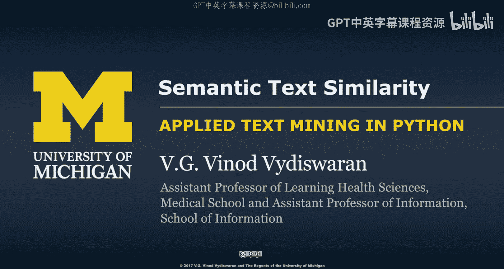
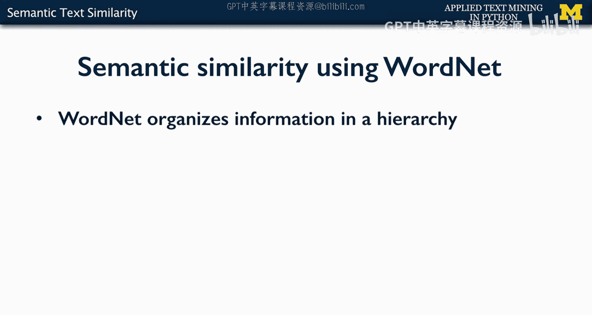
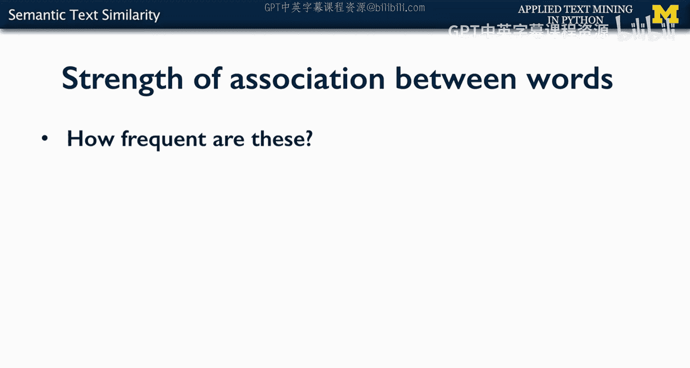
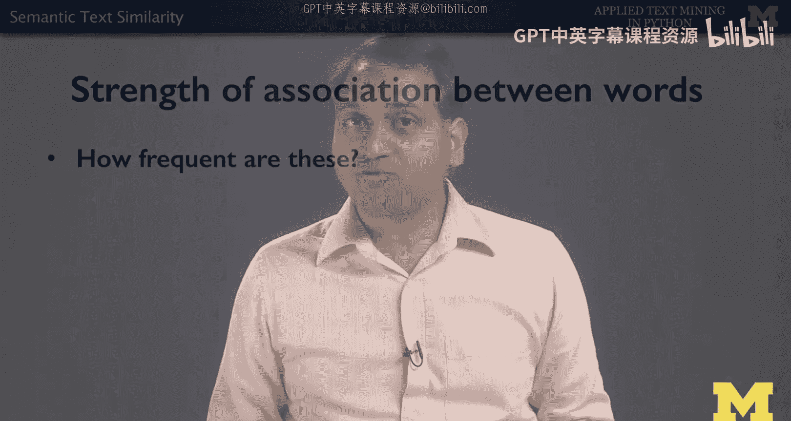
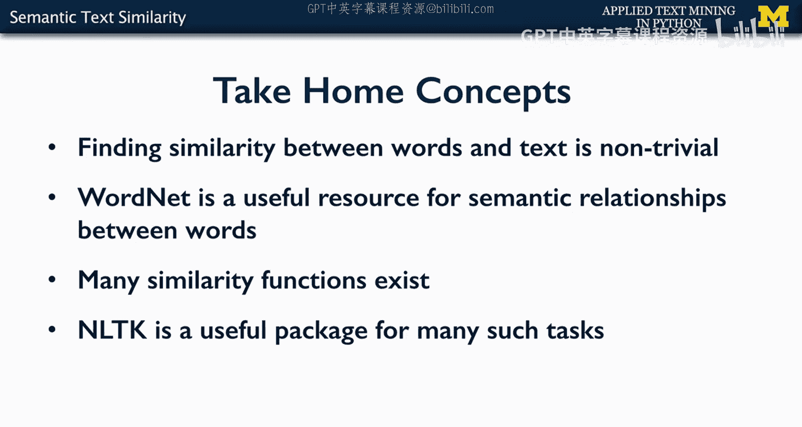

# 密歇根大学《Python用于数据科学实践（4-5课）｜Applied Data Science with Python 》中英deepseek翻译 p17 16_文本语义相似度.zh_en -BV1DTtueTEwf_p17-

Welcome back。In this video， we are going to talk about semantic similarity。Right at the start。

 I'm going to ask you a question。Which pair of words are the most similar in the following。

You have deer in elk， deer in giraffe， deer in heart， and deer in mouth。What do you think？

Hopefully you would have given the answer asDar an elk。But how can we quantify this。

 Why do DN elk appear in sound to be similar or more similar than other animals here？

To help us with that， we could use some semantic similarities resources。

 and we're going to talk about that in more detail now。But first。

 let's see what are the applications of semantic similarity？

Semantic similarity is useful when you are grouping similar words into semantic concepts。

 into concepts that have the same meaning appear to have the same meaning， for example。

Or sematictic similarity is very useful as a building block in natural language understanding tasks。

😊，Tasks such as textual entailment。Or paraphrasing。

Paraphrasing is a task where you rephrase or rewrite some sentence you get into another sentence that has the same meaning。

Texual entailment， on the other hand， is a little bit more complex。

 It says that the smaller sentence or one of the two sentences。

Deives its meaning or entails its meaning from another piece of text。

 so you have a text document or a text passage and a sentence and based on the information in the text passage you need to say whether the sentence is correct or it derives its meaning from there or not。

This is a typical task of semantic similarity。One of the resources useful for semantic similarity is WordNe。

😊，Wordnet is a semantic dictionary of words interlinked by semantic relationships。😊。

It is most extensively developed in English， but there are wordnot available now for quite a few languages。

😊，This wordnet includes rich linguistic information， for example it has the part of speech。

 whether something is a noun or an adjective or a verb， a word senses。

 different meanings of the same word， synonyms， other words that mean the same hypernyms and hyponyms that is a relationship。

 for example， a deer is a mammal。Or merenm， that is a whole in part relationship and derivationally related forms。

😊，Wordnet is also a machine readable and it is freely available。

 so it is extensively used in lot of natural language processing tasks and in general in text mining tasks。

😊，So how do you use wordnet for semantic similarity？

Wordnet organizes information in a hierarchy in a tree。

 you have a dummy root that is on top of all words of the same part of speech。

 so now it has a dummy root， a verb has a dummy root。

 and then there are many semantic similarity measures that are using this hierarchy in some way。

For example， you have different hierarchies for these part of speech and let's take an example of our deer that we started with where deer elk。

 giraffe， horse and so on， these words are grouped together in some form in this hierarchy For example。

 elk vpiti and Kaibbu are all types of deer deer and giraffe are siblings in this tree hierarchy because they are ruminants and so on and horse is related but not in the same hierarchies related because they are horse and gider are ungulates。

 but they are not siblings， for example。So one such measure of using this hierarchy for defining semantic similarity is a path similarity。

 you could imagine that you would start with one of these concepts and see how many steps you need to take to get to the other。

So in other words， you are finding a shortest path between these two concepts in this hierarchy。

And then similarity can be just measured as inversely related to this distance that you compute。

 for example， if you have D and elk。You would have the deer and elk actually are have a parent child relationship in this case。

 So the distance is one。While， deer and。Let's take in another color。 De in giraffe。

Is distance of two because you need to go up rumant and down giraffe。 So you have a distance of2。

In general， you can see that when you compute it with path， you。

 you use this one distance of one between de and elk and say it's1 over that distance plus1。

 So 1 over 2， that's 0。5。 the distance between de and giraffe is 1 over 3。 So that's 0。33。

 And if you just measure the same way going from deer to horse， you say it's。1，2，3，4，5，6。

 So it's one over 7。 and that would be。14。The other way to find similarity between two concepts is using what is called lowest common subsumer。

Lowest common sub is。That an sister that is closest to both concepts。For example。

 deer and giraffe have the least common lowest common consumer to be。Ruminant。

 so you have dier and giraffe and the node that is the least common subumer is the one that is an ancestor to both of them。

 but the lowest in the hierarchy。 So even though ungulateates and even toward unngulate are both ancestors is the ruminant that is the lowest one in that hierarchy。

With respect to deer and elk， it's just a deer because deer is apparent for elk。

 so the one that subsumes both of these would be deer itself。And for deer and horse。

 it goes all the way up to Aguulate。Now you can use this lowest common subsumer notion to find similarity and that was proposed by Ly and called Ly similarity。

 you have similarity measure that is based on the information contained in the lowest common subsumer of the two concepts。

So for example， the formulation for doing that is if you have two concepts UN andV。

 you take the log of the probability of this lowest common subsumer and divide it by sum of log of the probabilities of UNV。

And these probabilities are something that is computed or given by the information content that is learned over large corpus。

So how do you do all of this in Python。In Python， especially in NLTK。

 you have a lot of systematic similarities already available for use directly。

 So Wordnet is very easily imported into Python through NLTK。

 you could say import NLTK and from NLTK corpus import wordnet。😊。

And then you can find appropriate sense of the word that you want to find similarity for。

 so for dear you say find me the syn of de， which is a noun and give me the first syn that's what de do n do01 means it says I want dear in the sense of given by the noun meaning of it and the first meaning of that。

The same way with L Q find the sensor that corresponds to L dot noun dot1 and so on。

Once you have this proper sense of the word you could use that to find similarity so you could say deer dot part similarity elk or de dot part similarity horse so in this particular case you recall that deer and elk were in a parentch relationship the similarity was 0。

5 while deer and horse were in two different subrees and the similarity the distance was 6 and the similarity was 1 over 7 that's 1。

1428。Now， for if you are using L similarity， you are going to use the information criteria in some way。

 and let's say we use the information criteria that is given by ground clusters。

 So we are first going to say from N LTK corpus import word net underscore I C。

You define brown I based on the brown I data and then say dear dotling similarity elk using this brown Icy。

Or the same way with horse with。And youll see that the similarity there is different the real similarimity is 0。

77 for deer and elk and it's 0。86 for Der and harsh and youll notice especially here that this is not using the distance between two concepts explicitly so deer and horse that were very far away in the wordnet hierarchy。

Are not still get the higher significance and higher similarity between them。

 And that is because in typical contexts and the information that is contained by this words dear and horse。

 you have dear and horse kind of closer in similarity because they are both。Basically， and mammals。

 whereas elk is a very specific instance of deer and not necessarily in in this。

 the particular L similarity does not come out as close。

The other different measure of similarity is using distributional similarity and co locations。

Co locationsations can be defined by this code。 you know a word by the company it keeps。

And that means two words that are frequently appearing in similar concept。

 in similar contexts are more likely to be similar or more likely to be semantically related。

So if you have two words that keep appearing in very similar contexts or that could replace another word in the similar context and still the meaning kind of remains the same。

 then they are more likely to be semanically related。An example is this。In these four sentences。

 you have something about meeting at a place， so friends meet at a cafe or Shaia Madre at a psizzeria。

 or let's meet up near a coffee shop and so on。So these words cafe or pgerium or coffee shop or restaurant are semantically related because they typically occur around the words meet around at a or near the。

 So there is a determinant right in front of them and there is some notion of location and and those are the concepts that would form your context around the world。

In general， you would define context based on words before after or within a small window of a target word。

 so what word comes before？For example， for all of these version of cafe and restaurant and so on。

 it was a or the right， because it's a noun and you have a determineant right before that。

What comes after or what comes within a small window。

 let's say of size 3 and you will remember that all of those examples had some form of meat， meat。

 meat， meeting， and so on in that small window of three to five words。😊。

You could also use parts of speech as context， so part of speech of words before after and a small window。

 you could say that this particular target word occurs right after a der or occurs after a location modality。

 the word and so on。You could have some specific semantic relation to the target word。

Or you could have words that come from the same sentence and same document and you can define that document as any length you want。

 let's say a passage in in a document， a paragraph that would constitute your context。

Once you are define this context， you can。Compute the strength of association between words。

Based on how frequently these words go occur。Or how frequently they co locate。

 that's why it's called co locations。

So for example， if you have two words that keep coming next to each other。

 then you would want to say that they are very highly related to each other。On the other side。

 if they don't occur together， then they are not necessarily very similar。

It's also important to see how frequent individual words are， for example。

 the word the is so frequent that it will occur with every other word fairly often。😊。

So the similarity score would be very high with the。

 but just because the itself happens to be very frequent。😊。

So there is a way in which we can normalize such that this very frequent word does not kind of superr all the other similarity images you find and one way to do it would be using pointwise mutual information。

😊，Point by mutual information is defined as the log of this ratio of seeing two things together。

 seeing a word and the context together。Divide by the probability of these occurring independently。

 so what is the chance that you would see the word in the overall corpus。

 what is the chance that you would see the context word in the overall corpus and what is the chance that they are actually occurring together。

This point is mutual information is also something that you can directly call in N LTK。

 You can use the NTK colocations and association measures。 For example。

 you can say import N LTK and import the colocations from N LTK。

You can define bygrams as NLTK colocations diagramograms。Bgram association measures。

 And then you can learn that based on a corpus。 in this case， we given a text here。

 So text corpus and then。Using the PMMI measure， you can。Sa。I'm going to get the top 10。

Pears using the PMmiI measure from bigram underscore score measures。

You can use use finder for other useful tasks such as frequency filtering。

 so suppose you want all bi measures that are where you have suppose 10 or more occurrences of words only then kind of keep them then you could use something like a finder dot apply frequency filter of 10 that would then restrict any pair that does not correctly 10 times in your corpus。

So the big take home messages from this discussion we have had so far is that finding similarity between words and text is nontrivial。

 but there are a lot of resources available such as WordNe that could be very useful for semantic relationship between words and semantic similarity between words。

There are many similarity functions that are available in Wordnet and N LTK provides a useful mechanism to actually access these similarity functions and is available for many such tasks to find similarity between words or text and so on。

 In fact， you could start from word similarity and then compute text similarity between two sentences and in general。

 these similarity functions are very useful for natural language understanding tasks。

In the next video， we are going to go into more detail about topic modeling， see you there。

