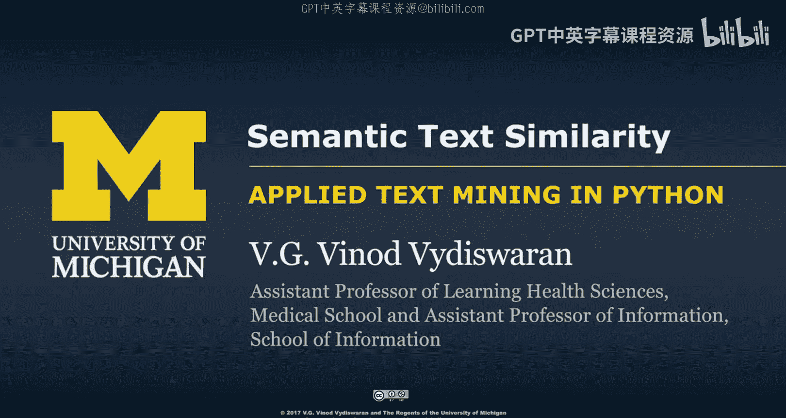
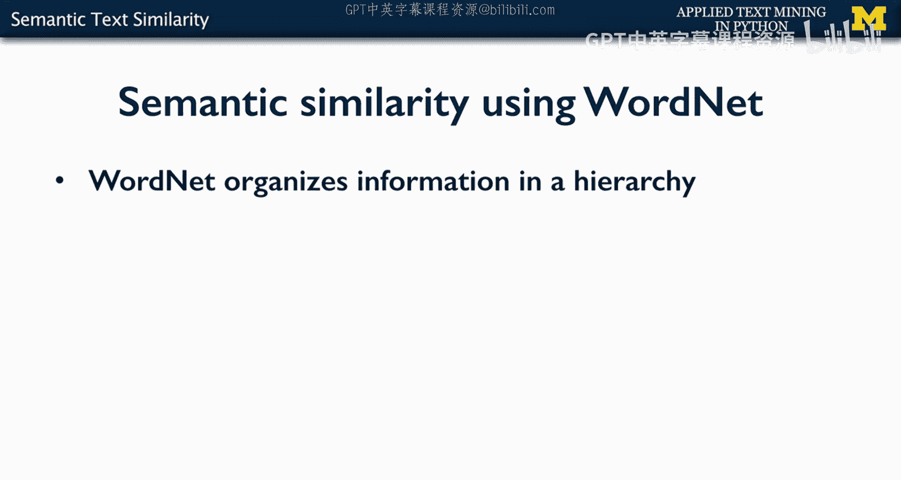
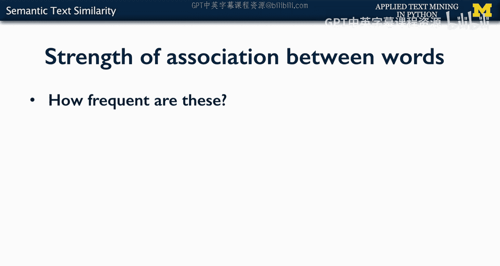
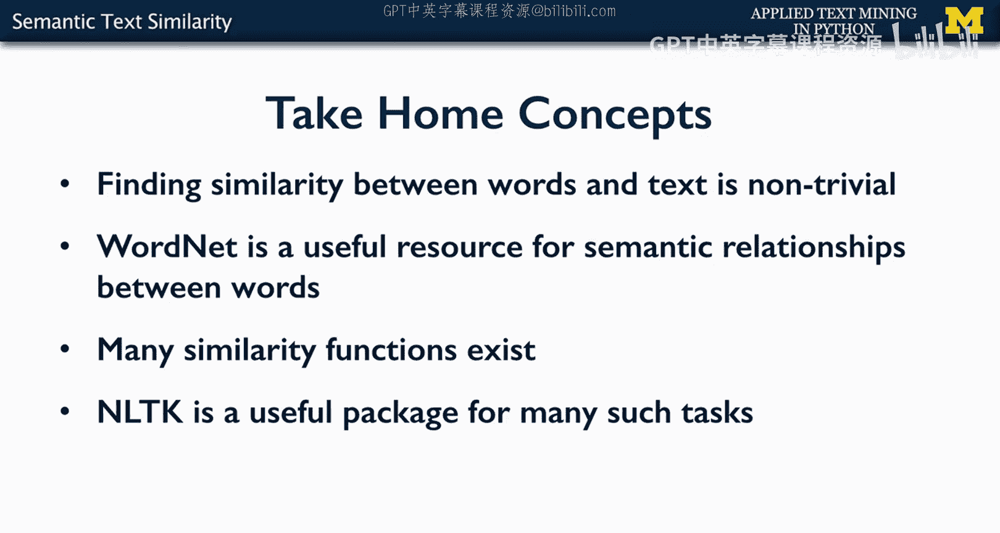

# 密歇根大学《Python用于数据科学实践》：4-5：文本语义相似度




## 概述
在本节课中，我们将要学习文本语义相似度的概念、应用以及如何利用现有资源和工具进行计算。语义相似度是自然语言处理中的核心任务之一，它帮助我们理解词语和文本片段在含义上的接近程度。

## 什么是语义相似度？
语义相似度用于衡量两个词语或文本片段在含义上的接近程度。例如，判断“鹿”和“麋鹿”的相似度是否高于“鹿”和“长颈鹿”。

## 语义相似度的应用
语义相似度在自然语言处理中有着广泛的应用。

以下是其主要应用场景：
*   **语义概念分组**：将含义相似的词语归类到同一语义概念下。
*   **自然语言理解任务的基础**：作为更复杂任务的构建模块。
*   **文本复述**：将句子重写为含义相同但表述不同的句子。
*   **文本蕴含**：判断一个句子是否可以从另一段文本中推导出其含义。

## 语义相似度资源：WordNet
WordNet 是一个通过语义关系将词语连接起来的语义词典。它是英语中发展最完善的资源，目前也支持多种其他语言。

WordNet 包含丰富的语言学信息。




以下是其主要信息类型：
*   **词性**：标注词语是名词、形容词还是动词。
*   **词义**：同一个词语的不同含义。
*   **同义词**：含义相同的其他词语。
*   **上下位关系**：例如，“鹿”是一种“哺乳动物”。
*   **整体部分关系**：描述整体与部分的关系。
*   **派生相关形式**：词语的派生形式。

WordNet 是机器可读且免费可用的，因此被广泛用于自然语言处理和文本挖掘任务。

## 基于WordNet的语义相似度计算
WordNet 以层次结构（树状）组织信息。每个词性（如名词、动词）都有一个虚拟根节点，所有词语都组织在这个层次结构中。

例如，“鹿”、“麋鹿”、“长颈鹿”、“马”等词语在这个层次结构中以特定方式分组。“麋鹿”是“鹿”的一种，因此它们是父子关系。“鹿”和“长颈鹿”都是“反刍动物”，因此它们是兄弟节点。“马”与它们的关系较远，虽然同属“有蹄类动物”，但不在同一直接分支下。

### 路径相似度
一种利用此层次结构定义语义相似度的方法是**路径相似度**。其核心思想是计算两个概念在层次树中的最短路径距离，相似度与此距离成反比。

**公式**：`相似度 = 1 / (距离 + 1)`

**示例计算**：
*   “鹿”与“麋鹿”距离为1，相似度为 `1/(1+1) = 0.5`。
*   “鹿”与“长颈鹿”距离为2，相似度为 `1/(2+1) ≈ 0.33`。
*   “鹿”与“马”距离为6，相似度为 `1/(6+1) ≈ 0.14`。

### 最低公共包含与Lin相似度
另一种方法是找到两个概念的**最低公共包含**，即层次树中同时是两者祖先且位置最低的节点。

*   “鹿”与“麋鹿”的LCS是“鹿”。
*   “鹿”与“长颈鹿”的LCS是“反刍动物”。
*   “鹿”与“马”的LCS是“有蹄类动物”。

**Lin相似度** 基于LCS所包含的信息量来计算相似度。

**公式**：`sim_Lin(u, v) = 2 * log P(lcs(u, v)) / (log P(u) + log P(v))`
其中，`P(x)` 表示概念 `x` 在大规模语料库中出现的概率（信息内容）。

## 在Python中使用NLTK计算语义相似度
Python的NLTK库提供了便捷的方法来使用WordNet及其相似度度量。

首先，需要导入必要的模块并获取词语的正确词义。
```python
import nltk
from nltk.corpus import wordnet, wordnet_ic

# 获取词语的词义（这里取名词的第一个词义）
deer = wordnet.synset('deer.n.01')
elk = wordnet.synset('elk.n.01')
horse = wordnet.synset('horse.n.01')
```

然后，可以计算路径相似度。
```python
# 计算路径相似度
print(deer.path_similarity(elk))   # 输出例如 0.5
print(deer.path_similarity(horse)) # 输出例如 0.14285714285714285
```

要计算Lin相似度，需要基于语料库（如布朗语料库）的信息内容。
```python
# 加载信息内容数据
brown_ic = wordnet_ic.ic('ic-brown.dat')

# 计算Lin相似度
print(deer.lin_similarity(elk, brown_ic))   # 输出例如 0.77
print(deer.lin_similarity(horse, brown_ic)) # 输出例如 0.86
```
注意，Lin相似度的结果可能与路径相似度不同，因为它不仅考虑结构距离，还融入了词语在实际语料中的分布信息。

## 基于分布相似度与共现的方法
“观其伴，知其义”是分布相似度的核心思想。经常出现在相似上下文中的词语，更可能在语义上相关。

例如，在“在咖啡馆见面”、“在披萨店偶遇”、“在咖啡店附近碰头”这些句子中，“咖啡馆”、“披萨店”、“咖啡店”、“餐厅”这些词因为频繁出现在“见面”、“在…”、“附近”等相似上下文（如前接冠词、后接地点介词、窗口内有“见面”类动词）中，所以被认为是语义相关的。



上下文可以定义为目标词前后特定窗口内的词语、词性标签，甚至是整个句子或段落。


### 点间互信息
为了衡量词语与上下文共现的强度，并避免像“the”这样的高频词主导结果，我们常使用**点间互信息**。

**公式**：`PMI(x, y) = log( P(x, y) / (P(x) * P(y)) )`
其中，`P(x, y)` 是x和y共同出现的概率，`P(x)` 和 `P(y)` 是它们各自独立出现的概率。

在NLTK中，可以方便地计算PMI来寻找强共现词对。
```python
from nltk.collocations import BigramAssocMeasures, BigramCollocationFinder
from nltk.tokenize import word_tokenize

# 假设 text 是您的文本语料（字符串）
tokens = word_tokenize(text.lower()) # 分词并转为小写

# 创建二元组查找器
finder = BigramCollocationFinder.from_words(tokens)

# 应用频率过滤，例如只保留出现10次以上的二元组
finder.apply_freq_filter(10)

# 使用PMI度量获取前10个最相关的二元组
pmi_measures = BigramAssocMeasures()
top_pmi_pairs = finder.nbest(pmi_measures.pmi, 10)
print(top_pmi_pairs)
```




## 总结
本节课我们一起学习了文本语义相似度。我们了解到，衡量词语和文本间的相似度并非易事，但存在像WordNet这样的丰富资源可供利用。WordNet和NLTK库提供了多种可用的相似度计算函数（如路径相似度、Lin相似度），是进行词语乃至文本间相似度计算的实用工具。这些相似度度量是许多自然语言理解任务（如复述、蕴含、主题建模）的重要基础。我们还介绍了基于分布假设和点间互信息的共现分析方法，这是从大规模文本数据中自动发现语义关联的另一种强大手段。