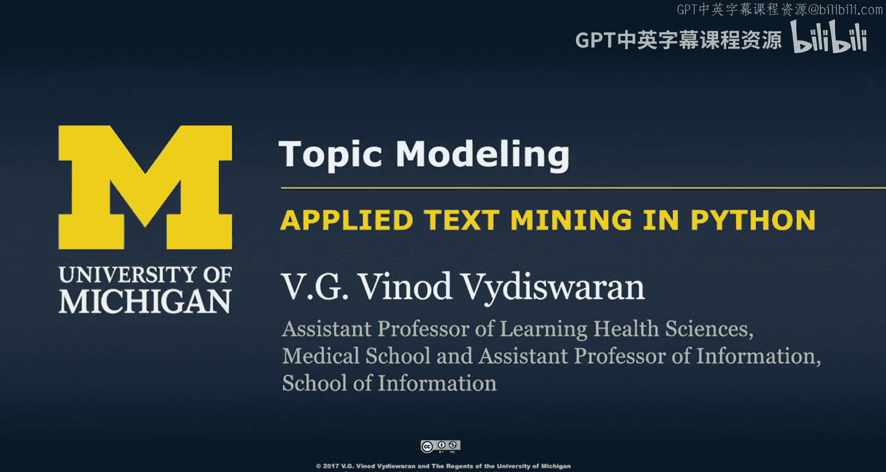
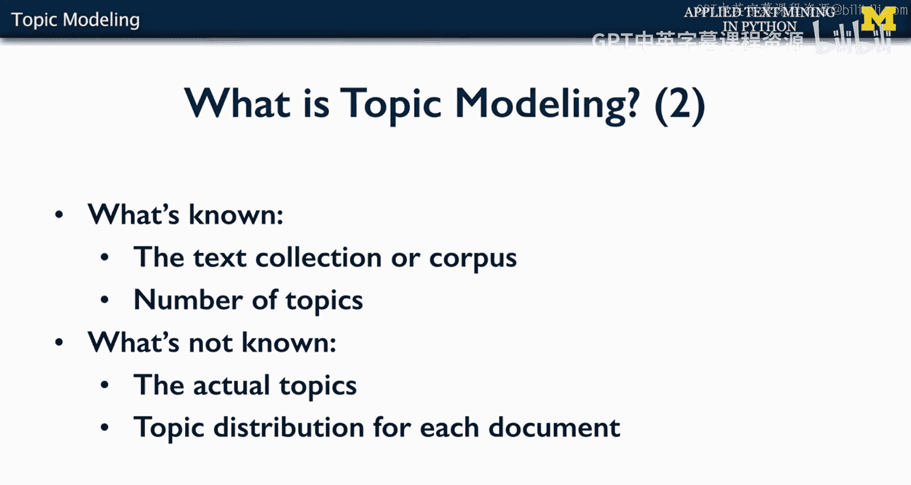
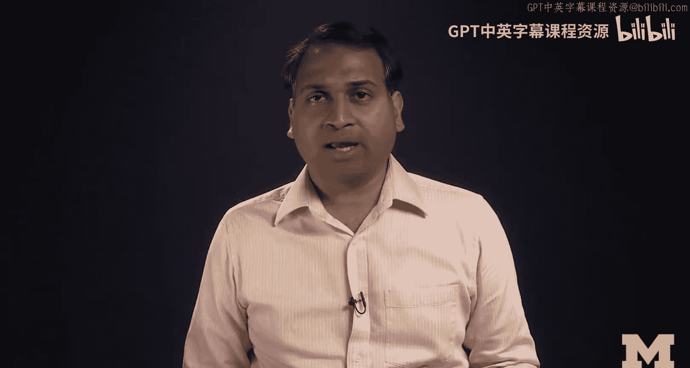
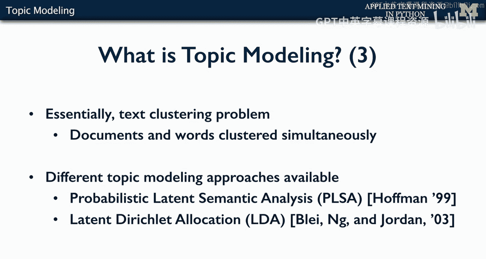

# 密歇根大学《Python用于数据科学实践（4-5课）｜Applied Data Science with Python 》中英deepseek翻译 p18 17_主题建模技术.zh_en -BV1DTtueTEwf_p18-

Well come back。In this video， we are going to talk about topic modeling。

Let's take an example of this article from science。And this is about seeking life's bare necessities。

 bare genetic necessities。And as you look through this。

 you'll notice that some words have been highlighted。

 so you have words such as genes and genomes that are highlighted in yellow。

Words such as computer and predictions and computer analysis and computation are in blue。

And then you have organism or survive or life in pink。

This kind of demonstrates that any article you see is more likely to be formed of different topics or subunits that intermingle kind of very seamlessly in weaving out an article。

This is the basis of one of the leading research work that has happened in text mining on topic modeling。

 And this one， particularly is from late interticiary allocation。Where you have three topics。

 you have genetics that's in yellow or computation that's in blue and life related life sciences。

 let's say in pink。This shows that documents are typically a mixture of topics。

 so you have topics coming from genetics computation or even anatomy。

And each of these topics are basically words that are more probable coming from that topic。

When you're talking about genes and DNA and so on， you are mostly in the genetic realm。

 while if you're talking about brain and neuron and nerve， you are in anatomy。

If you are talking about computers and numbers and data and so on。

 you are most likely in computation。So when a new document comes in， in this case。

 this article on seeking lifes bare genetic necessities。It comes with it。

topicpic distribution and so for that particular article there is some sort of tro distribution over these topics assume there are only four topics in the world genetics computation life sciences anatomy obviously that's not true。

 but let's take in this sense that these are the only four topics you have。

And this particular article is generated by these four topics in some combination of words where anatomy。

 the green one is absent and computation for example is the most probable。

But then you have genetics also equally represented and a little bit of life sciences。

So what is the topic modeling？Topic modeling is a course level analysis of what is in architects collection。

When you have a large corpus and you want to make sense of what this collection is about。

 you would probably use topic modeling because you would say let's figure out what kind of documents you have in this collection。

 are they all about sports， are they all about business？Or are they all about computers？

 And if they are all about computers， then are they all about。Architecture。

 or are they all about algorithms， which are all different subunits within a larger unit？

A topic is a subject or theme of a discourse。And topics are represented by a word distribution。

 and that means that you have some probability of a word appearing in that topic。

And different words have different probabilities in that topic， so for example。

 if you see a basketball or a player or a field。😊，Or a score。

 you are more likely to be in the topic of sports。 And if you are in topic of sports。

 then words such as player and team and score are more likely to appear。

Team may also appear in social science studies， but maybe not as。Frequently。

 or it's not as probable to have that in， let's say， in life。

Though it is likely there as well right so for a particular word you have a different distribution of or probability of occurring in a topic and topics are basically this probability distribution over all words。

😊，A document is assumed to be a mixture of topics。So for example you will have a lot of topics like this。

 you have humans， genomes， DNA and so on that is probably about the genetics topic。

 you have another topic that is evolution and species and organism and life and biology。

 you have a third topic on disease and host and bacteria and so on on new strains。

And another one on computer model information data and you can see that these topics are these word distributions where。

 for example， a topic is what is there in a column and they are sorted maybe weekly by how probable these words are。

 So computer or model is the most probable word in this topic the fourth topic。

So when you are doing topic modeling， what's known， what's given to you。

 what you are given is a text collection or a corpus。

 and you are somehow said somehow given the number of topics。

Let's say we are interested in 20 topics， and we are somehow。

Group these words and find these topics and find 20 of them from a large collection。

What's not known are the actual topics。You are not given that you are interested in these specific 20 topics you say what you are given is that you need to find 20 topics。

 but you could find any 20 topics and you want to find a topic that is more coherent。

So that's part of the problem。And you are also not given the topic distribution for each document。

 so you are not given that this particular document is all about sports or this particular document is 50% sports and 50% genetics。

So that distribution is not known either。Essentially， topic modeling is a text clustering problem。

 however， in this particular case， the documents and words are clustered simultaneously。😊。

You need to figure out what words come together， what was are similar to each other or semantically related to each other recall one of the previous videos where we talked about semantic similarity of words。

And then you also need to figure out what documents come together。

 what documents are of the same topic or are mostly about the same topic and how does these words kind of get derived based on these documents So how do how do you build these topic modeling to understand what is a distribution of words in a particular document and what is the probability of a word in a topic。

Different topic modeling approaches are available and there will be new models that are defined very regularly in computer sense literature。

The most common ones and the ones are that kind of started this field are probabilistic latent semantic analysis。

 PLSA that was first proposed in 1999 and then。😊，Late in deier allocation。

 that's LDA that was proposed in 2003。LDA is by far one of the most popular topic models。

 and we're going to talk about it in more detail in the next video。

