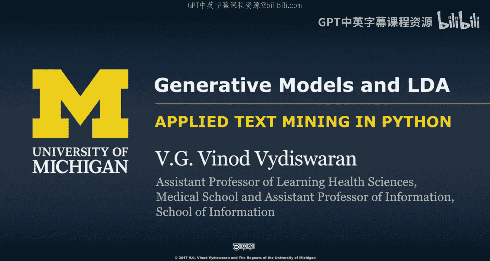
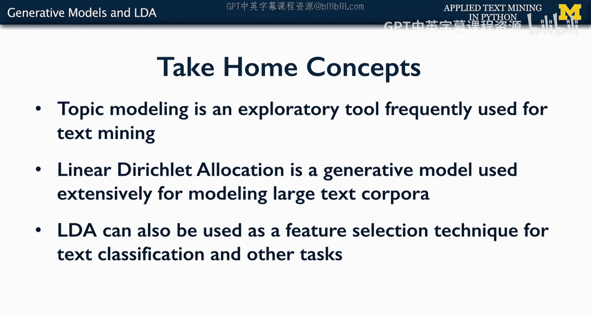

# 密歇根大学《Python用于数据科学实践（4-5课）｜Applied Data Science with Python 》中英deepseek翻译 p19 18_生成模型与LDA算法.zh_en -BV1DTtueTEwf_p19-

Let's talk in more detail about generative models and LDA。

The generative models of text basically starts with this magic chest。

Suppose you have this chest and words come out of this chest magically。

And you pick words from this chest to then create your document。So when you start pulling out words。

 you start seeing words like this， you have Harry Potter is。

 and then you have other words like movie and and the and so on。Already。

 by just looking at first two words， you know that this chest kind of gives out words about Harry Potter。

 So this is some word distribution that favors words coming from Harry Potter。

And then you can use these words that come out to create this document to generate this document。

 and this document would be something like the movie Harry Potter is based on books from JK Rowlling。

😊，And now you see that in the generation process， you have a model that gives out words。

 and then you use those words coming from that model to generate the document。😊。

But then you could go the other way， you could start from the document and see how many times the word the occurs or Harry occurs or Poter occurs。

And then create a distribution of words。That is you create a probability distribution of how likely it is to see the words Harry in this document or the word movie in this document。

And you notice that when you generate this model， when you infer this model。😊，The word the。

Is most frequent。 It is frequent The probability is 01。 That means one in 10 words is the。

And then you have is and then Harry and Porttter and so on。

So notice that because the documents were about Harry Potter。

 the model favors the words Harry Potter。It's very unlikely that you would see Harry and Potter being this frequent in any other topic model or in any other corpus of words of documents。

So here you had a very simple generative process， you had one topic model and you pulled out words from that topic model to create your document。

That was a generation story。However， the generation story can be very complex in most cases。Inset。

 suppose you have。Instead of one， suppose you have four topic modelss， four chests。

And you have this magic hat that pulls out words from these chest at random or it has its own policy of choosing one chest over the other and then you have these words that come out and then you still create this document。

😊，Now your model is more complex because instead of learning。

The generation is almost like where you decide which chest the word comes out of and once you have made that choice。

 then you have a different distribution of that word coming from that chest。😊。

The you still create the same document。 But then when you are using these documents to infer your models。

 you need to infer four models and here to somehow infer what was the combination of words coming from these four。

Chests these four topics， so you not only have to somehow figure out what were the individual topic models。

 individual word distributions， but also this mixture model of how you use these four topic models and combine them to create one document。

So this is typically called the mixture model The first one that we saw in the previous slide was Unigram model where you have one topic distribution and you get words from there whereas here it's a mixture of topics so you have the same document generated by four different topics some of them represented with a higher proportion and others that are not you should remind you of the example we started this topic model discussion from that was on the bare necessities in science article and you saw that there was a topic model for computation and another topic model for genetics and a third topic model for anatomy that was not represented as well in the document and so on。

So this is kind of similar model here。LDA is another such generative model。

And the Genrative model for a document D。Is you choose a length of document。

 you first decide what is the length of the document that you are generating。

Then you choose a mixture of topics for that document。

And then you use that topics multinomal distribution。

 that is the word distribution to output the words to fill up that quota， that topics quota。

 so suppose you decide that for a particular document 40% of the words come from topic A。

 then you use that topic A is multiormal distribution to output the 40% of the words。

This is a very simplistic explanation of LDA you could some of you might have seen more complex mathematical notations called plate notations to define topic models and that is something that we leave for a future study I can point to some of it in the reading lists。

 but for now it is enough to kind of understand that LDA is also a generative model and it creates these documents based on some notion of length of the document mixture of topics in that document and then individual topics multinomal distributions。

In practice， the questions you need to ask， though。

 when you create a model such as LDA is how many topics you want。

There is no good answer for it finding or even guessing that number is actually very hard。

 so you have to somehow say that okay I believe that there might be five topics or I would prefer learning five distinct topics that 25 topics that are very similar to each other。

😊，So you may make a choice just based on guess of how how distinct these topics could be。

 But if you are in a domain where you know these topics a little bit well。 So， for example。

 you have all medical documents。 And you want， you know that these medical documents come from radiology and pathlogy and neurology and there are these streams。

 then you might say， okay， I'm interested in these seven streams of medicine and that's that those are my topics。

 right， so that that there is， you have some sense of how many topics should there should be。

The other big problem is interpreting the topics。😊，So you would get topics。

 but topics are just word distributions。 They just tell you which words are more frequent and more probable coming from a particular topic and which ones are not as probable。

But making sense of that or generating a coherent label for the topic is a subjective decision There have been some work that has looked into generating names for these topics but most likely whenever you see a name in a topic model it is it just comes out manually people have just look at these words like genetics and genes and and so on and say that this is the genetic topic or if they say computation and model and data and information and say something to do with computation or computer science or informatics。

So those names are fairly subjective。But actual topics that you learn from LDA are is basically a solution of an optimization function。

 So it is more kind of deterministic in that sense。

To summarize topic modeling is a great tool for exploratory text analysis that helps you kind of answer the question about what these documents are about。

 what is this culpus about and you could think about it as a corpus of tweets or corpus of reviews or news articles so you might get a big dump of tweets and say what are people talking about in tweets。

 what are the different themes that come from tweets？😊。

And there are many tools available to do it fairly effortlessly in Python。So let's。

 let's take an example of how to do it。 There are many packages available。 Some of them are gensim。

 LDA and so on。 We are going to go and talk about it talk about gensim or in in the next few slides。

But before you use any of these packages you need to preprocess a text and I would encourage you to kind of recall what we talked about early on in this course right in the first module about pre-processing text that you need to tokenize text and normalize it that means make them more lower case decide whether you should make them lowercase or not you remove stop wordss stop wordss are common words that occur frequently in a particular domain and is not meaningful in that domain so for example in general English the word the and is and so on might be words that you might want to remove。

While if you are in the the area of medical documents， let's say。

 and you always see so clinical notes， you would always see the word patient and always see the word doctor and so on。

 and they may may not be as important as the other words like what is a medication and what is the disease。

 then you may want to say patient and doctor stop wordss for that context。

The other pre step would be stemming， that means you need to remove the derivationary related form。

 somehow normalize the derivationary related forms to the same word meet meeting met all should be called meat。

 let's say。And then once you have done the preprocesing steps。

 you convert this tokenized document into a document term matrix。

 so going from which document has what words to what words are occurring in which documents。

 getting that document term matrix would be the important first step。

In finding out I working with LDA。And then once you have done that。

 once you built this documenter matrix， you build the LDA models on top of it。

So once you have built the mapping between the terms and documents。

 then suppose you have a set of pre processcessed text documents in this variable doc set。

Then you could use Gensim to learn LDA this way， you could import Gensim and specifically you import the corporani models first you create a dictionary。

Dictionary is this mapping between Is and words。Then you create corpus and corpus you create going through this all the documents in the doet and creating a document to a bag of watch model this is the step that creates the document term matrix。

Once you have that， then you input that in the LDA model call so that you use the GensI models LDA model where you also specify the number of topics you want to learn so in this case we said number of topics is going to be four and you also specify this mapping the ID to word mapping that's a dictionary that is learned two steps ahead。

Once you have learned that and that's it and you can say how many passes it should go through and there are other parameters that I would encourage you to read up on。

 but once you have defined this LDA model you can then use the LDA model to print the topics so in this particular case we learned four topics and you can say give me the top five words of these four topics and then it will print that one out for you。

LDA model can also be used to find topic distributions of documents。

 so when you have a new document and you apply the LDA model on it， so you infer it。

You can say what was the topic distribution across these four topics for that new document？

So the take home concepts here are the topic modeling is an exploratory tool that is frequently used in text mining。

LDA is a generative model that is used extensively in modeling large text core program。

 There are other topic models available PLSA being another one。

In addition to being a exploratory tool， LDA can also be used as a feature selection technique for text classification or tasks so for example。

 if you want to remove all features that are coming from words that are fairly common in your corpus or you want to focus your features to only those that are coming from specific topics then you would want to first train an LDA model and then based on just the topics。

 the words that come from specific topics of interest， you might actually generate features that way。

So in general， LDA is a very powerful tool and a text clustering tool that is fairly commonly used as the first step to understand what a corpus is about。

Hope you learned how we could use topic modeling and this gives you a brief introduction to topic models that is many。

 many things that you can go into more detail about， but for this course I think we leave it there。

