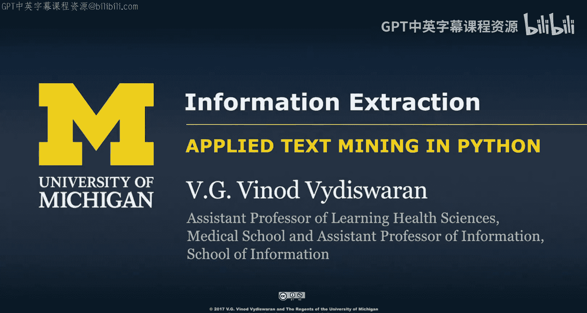
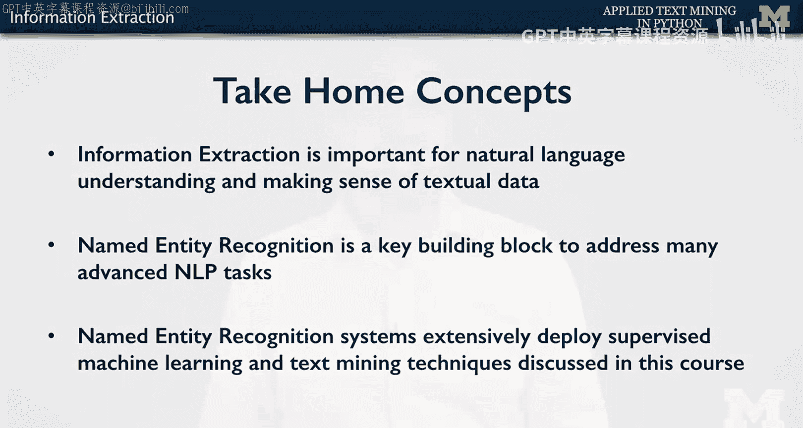

# 密歇根大学《Python用于数据科学实践（4-5课）｜Applied Data Science with Python 》中英deepseek翻译 p20 19_信息抽取技术.zh_en -BV1DTtueTEwf_p20-

Yeah。In this video， we are going to go a little bit more detail about how some of these what we have learned in this course can be all put together into specific natural language processing tasks that are really important in lot of other tasks of understanding free text so information is as we have seen so many times is hidden in free text in very interesting ways。

You have most traditional transactional information that is structured。

While a lot of information now is in unstructured free text form。As we have seen earlier。

 when I was introducing this whole course that about 80% of data is now in unstructured form。

 in blogs， in websites， on websites， and so on。And it's growing。

 you have tweets and other social media that is kind of adding out more information here。

So the question then becomes， how do you convert this unstructured text to structured form？

You don't necessarily have to convert it all but more what I'm trying to get here is how do you extract relevant information from unstructured text and if you were to make it searchable or make it usable later on。

 you will probably put it in a structured form as it has been traditionally kept so so that way it is it is kind of conversion from unstructured to structured text。

😊，And that's where information extraction comes in。

The goal of this task is to identify and extract fields of interest from free text。

So let's take an example of a medical article， this one is from WebMD from quite some time back。

 but it says herbits help treat advanced lung cancer。By looking at this。

 you know that one of the pieces of information that you want to extract would be the headline。

But more importantly， also the components of that saying that herbitex is a particular treatment for lung cancer。

😊，And the fact that advanced lung cancer is a specific form of lung cancer。

 so youre can of understand which modifier could be dropped。

 so in this case advanced could be dropped but lung couldn't be so because lung cancer treatments are different from let's say blood cancer or。

Breast cancer and so。But this webage has more information than just the headline。

It has some information about who wrote this article。Or who reviewed this article？

Or when was it published？Or the place it was published。And so on。

And you can see that this happens all the time in news reports and other places where when you see some piece of information。

 some news article or a tweet。It has more than just the text that is important and were of some interest for people。

 So who wrote a particular news report， where is it coming from。

What does it say who what are the other persons involved in this story？

This is the statistical representation of an information extraction task。

The first thing to notice here is something about fields of interest。

These fields of interest are named entities。If it's news。

 you are talking about people and places and data and organizations and other geopolitical entities。

 when you say White House， you mean something completely different than a White House right or when you're saying 10 Downing street。

 it's a completely different meaning than the actual address 10 Downing street。

If you're talking about finance， you're talking about money or monetary values about how much was a particular sale for。

Or the names of companies or this stock price index of a particular company。

When you're talking about medicine and health， you're talking about diseases and drugs and procedures and especially if you are talking about the protected information。

 protected health information， then you' are talking about address。And they unique identifiers。

 sometimes even emails and URLls and professions and so on。

 So you can see that these name entities can be very， very diverse they are。

 they don't all follow the same ideas and the same features。 So， for example， in news。

 it's fairly common for people' name and places to be capitalized。So you have a title case there。

 you would see。China would sea capital more often than with small sea。

We have dates they are typically of a particular format。

 we have seen some examples of that early on in this course。But those don't apply in medicine。

 so for example， when you're talking about lung cancer。

 you don't have capital L and capital C or when you're writing it out。

 it's going to be all small case。So the particular rule that you might have for named entity being title cased is not applicable for some other data sets like in medicine。

Once you have understood what named entities are， the next is relations。

Relations basically is what happened to who， when， where。And so on。 So again here。

 even though the particular pieces of information are named entities。

 so who is basically a person or an organization， when is a particular time or a date。

 where is a place。But it also has this relationship between these named entities to get meaningful semantics out of it。

So let's take these two examples in more detail and see what that means。😊。

So named entity recognition relies on something called named entities。

 named entities are noun traces that are of specific type and refer to specific individuals， places。

 organizations and so on。😊，And the named entity recognition task is a set of techniques and methods that would help identify all mentions of predefined named entities in text。

😊，So for example， it has you are to identify then the mention。

 the actual phrase where something is happening， so you need to know where does that mention start and where does it end so this is the boundary detection subtask with the named entity recognition。

Once you have understood the boundary， the next task is to。

Type it to tag it or to classify it in one of the named entity types that you are interested in。So。

 for example， if you have。The word Chicago。It could be。But please。It could be an album。

It could be a font。 So depending on what kind of variation it is。

 you need to know what is the label that should be assigned to this word once you have identified that Chicago is your relevant phrase。

So let's take an example of a named entity task in the context of a medical document。😊。

I'm going to leave this one and let you try out what are the different named entities here that you would be interested in。

Okay， now that you have some chance to see what are the named entities， let's see some of them。😊。

One big one is the disease or the condition or the symptom， right。

 So you have bilateral handness or occasional weakness or C 5，6 disc herniation。Okay。

 but you also have age here， so you could say age is 63 or you could say age is 63 year old。

You have gender， female。You have mention of a medical specialty。In a neurologist。

 you have a procedure that was done， so you have a workup or an MRI。And in addition to all of these。

 you also have body parts like feet and hand。And suddenly you come to a conclusion where you can see that these named entities don't have to be separate from each other。

 So for example， bilateral hand numbness is a completely valid named entity in itself。

 but hand is also a named entity that is of interest。

 So then the question becomes what is the granularity where which you need to annotate these。😊。

And if you are doing hand as a separate orientation。

 why not C 56 disc or chd because you're talking about spinal cord in this case。

 you're talking about an anatomical part。😊，So these are the decisions that need to be made when you are defining this named entity task so in this particular case。

 if you define the task to be one where you say we are only interested in the condition。

 the the diagnosis， the age， the gender， the procedures that were done and the specialty that's it in this case then you are not going to focus on body parts hand and feet and even if they are there that's fine。

And some decision already was done that way。 so for example。

 nobody said that patient is not a valid entity in this role。

 it could be very well could be if neurologist is a valid entity。

 patient could be a valid entity and thats a decision that has to be made when you are defining this named entity task。

😊，Suppose you have these goals then you know that you have not only identified the boundary but also colored it in some way。

 tagged it to say what is the type of this same entity that you have identified。Okay。

Now that we know the task well， what are the approaches that people use to identify named entities？

It really depends on the kind of entities that we have。So for example。

 if you have well formatted fields like dates and phone numbers。

 then you would use regular expressions。Recall that we have done the regular expressions for date。

 for example， in week one of this course。And that is a very valid named entity identification task。

 in fact， the assignment was really asking you to do an information extraction task for dates from the given text file。

😊，For other fields， it's fairly common to use a machine learning approach。 In fact。

 even for dates and phone numbers， you might want to use a machine learning approach where you use these regular expressions as features。

 but you have other features that help them define this particular extraction to be valid。

 So for example， phone numbers and fax numbers are very similar。

The only thing that differentiates them is what is the number preceded by so is it phone dot or is it fax dot。

So some context information kind of helps doing that and you could either include it as a regular expression or let those be features in a machine learning model that you then train over large dataset sets。

The standard NER task in natural language processing is this four class model where you have person organization。

 location and everything else or everything outside。 So if you if you have a sentence like John Me。

Brenda。You want to say that John and Brenda are。Name entities。

So you have those two persons and then met is a word that is outside of any named entity。

 so you are going to use these two classes so you'm going to say John is a person。

 met is outside and Brenda is a person again。Once you have identified these。

 then you are going to go and ask the question about relation and relation extraction。

The relation extraction task is identifying relationship between named entities。

So let's take an example of something that we have seen earlier today on herbits helps treat lung cancer。

So this sentence has a relationship between two named entities。One is herbitex。

 herbitex is colored yellow here to represent that it is a diagnosis。

 sorry it is a treatment of some kind and then you have lung cancer that is represent as in green to represent a different named entity in this particular case a disease or a diagnosis。

And then you have a relationship between them， so herbitox and lung cancer are linked by a treatment relation going from herbitox to lung cancer that says herbitex is a treatment for lung cancer。

You could have easily have a link going the other way。

 lung cancer and to orbitex saying lung cancer is treated by okay so this is the relation a very simple relation。

 a binary relation between a disease and a treatment or a drug。😊。

The other task is Co reference resolution。That is to disambiguate mentions in text and group mentions together if they are referring to the same entity。

An example would be if Anita met Joseph at the market and he surprised her with a rose。

 then you have two named entities， Anita and Joseph。But then the second sentence uses pronouns。

 he to refer to Joseph and her to refer to Anita。So in this case。

 it's pronoun resolution where you are making an inference that if Anita met Joseph at the market。

 Joseph surprised Anita with a rose。Why is that important。

 that is in a question answering task where you have a question where you're given a question and you find the most appropriate answer from text。

Now， appropriateness is something that we can talk about in more detail。

 but let's say in this case the correct answer or the set of correct answers would be one definition here。

And you would need both named entity recognition and relation extraction to answer these questions。

 So， for example， if the question is what does herbitox treat。

 you first have to identify that herbitox is a treatment。

 The relation is treat and then somehow fill a slot。

In this relation to say herbitox is a treatment for something and that comes from text and that is lung cancer。

Or who gave Anita the rose where you are doing some sort of pronoun resolution to then identify that Joseph was the person who gave Anita the rose at the market。

So this builds on the named entity recognition task and relation extraction and core reference resolution that we have seen earlier。

So， to conclude。We see that information extraction is an important task for natural language understanding and making sense of textual data。

 It is the first step in converting this unstructured text into more structured form。

Name entity recognition becomes a key building block in addressing these tasks and these advanced NLP tasks。

And named entity recognition systems use these supervised machine learning approaches and text mining approaches that we have discussed in the course。

 so for example， if the entity that you need to recognize is a date you're using typically regular expressions that we talked about in week one。

If you are talking about extracting people name and so person name or organization name。

 you are not only using a machine learning model to identify what is a named entity and what label you should get it。

 but also the features that you are going to use are coming from what we talked about in week2。

 So for example， you want to know that yes， it is capitalized or not。

 but what is the part of speech of a particular word， is it a noun or a verb。What is the relation。

 what is the semantic role that a particular word is playing in a given context in a sentence。

 and these could be features that you would then put in in a named entity recognition model。

NLTK has an inbuilt NER model that has trained on new dataset sets and so on for the standard task for the person organization location task。

But as have shown in this video that the named entity recognition problem goes beyond just news。

 if you're even extending it to finance or then if you go all the way to medicine。

 it's a completely open problem where the topics that we have talked about in this course kind of puts it all together and brings it all together hope you had fun with the course and I had fun presenting it to you。

