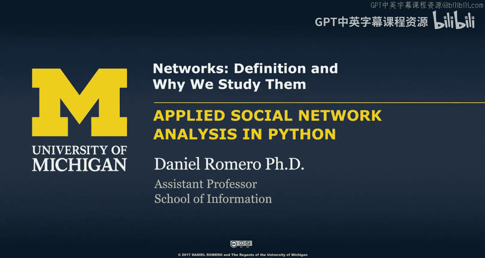
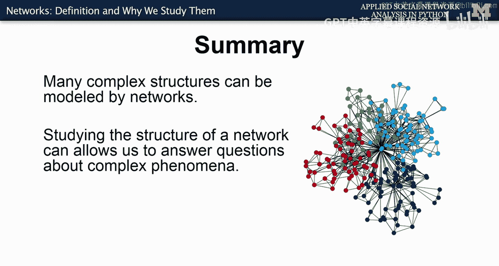

# 密歇根大学《Python用于数据科学实践（4-5课）｜Applied Data Science with Python 》中英deepseek翻译 p21 0_网络定义与研究意义.zh_en -BV1DTtueTEwf_p21-

So we're going to begin by giving you a basic idea about what a network is and why we want to study networks so a network is simply a set of objects which we call nodes that have some relationships between each other which we call edges and why do we want to study networks so the first reason why we want to study networks is because networks are everywhere so what I'm going to do is I'm going to show you how networks show up in a bunch of different settings。

So the first kind of network that we're going to look at are social networks and in social networks the node are people and the connections between the nodes represent some type of relationship between the people in the network so here we see an example of 34 people who belong to a karate Club and the network represents friendship between them in this example note number one which you see right here is the instructor of the karate Club and everybody else is a student in the karate Club。

This other example is a network of friendship marital tie and family tie among 2。

200 people here the edges are colored to represent the particular type of relationship between the nodes。

And then next we have an email communication network。

 so the other two networks we saw were relationships that were sort of happening in the offline world。

 but networks can also be constructed based on relationships that happen in the online world。

 so here in this example we have a network between 436 H employees and the edges represent communication through email。

We can also have transportation and mobility networks。

 so in this example we see a network of directed flights between different airports around the world。

And there is human mobility network that is based on the location of dollar bills using the words George website where people look at their dollar bills。

 tell the website where they are located， and then this bill can be tracked when other people update the location of this bill。

 we can see how this bill has traveled throughout the United States and here's the network gets formed by tracking those movements。

And here we have a network that represents the bus transportation network of Ann Arbor。

 and here the edges represent direct bus routes from one stop to the next stop。

There are also information networks， so in this example we see a network where the nodes are political blogs and then edges represent connections between the blogs through URLs。

 so who links to what blog links to which blog and what we see here is that they're colored by whether they're left wing or right wing and what we see is that left wing blogs tend to connect mainly to left wing blockss and right wing blockss tend to connect mainly to right wing blogs but there are not a lot of connections that go from one to the other so there we call this clustering there's a lot of clustering between the different between the two types of blogs。

Here is the network that represents the internet connectivity。

And here's a network between Wikipedia articles about climate change。

 the edges also represent URL connections or direct connections between one article and the next and here we can also see that there is some clustering happening so the colors represent different subtoping within climate change and we can see that they are clustered by the different subtopics。

Networks also show up in biology， so here's an example of a protein to protein interaction。

 so the notes are proteins and they're connected by whether they interact with each other。

And here is a network that represents a food web， so what animals eat， what animals。

And I could continue showing more and more different types of networks so we can have financial networks。

 coat networks， trade networks， citation networks and on and on and on。

 so this can give you a sense that networks tend to show up in all different types of contexts in this course we're going to focus mainly on social networks but networks in general are useful to study in many other types of contexts。

Okay， so networks tend to be everywhere， but is that enough of a reason why we should study them。

 what kinds of things can we do when we take some complex phenomena and represent it as a network。

 is there something we can understand better about this phenomena？

By studying the structure of the network and the answer is yes， there are plenty of things we can do。

 so I'm going to give you some examples let's go back to this email communication network among the  436 HP employees。

The kinds of questions that we can answer by looking at the structure of the network are things like if there's a rumor that starts in some part of the network。

 is it likely to spread through the whole network？And who are the most influential people in this organization is the rumor that's starting on。

 say， some node that's sort of like on the outskitter of the network more or less likely to spread than if it were to be started by somebody who's more central to the network like someone around this area。

These are the kinds of things that we can start to analyze and understand by looking at the structure of Sil network。

Looking at again the friendship network between the karate Club members。

 we can answer things like is this club likely to split into two different clubs and actually the story is that this is exactly what happens。

 if you could try to guess which member is going to join which club after a split。

 you can look at the structure of this network and make a pretty educated guess and it turns out that as you can probably see from just looking at this network。

 the division between the club happens around here where the node on the left side of this line go to one club and then the ones on the right go to the other club。

If we look at a network of transportation network of direct flights around the world。

 can we answer questions like if there's an epidemic or a virus spreading in the world。

 are there airports that we have to pay more attention to than others？

Or if there are certain parts of the world that are harder to reach through air transportation。

 what are connections， what are key connections we can make to make those areas easier to reach these are all questions that we can study by looking at the structure of social network and a lot of which we're going to be asking again later on in the course and giving you the tools that you need to be able to begin to understand these types of questions。

So in summary， many complex structures can be modeled through networks。

 so we saw examples from social networks， from biology networks， transportation networks， and so on。

And by studying the structure of these networks， we can start to answer questions that are pretty complex and that deal with very complex relationships。

 and networks allow us to make those relationships or to make those complex phenomena simpler by representing them asA network and then using certain tools that allow us to answer them。

And so in this course， we're going to。Cover some of the basic techniques to study social networks and answer some very interesting questions about them。

