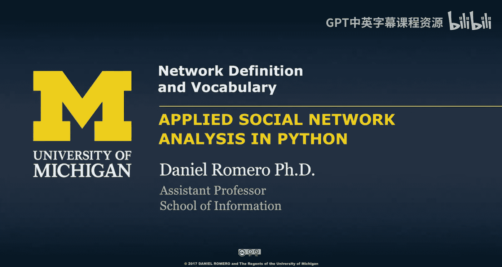
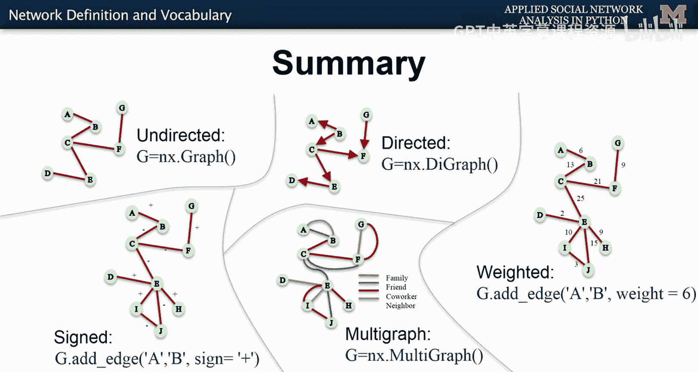

# 密歇根大学《Python用于数据科学实践（4-5课）｜Applied Data Science with Python 》中英deepseek翻译 p22 1_网络定义与术语体系.zh_en -BV1DTtueTEwf_p22-

Last time we talked about why we want to study social networks and how social networks show up in all kinds of places and can allow us to answer very cool questions about the complex phenomenon today we're going to get a little more details about the different network definitions and vocabulary we're going to use through the course and we're going to start talking a little bit about how we can use network X in Python to build some of the different types of networks that we're going to be looking at。

So first of all， a network or a graph which we also call a graph is a representation of connections among different sets。

 so here's an example of a set of things which we call nodes。

 just circles that have labels A through G， so we call these things nodes or vertices。

And then there are connections between them that can represent various different things。

 and we call these connections edges， or sometimes we call them lengths or ties as well。

And we're going to use network X in Python in order to work with some of the networks that we look at。

 so the first thing you need to know is how to create a network of network X。

So the first thing we're going to do is import network X as NX and then we're going to use the class graph in order to represent this network that we see here so here I'm making G in instance of one of those graphs and then what I can do is I can add edges so for example here I'm adding the edge AB which is this edge right here。

And then I would add the next edge which would be the edge BC and I could continue adding all all the other edges now notice that I haven't added the notes themselves and so when you add the edge node if the node that you're adding the pairs of nodes that you're adding are not in the graph already network X will automatically add them to the graph so that's pretty cool。

Now let's go back to a network that we had seen before。

 this is a network between people and the edges here represent friendship。

 marital tiehai and family ties among 2，200 people。When you look at this network。

 one thing that you can see is that these edges are mostly symmetric relationships and by that I mean if a is a friend of B。

 then B is also a friend of A， or at least most of the time that's the case and so this network has symmetric relationships。

But that doesn't always have to be the case， so if you look at this network which represents what animals eat other animals。

 these relationships are very asymmetric， so for example。

 it's very different if you have an edge pointing from the fish to the eagle that says that the eagle eats the fish rather than the other way around。

 so the direction of the edge in this network has a very important meaning to what the edge is trying to represent。

So this suggests that we。Need at least two different types of networks， some that are undirected。

 meaning the edges don't have any direction or that the direction of the edge is not really important。

 and we call these undirected edges， and in network X we use the class graph to represent these types of networks。

 just like I showed you before。But if we wanted to have a network that actually has direction like the photo web example。

 then you would need directed edges， and to use network X to represent a network like this。

 we would use the class D graph， which is directed graph。And then we would add the edges。

 so we'll be adding the edge BA。And then the add BCc。You notice that now the order matters。

 so it's very different to add the edge BC than adding the edge C， because now these have directions。

The next type of network we're going to look at is the weighted networking The intuition here is that in some networks some edges carry a different weight than others。

 and so we want a way of capturing this let me start with an example of such a network here's a network where the node are people and then the edges represent how many times they had lunch together these are coworkers。

And so。If you look at， for example， edge AB， A and B had lung together six times。

 whereas the E CE says that the node C and E had lunch together 25 times。

 those are two very different relationships and so we want a way of capturing these weights。

And so weighted network is a network where the edges are assigned a particular weight。

 typically a numerical weight that has some meaning in the relationship between the two nodes。

In network X， we can represent these types of networks also by using the class graph。

 but what we're going to do is when we add an edge， for example， the edge AB。

 we're going to add an attribute weight which will have the value6 and this will allow us to capture these weights on the graph。

Same thing with the edge BC， which has a weight of 13。And so on。

The next type of network we're going to look at is the sign network now some networks can carry information about friendship。

 but also about antagonism between people which could happen due to conflict or disagreement so for example。

 the website's opinions and its sdot give people the ability to declare not only who their friends are but also who their enemies are。

So now let's look at this network that represents who in this network are friends with each other and who are enemiesim with each other。

 would like to have a way of capturing this。And this is called a sign network， and now the edges。

 instead of having a weight， they have a positive or negative sign that represents whether people are friends or enemies。

And we can also construct these types of networks on network X so using the class graph。

 and now instead of adding an attribute weight to the edge， we're going to add an attribute。

 which we call sine and so the edge AB will have a positive sign and then the edge BCC will have a negative sign。

So edges can have weights， they can have signs。But they can have a bunch of other things when you think about it。

So here's another example， now these edges are colored and they're colored to represent a particular type of relationship between two nodes。

 so here we have notes who are family members or who are friends or who are coworkers or who are neighbors。

So in order to represent something like this， as you might imagine。

 you can just use another type of attribute when you add the edge in this case we call it relation so when we add the edge AB because it has a blue color here that means they're friends。

Then we're going to add the attribute relation and we're going to give it the value friend。

Same thing with coworker relationship between B and C and then the family relationship between DE。

So in general， we can have any type of attribute when we add these edges。

 we can give the edge any type of attribute that we want。

So the next type of network we're going to look at are called multigraphs。

TheIntuition for multigraphs is that for a single pair of nodes。

 there is no reason why they shouldn't be able to have many different relationships at the same time。

So let's go back to the example we were looking at in this graph。

 the edges represent represent some type of relationship between the nodes， which could be family。

 friend， coworker or neighbor。But there is nothing stopping。

 there is nothing that stops any two nodes from having two kinds of relationship at the same time。

 so for example， this network in general could look more like this where now the relationship between nodes A and B。

It's not only that they're friends， but they're also neighbors。

 or the relationship between G andF is not only that they're family members。

 but they're also coworkers and so on。And so this is called a multigraph。

 it's a network where multiple edges can connect the same pair of nodes。

 they're also called parallel edges。And in Network X。

 we're going to use a different class in order to represent multigraphs。

 which is the multigraph class。And what we're going to do is when we add an edge to a multigraph。

 or we're going to add it and give it a particular attribute。

 and then if we want to add a second edge with a different attribute。

 we can add it again and give it a different attribute and in fact you don't have to attributes to a multigraph you can just simply add multiple parallel edges and then the multigraph class will capture how many edges there are between a given pair of node in this case we are looking at different relationships so we are using the attributes。

And we would add the rest of the edges。So in summary。

 what we saw in this video is that we have many different types of networks。

 we have undirected networks or undirected graphs which we use the graph class in order to represent them。

 we have directed graphs for which we use the DG class。

We have sign networks for which we use the graph class。

 but we give a sign attribute to the edges when we add them。

We have multigraphs and for those we use the multigraph class and those can handle multiple edges for each pair of notes。

 and then we have the weighted networks for which we add a weight attribute in the edges when we add the edges。

Thanks for listening to this lecture and I will see you at the next one。

