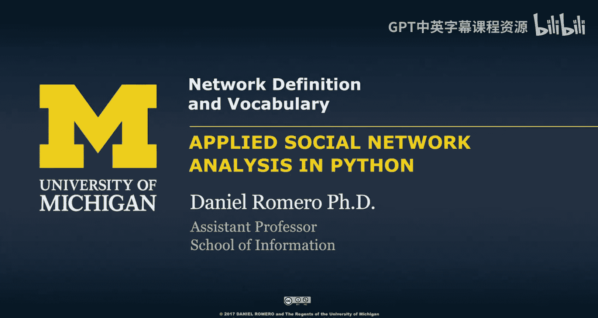
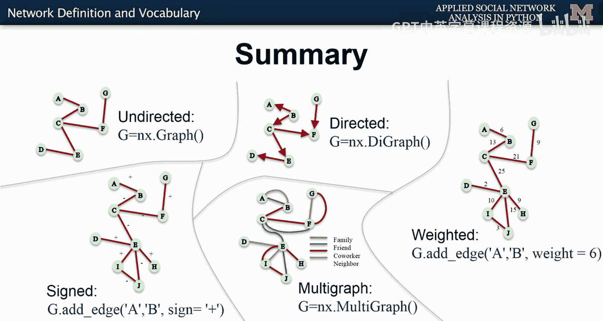

# Python用于数据科学实践：4-5：网络定义与术语体系





在本节课中，我们将学习网络科学的基础定义和术语体系。我们将了解不同类型的网络，并学习如何使用Python的NetworkX库来构建和表示这些网络。

## 网络基础定义

上一节我们讨论了研究社交网络的原因及其在各种场景中的应用。本节中，我们将更详细地了解课程中将使用的不同网络定义和词汇，并开始学习如何使用Python中的NetworkX来构建我们将要研究的几种网络类型。

首先，网络或图（我们也称之为图）是不同集合之间连接关系的表示。

以下是一个示例，其中包含一组我们称为节点的东西。这些是带有标签A到G的圆圈，我们称这些东西为节点或顶点。

然后，它们之间存在可以代表各种不同事物的连接。我们称这些连接为边，有时我们也称它们为链接或纽带。

我们将使用Python中的NetworkX来处理我们将要研究的一些网络。因此，你需要知道的第一件事是如何在NetworkX中创建一个网络。

## 使用NetworkX创建网络

以下是创建网络的基本步骤。

首先，我们需要导入NetworkX库，然后使用`Graph`类来表示我们在这里看到的网络。这里，我创建了一个`Graph`类的实例`G`。

接下来，我可以添加边。例如，这里我添加了边AB，也就是这里的这条边。

然后，我会添加下一条边，即边BC，并可以继续添加所有其他边。请注意，我还没有添加节点本身。当你添加边时，如果边所连接的一对节点尚未存在于图中，NetworkX会自动将它们添加到图中。这非常方便。

```python
import networkx as nx

# 创建一个无向图
G = nx.Graph()

# 添加边，节点会自动添加
G.add_edge('A', 'B')
G.add_edge('B', 'C')
# 继续添加其他边...
```

## 无向图与有向图

现在让我们回到之前见过的一个网络。这是一个人与人之间的网络，这里的边代表友谊、婚姻关系和家庭关系，涉及2200人。

观察这个网络时，你会发现这些边大多是对称关系。我的意思是，如果A是B的朋友，那么B通常也是A的朋友。因此，这个网络具有对称关系。

但情况并非总是如此。如果你看这个代表动物捕食关系的网络，这些关系是非常不对称的。例如，如果有一条从鱼指向鹰的边，表示鹰吃鱼，这与相反方向的意义截然不同。因此，在这个网络中，边的方向对于边所要表示的内容具有非常重要的意义。

这表明我们至少需要两种不同类型的网络：一些是无向的，意味着边没有方向，或者边的方向并不重要，我们称这些为无向边。在NetworkX中，我们使用`Graph`类来表示这些类型的网络，就像我之前展示的那样。

但是，如果我们想要一个真正有方向的网络，比如食物网的例子，那么你就需要有向边。要使用NetworkX来表示这样的网络，我们将使用`DiGraph`类，它代表有向图。然后我们会添加边，例如添加边B->A，然后添加边B->C。你会注意到现在顺序很重要，因为添加边B->C与添加边C->B是非常不同的，现在这些边具有方向。

```python
# 创建一个有向图
DG = nx.DiGraph()
DG.add_edge('B', 'A')
DG.add_edge('B', 'C')
```

## 加权网络

接下来我们要看的网络类型是加权网络。这里的直观理解是，在某些网络中，一些边承载的权重与其他边不同，因此我们需要一种方法来捕捉这一点。

让我从一个这样的网络示例开始。这是一个节点代表人的网络，边代表他们一起共进午餐的次数，这些人是同事。

例如，观察边AB，A和B一起吃了6次午餐，而边CE表示节点C和E一起吃了25次午餐。这是两种非常不同的关系，因此我们需要一种方法来捕捉这些权重。

加权网络是一种为边分配特定权重的网络，通常是一个在节点间关系中具有意义的数值权重。

在NetworkX中，我们也可以使用`Graph`类来表示这些类型的网络，但我们要做的是在添加边时，例如边AB，我们将添加一个名为`weight`的属性，其值为6，这将允许我们在图上捕捉这些权重。边BC也是如此，其权重为13，依此类推。

```python
# 创建一个加权无向图
WG = nx.Graph()
WG.add_edge('A', 'B', weight=6)
WG.add_edge('B', 'C', weight=13)
```

## 符号网络

接下来我们要看的网络类型是符号网络。有些网络不仅可以承载关于友谊的信息，还可以承载人与人之间的对立信息，这可能源于冲突或分歧。例如，网站Slashdot允许人们不仅声明谁是他们的朋友，还可以声明谁是他们的敌人。

现在让我们看看这个网络，它代表了网络中谁与谁是朋友，谁与谁是敌人。我们希望有一种方法来捕捉这一点。这被称为符号网络，现在边不是具有权重，而是具有正号或负号，代表人们是朋友还是敌人。

我们也可以在NetworkX上构建这些类型的网络，使用`Graph`类。现在，我们不是为边添加`weight`属性，而是添加一个我们称为`sign`的属性。因此，边AB将有一个正号，然后边BC将有一个负号。

```python
# 创建一个符号网络
SG = nx.Graph()
SG.add_edge('A', 'B', sign='+')
SG.add_edge('B', 'C', sign='-')
```

## 边的属性

边可以有权重，可以有符号。但仔细想想，它们还可以有很多其他东西。

这是另一个例子。现在这些边被着色，颜色代表两个节点之间特定类型的关系。这里我们有代表家庭成员、朋友、同事或邻居关系的节点。

为了表示这样的东西，正如你可能想象的那样，你可以在添加边时使用另一种类型的属性。在这种情况下，我们称之为`relation`。当我们添加边AB时，因为它在这里是蓝色，意味着他们是朋友，那么我们将添加属性`relation`并赋予其值`friend`。B和C之间的同事关系，以及D和E之间的家庭关系也是如此。

总的来说，当我们添加这些边时，我们可以拥有任何类型的属性。我们可以为边赋予任何我们想要的属性类型。

```python
# 创建带有关系属性的图
RG = nx.Graph()
RG.add_edge('A', 'B', relation='friend')
RG.add_edge('B', 'C', relation='coworker')
RG.add_edge('D', 'E', relation='family')
```

## 多重图

我们要看的下一种网络类型称为多重图。多重图的直观理解是，对于一对节点，没有理由不能同时拥有多种不同的关系。

让我们回到我们在这个图中看到的例子。边代表节点之间的某种关系，可能是家庭、朋友、同事或邻居关系。但没有任何东西阻止任何两个节点同时拥有两种关系。例如，这个网络总体上可能看起来更像这样，现在节点A和B之间的关系不仅是朋友，而且还是邻居；或者节点G和F之间的关系不仅是家庭成员，而且还是同事，等等。

这被称为多重图，它是一种同一对节点之间可以由多条边连接的网络，这些边也称为平行边。在NetworkX中，我们将使用一个不同的类来表示多重图，即`MultiGraph`类。我们要做的是，当向多重图添加一条边时，我们会添加它并赋予它一个特定的属性。然后，如果我们想添加一条具有不同属性的第二条边，我们可以再次添加它并赋予它不同的属性。实际上，你并不一定要为多重图添加属性，你可以简单地添加多条平行边，然后`MultiGraph`类会捕获给定节点对之间有多少条边。在这种情况下，我们正在查看不同的关系，因此我们使用了属性。

```python
# 创建一个多重图
MG = nx.MultiGraph()
MG.add_edge('A', 'B', relation='friend')
MG.add_edge('A', 'B', relation='neighbor')  # 同一对节点间的第二条边
# 添加其余边...
```

## 总结

本节课中我们一起学习了多种不同类型的网络。

*   **无向图**：我们使用`Graph`类来表示。
*   **有向图**：我们使用`DiGraph`类来表示。
*   **符号网络**：我们使用`Graph`类，但在添加边时赋予一个`sign`属性。
*   **多重图**：我们使用`MultiGraph`类，它可以处理每对节点之间的多条边。
*   **加权网络**：我们在添加边时，为边赋予一个`weight`属性。




感谢收听本讲座，我们下一讲再见。